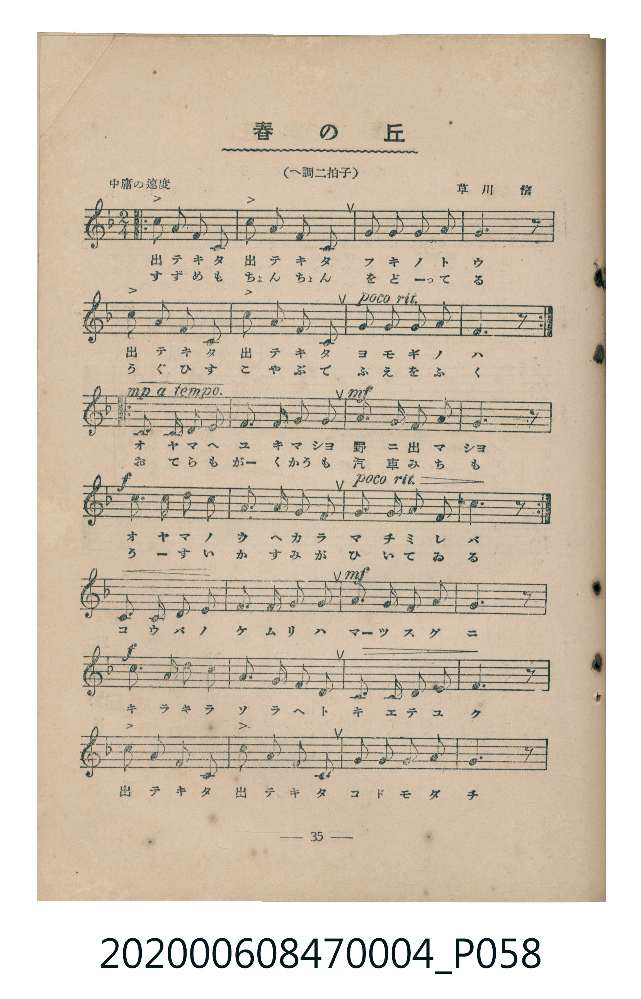
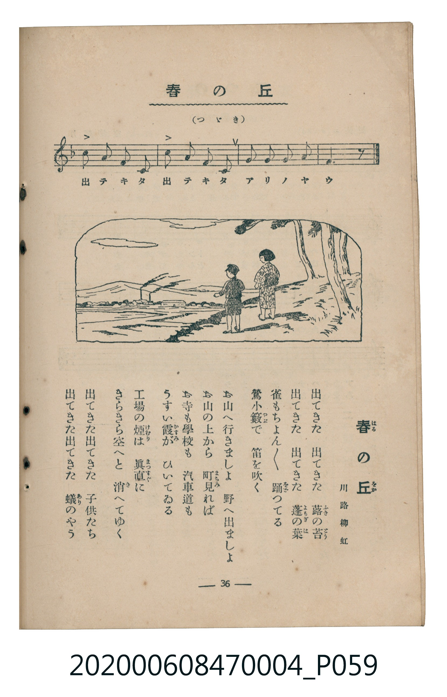

# 春の丘

> Re:Shōka 使用 AI 協助辨識與重建樂譜，可能會有錯誤。歡迎回報。

- **NEUTRINO 歌聲合成版**：<br><audio controls src="haru_no_oka_neutrino.mp3"></audio>
- **鋼琴伴奏版**：<br><audio controls src="haru_no_oka.mp3"></audio>


- 詞：川路柳虹
- 曲：草川信
- 臺灣教育會公認《新定兒童唱歌》尋常科第四學年用（2020.006.0847.0004）

## 說明

原書資訊與歌詞全文（對應 P058.jpg–P059.jpg，書頁 pp. 35–36，參考教材第 2 首）：
調性與拍號：へ調二拍子（F 大調 2/4 拍）
速度指示：中庸の速度


## 歌詞

```text
出てきた　出てきた　蕗（ふき）の苔（とう）
出てきた　出てきた　蓬（よもぎ）の葉（は）
雀（すずめ）もちょん／＼　踊（をど）つてる
鶯（うぐひす）小藪（こやぶ）で　笛（ふえ）を吹（ふ）く

お山（やま）へ行（ゆ）きましょ　野（の）へ出（で）ましょ
お山の上（うへ）から　町見（まちみ）れば
お寺（てら）も學校（がくかう）も　汽車道（きしゃみち）も
うすい霞（かすみ）が　ひいてゐる

工場（こうば）の煙（けむり）は　眞直（まつすぐ）に
きらきら空（そら）へと　消（き）へてゆく
出てきた出てきた　子供（こども）たち
出てきた出てきた　蟻（あり）のやう
```

## ABC

```abc
X:1
T:春の丘
C:曲：草川信
M:2/4
L:1/16
Q:1/4=96
K:F
V:V1 name="Piano" snm="Pia"
[V:V1]
c2 A2 F2 C2 | c2 A2 F2 C2 | G2 G2 G2 A2 | G6 z2 |
w: 出 テ キ タ | 出 テ キ タ | フ キ ノ ト | ウ
c2 A2 F2 C2 | c2 A2 F2 C2 | G2 G2 G2 A2 | F6 z2 |
w: 出 テ キ タ | 出 テ キ タ | ヨ モ ギ ノ | ハ
c2 A2 F2 C2 | c2 A2 F2 C2 | G2 G2 G2 A2 | G6 z2 |
w: す ず め も | ちょ ん ちょ ん | を ど ーっ て | る
c2 A2 F2 C2 | c2 A2 F2 C2 | G2 G2 G2 A2 | F6 z2 |
w: う ぐ ひ す | こ や ぶ で | ふ え を ふ | く
!mp! C3 C D2 E2 | F3 F G2 G2 | !mf! A3 G F2 A2 | G6 z2 |
w: オ ヤ マ ヘ | ユ キ マ シヨ | 野 ニ 出 マ | シヨ
!f! c3 c d2 c2 | A3 A G2 F2 | G3 G A2 F2 | c6 z2 |
w: オ ヤ マ ノ | ウ ヘ カ ラ | マ チ ミ レ | バ
!mp! C3 C D2 E2 | F3 F G2 G2 | !mf! A3 G F2 A2 | G6 z2 |
w: お て ら も | がー く かう も | 汽 車 み ち | も
!f! c3 c d2 c2 | A3 A G2 F2 | G3 G A2 F2 | c6 z2 |
w: う _ す い | か す み が | ひ い て ゐ | る
C3 C D2 E2 | F3 F G2 G2 | !mf! A3 G F2 A2 | G6 z2 |
w: コ ウ バ ノ | ケ ム リ ハ | マー ツ ス グ | ニ
!f! c3 c d2 c2 | A3 G F2 D2 | C3 C D2 E2 | F6 z2 |
w: キ ラ キ ラ | ソ ラ ヘ ト | キ エ テ ユ | ク
c2 A2 F2 C2 | c2 A2 F2 C2 | G2 G2 G2 A2 | G6 z2 |
w: 出 テ キ タ | 出 テ キ タ | コ ド モ ダ | チ
c2 A2 F2 C2 | c2 A2 F2 C2 | G2 G2 G2 A2 | F6 z2 |
w: 出 テ キ タ | 出 テ キ タ | ア リ ノ ヤ | ウ
```

## TMD 檔案連結

- [主旋律 TMD 檔案](haru_no_oka.tmd) [[在 TMD Studio 編輯](https://tmdlang.github.io/Tmd-TS/#tmd=s7IKdvYPcrWy4qpTUCpJTLdSSM7PyUlNLsnMz7MqzsjMK0nNjM_KTMmPL87Iz05Ugisry88pzU21Si9KTEmNN4k3MjAyiDcwMIs3sDAxBzIMTBBKi_NLi5JTrYqTM_Lzc-JLUitKkvLzsxHyBUX5Zal5iXlANQVFIBtTwIoQClLLMlNSQdKpKZkl-UWZiTlI7kgtKga7FWxJfElRYl5xclFmAcgDCFX5RSUZ-UC3FmRUWmVkFoMMSU7Mic9OzEPyUklGKtBHeYklpUWp6KLFqYnF-XnFSlxaWgrPZix93LjuyY4ZClpaXIq2CpZmXPa2Cm5cNkb6JnYgfS9Wznu_Z9bT7XNfbF__bP7mFzN3go17NnsTUPhFbydQ5sn-hWCxF-27njcufjZ15oumTc_mND9tXfNiVe_jhq5n0zY8XTfraeuk56uXPp2y8dnanscN3U83dD_dseP58onP16x5Onv207U7nu7c8nzKivd7OkDhrwcMfz1Q-AMZBibv93QqcXHpaynYUgtwKSgoPO2b_2z2jheb21-s6HrR0Q50F9CzT1tXPJvWDnTF0w29z9o7FQIMTC30sgrSHzVMBjItQcz3e3qA-l4uaFQoKNBTMDYFShmbAQWf9je_aGgG-v_Z3AlAXykYKbxcNg3odGBAgax7sWr_s4blIIu6e1_MnA8Ufdy4Ayj4ZFcPUOTp2glAS90Uni5ZDhRTAAa_AlAUqBuk9WXD_Ke7lj3raX--ZBdQ35Mda5_u2gGMN4g4F9gz7bseNy573Nj7uHH-44YGNO6LqdOBpj9u3AoUAZoJ1PqiewpYZMXjxjaoLQSMmLwGpKEJiJoeN_ZBTZkI9B3QlPUwh85uAPNnPm6c9bipEaQIpHrh46b2x02T3-_pf79nD8isHV1gsyY9blwJNmgJyKambrAR24CGAY1oe9w44XHjJqBZQBVPN_S_mL4KLD75cVPL48ZtYG3LgWY9XzMb5rUOsH2Tnk7YCREBq-kHB8_jxq6nGzeCLQXq3geW2fFiYQ9YBBQAYH_ue9w4HeTUhoaX7UAfAs1YB1EJDAswdzmYC1WGMBechcBeAjl7B1hR9-OmTpDzpux6sawbLAXUtvBx436wI3seN26A6V8PMRsYAMDABAUYMDM8W7AQLAhU1w8yCxxJoLBsaHi2ce-L3V0vG4HBCVQAdDXQLc1Ac4GmQ9RAzAU6BBgLLS_nAPMvUB3QCCAXbDnQ0IYGcNACgwJo6wRQyIMTwPalTxdsgYYyyIANkFh-3gqMA6DgxMdNDY-bgP4ECq4H-W3OvOezIeqBfgPGIdAGYCoGyq6GuKEXFAZg8vlKiCfnQj3ZCEy-K0Ce2QaMNJA3YIJA9wAt7kdPj-hpc-2EJ_sg8Q506Uqgp8H65wPDgIDOF_N3g7U1wTyyDpwi2kDaKC9WoEBBS5-LyyOxqNQv3z870SogMzEv36HGoKYaZIuCjaGZlh2Yha1EUwAWHU92NDxbB0y-HU_7e18sa3vauvLZGmDk9jxb3w9kKFgoAPPD8_XArNYDK56AXsFiFNAZUGughq5ZaAUKHIXHzW0Kj5vWAvF-hRosIo-bp0J4zX1A3AESaVoGM65GwVRBV8EYiA2B2DQeSGAVMgKSMAySgojAoAFIBGyeD8QFumA3AEmgvSByP1gLbhmQG-FiQHeCyA6IDNCt2CwiJxxWAPEiIG8d2A6QSD_l4QCSpGI4rADLLAKLrYOHBsSt6BYhBwSw4gEFBDDfAvEsoOZGIG4CaQSX2EDOZGQmKGAnAQVWAg3e87hxMZC5DCzYTcOUAXIc0EdA54F81wgmmyC-g7gMJDAZrASFC3EsSHglOETADgZxQUkD4mg8SQQeMsDE0DgBiDeBHQKyFBgkTS1AehsQLweLbAXiDmjYbAWL0DKJgNwE8scEMLkJTIKCCOI2kPdbwGLbwORyqMxWMA-UPWDBAhKBuBVXEsFeNAGDhmZF0-OmVcCoWgLE84B4BjgJL4MWRECRpu2gtF6jAKycgQLd0Pw6DxydYCl4qFfnFtRCwhYcxGYgljkkqCEBawgPbpDitFpwqIMEQNKEkiTQlSBBmEtBrBmQ0AS6FiwDdTGIBXYYSBLkaog2iMtBLJASuOsJF1mo4QMujoBFHcj2x02rgfRKsBtAcsCc3DwfiNeARSYghQzQr6AECAwXBTMwCXIBxPfGYD-DQgDmeyN4QoUkW6LDA1oAQQtimAtBLFB2hLgSIgNxKYi1BioDStlEFFpd4MwMbE_AC60eYDYHp2hIiwkqDmwvKQAbTEDB_aBCAuysJnolFaArwd6EuhS59AK7FiIJdzFCHuRqkCTM5eACDhqoIBVEFV3g4AAV7i1gG7uhPFA49IBFQMUaqDADuW4CellOi6QC9iPE05ByHVRYQdwGE4X5tgcqAyriICohhTfIpbiKcAKtqk5I0WVohllKofTv8BdYj5s2Q_MdsGaA5sKNQNYCIAblz35I-gaHfjPQ1U07gXgDWBC5pqRZ6bQZEmBQFyLnxo0QGahLQSxQ6Q93LUQS4mKQARugkjirSkg5B2wPQGmQHXshIqAcD204ghpToGYUKEFCGgzriUtkEP-Cgwd_eGENhrVQ_0Cch1T0AJ0IlwEX3Ih2I1QP1LkgGVhzYT2uMCCqGQlKMc3AggrUlGxuAAdq42BrToPTDciVIBLcmAS6FJIAQM0uCjwP8jQoY4Bq7SXQamGQtaGBbgTJQDIFpC-xBCqD2Zeo5eLStVOA9-8UgBxlLgA)]
- [鋼琴伴奏 TMD 檔案](haru_no_oka_piano.tmd) [[在 TMD Studio 編輯](https://tmdlang.github.io/Tmd-TS/#tmd=s7IKdvYPcrWy4tLSUng2Y-njxnVPdsx4v6fjZfee5xO2PNmz5enS_uedHe_3dCpoaXEp2ipYmnHZ2yq4cdkY6ZvYcdUpKL1YOe_9nllPt899sX39s_mbX8zcqQQSfjZ7E1D4RW8nUObJ_oVgsRftu543Ln42deaLpk3P5jQ_bV3zYlXv44auZ9M2PF0362nrpOerlz6dsvHZ2p7HDd1PN3Q_3bHj-fKJz9eseTp79tO1O57u3PJ8ygqg44wMjAz0DAzM9AwsTMyBDAMToPuUuLg8EotK_fL9sxOtAjIT8_KDPBxqDGqquRSAwMbQTMsOzNLXUrBFBwpAO57saHi2bivQ9Kf9vS-WtT1tXflszcL3e3qere8HMhQsFJ5u6H--vgEoEmBgaqGXVZAOChRMo7T0wdbUKJgq6CoYA7EhEJvGAwmsQkZAEoZBUhARGDQAiYDN86lReNq-C8h93NwGIpvWgsn9YC24ZR43T0WINfeByQ6ITNMyrBaR73CQJBUdvgIsswgstg7ufJBMP5UdjjPEHzfOBFncOAvsiEYw2QRxROPCx03tYIHJYCUoXFDoTgILrwQ7fM_jxsVgLijIQZLdVPYBzqB_3AgO2sYJYHITmAT5CSQDdnhTC1hsG5hcDpXZCuaB0gnMHyARkAxm0OPPVLt6qJupqnMLaiHBAA4NMxDLHBIqkDAwhIcMSHFaLTiAQAIgaULR3bQKLPi4eQkQzwOzZkA83gzJLKA0CpVp2g5JojUKL9tBCROkuBueoEFKQAZCFWGL62qg40CRC_SIghmYBGmBONcY7EiQk2HONYInAkiSINoD0EwDze0gDz1uWg1mgdImyGsgdSB-IxDPB7PWQGVAqQar02kaC41dEAcBc8vjpk4QC57peoB5CSrZD8Td0OQNlX-2cS9Y8sXuLqAkqBwB5kuo90Eq6BULYEdBXAkpP0B5DCQOyfYgUZjzeqAyoJwJUQkpJB43gcIee1FBoBrrhOQ4QzPMzPWoYTKQaUlM5UWzLLYZ4lNgeoSkL0QK3QiRaV4AxKB0DCnowSkUHu3NwABq2gk2YANUEldZii9mIW4Few2_X7F6YS3ULSvhFSs0KzVB0h9YBlxyICpbqJ6mFbDaDlyigGTW43D_4Gg_gOPrcTM4G0Iq4-YGiAywvKCuw6nbfmiCOBaSkCANnyVQGcyGTy1G49EHufFoAW07At0YrxBtGAujMPmm8UCWaXwsmAEURRMxgAcS6QYhVFBiCo2cg2oMXDUOEaghWIzGcJEJqnWY_iDSnMHhJHq4CSQP5Eab4DR38CYjYD7UtVOAZ0UFIEeZCwA)]

## 分析

```text
================================================================================
📊 TMD Song Profile: [ 春の丘 ]
================================================================================
⏱  Duration:       1:00 (60.0s), 48 measures total
🎼 Key & Tempo:    首調基準 F, != 96.0 BPM, <2/4>
   - 分析範圍：      由實際發聲的音符與和弦推測調性；播放脈絡另行呈現
🎤 人聲音域:    C4 (MIDI 60) – D5 (MIDI 74) [跨度: 14 個半音 / 1.2 個八度, 難度: moderate]
   - 最低音:  C4 in [HaruNoOka #1 @ m.1, 0:00]
   - 最高音: D5 in [HaruNoOka #1 @ m.21, 0:25]
   - 適合: soprano, mezzo-soprano, contralto, tenor, baritone, bass
🏛  結構:      HaruNoOka (60.0s)
⚡ 編曲密度:        Peak 1 軌道同時演奏
🗝  調性診斷：       C 大調（純淨自然大調，未偵測到可信轉調）
   - 風格氣質:    純淨自然大調（陽光明朗、易唱易記，無明顯調外色彩）
   - 轉調歷程:    全曲維持單一推測調性（未偵測到可信轉調）
   - 核心骨幹音:  G, C, F, A, D
   - 調性數值:    C 大調 [相關度: 0.85, 穩定度: Moderate, 自然音純度: 100.0%]
   - 候選調性 (K-S): C 大調 (0.85), F 大調 (0.73), A 小調 (0.59)
   - 五度圈歷程:   +0
   - 各段落調性細節:
     • [HaruNoOka #1]: C 大調 (r: 0.85, 自然音純度: 100.0%)

  [ 五度圈游移軌跡 ]
              [C ]*
         F            G  
      Bb               D  
      Eb               A  
         Ab           E  
            Db       B  
               F# 
     (* = active key center)

  [ 十二半音累積音高分佈 ]
     C  : ███████████████████████   26.1%
     C# :                            0.0%
     D  : ████                       4.4%
     D# :                            0.0%
     E  : ██                         2.2%
     F  : ██████████████████        21.1%
     F# :                            0.0%
     G  : ████████████████████████  27.8%
     G# :                            0.0%
     A  : ████████████████          18.3%
     A# :                            0.0%
     B  :                            0.0%
--------------------------------------------------------------------------------
Assignment 軌道音域：
  - Piano         : C4 – D5 (14 個半音 / 1.2 個八度, 156 個音符)
================================================================================
```


## 原書掃描頁






