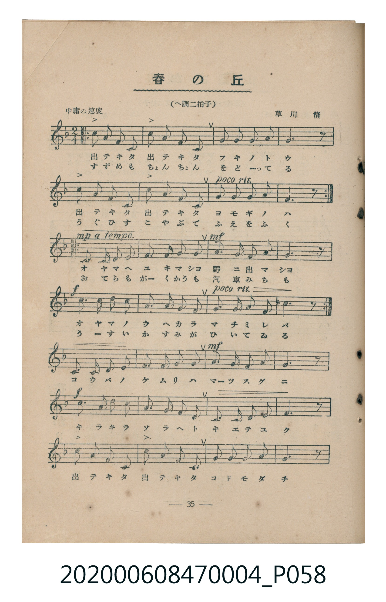
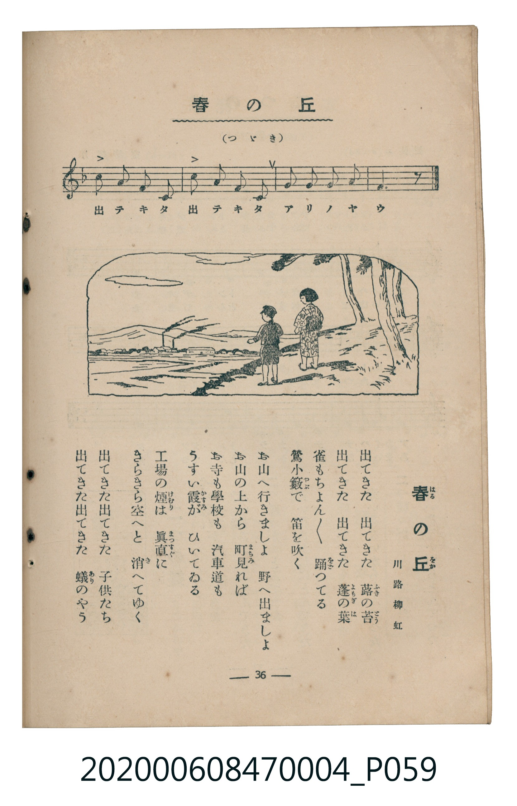

# 春の丘

> Re:Shōka 使用 AI 協助辨識與重建樂譜，可能會有錯誤。歡迎回報。

- **鋼琴伴奏版**：<br><audio controls src="haru_no_oka.mp3"></audio>
- **NEUTRINO 歌聲合成版**：<br><audio controls src="haru_no_oka_neutrino.mp3"></audio>

- 詞：川路柳虹
- 曲：草川信
- 臺灣教育會公認《新定兒童唱歌》尋常科第四學年用（2020.006.0847.0004）

## 說明

原書資訊與歌詞全文（對應 P058.jpg–P059.jpg，書頁 pp. 35–36，參考教材第 2 首）：
調性與拍號：へ調二拍子（F 大調 2/4 拍）
速度指示：中庸の速度


## 歌詞

```text
出てきた　出てきた　蕗（ふき）の苔（とう）
出てきた　出てきた　蓬（よもぎ）の葉（は）
雀（すずめ）もちょん／＼　踊（をど）つてる
鶯（うぐひす）小藪（こやぶ）で　笛（ふえ）を吹（ふ）く

お山（やま）へ行（ゆ）きましょ　野（の）へ出（で）ましょ
お山の上（うへ）から　町見（まちみ）れば
お寺（てら）も學校（がくかう）も　汽車道（きしゃみち）も
うすい霞（かすみ）が　ひいてゐる

工場（こうば）の煙（けむり）は　眞直（まつすぐ）に
きらきら空（そら）へと　消（き）へてゆく
出てきた出てきた　子供（こども）たち
出てきた出てきた　蟻（あり）のやう
```

## ABC

<div class="abc-score" data-abc-src="haru_no_oka.abc" aria-label="五線譜載入中"></div>

[下載 ABC 原始檔](haru_no_oka.abc)

## TMD 檔案連結

- [主旋律 TMD 檔案](haru_no_oka.tmd) [[在 TMD Studio 編輯](https://tmdlang.github.io/Tmd-TS/#tmd=s7IKdvYPcrWy4qpTUCpJTLdSSM7PyUlNLsnMz7MqzsjMK0nNjM_KTMmPL87Iz05Ugisry88pzU21Si9KTEmNN4k3MjAyiDcwMIs3sDAxBzIMTBBKi_NLi5JTrYqTM_Lzc-JLUitKkvLzsxHyBUX5Zal5iXlANQVFIBtTwIoQClLLMlNSQdKpKZkl-UWZiTlI7kgtKga7FWxJfElRYl5xclFmAcgDCFX5RSUZ-UC3FmRUWmVkFoMMSU7Mic9OzEPyUklGKtBHeYklpUWp6KLFqYnF-XnFyCZmpmfmWZUkZgIDBhQ45YnxuYmZeTmJeSnoXo8vSExPtQowMLXQBRKWSlxaWgrPZix93LjuyY4ZClpaXIq2CpZmXPa2Cm5cNkb6JnYg_S9Wznu_Z9bT7XNfbF__bP7mFzN3go19NnsTUPhFbydQ5sn-hWCxF-27njcufjZ15oumTc_mND9tXfNiVe_jhq5n0zY8XTfraeuk56uXPp2y8dnanscN3U83dD_dseP58onP16x5Onv207U7nu7c8nzKivd7OkCRqAeMRD1QJAIZBibv93QqcXHpaynYUgtwKSgoPO2b_2z2jheb21-s6HrR0Q50F9CzT1tXPJvWDnTF0w29z9o7FUDBpZdVkP6oYTIo0EDM93t6gPpeLmhUKCjQUzA2BUoZmwEFn_Y3v2hoBvr_2dwJQF8pGCm8XDYN6HRgQIGse7Fq_7OG5SCLuntfzJwPFH3cuAMo-GRXD1Dk6doJQEvdFJ4uWQ4UUwAGvwJQFKgbpPVlw_ynu5Y962l_vmQXUN-THWuf7toBjDeIOBfYM-27Hjcue9zY-7hx_uOGBjTui6nTgaY_btwKFAGaCdT6onsKWGTF48Y2qC0EjJi8BqShCYiaHjf2QU2ZCPQd0JT1MIfObgDzZz5unPW4qRGkCKR64eOm9sdNk9_v6X-_Zw_IrB1dYLMmPW5cCTZoCcimpm6wEduAhgGNaHvcOOFx4yagWUAVTzf0v5i-Ciw--XFTy-PGbWBty4FmPV8zG-a1DrB9k55O2AkRAavpBwfP48aupxs3gi0F6t4HltnxYmEPWAQUAGB_7nvcOB3k1IaGl-1AHwLNWAdRCQwLMHc5mAtVhjAXnIXAXgI5ewdYUffjpk6Q86bserGsGywF1LbwceN-sCN7HjdugOlfDzEbGADAwAQFGDAzPFuwECwIVNcPMgscSaCwbGh4tnHvi91dLxuBwQlUAHQ10C3NQHOBpkPUQMwFOgQYCy0v5wDzL1Ad0AggF2w50NCGBnDQAoMCaOsEUMiDE8D2pU8XbIGGMsiADZBYft4KjAOg4MTHTQ2Pm4D-BAquB_ltzrznsyHqgX4DxiHQBmAqBsquhrihFxQGYPL5Sogn50I92QhMvitAntkGjDSQN2CCQPcALe5HT4_oaXPthCf7IPEOdOlKoKfB-ucDw4CAzhfzd4O1NcE8sg6cItpA2igvVqBAQUufi8sjsajUL98_O9EqIDMxL9-hxqCmGmSLgo2hmZYdmIWtRFMAFh1PdjQ8WwdMvh1P-3tfLGt72rry2Rpg5PY8W98PZChYKADzw_P1wKzWAyuegF7BYhTQGVBroIauWWgFChyFx81tCo-b1gLxfoUaLCKPm6dCeM19QNwBEmlaBjOuRsFUQVfBGIgNgdg0HkhgFTICkjAMkoKIwKABSARsng_EBbpgNwBJoL0gcj9YC24ZkBvhYkB3gsgOiAzQrdgsIiccVgDxIiBvHdgOkEg_5eEAkqRiOKwAyywCi62DhwbEregWIQcEsOIBBQQw3wLxLKDmRiBuAmkEl9hAzmRkJihgJwEFVgIN3vO4cTGQuQws2E3DlAFyHNBHQOeBfNcIJpsgvoO4DCQwGawEhQtxLEh4JThEwA4GcUFJA-JoPEkEHjLAxNA4AYg3gR0CshQYJE0tQHobEC8Hi2wF4g5o2GwFi9AyiYDcBPLHBDC5CUyCggjiNpD3W8Bi28DkcqjMVjAPlD1gwQISgbgVVxLBXjQBg4ZmRdPjplXAqFoCxPOAeAY4CS-DFkRAkabtoLReowCsnIEC3dD8Og8cnWApeKhX5xbUQsIWHMRmIJY5JKghAWsID26Q4rRacKiDBEDShJIk0JUgQZhLQawZkNAEuhYsA3UxiAV2GEgS5GqINojLQSyQErjrCRdZqOEDLo6ARR3I9sdNq4H0SrAbQHLAnNw8H4jXgEUmIIUM0K-gBAgMFwUzMAlyAcT3xmA_g0IA5nsjeEKFJFuiwwNaAEELYpgLQSxQdoS4EiIDcSmItQYqA0rZRBRaXeDMDGxPwAutHmA2B6doSIsJKg5sLykAG0xAwf2gQgLsrCZ6JRWgK8HehLoUufQCuxYiCXcxQh7kapAkzOXgAg4aqCAVRBVd4OAAFe4tYBu7oTxQOPSARUDFGqgwA7luAnpZToukAvYjxNOQch1UWEHcBhOF-bYHKgMq4iAqIYU3yKW4inACrapOSNFlaIZZSqH07_AXWI-bNkPzHbBmgObCjUDWAiAG5c9-SPoGh34z0NVNO4F4A1gQuaakWem0GRJgUBci58aNEBmoS0EsUOkPdy1EEuJikAEboJI4q0pIOQdsD0BpkB17ISKgHA9tOIIaU6BmFChBQhoM64lLZBD_goMHf3hhDYa1UP9AnIdU9ACdCJcBF9yIdiNUD9S5IBlYc2E9rjAgqhkJSjHNwIIK1JRsbgAHauNga06D0w3IlSAS3JgEuhSSAEDNLgo8D_I0KGOAau0l0GphkLWhgW4EyUAyBaQvsQQqg9mXqOXi0rVTgPfvFIAcZS4A)]
- [鋼琴伴奏 TMD 檔案](haru_no_oka_piano.tmd) [[在 TMD Studio 編輯](https://tmdlang.github.io/Tmd-TS/#tmd=s7IKdvYPcrWy4qpTUCpJTLdSyC8qychPL0osyKi0ysgsLskvykxOzInPTsxLVIIrKs4vLUpOjS9ITE-1CjAwtdAFEpZKXFpaCs9mLH3cuO7Jjhnv93S87N7zfMKWJ3u2PF3a_7yz4_2eTgUtLS5FWwVLMy57WwU3LhsjfRM7kKEvVs57v2fW0-1zX2xf_2z-5hczd4LtejZ7E1D4RW8nUObJ_oVgsRftu543Ln42deaLpk3P5jQ_bV3zYlXv44auZ9M2PF0362nrpOerlz6dsvHZ2p7HDd1PN3Q_3bHj-fKJz9eseTp79tO1O57u3PJ8ygqg44wMjAz0DAzM9AwsTMyBDAMToPuUuLg8EotK_fL9sxOtAjIT8_KDPBxqDGqquRSAwMbQTMsOzNLXUrBFBwpAO57saHi2bivQ9Kf9vS-WtT1tXflszcL3e3qere8HMhQsFJ5u6H--vgEoAgo1vayCdFCgYBqlpQ-2pkbBVEFXwRiIDYHYNB5IYBUyApIwDJKCiMCgAUgEbJ5PjcLT9l1A7uPmNhDZtBZM7gdrwS3zuHkqQqy5D0x2QGSalmG1iHyHgySp6PAVYJlFYLF1cOeDZPqp7HCcIf64cSbI4sZZYEc0gskmiCMaFz5uagcLTAYrQeGCQncSWHgl2OF7HjcuBnNBQQ6S7KayD3AG_eNGcNA2TgCTm8AkyE8gGbDDm1rAYtvA5HKozFYwD5ROYP4AiYBkMIMef6ba1UPdTFWdW1ALCQZwaJiBWOaQUIGEgSE8ZECK02rBAQQSAEkTiu6mVWDBx81LgHgemDUD4vFmSGYBpVGoTNN2SBKtUXjZDkqYIMXd8AQNUgIyEKoIW1xXAx0HilygRxTMwCRIC8S5xmBHgpwMc64RPBFAkgTRHoBmGmhuB3nocdNqMAuUNkFeA6kD8RuBeD6YtQYqA0o1WJ1O01ho7II4CJhbHjd1gljwTNcDzEtQyX4g7oYmb6j8s417wZIvdncBJUHlCDBfQr0PUkGvWAA7CuJKSPkBymMgcUi2B4nCnNcDlQHlTIhKSCHxuAkU9tiLCgLVWCckxxmaYWauRw2TQbU9MZUXzbLYZohPgekRkr4QKXQjRKZ5ARCD0jGkoAenUHi0NwMDqGkn2IANUElcZSm-mIW4Few1_H7F6oW1ULeshFes0KzUBEl_YBlwyYGobKF6mlbAajtwiQKSWY_D_YOj_QCOr8fN4GwIqYybGyAywPKCug6nbvuhCeJYSEKCNHyWQGUwGz61GI1HH-TGowW07Qh0Y7xCtGEsjMLkm8YDWabxsWAGUBRNxAAeSKQbhFBBiSk0cg6qMXDVOESghmAxGsNFJqjWYfqDSHMGh5Po4SaQPJAbbYLT3MGbjID5UNdOAZ4VFYAcZS4A)]

## 分析

```text
================================================================================
📊 TMD Song Profile: [ 春の丘 ]
================================================================================
⏱  Duration:       1:00 (60.0s), 48 measures total
🎼 Key & Tempo:    首調基準 F, != 96.0 BPM, <2/4>
   - 分析範圍：      由實際發聲的音符與和弦推測調性；播放脈絡另行呈現
🎤 人聲音域:    C4 (MIDI 60) – D5 (MIDI 74) [跨度: 14 個半音 / 1.2 個八度, 難度: moderate]
   - 最低音:  C4 in [HaruNoOka #1 @ m.1, 0:00]
   - 最高音: D5 in [HaruNoOka #1 @ m.21, 0:25]
   - 適合: soprano, mezzo-soprano, contralto, tenor, baritone, bass
🏛  結構:      HaruNoOka (60.0s)
⚡ 編曲密度:        Peak 1 軌道同時演奏
🗝  調性診斷：       C 大調（純淨自然大調，未偵測到可信轉調）
   - 風格氣質:    純淨自然大調（陽光明朗、易唱易記，無明顯調外色彩）
   - 轉調歷程:    全曲維持單一推測調性（未偵測到可信轉調）
   - 核心骨幹音:  G, C, F, A, D
   - 調性數值:    C 大調 [相關度: 0.85, 穩定度: Moderate, 自然音純度: 100.0%]
   - 候選調性 (K-S): C 大調 (0.85), F 大調 (0.73), A 小調 (0.59)
   - 五度圈歷程:   +0
   - 各段落調性細節:
     • [HaruNoOka #1]: C 大調 (r: 0.85, 自然音純度: 100.0%)

  [ 五度圈游移軌跡 ]
              [C ]*
         F            G  
      Bb               D  
      Eb               A  
         Ab           E  
            Db       B  
               F# 
     (* = active key center)

  [ 十二半音累積音高分佈 ]
     C  : ███████████████████████   26.1%
     C# :                            0.0%
     D  : ████                       4.4%
     D# :                            0.0%
     E  : ██                         2.2%
     F  : ██████████████████        21.1%
     F# :                            0.0%
     G  : ████████████████████████  27.8%
     G# :                            0.0%
     A  : ████████████████          18.3%
     A# :                            0.0%
     B  :                            0.0%
--------------------------------------------------------------------------------
Assignment 軌道音域：
  - Piano         : C4 – D5 (14 個半音 / 1.2 個八度, 156 個音符)
================================================================================
```


## 原書掃描頁






