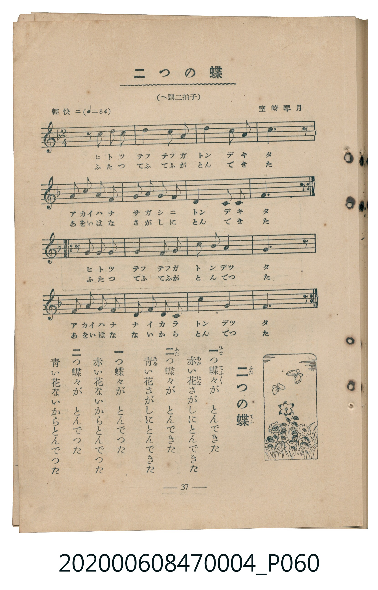

# 二つの蝶

> Re:Shōka 使用 AI 協助辨識與重建樂譜，可能會有錯誤。歡迎[回報](https://github.com/TMDLang/reshoka/issues)。

- **鋼琴伴奏版**：<br><audio controls src="futatsu_no_cho.mp3"></audio>
- **NEUTRINO 歌聲合成版**：<br><audio controls src="futatsu_no_cho_neutrino.mp3"></audio>

- 曲：室崎琴月
- 臺灣教育會公認《新定兒童唱歌》尋常科第四學年用（2020.006.0847.0004）

## 說明

原書資訊與歌詞全文（對應 P060.jpg，書頁 p. 37，參考教材第 3 首）：
調性與拍號：へ調二拍子（F 大調 2/4 拍）
速度指示：輕快ニ（♩=84）


## 歌詞

```text
一
一（ひと）つ蝶々（てふ／＼）が　とんできた
赤（あか）い花（はな）さがしにとんできた

二
二（ふた）つ蝶々が　とんできた
青（あを）い花さがしにとんできた

一
一つ蝶々が　とんでつた
赤い花ないからとんでつた

二
二つ蝶々が　とんでつた
青い花ないからとんでつた
```

## ABC

<div class="abc-score" data-abc-src="futatsu_no_cho.abc" aria-label="五線譜載入中"></div>

[下載 ABC 原始檔](futatsu_no_cho.abc)

## TMD 檔案連結

- [主旋律 TMD 檔案](futatsu_no_cho.tmd) [[在 TMD Studio 編輯](https://tmdlang.github.io/Tmd-TS/#tmd=s7IKdvYPcrWy4qpTUCpJTLdSSM7PyUlNLsnMz7MqzsjMK0nNjM_KTMmPL87Iz05Ugisry88pzU21Si9KTEmNN4k3MjAyiDcwMIs3sDAxBzIMTBBKi_NLi5JTrYqTM_Lzc-JLUitKkvLzsxHyBUX5Zal5iXlANQVFIBtTwIoQClLLMlNSQdKpKZkl-UWZiTlI7kgtKga7FWxJfElRYl5xclFmAcgDCFX5RSUZ-UC3FmRUWmVkFoMMSU7Mic9OzEPyUklGKtBHiXmZucgWAJWmZ-ZZlSRmAkMAFArlifG5iZl5OYl5Keh-jC9ITE-1CjAwM1Di0tJSeLKr53HjkseN617M3aagpcWlaKtgYcJlb6vgxmVjpG9iB9L9bPam93tmPV235OmWvucTtjyb0wE29EX7rueNi59NnfmiadOzOc1PW9e8WNX7uKHr2bQNT9fNeto66fnqpU-nbHy2tudxQ_fTDd1Pd-x4vnzi8zVrns6e_XTtjqc7tzyfsuL9ng5QvOgB40UPFC9AhoHJ-z2dSlxc-loKttQCXAoKCk_75j-bvePF5vYXK7pedLQD3fVi5bynrSueTWsHuuLpht5n7Z0KoIDRyypIf7-nB6j45YJGhQI9BWNzIPdpf_OLhmagd5_NnQD0hIKxwstl04AuBQYNyPQXq_Y_a1gOMre798XM-UDRx407gILAAAaKPF07AWiHm8LTJcuBYgrAkFUAigJ1g7S-bJj_dNeyZz3tz5fsAup7sWfq0_2rHzd3A3U8mrnS1gIUHlwghU92NEApoNTjxk2PG4Hh1wmMP2DkPW5oBQsue9y49f2e_vd79oClgGHfAFT2uGny48bljxt7HzfOB7t26xKw6qbHjUBrgOpaXnRtBIusf9y4CiwyFaS5cfrjxtXo-sFu2NUDpcC6tgLFkZ2C0-KXcydBLW4CMqAWE7QM7m_cFgDTMMxnMENXARlA_z1uAlqDqg7VB4QNBbqasKFAdZQnVChQ0NLn4nIrLUksKS71y3fOyHe0CshMzMt3qDGoqQbZpGBjoWUHZmDLJgpPO3uf9nY9WwdMCh1P-3tfLGt72rry2ZqFoGS9vh_IULBQeLqh__l6YErqQaT5TixGAV0CsqZGwUDBVMEMiGuApC6QNkZhmQJZukA1NWDVPoYg9Y-bJwFxBxC3AFU8bm573DwVqAjKeNy0Biza8bh5M1i0HSi0FiTUtB_VMCOwYY1bgXg-EC8BqQEndJA2CAMYdWBRUJSARZcDcS9YaD6KYTVA14JcbAhkGQFpIzDLLB7kkXgQqgEKoHvlcdMiIF79uGkJ0Jn9QNwFdibQWqAfHjdtB4p0E-8XYOoHioNSFJC5HohXgd0JDBGgJ4C5AIhXE_ZMLWoCccKaQPCkkH09NEghRmAIClldYDCCWKCwBvEgYmSmECDeDApUkDKQURSlEKDuyaAwBSkDG4aRQgyR04UhiACnC1ASh3iF2BQCJMEiTauB7JVoKQSfZ3AkkVVADBLpBkp2oiURbN4BphFdOwWUckQBTcAJJKDMBQA)]
- [鋼琴伴奏 TMD 檔案](futatsu_no_cho_piano.tmd) [[在 TMD Studio 編輯](https://tmdlang.github.io/Tmd-TS/#tmd=s7IKdvYPcrWy4qpTUCpJTLdSyC8qychPL0osyKi0ysgsLskvykxOzInPTsxLVIIrKs4vLUpOjS9ITE-1CjAwM1Di0tJSeLKr53HjkseN617M3fZ-T8fL7j3PJ2x5smfL06X9zzs73u_pVNDS4lK0VbAw4bK3VXDjsjHSN7EDGfls9qb3e2Y9Xbfk6ZY-oJZnczrANr1o3_W8cfGzqTNfNG16Nqf5aeuaF6t6Hzd0PZu24em6WU9bJz1fvfTplI3P1vY8buh-uqH76Y4dz5dPfL5mzdPZs5-u3fF055bnU1YAHWJkYGSgZ2BgpmdgYWIOZBiYAN2ixMXlVlqSWFJc6pfvnJFvFZCZmJcf5OFQY1BTzaUABDYWWnZghr6Wgi06UHja2fu0t-vZuq1A85_2975Y1va0deWzNQvf7-l5tr4fyFCwUHi6of_5-gagCCiE9LIK0kFBgGmUlj7YmhoFAwVTBTMgrgGSukDaGIVlCmTpAtXUgFX7gJQ_bp4ExB1A3AJU8Li57XHzVKAaKONx0xqwaMfj5s1g0Xag0FqQUNN-FLNqgOaD7DAEsoyAtBGYZRYPsjoehGqAAmiWP25aBMSrHzctARrcD8RdYIO3gm193LQdKNJN2HayPd4ItKhxPhAvAZnYuAwkALQEwnjc2AMWXfG4aTJYdDkQ94KF5lPu8cYmoBcmPW5sATLXA_EqsMHA4Aba-rhxOhCvJmw7noS1r4cGCcsIDEG-1AV6CcQC-RvEg4iRl7CAeDMoZkHKQCZhJixD5FA1BBHgUAVFKcRyIhMWkASLNK0GsleiJSxs1uP1uQnQVbh8TlzKAto1GRS1IGVgqzFSFhk-x56yVgExSKQbKNmJlrKwWV-LrWDzwVawAd0QD9QSbRgL0qhgEq8QbRILEgOJYPJN44Es0_hYMAPJoxB5TGVIBoFMgmoESyHrQjFpULgGahTEYLAKkIMwTYIykMwh0lFwJ-AwyhxXCA0qJwETmq6dAnJaUwDylbkA)]

## 分析

```text
================================================================================
📊 TMD Song Profile: [ 二つの蝶 ]
================================================================================
⏱  Duration:       0:22 (22.9s), 16 measures total
🎼 Key & Tempo:    首調基準 F, != 84.0 BPM, <2/4>
   - 分析範圍：      由實際發聲的音符與和弦推測調性；播放脈絡另行呈現
🎤 人聲音域:    C4 (MIDI 60) – D5 (MIDI 74) [跨度: 14 個半音 / 1.2 個八度, 難度: moderate]
   - 最低音:  C4 in [FutatsuNoChoA #1 @ m.7, 0:09]
   - 最高音: D5 in [FutatsuNoChoA #1 @ m.1, 0:00]
   - 適合: soprano, mezzo-soprano, contralto, tenor, baritone, bass
🏛  結構:      FutatsuNoChoA (11.4s) -> FutatsuNoChoB (11.4s)
⚡ 編曲密度:        Peak 1 軌道同時演奏
🗝  調性診斷：       C 大調（純淨自然大調，未偵測到可信轉調）
   - 風格氣質:    純淨自然大調（陽光明朗、易唱易記，無明顯調外色彩）
   - 轉調歷程:    全曲維持單一推測調性（未偵測到可信轉調）
   - 核心骨幹音:  G, C, F, D, A
   - 調性數值:    C 大調 [相關度: 0.82, 穩定度: Moderate, 自然音純度: 100.0%]
   - 候選調性 (K-S): C 大調 (0.82), F 大調 (0.72), G 大調 (0.60)
   - 五度圈歷程:   -1 -> +0
   - 各段落調性細節:
     • [FutatsuNoChoA #1]: F 調性不明確 (r: 0.74, 自然音純度: 100.0%)
     • [FutatsuNoChoB #1]: C 調性不明確 (r: 0.65, 自然音純度: 100.0%)

  [ 五度圈游移軌跡 ]
              [C ]*
        [F ]*          G  
      Bb               D  
      Eb               A  
         Ab           E  
            Db       B  
               F# 
     (* = active key center)

  [ 十二半音累積音高分佈 ]
     C  : █████████████████████     24.1%
     C# :                            0.0%
     D  : ██████████████            15.5%
     D# :                            0.0%
     E  :                            0.0%
     F  : ██████████████████        20.7%
     F# :                            0.0%
     G  : ████████████████████████  27.6%
     G# :                            0.0%
     A  : ███████████               12.1%
     A# :                            0.0%
     B  :                            0.0%
--------------------------------------------------------------------------------
Assignment 軌道音域：
  - Piano         : C4 – D5 (14 個半音 / 1.2 個八度, 43 個音符)
================================================================================
```


## 原書掃描頁




