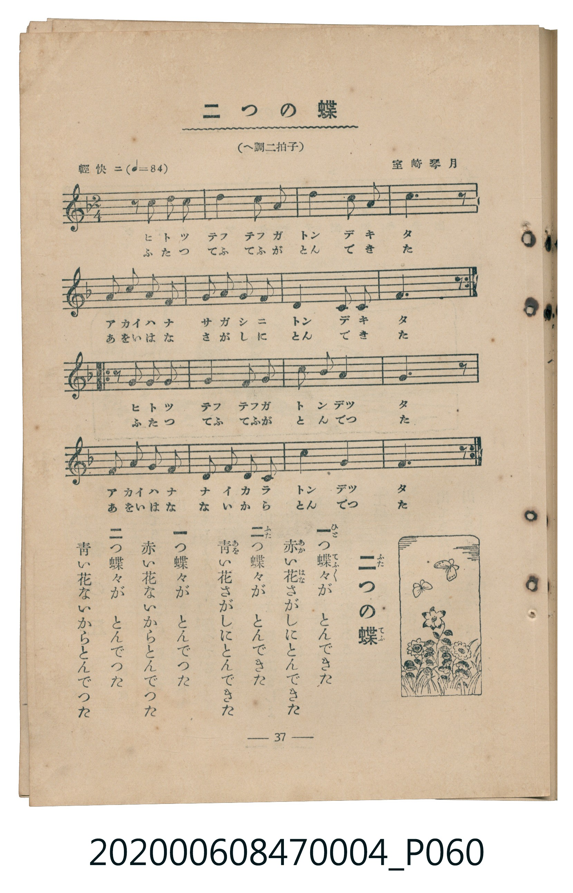

# 二つの蝶

<audio controls src="futatsu_no_cho.mp3"></audio>

- 曲：室崎琴月
- 臺灣教育會公認《新定兒童唱歌》尋常科第四學年用（2020.006.0847.0004）

## 說明

原書資訊與歌詞全文（對應 P060.jpg，書頁 p. 37，參考教材第 3 首）：
調性與拍號：へ調二拍子（F 大調 2/4 拍）
速度指示：輕快ニ（♩=84）

## 歌詞

```text
一
一（ひと）つ蝶々（てふ／＼）が　とんできた
赤（あか）い花（はな）さがしにとんできた

二
二（ふた）つ蝶々が　とんできた
青（あを）い花さがしにとんできた

一
一つ蝶々が　とんでつた
赤い花ないからとんでつた

二
二つ蝶々が　とんでつた
青い花ないからとんでつた
```

## ABC

```abc
X:1
T:二つの蝶
C:曲：室崎琴月
M:2/4
L:1/16
Q:1/4=84
K:F
V:V1 name="Piano" snm="Pia"
[V:V1]
z2 A2 A2 A2 | c4 c2 d2 | c4 A2 G2 | A6 z2 |
F2 F2 G2 A2 | G2 G2 A2 G2 | F4 G2 A2 | G6 z2 |
z2 A2 A2 A2 | c4 c2 d2 | c4 A2 G2 | A6 z2 |
F2 F2 G2 A2 | G2 G2 A2 G2 | F4 G2 A2 | G6 z2 |
z2 A2 A2 A2 | c4 c2 d2 | c2 A2 G4 | F6 z2 |
E2 E2 F2 G2 | A2 c2 d2 c2 | A4 G4 | F6 z2 |
z2 A2 A2 A2 | c4 c2 d2 | c2 A2 G4 | F6 z2 |
E2 E2 F2 G2 | A2 c2 d2 c2 | A4 G4 | F6 z2 |
```

## TMD 檔案連結

- [主旋律 TMD 檔案](futatsu_no_cho.tmd) [[在 TMD Studio 編輯](https://tmdlang.github.io/Tmd-TS/#tmd=s7IKdvYPcrWy4tLSUniyq-dx45LHjetezN2moKXFpWirYGHCZW-r4MZlY6RvYsdVp6D0bPam93tmPV235OmWvucTtjyb06EEEn7Rvut54-JnU2e-aNr0bE7z09Y1L1b1Pm7oejZtw9N1s562Tnq-eunTKRufre153ND9dEP30x07ni-f-HzNmqezZz9du-Ppzi3Pp6x4v6fDyMDIQM_AwEzPwMLEHMgwMHm_p1OJi0tfS8GWWoBLQUHhad_8Z7N3vNjc_mJF14uOdqC7Xqyc97R1xbNp7UBXPN3Q-6y9UyHAwMxAL6sg_f2eHqDilwsaFQr0FIzNgdyn_c0vGpqB3n02dwLQEwrGCi-XTQO6FBg0INNfrNr_rGE5yNzu3hcz5wNFHzfuAAoCAxgo8nTtBKAdbgpPlywHiikAQ1YBKArUDdL6smH-013LnvW0P1-yC6jvxZ6pT_evftzcDdTxaOZKWwtQeHCBFD7Z0QClgFKPGzc9bgSGXycw_oCR97ihFSy47HHj1vd7-t_v2QOWAoZ9A1DZ46bJjxuXP27sfdw4H-zarUvAqpseNwKtAapredG1ESyy_nHjKrDIVJDmxumPG1ej6we7YVcPlALr2goUR3YKTotfzp0EtbgJyIBaTNAyuL9xWwBMwzCfwQxdBWQA_fe4CWgNqjpUHxA2FOhqwoYC1VGeUKFAQUufi8uttCSxpLjUL985I98qIDMxL9-hxqBGoRpkk4KNhZYdmIEtmyg87ex92tv1bB0wKXQ87e99saztaevKZ2sWgpL1-n4gQ8FC4emG_ufrgSmpB5HmO7EYBXQJ1BoNYARoWikYKDxungTEHUDcolADJNseN08FUnvgzKY1YPGOx82boeLtQMG1IMGm_VCRPUCDoGbXAJnGYFijYKqgC8RmUJaxghGQZQxk6QLV1KC55HHTIiBe_bhpCdC8fiDuAtuwFeyAx03bgSLdJDrEEAiNwA4xAtMg6w2BlsPEYA5BuGRXDyRMGoHWNs4H4iUg08H5EGIBlNnYAxYHpRmo-HIg7gULArVRIUzALgFmLaDfQMkVyFwPxKvANgAjBegAYBYD4tUkOoTUMMGSHPf1DIbkCMSgZNAOUgiSJzE5gnyuC_U78ckRSIJFmlYD2SsxkiNBt5jHgxAoBkCRDnKLKTT60V1DfpoE2g1MC-CSDOYYUtIknoDBlyZXATFIpBso2YmRJgm6hfiAqeXi0rVTQC5OFYB8ZS4uAA)]
- [鋼琴伴奏 TMD 檔案](futatsu_no_cho_piano.tmd) [[在 TMD Studio 編輯](https://tmdlang.github.io/Tmd-TS/#tmd=s7IKdvYPcrWy4tLSUniyq-dx45LHjetezN32fk_Hy-49zydsebJny9Ol_c87O97v6VTQ0uJStFWwMOGyt1Vw47Ix0jex46pTUHo2e9P7PbOerlvydEsfUMuzOR1KIOEX7bueNy5-NnXmi6ZNz-Y0P21d82JV7-OGrmfTNjxdN-tp66Tnq5c-nbLx2dqexw3dTzd0P92x4_nyic_XrHk6e_bTtTue7tzyfMoKoEOMDIwM9AwMzPQMLEzMgQwDE6BblLi43EpLEkuKS_3ynTPyrQIyE_PygzwcagxqFKq5FIDAxkLLDszQ11KwRQcKTzt7n_Z2PVu3FWjB0_7eF8vanraufLZm4fs9Pc_W9wMZChYKTzf0P1_fABQJMDAz0MsqSAeFAaZRWvpga2oUDBSMwbBGwVRBF4jNoCxjBSMgyxjI0gWqqYGqNgRCI7BqIzANUmMIVAETQ1VNG7PxhM--HjqFD8h1ulD3IfvBPB6EQP4A-Q-k2hTqU-zqaWV6LbaU5oM1pQG1xQP1RBvGgnSCOCCmCZAyiUXwTeOBtGk8kghYF8xlUOVQKaAfYMox9RkBKaNcJEXmEFVICWHQuId0BwE1Y3cRQh7uKDJNGiyuAaYxXTsF5GSmAOQrc3EBAA)]

## 分析

```text
================================================================================
📊 TMD Song Profile: [ 二つの蝶 ]
================================================================================
⏱  Duration:       0:45 (45.7s), 32 measures total
🎼 Key & Tempo:    首調基準 F, != 84.0 BPM, <2/4>
   - 分析範圍：      由實際發聲的音符與和弦推測調性；播放脈絡另行呈現
🎤 人聲音域:    E4 (MIDI 64) – D5 (MIDI 74) [跨度: 10 個半音 / 0.8 個八度, 難度: easy]
   - 最低音:  E4 in [FutatsuNoCho #1 @ m.21, 0:28]
   - 最高音: D5 in [FutatsuNoCho #1 @ m.2, 0:02]
   - 適合: soprano, mezzo-soprano, contralto, tenor, baritone, bass
🏛  結構:      FutatsuNoCho (45.7s)
⚡ 編曲密度:        Peak 1 軌道同時演奏
🗝  調性診斷：       A 調性不明確（純淨自然大調，未偵測到可信轉調）
   - 風格氣質:    純淨自然大調（陽光明朗、易唱易記，無明顯調外色彩）
   - 轉調歷程:    全曲維持單一推測調性（未偵測到可信轉調）
   - 核心骨幹音:  A, G, C, F, D
   - 調性數值:    A 調性不明確 [相關度: 0.73, 穩定度: Ambiguous, 自然音純度: 100.0%]
   - 候選調性 (K-S): A 小調 (0.73), C 大調 (0.71), F 大調 (0.69)
   - 五度圈歷程:   +3
   - 各段落調性細節:
     • [FutatsuNoCho #1]: A 調性不明確 (r: 0.73, 自然音純度: 100.0%)

  [ 五度圈游移軌跡 ]
               C  
         F            G  
      Bb               D  
      Eb              [A ]*
         Ab           E  
            Db       B  
               F# 
     (* = active key center)

  [ 十二半音累積音高分佈 ]
     C  : ████████████████          19.0%
     C# :                            0.0%
     D  : ████                       5.2%
     D# :                            0.0%
     E  : ███                        3.4%
     F  : ████████████████          19.0%
     F# :                            0.0%
     G  : ████████████████████      24.1%
     G# :                            0.0%
     A  : ████████████████████████  29.3%
     A# :                            0.0%
     B  :                            0.0%
--------------------------------------------------------------------------------
Assignment 軌道音域：
  - Piano         : E4 – D5 (10 個半音 / 0.8 個八度, 86 個音符)
================================================================================
```


## 原書掃描頁




