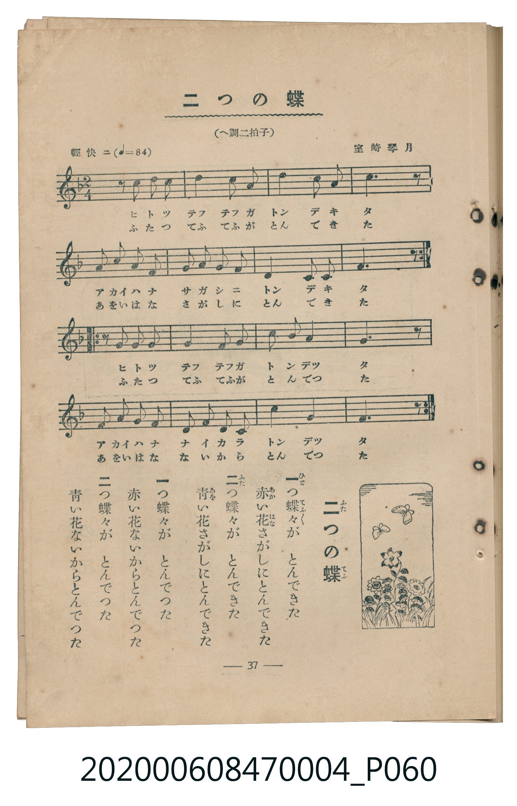

# 二つの蝶

> Re:Shōka 使用 AI 協助辨識與重建樂譜，可能會有錯誤。歡迎回報。

- **鋼琴伴奏版**：<br><audio controls src="futatsu_no_cho.mp3"></audio>
- **NEUTRINO 歌聲合成版**：<br><audio controls src="futatsu_no_cho_neutrino.mp3"></audio>

- 曲：室崎琴月
- 臺灣教育會公認《新定兒童唱歌》尋常科第四學年用（2020.006.0847.0004）

## 說明

原書資訊與歌詞全文（對應 P060.jpg，書頁 p. 37，參考教材第 3 首）：
調性與拍號：へ調二拍子（F 大調 2/4 拍）
速度指示：輕快ニ（♩=84）

## 歌詞

```text
一
一（ひと）つ蝶々（てふ／＼）が　とんできた
赤（あか）い花（はな）さがしにとんできた

二
二（ふた）つ蝶々が　とんできた
青（あを）い花さがしにとんできた

一
一つ蝶々が　とんでつた
赤い花ないからとんでつた

二
二つ蝶々が　とんでつた
青い花ないからとんでつた
```

## ABC

```abc
X:1
T:二つの蝶
C:曲：室崎琴月
M:2/4
L:1/16
Q:1/4=84
K:F
V:V1 name="Piano" snm="Pia"
[V:V1]
z2 c2 d2 c2 | d4 c2 A2 | d4 c2 A2 | c6 z2 |
w: ヒ ト ツ | テフ テフ ガ | トン デ キ | タ
A2 c2 A2 F2 | G2 A2 G2 F2 | D4 C2 C2 | F6 z2 |
w: ア カイ ハ ナ | サ ガ シ ニ | トン デ キ | タ
z2 c2 d2 c2 | d4 c2 A2 | d4 c2 A2 | c6 z2 |
w: ふ た つ | てふ てふ が | とん で き | た
A2 c2 A2 F2 | G2 A2 G2 F2 | D4 C2 C2 | F6 z2 |
w: あ をい は な | さ が し に | とん で き | た
z2 G2 G2 G2 | G4 F2 G2 | c2 A2 G4 | G6 z2 |
w: ヒ ト ツ | テフ テフ ガ | ト ン デツ | タ
F2 A2 G2 F2 | D2 F2 D2 C2 | c4 G4 | F6 z2 |
w: ア カイ ハ ナ | ナ イ カ ラ | トン デツ | タ
z2 G2 G2 G2 | G4 F2 G2 | c2 B2 A4 | G6 z2 |
w: ふ た つ | てふ てふ が | と ん でつ | た
F2 A2 G2 F2 | D2 F2 D2 C2 | c4 G4 | F6 z2 |
w: あ をい は な | な い か ら | とん でつ | た
```

## TMD 檔案連結

- [主旋律 TMD 檔案](futatsu_no_cho.tmd) [[在 TMD Studio 編輯](https://tmdlang.github.io/Tmd-TS/#tmd=s7IKdvYPcrWy4qpTUCpJTLdSSM7PyUlNLsnMz7MqzsjMK0nNjM_KTMmPL87Iz05Ugisry88pzU21Si9KTEmNN4k3MjAyiDcwMIs3sDAxBzIMTBBKi_NLi5JTrYqTM_Lzc-JLUitKkvLzsxHyBUX5Zal5iXlANQVFIBtTwIoQClLLMlNSQdKpKZkl-UWZiTlI7kgtKga7FWxJfElRYl5xclFmAcgDCFX5RSUZ-UC3FmRUWmVkFoMMSU7Mic9OzEPyUklGKtBHiXmZuSALtLQUnuzqedy45HHjuhdztyloaXEp2ipYmHDZ2yq4cdkY6ZvYgXQ-m73p_Z5ZT9ctebql7_mELc_mdIANfNG-63nj4mdTZ75o2vRsTvPT1jUvVvU-buh6Nm3D03WznrZOer566dMpG5-t7Xnc0P10Q_fTHTueL5_4fM2ap7NnP1274-nOLc-nrHi_pwMUrnrAcNUDhSuQYWDyfk-nEheXvpaCLbUAl4KCwtO--c9m73ixuf3Fiq4XHe1Ad71YOe9p64pn09qBrni6ofdZe6dCgIGZgV5WQfr7PT1AxS8XNCoU6CkYmwO5T_ubXzQ0A737bO4EoCcUjBVeLpsGdCkwaECmv1i1_1nDcpC53b0vZs4Hij5u3AEUBAYwUOTp2glAO9wUni5ZDhRTAIasAlAUqBuk9WXD_Ke7lj3raX--ZBdQ34s9U5_uX_24uRuo49HMlbYWoPDgAil8sqMBSgGlHjduetwIDL9OYPwBI-9xQytYcNnjxq3v9_S_37MHLAUM-wagssdNkx83Ln_c2Pu4cT7YtVuXgFU3PW4EWgNU1_KiayNYZP3jxlVgkakgzY3THzeuRtcPdsOuHigF1rUVKI7sFJwWv5w7CWpxE5ABtZigZXB_47YAmIZhPoMZugrIAPrvcRPQGlR1qD4gbCjQ1YQNBaqjPKFCgYKWPheXW2lJYklxqV--c0a-VUBmYl6-Q41BTTXIIgUbCy07MANbLlF42tn7tLfr2TpgSuh42t_7Ylnb09aVz9YsBKXq9f1AhoKFwtMN_c_XAxNSDyLJd2IxCugQkDU1CgYKpgpmQFwDJHWBtDEKyxTI0gWqqQGr9gEpf9w8CYg7gLgFqOBxc9vj5qlANVDG46Y1YNGOx82bwaLtQKG1IKGm_Shm1QDNB9lhCGQZAWkjMMssHmR1PAjVAAXQLH_ctAiIVz9uWgI0uB-Iu8AGbwXb-rhpO1Ckm7DtZHu8EWhR43wgXgIyEZwlQZZAGMBEBhYFJR6w6HIg7gULzafc441NQC-AEiuQuR6IV4ENBgY30FZgBgPi1YRtx5Ow9vXQIGEZgSHIl7pAL4FYIH-DeBAx8hIWEG8GxSxIGcgkzIRliByqhiACHKqgKIVYTmTCApJgkabVQPZKtISFzXq8PjcBugqXz4lLWUC7JoOiFqQMbDVGyiLD59hT1iogBol0AyU70VIWNutrubh07RSQSzYFIF-ZCwA)]
- [鋼琴伴奏 TMD 檔案](futatsu_no_cho_piano.tmd) [[在 TMD Studio 編輯](https://tmdlang.github.io/Tmd-TS/#tmd=s7IKdvYPcrWy4tLSUniyq-dx45LHjetezN32fk_Hy-49zydsebJny9Ol_c87O97v6VTQ0uJStFWwMOGyt1Vw47Ix0jex46pTUHo2e9P7PbOerlvydEsfUMuzOR1KIOEX7bueNy5-NnXmi6ZNz-Y0P21d82JV7-OGrmfTNjxdN-tp66Tnq5c-nbLx2dqexw3dTzd0P92x4_nyic_XrHk6e_bTtTue7tzyfMoKoEOMDIwM9AwMzPQMLEzMgQwDE6BblLi43EpLEkuKS_3ynTPyrQIyE_PygzwcagxqqrkUgMDGQssOzNDXUrBFBwpPO3uf9nY9W7cVaP7T_t4Xy9qetq58tmbh-z09z9b3AxkKFgpPN_Q_X98AFAkwMDPQyypIBwUBplFa-mBrahQMFEwVzIC4BkjqAmljFJYpkKULVFMDVu0DUv64eRIQdwBxC1DB4-a2x81TgWqgjMdNa8CiHY-bN4NF24FCa0FCTftRzKoBmg-ywxDIMgLSRmCWWTzI6ngQqgEKoFn-uGkREK9-3LQEaHA_EHeBDd4KtvVx03agSDdh28n2eCPQosb5QLwEZGLjMpAA0BII43FjD1h0xeOmyWDR5UDcCxaaT7nHG5uAXpj0uLEFyFwPxKvABgODG2jr48bpQLyasO14Eta-HhokLCMwBPlSF-glEAvkbxAPIkZewgLizaCYBSkDmYSZsAyRQ9UQRIBDFRSlEMuJTFhAEizStBrIXomWsLBZj9fnJkBX4fI5cSkLaNdkUNSClIGtxkhZZPgce8paBcQgkW6gZCdaysJmfS22gs0HW8EGdEM8UEu0YSxIo4JJvEK0SSxIDCSCyTeNB7JM42PBDCSPQuQxlSEZBDIJqhEshawLxaRB4RqoURCDwSpADsI0CcpAModIR8GdgMMoc1whNKicBExounYKyGlNAchX5gIA)]

## 分析

```text
================================================================================
📊 TMD Song Profile: [ 二つの蝶 ]
================================================================================
⏱  Duration:       0:45 (45.7s), 32 measures total
🎼 Key & Tempo:    首調基準 F, != 84.0 BPM, <2/4>
   - 分析範圍：      由實際發聲的音符與和弦推測調性；播放脈絡另行呈現
🎤 人聲音域:    C4 (MIDI 60) – D5 (MIDI 74) [跨度: 14 個半音 / 1.2 個八度, 難度: moderate]
   - 最低音:  C4 in [FutatsuNoCho #1 @ m.7, 0:09]
   - 最高音: D5 in [FutatsuNoCho #1 @ m.1, 0:00]
   - 適合: soprano, mezzo-soprano, contralto, tenor, baritone, bass
🏛  結構:      FutatsuNoCho (45.7s)
⚡ 編曲密度:        Peak 1 軌道同時演奏
🗝  調性診斷：       C 大調（純淨自然大調，未偵測到可信轉調）
   - 風格氣質:    純淨自然大調（陽光明朗、易唱易記，無明顯調外色彩）
   - 轉調歷程:    全曲維持單一推測調性（未偵測到可信轉調）
   - 核心骨幹音:  G, C, F, D, A
   - 調性數值:    C 大調 [相關度: 0.82, 穩定度: Moderate, 自然音純度: 99.1%]
   - 候選調性 (K-S): C 大調 (0.82), F 大調 (0.74), G 大調 (0.58)
   - 五度圈歷程:   +0
   - 各段落調性細節:
     • [FutatsuNoCho #1]: C 大調 (r: 0.82, 自然音純度: 99.1%, 調外音: A#)

  [ 五度圈游移軌跡 ]
              [C ]*
         F            G  
      Bb               D  
      Eb               A  
         Ab           E  
            Db       B  
               F# 
     (* = active key center)

  [ 十二半音累積音高分佈 ]
     C  : ██████████████████████    24.1%
     C# :                            0.0%
     D  : ██████████████            15.5%
     D# :                            0.0%
     E  :                            0.0%
     F  : ███████████████████       20.7%
     F# :                            0.0%
     G  : ████████████████████████  25.9%
     G# :                            0.0%
     A  : ████████████              12.9%
     A# : █                          0.9%
     B  :                            0.0%
--------------------------------------------------------------------------------
Assignment 軌道音域：
  - Piano         : C4 – D5 (14 個半音 / 1.2 個八度, 86 個音符)
================================================================================
```


## 原書掃描頁




