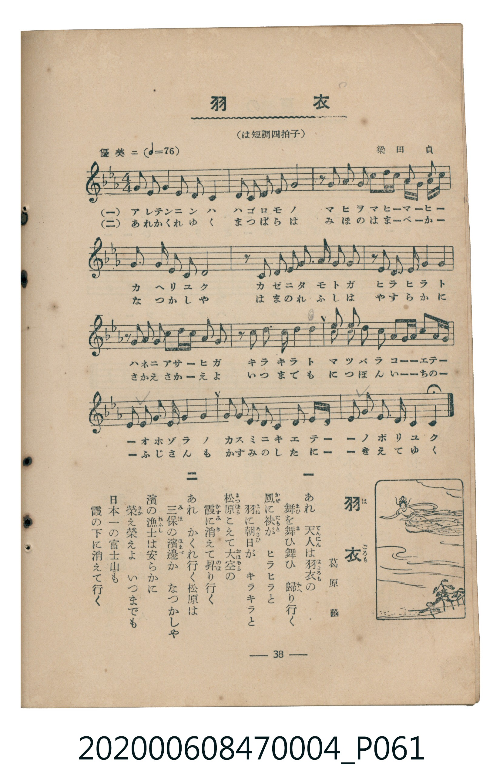

# 羽衣

> Re:Shōka 使用 AI 協助辨識與重建樂譜，可能會有錯誤。歡迎回報。

- **NEUTRINO 歌聲合成版**：<br><audio controls src="hagoromo_neutrino.mp3"></audio>
- **鋼琴伴奏版**：<br><audio controls src="hagoromo.mp3"></audio>


- 詞：葛原しげる
- 曲：梁田貞
- 臺灣教育會公認《新定兒童唱歌》尋常科第四學年用（2020.006.0847.0004）

## 說明

原書資訊與歌詞全文（對應 P061.jpg，書頁 p. 38，參考教材第 4 首）：
調性與拍號：は短調四拍子（c 小調 4/4 拍）
速度指示：優美ニ（♩=76）
作者署名：葛原蘢（詞）、梁田貞（曲）

## 跨冊／重複收錄參照

> 同曲（〈羽衣〉；收錄於《新定兒童唱歌》四年級與《唱歌帖》P157《小公學校唱歌教材集》抄譜）

- **[同曲]** 楊金土手抄《唱歌帖》第 1 冊（2020.006.0843）：[**〈羽衣〉**](../../../shokacho/vol_01/p157_hagoromo/index.md)（`E,` / `4/4` — [原始 TMD](../../../shokacho/vol_01/p157_hagoromo/hagoromo.tmd)）
- 總表：[跨冊重複與同名歌曲總索引](../../../duplicate_songs.md)

## 歌詞

```text
一
あれ　天人（てんにん）は羽衣（はごろも）の
舞（まひ）を舞ひ舞ひ　歸（かへ）り行（ゆ）く
風（かぜ）に袂（たもと）が　ヒラヒラと
羽（はね）に朝日（あさひ）が　キラキラと
松原（まつばら）こえて大空（おほぞら）の
霞（かすみ）に消（き）えて昇（のぼ）り行く

二
あれ　かくれ行く松原は
三保（みほ）の濱邊（はまべ）か　なつかしや
濱の漁士（れふし）は安らかに
榮（さか）え榮えよ　いつまでも
日本一（につぽんいち）の富士山（ふじさん）も
霞の下（した）に消えて行く
```

## ABC

```abc
X:1
T:羽衣
C:曲：梁田貞
M:4/4
L:1/16
Q:1/4=76
K:Cm
V:V1 name="Piano" snm="Pia"
[V:V1]
G2 E2 G4 E2 D2 C4 | D2 C2 D2 F2 G8 | z2 G2 A2 G2 c2 d c A G A c | G3 G E2 C2 D8 |
w: 1.~ア レ テン ニ ン ハ | ハ ゴ ロ モ ノ | マ ヒ ヲ マ ヒ _ マ _ ヒ _ | カ ヘ リ ユ ク
w: 2.~あ れ か く れ ゆ | ま つ ば ら は | み ほ の は ま _ べ _ か _ | な つ か し や
z2 C2 D2 E2 G3 A G2 G2 | z2 E2 D3 E G4 G4 | z2 G2 A2 G2 c2 d c A2 G2 | z2 c2 d3 c d4 d4 |
w: 1.~カ ゼ ニ タ モ ト ガ | ヒ ラ ヒ ラ ト | ハ ネ ニ ア サ _ ヒ ガ | キ ラ キ ラ ト
w: 2.~は ま の れ ふ し は | や す ら か に | さ か え さ か _ え よ | い つ ま で も
c2 c2 d2 c2 A2 G A c2 A G | E2 E2 G3 E G4 G4 | G2 G2 E2 D2 C4 D2 E D | E2 G2 F3 D C4 C4 |
w: 1.~マ ツ バ ラ コ _ _ エ テ _ | _ オ ホ ゾ ラ ノ | カ ス ミ ニ キ エ テ _ | _ ノ ボ リ ユ ク
w: 2.~に つ ぽ ん い _ _ ち の _ | _ ふ じ さ ん も | か す み の し た に _ | _ き え て ゆ く
```

## TMD 檔案連結

- [主旋律 TMD 檔案](hagoromo.tmd) [[在 TMD Studio 編輯](https://tmdlang.github.io/Tmd-TS/#tmd=s7IKdvYPcrWy4qpTUCpJTLdSSM7PyUlNLsnMz7MqzsjMK0nNjM_KTMmPL87Iz05Ugisry88pzU21Si9KTEmNN4k3MjAyiDcwMIs3sDAxBzIMTBBKi_NLi5JTrYqTM_Lzc-JLUitKkvLzsxHyBUX5Zal5iXlANQVFIBtTwIoQClLLMlNSQdKpKZkl-UWZiTlI7kgtKga7FWxJfElRYl5xclFmAcgDCFX5RSUZ-UC3FmRUWmVkFoMMSU7Mic9OzEPyUklGKtBHafk52Tn5RalKXFpaCs_37X2xcLGClhaXoq2CuRmXva2Cqw5XdmqlrYJzLpeNib6JHUj7i5Xz3u-Z9WLi7Kd98x83Tn_cOOlxUzfY4GezNwFlni1qfD5lw4tN88BiL9p3PW9c_GzqzBdNm57NaX7auubFqt7HDV3Ppm14um7W09ZJz1cvfTpl47O1PY8bup9u6H66Y8fz5ROfr1nzdPbsp2t3PN255fmUFe_3dIDCXA8Y5nqgMAcyDEze7-lU4uLS11KwpRbgUlBQAHrq2ewdLza3v1jR9aKjHeguoH-ftq54Nq0d6IqnG3qftXcqBBiYGeplFaS_39MDVPxyQaNCgZ6CsQWQ-7S_-UVDM9C7z-ZOAHpCwUTh5bJpQJcCwwVk-otV-581LAeZ2937YuZ8oOjjxvXP568FigP9CxR8unYC0Jpkhacb-oFiCsAwVwCKAg0A6X7ZMP_prmXPetqfL9kF1Pq0ZdXzfX2Pm7uBOh7NXGlrbgZV92TvnBcNrc_3bno6AagVGlUvZiwCqgNHXufjhkZ4LAEFwfHWyQXWuqMBRD1ubHrcBIyRhqdLVj7ZBbSs43HjssdNkx83rgaSIBOAzgYnF7DU-seNUx439T5uagJLrQN7tQNk9OPGfY8bQaY_bpoEFAGyISTQ6Gdrd4AVdD9uBDKACrpeLOwBiTS1gU3pB3t5ESjywYrmgEVXv1gEtAQoMh9o2-NGoCxQEOTSx82THjevhJKNK0CagS6EOW8tRPOzOXOfTV8KFgRqngp1GkR_01qQTggJ0f9s7j5gwMF8seRx44bHTcCYBGoABgQoRJ4uWf58JSR0uh437n7cOA-mABwEL-dAggDo-JmPG_dDnbCtAywIilSIKc9mgJIWUM_jxj3wgAD5Hxwhu3pQIgRsWj-QDVEDcSLQi5DI63yyfy7YrP1A50Ac8mz_xpdNXbBwAPpjJ1i8G2zWKrC3gCZOf9zUAvby_o0gPXsany5eDY4LoCVbgdKQKH-6Dug6sObG1WDVy9aBDQYGJDARgrwDFAF5qqkDbHwL2HigncuBkQXWMH3pszlrgIkMrG01WHovOF0BlS6EOPjp-h6g5U83bgSrAVo-A2QBJNVBTAGGK1Ddkx2ghA8ugYBxBA1aSIhCww-olPJCAQoUtPS5uDwS0_OL8nPzrQIyE_PyHWoMaqpBlijYGJpp2YFZ2IojBWBBAPQy0FEKGsagnP18fYMOvAzRxKIBaBfIsBoFYwVdBUMgBtEgCGKbxwMJMxABgjVIfDDLCEk5DNYoGEBFTaC0GUg5kDQB8kyAdA3YQh_DGoXHTYuAco-b14DJtsfNm6GGAAsaMAniP27uhxsNYT9u2gIWXwsmIUb0YXXG4-Z5YHISmNyEIYJgQx1lBLSjsQlsRw-IbAS5A-yiRojNYNGmNoSLGveBZZeAyQ1g2U4wez12FzXuB5O7weQ6uEqYOTvhttaA8yTuWN4FypZkxTIoWkCxi4hITHci5BBpAhSBEDZEDTyFgJiwdACjkWN5NSQIm2cA8Sowaxk4oHAEEVj946Y9YJXghNAECjRIZD9u7gCLgNIMLJIhkbkSqmYSnA3igVQjuQccwSA3QCINEtTAjA02swW7e1AiCBxl4GQA4m2F6QWrgbkfZA6wHIaoASYH5GQECQvC0bujk5zoxZ33kCMOIgpyhRmUhvFBKkCyMBUgGqIXlHMhSQARs5DQB2eM5l4wCYktcJZs2gqNDbTYaoJkW2hsAXlYYwueOcFh2TwBrudxE7yQaFoBFgVlRkTsQmJsKpiExC04vWCKNIFImHpIjIEyMSSmgdUI3BZQcQDL7OCUCc3se8Gyk-H6IXoXgklQKiEQw8BGGDkxDMp0iCyJJd_BMylmAQ7Nz0AKYg5IFagMB8vAVSHKe3hEQwICknVnQ3nAQEKKOFj5C8vuj5vAJVnzfDAJSRagiMeIOCT9j5vnQHmroEUERDWsmEBEMizzgcgZUN5UaGRgRhok0kHZEVb6QspdUMaF6AW7Ehy5MLPByRmcUED0MqQyH1ITQNxTy8Wla6cAq6oVgGxlLgA)]
- [鋼琴伴奏 TMD 檔案](hagoromo_piano.tmd) [[在 TMD Studio 編輯](https://tmdlang.github.io/Tmd-TS/#tmd=s7IKdvYPcrWy4tLSUni-b--LhYvf7-l42b3n-YQtT_Zsebq0_3lnx_s9nQpaWlyKtgrmZlz2tgquOlzZqZW2Cs65XDYm-iZ2XHUKSi9Wznu_Z9aLibOf9s1_3Dj9ceOkx03dSiCZZ7M3AWWeLWp8PmXDi03zwGIv2nc9b1z8bOrMF02bns1pftq65sWq3scNXc-mbXi6btbT1knPVy99OmXjs7U9jxu6n27ofrpjx_PlE5-vWfN09uyna3c83bnl-ZQVQIcaGRgZ6BkYmOkZWJiYAxkGJkC3KnFxeSSm5xfl5-ZbBWQm5uUHeTjUGNRUcykAgY2hmZYdmKWvpWCLDhSAVjzZ0fBiYY-ChrHC0w39z9c36CgEGJgZ6mUVpGti0aClDzasRsFYQVfBEIhBNAiC2ObxQMIMRIBgDRIfzDJCUg6DNQoGUFETKG0GUg4kTYA8EyBdA7bQx7BG4XHTIqDc4-Y1YLLtcfNmqCGPm7vBJIj_uLkfbjSE_bhpC1h8LZiEGNGH1RmPm-eByUlgchOGCIINdZQR0I7GJrAdPSCyEeQOsIsaITaDRZvaEC5q3AeWXQImN4BlO8Hs9dhd1LgfTO4Gk-vgKmHm7ITbWsOFP5Z39ZAby6BoAcUuIiIx3YmQQ6QJUARC2BA18BQCYsLSAYxGjuXVkCBsngHEq8CsZeCAwhFEYPWPm_aAVYITQhMo0CCR_bi5AywCSjOwSIZE5kqomklwNogHUo3kHnAEg9wAiTRIUAPzO9jMFuzuQYkgcJSBkwGItxWmF6wG5n6QOY8bZ0LUAJMDcjKChAXh6N3RSU704s57yBEHEQW5wgxKw_ggFSBZmAoQDdELyrmQJICIWUjogzNGcy-YhMQWOEs2bYXGBlpsNUGyLTS2gDyssQXPnOCwbJ4A1_O4CV5INK0Ai4IyIyJ2ITE2FUxC4hacXjBFmkAkTD0kxkCZGBLTjxuXw20BFQewzA5OmdDMvhcsOxmuH6J3IZgEpRICMQysCciJYVCmQ2RJLPkOnkkxC3BofgZSEHNAqkBlOFgGrgpR3sMjGhIQkKw7G8oDBhJSxMHKX1h2f9wELsma54NJSLIARTxGxCHpf9w8B8pbBS0iIKphxQQikmGZD0TOgPKmQiMDM9IgkQ7KjrDSF1LugjIuRC_YleDIhZkNTs7ghAKilyGV-ZCaAOKeWvSa2ge5pjaBVtTALBUfrxBtFp8bq2AEY9QomIIETeNjFYyBtDFYCKTOMB6kCBgJEO8ia0ZVCFQFVAszDSoCV4KkGWIikKwB0SBrsRlEnI1wX0BVGYO4CPXgING1U4CFSrSPYawCCt8IzFfmAgA)]

## 分析

```text
================================================================================
📊 TMD Song Profile: [ 羽衣 ]
================================================================================
⏱  Duration:       0:37 (37.9s), 12 measures total
🎼 Key & Tempo:    首調基準 E,, != 76.0 BPM, <4/4>
   - 分析範圍：      由實際發聲的音符與和弦推測調性；播放脈絡另行呈現
🎤 人聲音域:    C4 (MIDI 60) – D5 (MIDI 74) [跨度: 14 個半音 / 1.2 個八度, 難度: moderate]
   - 最低音:  C4 in [Hagoromo #1 @ m.1, 0:02]
   - 最高音: D5 in [Hagoromo #1 @ m.3, 0:08]
   - 適合: soprano, mezzo-soprano, contralto, tenor, baritone, bass
🏛  結構:      Hagoromo (37.9s)
⚡ 編曲密度:        Peak 1 軌道同時演奏
🗝  調性診斷：       G 調性不明確（流行色彩大調，未偵測到可信轉調）
   - 風格氣質:    調式色彩／藍調前衛（調外音豐富，張力強烈）
   - 轉調歷程:    全曲維持單一推測調性（未偵測到可信轉調）
   - 核心骨幹音:  G, C, D, D#, G#
   - 調性數值:    G 調性不明確 [相關度: 0.73, 穩定度: Ambiguous, 自然音純度: 78.6%]
   - 候選調性 (K-S): G 大調 (0.73), C 小調 (0.71), G 小調 (0.67)
   - 五度圈歷程:   +1
   - 各段落調性細節:
     • [Hagoromo #1]: G 調性不明確 (r: 0.73, 自然音純度: 78.6%, 調外音: D#, F, G#)

  [ 五度圈游移軌跡 ]
               C  
         F           [G ]*
      Bb               D  
      Eb               A  
         Ab           E  
            Db       B  
               F# 
     (* = active key center)

  [ 十二半音累積音高分佈 ]
     C  : ███████████████           22.0%
     C# :                            0.0%
     D  : ███████████████           22.0%
     D# : ████████                  11.5%
     E  :                            0.0%
     F  : ██                         2.7%
     F# :                            0.0%
     G  : ████████████████████████  34.6%
     G# : █████                      7.1%
     A  :                            0.0%
     A# :                            0.0%
     B  :                            0.0%
--------------------------------------------------------------------------------
Assignment 軌道音域：
  - Piano         : C4 – D5 (14 個半音 / 1.2 個八度, 81 個音符)
================================================================================
```


## 原書掃描頁




