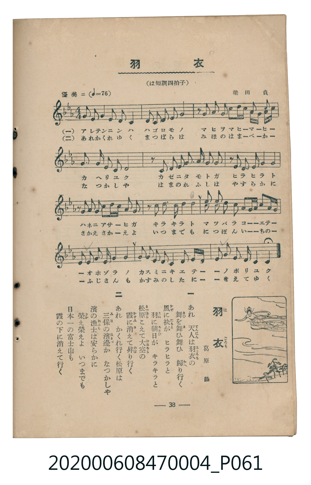

# 羽衣

> Re:Shōka 使用 AI 協助辨識與重建樂譜，可能會有錯誤。歡迎回報。

- **鋼琴伴奏版**：<br><audio controls src="hagoromo.mp3"></audio>
- **NEUTRINO 歌聲合成版**：<br><audio controls src="hagoromo_neutrino.mp3"></audio>

- lyrics: 葛原𦱳（葛原しげる）
- composer: 梁田貞
- 臺灣教育會公認《新定兒童唱歌》尋常科第四學年用（2020.006.0847.0004）

## 說明

原書資訊與歌詞全文（對應 P061.jpg，書頁 p. 38，參考教材第 4 首）：
調性與拍號：は短調四拍子（c 小調 4/4 拍，日本都節音階）
速度指示：優美ニ（♩= 76）
作者署名：葛原𦱳（詞，即葛原蕋／葛原しげる之原書印字）、梁田貞（曲）
版面校勘：


## 歌詞

```text
1. 第 1 小節第 2 拍四分音符 `3` 對應第一段「テン」、第二段「かく」，全小節第二段譜下完整印作「あれかくれゆく」。
2. 第 2 小節第 4 音與第 12 小節第 3 音於五線譜均位在第一線（E♭4 = `1`），全曲嚴守都節五聲音階（無 F4 = `2`）。
3. 第 3 小節第 4 拍印有細膩十六分音符裝飾旋律 `4 3 4 6`（末拍上方並附小音符 C5 簡化替換音）；第 9 小節第 1 拍主旋律實心符頭為高音 E♭5 `1^ - 1^ -`（下方附空心八分音符 `6 - 6 -` 作為低音域替換音）。

一
あれ　天人（てんにん）は羽衣（はごろも）の
舞（まひ）を舞（ま）ひ舞ひ　歸（かへ）り行（ゆ）く
風（かぜ）に袂（たもと）が　ヒラヒラと
羽（はね）に朝日（あさひ）が　キラキラと
松原（まつばら）こえて大空（おほぞら）の
霞（かすみ）に消（き）えて昇（のぼ）り行く

二
あれ　かくれ行く松原は
三保（みほ）の濱邊（はまべ）か　なつかしや
濱の漁士（れふし）は安らかに
榮（さか）え榮えよ　いつまでも
日本一（につぽんいち）の富士山（ふじさん）も
霞の下（した）に消えて行く
```

## ABC

<div class="abc-score" data-abc-src="hagoromo.abc" aria-label="五線譜載入中"></div>

[下載 ABC 原始檔](hagoromo.abc)

## TMD 檔案連結

- [主旋律 TMD 檔案](hagoromo.tmd) [[在 TMD Studio 編輯](https://tmdlang.github.io/Tmd-TS/#tmd=s7IKdvYPcrWy4qpTUCpJTLdSSM7PyUlNLsnMz7MqzsjMK0nNjM_KTMmPL87Iz05Ugisry88pzU21Si9KTEmNN4k3MjAyiDcwMIs3sDAxBzIMTBBKi_NLi5JTrYqTM_Lzc-JLUitKkvLzs9Hl4wsS01OtAgzMDBEyBUX5Zal5iXlA3QVFILekgLUjFKSWZaakgqSLkxPz4stSizLTMlNTEPL5RSUZ-UA3FmRUWmVkFpfkF2UmJ-bEZyfmIXsltagY7F2IO0qKEvOKk4syC0BhgFBVkpEK9G9afk52Tn5RKrp4XmJJKbIo0KL0zDyrksRMYLiBwq48MT43MTMvJzEP6DwtLYXn-_a-WLhYQUuLS9FWwdyMy95WwVWHKzu10lbBOZfLxkTfxA5kWE4l0MXFVgovJs5-2jf_w7KNm9_v6YBwHjdOf9w46XFT9_s9nWCLk_NzC_KLU4usFJ4tanw-ZcOLTfPA4i_adz1vXPxs6swXTZuezWl-2rrmxarexw1dz6ZteLpu1tPWSc9XL306ZeOztT2PG7qfbuh-umPH8-UTn69Z83T27KdrdzzdueX5lBVAa0FxrAeMYz1QHAMZBiZgm7n0tRRsqQW4FBQUgH57NnvHi83tL1Z0vehoB7rrxcp5T1tXPJvWDnTF0w29z9o7FUAJRS-rIP39nh6g4pcLGhUK9BSMLYDcp_3NLxqagd59NncC0BMKJgovl00DuvT9nlkg01-s2v-sYTnI3O7eFzPnA0UfN65_Pn8tUBzoX6Dg07UTgNYkKzzd0A8UUwDGhAJQFGTP9KXP5qx52bz3-fqGl_M3v5zVBzQVZOTLhvlPdy171tP-fMkuoHlPW1Y939f3uBkYMR2PZq4ERS9U4ZO9c140tD7fu-npBKCBs1AjdeU8kON7N0NEX0wFau9Hi-knO7shgfO0d8PTtdOBpj5uaIRHNtCQZ7M3Qa163tnxcu6iZwsWPu2eAfW5oZ4CKDwMQT4DegHENgJ5DRTNHW1AHz1fs0whwTgBKA8KYqD8kx0Nz9ZtfdzQ87i57XHz5scNwGTTCBLf1QMVb-x-3NgPFAc5vXUF3GCIghdr5zzZ0f10Xc-zqVuALgb6Hqyl6XETTCOQ0dQGMeFxQxPIkUYQRxohORIYgfM3AyMM7HhkCWOQxLNpe57smvJ8-yygbU_ntj_Z2_t0zgqI24GCwDBxfTRzrYmCrUKCYQI4FYAcCgynp7O2PF3XAYlNoAEvGjfB4rTjectCBTewFiOQFqjLjCEuM0ZxGSj4ejc8m9P5fMuGF20rn_Y2Pm1dCw_NF4vnvly879n07qf7uhUSTIB6TRTMgEZ2PJuzGqjzyQ5gHtz5ZMeylzNbgIZCY8DZVOH5hoVPe6Y9m73_Wf9soCjY2bNBFloiWW4IsvzJjt0Q45-uX_Z0fzNQ_8sFa5837Xq5egZQowLI76ZAn8cp6CqACJDdwCgB2gq08vnKXUAtT1tXI8W-GVAhECeAkirQmCd7-4AyT-cD0xzCLaDwAKfmHQ0gChqhDQ1Pl6x8sguYAToeNy573DT5ceNqIAlSD8xf4NIOLLX-ceOUx029j5uawFLrwHmyA5R4Hzfue9wISr-PmybBRcCKNgG5QBJox7O1O8DiwNQDZABVdr1Y2AMSaWoDq-wH58dFoOIKrGgOWHT1i0VA24Ai84HWPm4EygIFQU5-3DzpcfNKKNm4Apxx9u2FuXMtRPOzOXOBWR8sCNQ8FepGiP6mtSCdEBKi_9ncfcA8CvPOkseNGx43AaMPqAEYIqCgebpkOTDkwQq6Hjfuftw4D6YAHBYv50B8DnT8zMeN-6FO2NYBFgTmMyAXZMqzGaDCEKjnceMeeECA_A-OmV09KDEDz20QNRAnAr0IicXOJ_vngs3aD3QOxCHP9m982dQFCwegP3aCxbvBZq0Cewto4vTHTS1gL-_fCNKzp_Hp4tXguABashUoDYn7p-uArgNrblwNVr1sHdhgYECCqi6gd4AiIE81dYCNbwEbD7RzOTCywBrA5S4wtYG1rQZL7wUnMKDShRAHP13fA7T86caNYDVAy2eALIAkP4gpwHAFqgMmfrAKYIEKjCNo0EJCFBp-QKWUV2NQoKClz8XlkZieX5Sfm28VkJmYl-9QY1BTDbJEwcbQTMsOzMJWgYLKGqCXgY5S0IAVOTrwWk8TiwagXSDDaoClDDCzAzGIBkEQ2zwelLFBBAjWIPHBLGTlMFijYAAVNYHSoMLBHEhCCzKFGrCFPoY1Co-bFgHlHjevAZOgugJqCLAWBJMg_uPmfrjREPbjpi1g8bVgEmJEH4YzQA583DwPTE4Ck5swRBBsqKOMgHY0NoHt6AGR4BwAcxREqKkNLIHkqMZ9YJElYHIDWE0nmL0eu6Ma94PJ3WByHVwlzJydEIvBjsIf0btAOZOsiAbFDCj2EHGJGYfY4hkUhxA2RA08kYCYsKQAo5EjejUkCJtnAPEqMGsZOKBwBBFY_eOmPWCV4LTQBAo0SHw_bu4Ai4CSDSyeIfG5EqpmEpwN4oFUI7kHHMcgN0AiDRLUwLwNNrMFu3tQIggcZeDEAOJthekFq4G5H2QOsCiGqAEmB4gtEB2QsCAcvTs6yYle3NkPOeIgoiBXmEFpGB-kAl7zg8VAaiG6QdkXkggQcQsJf3C-bO4Fk5D4AufLpq3Q-ECLryZI3oXGF5CHNb7gORQcms0T4HoeN8FLiqYVYFFQpkTELyTOpoJJSOyCUwymSBOIhKmHxBkoG0PiGliXwG0BlQmw7A5Om9DsvhcsOxmuH6J3IZgEpRMCcQxsRJMTx6Bsh8iUWHIePJtiluLQHA2kIObAVIFl4KoQhT48oiEBAcm8s6E8YCAhRRysEIZl-MdN4LKseT6YhCQLUMRjRByS_sfNc6C8VdBCAqIaVlAgIhmW_UDkDChvKjQyMCMNEumgDAkrfyElLyjrQvSCXQmOXJjZ4OQMTiggehm07Ifw4OU_Vy0Xl66dAqy-jvYxjFVA4RuB-cpcAA)]
- [鋼琴伴奏 TMD 檔案](hagoromo_piano.tmd) [[在 TMD Studio 編輯](https://tmdlang.github.io/Tmd-TS/#tmd=s7IKdvYPcrWy4qpTUCpJTLdSyC8qychPL0osyKi0ysgsLskvykxOzInPTsxLVIIrKs4vLUpOjS9ITE-1CjAwM1Ti0tJSeL5v74uFi9_v6XjZvef5hC1P9mx5urT_eWfH-z2dClpaXIq2CuZmXPa2Cq46XNmplbYKzrlcNib6JnYgU3MqgdYUWym8mDj7ad_8D8s2bgaaA-E8bpz-uHHS46ZuoDlgFyTn5xbkF6cWWSk8W9T4fMqGF5vmgcVftO963rj42dSZL5o2PZvT_LR1zYtVvY8bup5N2_B03aynrZOer176dMrGZ2t7Hjd0P93Q_XTHjufLJz5fs-bp7NlP1-54unPL8ykrgNYaGRgZ6BkYmOkZWJiYAxkGJmCbuTwS0_OL8nPzrQIyE_PygzwcagxqqrkUgMDG0EzLDszS11KwRQcKQCue7Gh4sbBHQcNY4emG_ufrG3QUQMGml1WQrolFg5Y-2LAaBWMFXQVDIAbRIAhim8cDCTMQAYI1SHwwC1k5DNYoGEBFTaC0GUg5kDQB8kyAdA3YQh_DGoXHTYuAco-b14DJtsfNm6GGPG7uBpMg_uPmfrjREPbjpi1g8bVgEmJEH4YzQA583DwPTE4Ck5swRBBsqKOMgHY0NoHt6AGRjd2PG2HWQ4Wa2sASSI5q3AcWWQImN4DVdILZ67E7qnE_mNwNJtfBVcLM2QmxGOwo_BG9q4fciAbFDCj2EHGJGYfY4hkUhxA2RA08kYCYsKQAo5EjejUkCJtnAPEqMGsZOKBwBBFY_eOmPWCV4LTQBAo0SHw_bu4Ai4CSDSyeIfG5EqpmEpwN4oFUI7kHHMcgN0AiDRLUwJwPNrMFu3tQIggcZeDEAOJthekFq4G5H2TO48aZEDXA5ACxBaIDEhaEo3dHJznRizv7IUccRBTkCjMoDeODVBjGASkwARIDqYXoBmVfSCJAxC0k_MH5srkXTELiC5wvm7ZC4wMtvpogeRcaX0Ae1viC51BwaDZPgOt53AQvKZpWgEVBmRIRv5A4mwomIbELTjGYIk0gEqYeEmegbAyJ68eNy-G2gMoEWHYHp01odt8Llp0M1w_RuxBMgtIJgTgGVgfkxDEo2yEyJZacB8-mmKU4NEcDKYg5MFVgGbgqRKEPj2hIQEAy72woDxhISBEHK4RhGf5xE7gsa54PJiHJAhTxGBGHpP9x8xwobxW0kICohhUUiEiGZT8QOQPKmwqNDMxIg0Q6KEPCyl9IyQvKuhC9YFeCIxdmNjg5gxMKiF4GLfshPHj5z1WLXl37IFfXJtDaugYYpPEK0WbxubFIrBoFIyDbGIqjjSFiIHnDeLAUiAnxMrIB6IpBfKAGmJkwISR7kIyAmgykIHyYC5ANhCrAbjvIJkNke0ygNHabgeGja6cAC6JoH6BWFL4RmK_MBQA)]

## 分析

```text
================================================================================
📊 TMD Song Profile: [ 羽衣 ]
================================================================================
⏱  Duration:       1:15 (75.8s), 24 measures total
🎼 Key & Tempo:    首調基準 E,, != 76.0 BPM, <4/4>
   - 分析範圍：      由實際發聲的音符與和弦推測調性；播放脈絡另行呈現
🎤 人聲音域:    C4 (MIDI 60) – D#5 (MIDI 75) [跨度: 15 個半音 / 1.2 個八度, 難度: moderate]
   - 最低音:  C4 in [Hagoromo[L1] #1 @ m.1, 0:02]
   - 最高音: D#5 in [Hagoromo[L1] #1 @ m.9, 0:25]
   - 適合: soprano, mezzo-soprano, contralto, tenor, baritone, bass
🏛  結構:      Hagoromo[L1] (37.9s) -> Hagoromo[L2] (37.9s)
⚡ 編曲密度:        Peak 1 軌道同時演奏
🗝  調性診斷：       C 調性不明確（純淨自然大調，未偵測到可信轉調）
   - 風格氣質:    純淨自然大調（陽光明朗、易唱易記，無明顯調外色彩）
   - 轉調歷程:    全曲維持單一推測調性（未偵測到可信轉調）
   - 核心骨幹音:  G, D, C, D#, G#
   - 調性數值:    C 調性不明確 [相關度: 0.72, 穩定度: Ambiguous, 自然音純度: 100.0%]
   - 候選調性 (K-S): C 小調 (0.72), G 大調 (0.70), G 小調 (0.68)
   - 五度圈歷程:   +0 -> +0
   - 各段落調性細節:
     • [Hagoromo[L1] #1]: C 調性不明確 (r: 0.72, 自然音純度: 100.0%)
     • [Hagoromo[L2] #1]: C 調性不明確 (r: 0.72, 自然音純度: 100.0%)

  [ 五度圈游移軌跡 ]
              [C ]*
         F            G  
      Bb               D  
      Eb               A  
         Ab           E  
            Db       B  
               F# 
     (* = active key center)

  [ 十二半音累積音高分佈 ]
     C  : ██████████████            19.8%
     C# :                            0.0%
     D  : ███████████████           22.0%
     D# : ███████████               16.5%
     E  :                            0.0%
     F  :                            0.0%
     F# :                            0.0%
     G  : ████████████████████████  34.6%
     G# : █████                      7.1%
     A  :                            0.0%
     A# :                            0.0%
     B  :                            0.0%
--------------------------------------------------------------------------------
Assignment 軌道音域：
  - Piano         : C4 – D#5 (15 個半音 / 1.2 個八度, 162 個音符)
================================================================================
```


## 原書掃描頁




