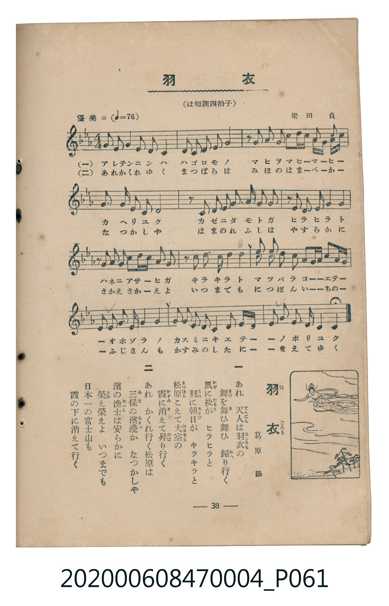

# 羽衣

<audio controls src="hagoromo.mp3"></audio>

- 詞：葛原しげる
- 曲：梁田貞
- 臺灣教育會公認《新定兒童唱歌》尋常科第四學年用（2020.006.0847.0004）

## 說明

原書資訊與歌詞全文（對應 P061.jpg，書頁 p. 38，參考教材第 4 首）：
調性與拍號：は短調四拍子（c 小調 4/4 拍）
速度指示：優美ニ（♩=76）

## 歌詞

```text
一
あれ　天人（てんにん）は羽衣（はごろも）の
舞（まひ）を舞ひ舞ひ　歸（かへ）り行（ゆ）く
風（かぜ）に袂（たもと）が　ヒラヒラと
羽（はね）に朝日（あさひ）が　キラキラと
松原（まつばら）こえて大空（おほぞら）の
霞（かすみ）に消（き）えて昇（のぼ）り行く

二
あれ　かくれ行く松原は
三保（みほ）の濱邊（はまべ）か　なつかしや
濱の漁士（れふし）は安らかに
榮（さか）え榮えよ　いつまでも
日本一（につぽんいち）の富士山（ふじさん）も
霞の下（した）に消えて行く
```

## ABC

```abc
X:1
T:羽衣
C:曲：梁田貞
M:4/4
L:1/16
Q:1/4=76
K:Cm
V:V1 name="Piano" snm="Pia"
[V:V1]
G2 A2 G4 F2 E2 D2 C2 | D2 E2 F2 D2 G8 | z2 G2 A2 G2 c2 d c A G F2 | E4 D2 C2 G4 G4 |
z2 C2 G2 G2 G3 A G2 F2 | z2 C2 F2 F2 G4 G4 | z2 G2 A2 G2 c2 d c G2 A2 | z2 c2 d2 c2 G4 c4 |
g2 f2 e2 c2 d c G2 A G F2 | E2 D2 C2 F2 G4 G4 | c2 G2 A2 G2 F2 G2 A G F2 | E2 G2 D3 E C4 C4 |
```

## TMD 檔案連結

- [主旋律 TMD 檔案](hagoromo.tmd)
- [鋼琴伴奏 TMD 檔案](hagoromo_piano.tmd)

## 分析

```text
================================================================================
📊 TMD Song Profile: [ 羽衣 ]
================================================================================
⏱  Duration:       0:37 (37.9s), 12 measures total
🎼 Key & Tempo:    首調基準 E,, != 76.0 BPM, <4/4>
   - 分析範圍：      由實際發聲的音符與和弦推測調性；播放脈絡另行呈現
🎤 人聲音域:    C4 (MIDI 60) – G5 (MIDI 79) [跨度: 19 個半音 / 1.6 個八度, 難度: challenging]
   - 最低音:  C4 in [Hagoromo #1 @ m.1, 0:02]
   - 最高音: G5 in [Hagoromo #1 @ m.9, 0:25]
   - 適合: soprano, mezzo-soprano, tenor, baritone
🏛  結構:      Hagoromo (37.9s)
⚡ 編曲密度:        Peak 1 軌道同時演奏
🗝  調性診斷：       C 調性不明確（流行色彩大調，未偵測到可信轉調）
   - 風格氣質:    流行大調（略帶和弦色彩音與裝飾副屬和弦）
   - 轉調歷程:    全曲維持單一推測調性（未偵測到可信轉調）
   - 核心骨幹音:  G, C, F, D, D#
   - 調性數值:    C 調性不明確 [相關度: 0.66, 穩定度: Ambiguous, 自然音純度: 84.1%]
   - 候選調性 (K-S): C 大調 (0.66), C 小調 (0.66), G 大調 (0.64)
   - 五度圈歷程:   +0
   - 各段落調性細節:
     • [Hagoromo #1]: C 調性不明確 (r: 0.66, 自然音純度: 84.1%, 調外音: D#, G#)

  [ 五度圈游移軌跡 ]
              [C ]*
         F            G  
      Bb               D  
      Eb               A  
         Ab           E  
            Db       B  
               F# 
     (* = active key center)

  [ 十二半音累積音高分佈 ]
     C  : ████████████              20.3%
     C# :                            0.0%
     D  : ██████                     9.9%
     D# : █████                      8.2%
     E  :                            0.0%
     F  : ███████                   12.1%
     F# :                            0.0%
     G  : ████████████████████████  41.8%
     G# : ████                       7.7%
     A  :                            0.0%
     A# :                            0.0%
     B  :                            0.0%
--------------------------------------------------------------------------------
Assignment 軌道音域：
  - Piano         : C4 – G5 (19 個半音 / 1.6 個八度, 82 個音符)
================================================================================
```


## 原書掃描頁




