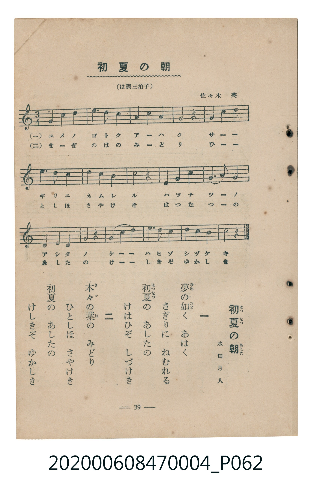

# 初夏の朝

<audio controls src="shoka_no_asa.mp3"></audio>

- 詞：水田月人
- 曲：佐々木英
- 臺灣教育會公認《新定兒童唱歌》尋常科第四學年用（2020.006.0847.0004）

## 說明

原書資訊與歌詞全文（對應 P062.jpg，書頁 p. 39，參考教材第 5 首）：
調性與拍號：は調三拍子（C 大調 3/4 拍）

## 歌詞

```text
一
夢（ゆめ）の如（ごと）く　あはく
さぎり（に）　ねむれる
初夏（はつなつ）の　あしたの
けはひぞ　しづけき

二
木々（きゞ）の葉（は）の　みどり
ひとしほ　さやけき
初夏の　あしたの
けしきぞ　ゆかしき
```

## 原書掃描頁



## 分析

```text
================================================================================
📊 TMD Song Profile: [ 初夏の朝 ]
================================================================================
⏱  Duration:       0:30 (30.0s), 16 measures total
🎼 Key & Tempo:    首調基準 C, != 96.0 BPM, <3/4>
   - 分析範圍：      由實際發聲的音符與和弦推測調性；播放脈絡另行呈現
🎤 人聲音域:    D4 (MIDI 62) – E5 (MIDI 76) [跨度: 14 個半音 / 1.2 個八度, 難度: moderate]
   - 最低音:  D4 in [ShokaNoAsa #1 @ m.9, 0:15]
   - 最高音: E5 in [ShokaNoAsa #1 @ m.6, 0:09]
   - 適合: soprano, mezzo-soprano, contralto, tenor, baritone, bass
🏛  結構:      ShokaNoAsa (30.0s)
⚡ 編曲密度:        Peak 1 軌道同時演奏
🗝  調性診斷：       C 大調（純淨自然大調，未偵測到可信轉調）
   - 風格氣質:    純淨自然大調（陽光明朗、易唱易記，無明顯調外色彩）
   - 轉調歷程:    全曲維持單一推測調性（未偵測到可信轉調）
   - 核心骨幹音:  C, E, G, D, B
   - 調性數值:    C 大調 [相關度: 0.92, 穩定度: High, 自然音純度: 100.0%]
   - 候選調性 (K-S): C 大調 (0.92), G 大調 (0.71), E 小調 (0.66)
   - 五度圈歷程:   +0
   - 各段落調性細節:
     • [ShokaNoAsa #1]: C 大調 (r: 0.92, 自然音純度: 100.0%)

  [ 五度圈游移軌跡 ]
              [C ]*
         F            G  
      Bb               D  
      Eb               A  
         Ab           E  
            Db       B  
               F# 
     (* = active key center)

  [ 十二半音累積音高分佈 ]
     C  : ████████████████████████  26.1%
     C# :                            0.0%
     D  : ███████████████           15.9%
     D# :                            0.0%
     E  : ██████████████████        19.3%
     F  : ██████                     6.8%
     F# :                            0.0%
     G  : ████████████████          17.0%
     G# :                            0.0%
     A  : ██████                     6.8%
     A# :                            0.0%
     B  : ███████                    8.0%
--------------------------------------------------------------------------------
Assignment 軌道音域：
  - Piano         : D4 – E5 (14 個半音 / 1.2 個八度, 40 個音符)
================================================================================
```

## ABC

```abc
X:1
T:初夏の朝
C:曲：佐々木英
M:3/4
L:1/16
Q:1/4=96
K:C
V:V1 name="Piano" snm="Pia"
[V:V1]
g4 a4 b4 | c6 b2 a4 | g4 a4 f4 | e8 z4 |
g4 c4 d4 | e6 d2 c4 | d4 c4 b4 | c8 z4 |
d4 e4 f4 | e6 g2 g4 | d4 e4 f4 | g8 z4 |
g4 c4 d4 | e6 d2 c4 | d4 c4 b4 | c8 z4 |
```

- [主旋律 TMD 檔案](shoka_no_asa.tmd)
- [鋼琴伴奏 TMD 檔案](shoka_no_asa_piano.tmd)
