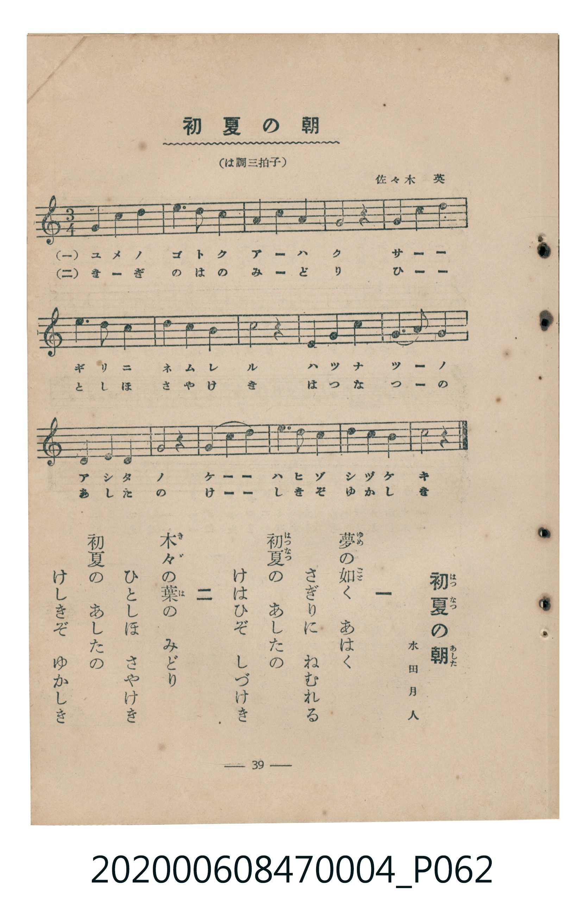

# 初夏の朝

> Re:Shōka 使用 AI 協助辨識與重建樂譜，可能會有錯誤。歡迎[回報](https://github.com/TMDLang/reshoka/issues)。

- **鋼琴伴奏版**：<br><audio controls src="shoka_no_asa.mp3"></audio>
- **NEUTRINO 歌聲合成版**：<br><audio controls src="shoka_no_asa_neutrino.mp3"></audio>

- 詞：水田月人
- 曲：佐々木英
- 臺灣教育會公認《新定兒童唱歌》尋常科第四學年用（2020.006.0847.0004）

## 說明

原書資訊與歌詞全文（對應 P062.jpg，書頁 p. 39，參考教材第 5 首）：
調性與拍號：は調三拍子（C 大調 3/4 拍）


## 歌詞

```text
一
夢（ゆめ）の如（ごと）く　あはく
さぎりに　ねむれる
初夏（はつなつ）の　あしたの
けはひぞ　しづけき

二
木々（きゞ）の葉（は）の　みどり
ひとしほ　さやけき
初夏の　あしたの
けしきぞ　ゆかしき
```

## ABC

<div class="abc-score" data-abc-src="shoka_no_asa.abc" aria-label="五線譜載入中"></div>

[下載 ABC 原始檔](shoka_no_asa.abc)

## TMD 檔案連結

- [主旋律 TMD 檔案](shoka_no_asa.tmd) [[在 TMD Studio 編輯](https://tmdlang.github.io/Tmd-TS/#tmd=s7IKdvYPcrWy4qpTUCpJTLdSSM7PyUlNLsnMz7MqzsjMK0nNjM_KTMmPL87Iz05Ugisry88pzU21Si9KTEmNN4k3MjAyiDcwMIs3sDAxBzIMTBBKi_NLi5JTrYqTM_Lzc-JLUitKkvLzsxHyBUX5Zal5iXlANQVFIBtTwIoQClLLMlNSQdKpKZkl-UWZiTlI7kgtKga7FWxJfElRYl5xclFmAcgDCFX5RSUZ-UC3FmRUWmVkFoMMSU7Mic9OzEPyUklGKtBHxamJxfl5xch6M9Mz86xKEjOBQQAKhvLE-NzEzLycxLwUdE_GFySmp1oFGJgZKXFpaSk87Zj7dEn_48Z1z-bMVdDS4lK0VbA047K3VXDmsjHWN7ED6X6xct77PbOebdjyfMqGZ3M6nuzaBTb02exNQOEneyc8bmh9NmfFi-6NYOEX7bueNy5-NnXmi6ZNz-Y0P21d82JV7-OGrmfTNjxdN-tp66Tnq5c-nbLx2dqexw3dTzd0P92x4_nyic_XrHk6e_bTtTue7gRas-L9ng5QfOkB40sPFF9AhoHJ-z2dSlxc-loKttQCXAoKCk_75j-bvePF5vYXK7pedLQD3QX079PWFc-mtQNd8XRD77P2TgVQeOllFaS_39MDVPxyQaNCgZ6CsSWQ-7S_-UVDM9C7z-ZOAHpCwVTh5bJpQJcCgwZk-otV-581LAeZ2937YuZ8oOjjxvVAwSc7OoEiT9dOANrhrPB0yXKgmAIwwBWAokDdXCC9T3Y0gB24ZBFQ0eOmtsdNjUApYFw9XdYEEmmc8rgRGFJAkf7HDQ2PG5uARgPZID2PG6c-bux73NT1uHE1WG7t46aGx009j5u6wUaCYx1sBlDHkseNq4AkxGyYSdMfN84HciGGTQSr2_S4cR5YGii3FCzYC3Hnrh4QBUwDwJQANrT3cRMwyYCMezERGBIga5BM3_-4cSXQaRCjgYauAJu4Gyw39XFTC9RouDvxuArI74W6Chg-jd0QEZA05YkDChS09Lm4gkFFi1--Y3GiVUBmYl6-Q41BTTXIGgUbCy07MANbulQApghgLL5Y2KOgYarwdEP_8_UNOvDEpIlFA9AykGE1wHSkq2AYBySMQESNgjGIAvPAojUKZjAFIAZEPQgawHlIusFm-hjWKDxuXgbkP25eCCb7wGofN20B63zc3AFkr4eKLYKa97i5HyoCkkHY8LhpK5QPglAbjIDijb0wnY1Q8xvXQfnroWyQ2H64qpVQ87pQzW_chGI-_jDe1UNOGGOEKTi0wGxzMB_MRLjJGEjCQxYW5GZgGimIm6DebV4FxN0QzzSDAuVx8wIwuQYqthrVw-CAftzcAiZBgQESA_EgpoEDEymYV0CDbzoQ74YG2VSQSBPYhMaJUDFYdMCCFRSNwNwOJldBxUA8iGng6CEQ2Ds6wYFtRlpgGwFNBgUgiCaQXEmNGKSwByXbx03bwSQoiYHCEBRyyAl3I5QPTljQcAeF8CSg3D6oGrAJza1gc0DqQWJrMe0Ex0QTNB5A5HxoiELSACLUQbGBZCdYNUh9LxDPg5rfBhYBpRiIPEbscdVycenaKSAKIwUgT5kLAA)]
- [鋼琴伴奏 TMD 檔案](shoka_no_asa_piano.tmd) [[在 TMD Studio 編輯](https://tmdlang.github.io/Tmd-TS/#tmd=s7IKdvYPcrWy4qpTUCpJTLdSyC8qychPL0osyKi0ysgsLskvykxOzInPTsxLVIIrKs4vLUpOjS9ITE-1CjAwM1Li0tJSeNox9-mS_seN657Nmft-T8fL7j3PJ2x5smfL06X9zzs73u_pVNDS4lK0VbA047K3VXDmsjHWN7EDGfli5bz3e2Y927Dl-ZQNz-Z0PNm1C2zTs9mbgMJP9k543ND6bM6KF90bwcIv2nc9b1z8bOrMF02bns1pftq65sWq3scNXc-mbXi6btbT1knPVy99OmXjs7U9jxu6n27ofrpjx_PlE5-vWfN09uyna3c83Qm0ZgXQfUYGRgZ6BgZmegYWJuZAhoEJ0IlKXFzBGfnZiX75jsWJVgGZiXn5QR4ONQY11VwKQGBjoWUHZuhrKdiiAwWgHU92NLxY2KOgYarwdEP_8_UNOgqg4NHLKkjXxKJBSx9sWI2CqYKugmEckDACETUKxiAKzAOL1iiYwRSAGBD1IGgA5yHpBpvpY1ij8Lh5GZD_uHkhmOwDq33ctAWs83FzB5C9Hiq2CGre4-Z-qAhIBmHD46atUD4IQm0wAoo39sJ0NkLNb1wH5a-HskFi--GqVkLN60I1v3ETivn4w3hXDzlhjBGm4NACs83BfDAT4SZjIAkPWViQm4FppCBugnq3eRUQd0M80wwKlMfNC8DkGqjYalQPgwP6cXMLmAQFBkgMxIOYBg5MpGBeAQ2-6UC8GxpkU0EiTWATGidCxWDRAQtWUDQ-blwCJldBxUA8iGng6CEQ2Ds6wYFtRlpgGwFNBgUgiCaQXEmNGKSwByXbx03bwSQoiYHCEBRyyAl3I5QPTljQcAeF8CSg3D6oGogJu8AkSD1IbC2mneCYaILGA4icDw1RSBpAhDooNpDsBKsGqe8F4nlQ89vAIqAUA5HHiD2uWsyyyAe5LDKBlkXAAIpXiDaMVTCNR7BBuEbBBMgxAXKAGC5jgKoB1QiINiMgxygXyDONx64RogyZAyvI4qFiuHRiuhGnZaAA0LVTQIRBtA9QAk3ECCyizAUA)]

## 分析

```text
================================================================================
📊 TMD Song Profile: [ 初夏の朝 ]
================================================================================
⏱  Duration:       0:30 (30.0s), 16 measures total
🎼 Key & Tempo:    首調基準 C, != 96.0 BPM, <3/4>
   - 分析範圍：      由實際發聲的音符與和弦推測調性；播放脈絡另行呈現
🎤 人聲音域:    D4 (MIDI 62) – E5 (MIDI 76) [跨度: 14 個半音 / 1.2 個八度, 難度: moderate]
   - 最低音:  D4 in [ShokaNoAsa #1 @ m.11, 0:18]
   - 最高音: E5 in [ShokaNoAsa #1 @ m.2, 0:01]
   - 適合: soprano, mezzo-soprano, contralto, tenor, baritone, bass
🏛  結構:      ShokaNoAsa (30.0s)
⚡ 編曲密度:        Peak 1 軌道同時演奏
🗝  調性診斷：       C 大調（純淨自然大調，未偵測到可信轉調）
   - 風格氣質:    純淨自然大調（陽光明朗、易唱易記，無明顯調外色彩）
   - 轉調歷程:    全曲維持單一推測調性（未偵測到可信轉調）
   - 核心骨幹音:  C, G, D, E, A
   - 調性數值:    C 大調 [相關度: 0.88, 穩定度: Moderate, 自然音純度: 100.0%]
   - 候選調性 (K-S): C 大調 (0.88), G 大調 (0.78), E 小調 (0.56)
   - 五度圈歷程:   +0
   - 各段落調性細節:
     • [ShokaNoAsa #1]: C 大調 (r: 0.88, 自然音純度: 100.0%)

  [ 五度圈游移軌跡 ]
              [C ]*
         F            G  
      Bb               D  
      Eb               A  
         Ab           E  
            Db       B  
               F# 
     (* = active key center)

  [ 十二半音累積音高分佈 ]
     C  : ████████████████████████  31.8%
     C# :                            0.0%
     D  : ███████████████           19.3%
     D# :                            0.0%
     E  : ███████████               14.8%
     F  :                            0.0%
     F# :                            0.0%
     G  : ██████████████████        23.9%
     G# :                            0.0%
     A  : ████                       5.7%
     A# :                            0.0%
     B  : ███                        4.5%
--------------------------------------------------------------------------------
Assignment 軌道音域：
  - Piano         : D4 – E5 (14 個半音 / 1.2 個八度, 40 個音符)
================================================================================
```


## 原書掃描頁




