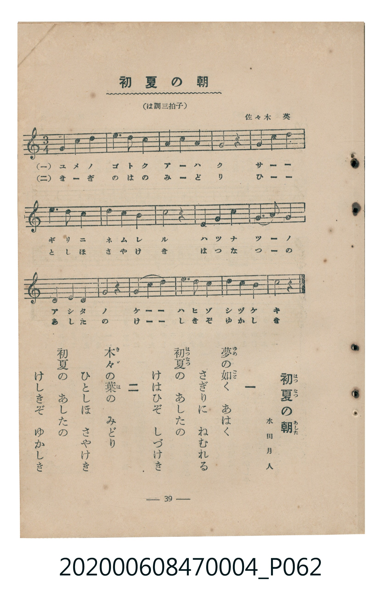

# 初夏の朝

> Re:Shōka 使用 AI 協助辨識與重建樂譜，可能會有錯誤。歡迎回報。

- **鋼琴伴奏版**：<br><audio controls src="shoka_no_asa.mp3"></audio>
- **NEUTRINO 歌聲合成版**：<br><audio controls src="shoka_no_asa_neutrino.mp3"></audio>

- 詞：水田月人
- 曲：佐々木英
- 臺灣教育會公認《新定兒童唱歌》尋常科第四學年用（2020.006.0847.0004）

## 說明

原書資訊與歌詞全文（對應 P062.jpg，書頁 p. 39，參考教材第 5 首）：
調性與拍號：は調三拍子（C 大調 3/4 拍）


## 歌詞

```text
一
夢（ゆめ）の如（ごと）く　あはく
さぎりに　ねむれる
初夏（はつなつ）の　あしたの
けはひぞ　しづけき

二
木々（きゞ）の葉（は）の　みどり
ひとしほ　さやけき
初夏の　あしたの
けしきぞ　ゆかしき
```

## ABC

```abc
X:1
T:初夏の朝
C:曲：佐々木英
M:3/4
L:1/16
Q:1/4=96
K:C
V:V1 name="Piano" snm="Pia"
[V:V1]
G4 c4 d4 | e6 d2 c4 | A4 c4 A4 | G8 z4 |
w: 1.~ユ メ ノ | ゴ ト ク | ア _ ハ | ク
w: 2.~き _ ぎ | の は の | み _ ど | り
G4 c4 d4 | e6 d2 c4 | d4 c4 B4 | c8 z4 |
w: 1.~サ _ _ | ギ リ ニ | ネ ム レ | ル
w: 2.~ひ _ _ | と し ほ | さ や け | き
E4 G4 c4 | G6 A2 G4 | D4 E4 D4 | G8 z4 |
w: 1.~ハ ツ ナ | ツ _ ノ | ア シ タ | ノ
w: 2.~は つ な | つ _ の | あ し た | の
G4 c4 d4 | e6 d2 c4 | d4 c4 B4 | c8 z4 |
w: 1.~ケ _ _ | ハ ヒ ゾ | シ ヅ ケ | キ
w: 2.~け _ _ | し き ぞ | ゆ か し | き
```

## TMD 檔案連結

- [主旋律 TMD 檔案](shoka_no_asa.tmd) [[在 TMD Studio 編輯](https://tmdlang.github.io/Tmd-TS/#tmd=s7IKdvYPcrWy4qpTUCpJTLdSSM7PyUlNLsnMz7MqzsjMK0nNjM_KTMmPL87Iz05Ugisry88pzU21Si9KTEmNN4k3MjAyiDcwMIs3sDAxBzIMTBBKi_NLi5JTrYqTM_Lzc-JLUitKkvLzsxHyBUX5Zal5iXlANQVFIBtTwIoQClLLMlNSQdKpKZkl-UWZiTlI7kgtKga7FWxJfElRYl5xclFmAcgDCFX5RSUZ-UC3FmRUWmVkFoMMSU7Mic9OzEPyUklGKtBHxamJxfl5xch6M9Mz86xKEjOBQQAKhvLE-NzEzLycxLwUJS4tLYWnHXOfLul_3Lju2Zy5ClpaXIq2CpZmXPa2Cs5cNsb6JnYgk16snPd-z6xnG7Y8n7Lh2ZyOJ7t2gS14NnsTUPjJ3gmPG1qfzVnxonsjWPhF-67njYufTZ35omnTsznNT1vXvFjV-7ih69m0DU_XzXraOun56qVPp2x8trbncUP30w3dT3fseL584vM1a57Onv107Y6nO4HWrHi_pwMUK3rAWNEDxQqQYWDyfk-nEheXvpaCLbUAl4KCwtO--c9m73ixuf3Fiq4XHe1AdwH9-7R1xbNp7UBXPN3Q-6y9UyHAwMxIL6sg_f2eHqDilwsaFQr0FIwtgdyn_c0vGpqB3n02dwLQEwqmCi-XTQO6FBg0INNfrNr_rGE5yNzu3hcz5wNFHzeuBwo-2dEJFHm6dgLQDmeFp0uWA8UUgAGuABQF6uYC6X2yowHswCWLgIoeN7U9bmoESgHj6umyJpBI45THjcCQAor0P25oeNzYBDQayAbpedw49XFj3-OmrseNq8Fyax83NTxu6nnc1A02EhzrYDOAOpY8blwFJCFmw0ya_rhxPpALMWwiWN2mx43zwNJAuaVgwV6IO3f1gChgGgCmBLChvY-bgEkGZNyLicCQAFmDZPr-x40rgU6DGA00dAXYxN1guamPm1qgRsPdicdVQH4v1FXA8GnshoiApClPHFCgoKXPxRUMKkD88h2LE60CMhPz8h1qDGqqQdYo2Fho2YEZ2NKlAjBFAGPxxcIeBQ1Thacb-p-vb9CBJyZNLBqAloEMqwGmI10FwzggYQQiahSMQRSYBxatUTCDKQAxIOpB0ADOQ9INNtPHsEbhcfMyIP9x80Iw2QdW-7hpC1jn4-YOIHs9VGwR1LzHzf1QEZAMwobHTVuhfBCE2mAEFG_shelshJrfuA7KXw9lg8T2w1WthJrXhWp-4yYU8_GH8a4ecsIYI0zBoQVmm4P5YCbCTcZAEh6ysCA3A9NIQdwE9W7zKiDuhnimGRQoj5sXgMk1ULHVqB4GB_Tj5hYwCQoMkBiIBzENHJhIwbwCGnzTgXg3NMimgkSawCY0ToSKwaIDFqygaATmdjC5CioG4kFMA0cPgcDe0QkObDPSAtsIaDIoAEE0geRKasQghT0o2T5u2g4mQUkMFIagkENOuBuhfHDCgoY7KIQnAeX2QdWATWhuBZsDUg8SW4tpJzgmmqDxACLnQ0MUkgYQoQ6KDSQ7wapB6nuBeB7U_DawCCjFQOQxYo-rlotL104BURgpAHnKXAA)]
- [鋼琴伴奏 TMD 檔案](shoka_no_asa_piano.tmd) [[在 TMD Studio 編輯](https://tmdlang.github.io/Tmd-TS/#tmd=s7IKdvYPcrWy4tLSUnjaMffpkv7HjeuezZn7fk_Hy-49zydsebJny9Ol_c87O97v6VTQ0uJStFWwNOOyt1Vw5rIx1jex46pTUHqxct77PbOebdjyfMqGZ3M6nuzapQQSfjZ7E1D4yd4Jjxtan81Z8aJ7I1j4Rfuu542Ln02d-aJp07M5zU9b17xY1fu4oevZtA1P18162jrp-eqlT6dsfLa253FD99MN3U937Hi-fOLzNWuezp79dO2OpzuB1qwAus_IwMhAz8DATM_AwsQcyDAwATpRiYsrOCM_O9Ev37E40SogMzEvP8jDocagpppLAQhsLLTswAx9LQVbdKAAtOPJjoYXC3sUNEwVnm7of76-QUchwMDMSC-rIF0TiwYtfbBhNQqmCroKhnFAwghE1CgYgygwDyxao2AGUwBiQNSDoAGch6QbbKaPYY3C4-ZlQP7j5oVgsg-s9nHTFrDOx80dQPZ6qNgiqHmPm_uhIiAZhA2Pm7ZC-SAItcEIKN7YC9PZCDW_cR2Uvx7KBonth6taCTWvC9X8xk0o5uMP41095IQxRpiCQwvMNgfzwUyEm4yBJDxkYUFuBqaRgrgJ6t3mVUDcDfFMMyhQHjcvAJNroGKrUT0MDujHzS1gEhQYIDEQD2IaODCRgnkFNPimA_FuaJBNBYk0gU1onAgVg0UHLFhB0fi4cQmYXAUVA_EgpoGjh0Bg7-gEB7YZaYFtBDQZFIAgmkByJTVikMIelGwfN20Hk6AkBgpDUMghJ9yNUD44YUHDHRTCk4By-6BqwCY0t4LNAakHia3FtBMcE03QeACR86EhCkkDiFAHxQaSnWDVIPW9QDwPan4bWASUYiDyGLHHVYtZFvkgl0Um0LIIGEDxCtGGsQqm8Qg2CNcomAA5JkAOEMNlDFA1oBoB0WYE5BjlAnmm8dg1QpQhc2AFWTxUDJdOTDfitAwUALp2CogwiPYBSqCJGIFFlLkA)]

## 分析

```text
================================================================================
📊 TMD Song Profile: [ 初夏の朝 ]
================================================================================
⏱  Duration:       0:30 (30.0s), 16 measures total
🎼 Key & Tempo:    首調基準 C, != 96.0 BPM, <3/4>
   - 分析範圍：      由實際發聲的音符與和弦推測調性；播放脈絡另行呈現
🎤 人聲音域:    D4 (MIDI 62) – E5 (MIDI 76) [跨度: 14 個半音 / 1.2 個八度, 難度: moderate]
   - 最低音:  D4 in [ShokaNoAsa #1 @ m.11, 0:18]
   - 最高音: E5 in [ShokaNoAsa #1 @ m.2, 0:01]
   - 適合: soprano, mezzo-soprano, contralto, tenor, baritone, bass
🏛  結構:      ShokaNoAsa (30.0s)
⚡ 編曲密度:        Peak 1 軌道同時演奏
🗝  調性診斷：       C 大調（純淨自然大調，未偵測到可信轉調）
   - 風格氣質:    純淨自然大調（陽光明朗、易唱易記，無明顯調外色彩）
   - 轉調歷程:    全曲維持單一推測調性（未偵測到可信轉調）
   - 核心骨幹音:  C, G, D, E, A
   - 調性數值:    C 大調 [相關度: 0.88, 穩定度: Moderate, 自然音純度: 100.0%]
   - 候選調性 (K-S): C 大調 (0.88), G 大調 (0.78), E 小調 (0.56)
   - 五度圈歷程:   +0
   - 各段落調性細節:
     • [ShokaNoAsa #1]: C 大調 (r: 0.88, 自然音純度: 100.0%)

  [ 五度圈游移軌跡 ]
              [C ]*
         F            G  
      Bb               D  
      Eb               A  
         Ab           E  
            Db       B  
               F# 
     (* = active key center)

  [ 十二半音累積音高分佈 ]
     C  : ████████████████████████  31.8%
     C# :                            0.0%
     D  : ███████████████           19.3%
     D# :                            0.0%
     E  : ███████████               14.8%
     F  :                            0.0%
     F# :                            0.0%
     G  : ██████████████████        23.9%
     G# :                            0.0%
     A  : ████                       5.7%
     A# :                            0.0%
     B  : ███                        4.5%
--------------------------------------------------------------------------------
Assignment 軌道音域：
  - Piano         : D4 – E5 (14 個半音 / 1.2 個八度, 40 個音符)
================================================================================
```


## 原書掃描頁




