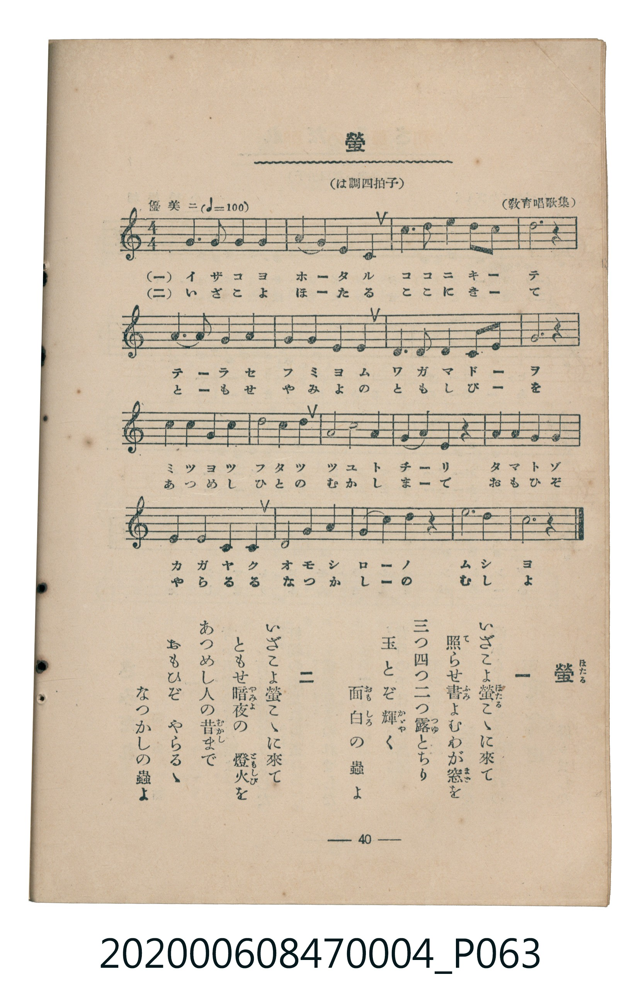

# 螢

> Re:Shōka 使用 AI 協助辨識與重建樂譜，可能會有錯誤。歡迎[回報](https://github.com/TMDLang/reshoka/issues)。

- **鋼琴伴奏版**：<br><audio controls src="hotaru.mp3"></audio>
- **NEUTRINO 歌聲合成版**：<br><audio controls src="hotaru_neutrino.mp3"></audio>

- 教育唱歌集
- 臺灣教育會公認《新定兒童唱歌》尋常科第四學年用（2020.006.0847.0004）

## 說明

原書資訊與歌詞全文（對應 P063.jpg，書頁 p. 40，參考教材第 6 首）：
調性與拍號：は調四拍子（C 大調 4/4 拍）
速度指示：優美ニ（♩=100）
出處註記：（教育唱歌集）


## 歌詞

```text
一
いざこよ螢（ほたる）こゝに來（き）て
照（て）らせ書（ふみ）よむわが窓（まど）を
三（み）つ四（よ）つ二（ふた）つ露（つゆ）とちり
玉（たま）とぞ輝（かゞや）く
面白（おもしろ）の蟲（むし）よ

二
いざこよ螢こゝに來て
ともせ暗夜（やみよ）の　燈火（ともしび）を
あつめし人（ひと）の昔（むかし）まで
おもひぞ　やらるゝ
なつかしの蟲よ
```

## ABC

<div class="abc-score" data-abc-src="hotaru.abc" aria-label="五線譜載入中"></div>

[下載 ABC 原始檔](hotaru.abc)

## TMD 檔案連結

- [主旋律 TMD 檔案](hotaru.tmd) [[在 TMD Studio 編輯](https://tmdlang.github.io/Tmd-TS/#tmd=s7IKdvYPcrWy4qpTUCpJTLdSSM7PyUlNLsnMz7MqzsjMK0nNjM_KTMmPL87Iz05Ugisry88pzU21Si9KTEmNN4k3MjAyiDcwMIs3sDAxBzIMTBBKi_NLi5JTrYqTM_Lzc-JLUitKkvLzsxHyBUX5Zal5iXlANQVFIBtTwIoQClLLMlNSQdKpKZkl-UWZiTlI7kgtKga7FWxJfElRYl5xclFmAcgDCFX5RSUZ-UC3FmRUWmVkFoMMSU7Mic9OzEPyUklGKtBHiXmZucgWAJWmZ-ZZ5aZmZmVicTzU3oLE9FSrAAMzYyUuLS2FF_MWKWhpcSnaKhgaGHDZ2yo4c9mY6JvYgXQ9mzrzRdOmp1M2Plvb83J2G9ikF-27njcuhsg8m9P8tHXNi1W9jxu6nk3b8HTdrKetk56vXgrR8bih--mG7qc7djxfPvH5mjVPZ89-unbH051bnk9Z8X5PBygW9ICxoAeKBSDDwOT9nk4lLi59LQVbagEuBQWFp33zn83e8WJz-4sVXS862oHuerFy3tPWFc-mtQNd8XRD77P2TgVQaOhlFaS_39MDVPxyQaNCgZ6CiQGQ-7S_-UVDM9C7z-ZOAHpCwUzh5bJpQJe-3zMLZPqLVfufNSwHmdvd-2LmfKDo48b1QEGgZ4EiT9dOANrhrPB0yXKgmAIwWBWAokDdIK0vG-Y_3bXsWU_78yW7gPqetqx6vq_vcXM3UMejmSttgbEBVfi0fdeLmVNfrNj9YsUMoEKgPFq8gNSBFD7Z0QCiHje2PG6c9rhx8uOmDmDsAtU_btz9uHH-4yag2Z1g8bmPG1c_2QfUCJQCuedx4zKQzuety8FCy0BCTUDR2cDQAItsfdy4HyzY8bip4XFT_-PGnuerJoOl9j1uXAmWmgRxAzBogKJg1Y1LgOEA4jZ1QLhPdvXAjAOGFUjk5ZxNYJElj5tA_njcuOJx48LHTV1g5_RBzJoPtAQmN-_Fnrlgwe7HTfMeN7WAxfvB4Tl30fOZe8FyXY-bmh43Tn_cBPHbuhfzwZYAXd44HeILSHjt6sESXsgBBA0XkM0gE2c_mzX96ZI5YLOAevbD_LXucUPD8_aO542rwdZDFE9_3LgZES6PG4FCQE82AiWe7AJGOFDdJqBSiP5nM6bAHNgNdSMoXJdDdEK8A1Q9D2gPyGZg1DQB_T8XIr0KZDBYH8SrIO8BJSjPPlCgoKXPxeWRX5JYVGoVkJmYl-9QY1BTDbJCwcZCyw7MwJZrFYD5BZgkXyzsUdAwUXi6of_5-gYdeFbTxKIBaBHIsBoFUwVdIDQF0yBcA8x3EJYxEBuCRQzjwIqM4hSMQSwgDRSpAdEgYQg0AKkEm-ljWKPwuGkJWPRx0zYg3gxiNa8Am_W4eTZUx-Om_WDx1RBxsCqQ6GagWDeYtRaqow27PUZAucYWiK7GaUA8GayrA6KrcTfMnsb5YHGQmSBxkCqQ6GQgBtkNzJdQmWUY9uAP8V095IQ4KHx1gSQojEFsSBzAQhyEgUELCXAwbQgUg8UT1rCGh8_j5pVgn4J8DhKfChYD-x4c-o-bF0Bl1kPDeg2QPQ8s0wmV2YQnrEFmQPQ1gcMNFJOgmAPFATCPwkMfmDmgIQrRAVIPzDNgGVAsg_RMIjGsd3SCw9qUtLAGp1wwAQo_MAMp3YL5YB4sVqBiiGgBsUBRAnYimAfLHuDMghQJkGAGBwU0sEFsWDQgJ3iYOCTpgkRACe9xMzThNjfCxVfBbYbphUQWOJCb9qFFDyRSQBkPWPiB2aAgB8nAIhUSIfDoaWqAi4MzHFw9yGSI-HKECxq7wCZDbAGZCCwlwS7AG3HAaomciINlBVABBCmEIFkCEu6I-EFEIcSV4AIKBqFRCy2-sJdT4BIAmA9AwQoJOlDeAMmAAh8SDYvA4tsh4s2gUgki3ocIHHDOgkGEWliOwZKbILmmCZTvIGUTooSC2wyJTHDkgMRB0QMRB0UgLGHAIhEiA41CcD5EtbmWi0vXTgFSuygAWcpcAA)]
- [鋼琴伴奏 TMD 檔案](hotaru_piano.tmd) [[在 TMD Studio 編輯](https://tmdlang.github.io/Tmd-TS/#tmd=s7IKdvYPcrWy4qpTUCpJTLdSyC8qychPL0osyKi0ysgsLskvykxOzInPTsxLVIIrKs4vLUpOjS9ITE-1CjAwM1bi0tJSeDFv0fs9HS-79zyfsOXJni1Pl_Y_7-x4v6dTQUuLS9FWwdDAgMveVsGZy8ZE38QOZNSzqTNfNG16OmXjs7U9L2e3gY1_0b7reeNiiMyzOc1PW9e8WNX7uKHr2bQNT9fNeto66fnqpRAdjxu6n27ofrpjx_PlE5-vWfN09uyna3c83bnl-ZQVQGcYGRgZ6BkYmOkZWJiYAxkGJkCXKHFxeeSXJBaVWgVkJublB3k41BjUVHMpAIGNhZYdmKGvpWCLDhSA5j_Z0fBiYY-ChonC0w39z9c36CiAPK6XVZCuiUWDlj7YsBoFUwVdIDQF0yBco2AGZRkDsSFYxDAOrMgoTsEYxALSQJEaEA0ShkADkEqwmT6GNQqPm5aARR83bQPizSBW8wqwWY-bZ0N1PG7aDxZfDREHqwKJbgaKdYNZa6E62rDbYwSUa2yB6GqcBsSTwbo6ILoad8PsaZwPFgeZCRIHqQKJTgZikN2PG3uhMssw7MEf4rt6yAlxUPjqAklQGIPYkDiAhTgIA4MWEuBg2hAoBosnrGEND5_HzSvBPgX5HCQ-FSwG9j049B83L4DKrIeG9Rogex5YphMqswlPWIPMgOhrAocbKCZBMQeKg8eN4NgEh_7jxnXQEIXoAKl_3DgdLAOKZZCeSSSG9Y5OcFibkhbW4JQLJkDhB2YgpVswH8yDxQpUDBEtIBYoSsBOBPNg2QOcWZAiARLM4KCABjaIDYsG5AQPE4ckXZAIKOE9boYm3OZGuPgquM0wvZDIAgdy0z606IFECijjPW4CmQEJcpAMLFIhEQKPnqYGuDg4w8HVg0yGiC9HuKCxC2wyxBaQiY8bQa4hEHHAYo-ciINlBVABBCmEIFkCEu6I-EFEIcSV4AIKBqFRCy2-sJdT4BIAmA9AwQoJOlDeAMmAAh8SDYvA4tsh4s2gUgki3ocIHHDOgkGEWliOwZKbILmmCZTvIGUTooSC2wyJTHDkgMRB0QMRB0UgLGHAIhEiA41CcD5EtbkWtXLxQa5cTKCVCzCw4hWiDWNhVI2CCRofXd40HsgyjY8FMwygHoRoM4EoA1IEtKGbjDAGpzaQCIiG2wSlIFogNgONQXYHyABijEV2L9RTyBogtqI6Fhi0unYKkNCN9gGKI_GMwDxlLgA)]

## 分析

```text
================================================================================
📊 TMD Song Profile: [ 螢 ]
================================================================================
⏱  Duration:       0:43 (43.2s), 18 measures total
🎼 Key & Tempo:    首調基準 C, != 100.0 BPM, <4/4>
   - 分析範圍：      由實際發聲的音符與和弦推測調性；播放脈絡另行呈現
🎤 人聲音域:    C4 (MIDI 60) – E5 (MIDI 76) [跨度: 16 個半音 / 1.3 個八度, 難度: moderate]
   - 最低音:  C4 in [Hotaru #1 @ m.2, 0:04]
   - 最高音: E5 in [Hotaru #1 @ m.3, 0:06]
   - 適合: soprano, mezzo-soprano, contralto, tenor, baritone, bass
🏛  結構:      Hotaru (43.2s)
⚡ 編曲密度:        Peak 1 軌道同時演奏
🗝  調性診斷：       G 調性不明確（純淨自然大調，未偵測到可信轉調）
   - 風格氣質:    純淨自然大調（陽光明朗、易唱易記，無明顯調外色彩）
   - 轉調歷程:    全曲維持單一推測調性（未偵測到可信轉調）
   - 核心骨幹音:  G, C, D, A, E
   - 調性數值:    G 調性不明確 [相關度: 0.81, 穩定度: Ambiguous, 自然音純度: 100.0%]
   - 候選調性 (K-S): G 大調 (0.81), C 大調 (0.80), A 小調 (0.59)
   - 五度圈歷程:   +1
   - 各段落調性細節:
     • [Hotaru #1]: G 調性不明確 (r: 0.81, 自然音純度: 100.0%)

  [ 五度圈游移軌跡 ]
               C  
         F           [G ]*
      Bb               D  
      Eb               A  
         Ab           E  
            Db       B  
               F# 
     (* = active key center)

  [ 十二半音累積音高分佈 ]
     C  : ████████████████████      21.6%
     C# :                            0.0%
     D  : ████████████████████      20.9%
     D# :                            0.0%
     E  : ███████████████           15.7%
     F  :                            0.0%
     F# :                            0.0%
     G  : ████████████████████████  25.4%
     G# :                            0.0%
     A  : ████████████████          16.4%
     A# :                            0.0%
     B  :                            0.0%
--------------------------------------------------------------------------------
Assignment 軌道音域：
  - Piano         : C4 – E5 (16 個半音 / 1.3 個八度, 58 個音符)
================================================================================
```


## 原書掃描頁




