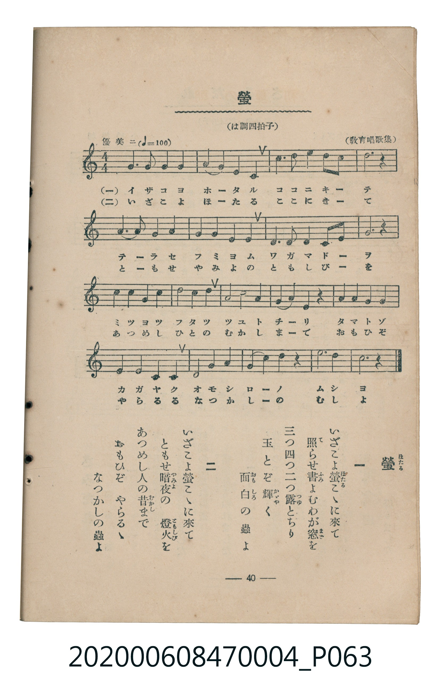

# 螢

<audio controls src="hotaru.mp3"></audio>

- 教育唱歌集
- 臺灣教育會公認《新定兒童唱歌》尋常科第四學年用（2020.006.0847.0004）

## 說明

原書資訊與歌詞全文（對應 P063.jpg，書頁 p. 40，參考教材第 6 首）：
調性與拍號：は調四拍子（C 大調 4/4 拍）
速度指示：優美ニ（♩=100）
出處註記：（教育唱歌集）

## 歌詞

```text
一
いざこよ螢（ほたる）こゝに來（き）て
照（て）らせ書（ふみ）よむわが窓（まど）を
三（み）つ四（よ）つ二（ふた）つ露（つゆ）とちり
玉（たま）とぞ輝（かゞや）く
面白（おもしろ）の蟲（むし）よ

二
いざこよ螢こゝに來て
ともせ暗夜（やみよ）の　燈火（ともしび）を
あつめし人（ひと）の昔（むかし）まで
おもひぞ　やらるゝ
なつかしの蟲よ
```

## ABC

```abc
X:1
T:螢
C:TMD (Chen, Chih-Han / aguai)
M:4/4
L:1/16
Q:1/4=100
K:C
V:V1 name="Piano" snm="Pia"
[V:V1]
G6 G2 G4 G4 | A4 G4 E4 C4 | c6 c2 c4 d2 c2 | d12 z4 |
A6 A2 G4 G4 | G4 F4 E4 G4 | D6 D2 E4 F2 G2 | A12 z4 |
c2 c2 c2 c2 d4 c2 A2 | G8 A4 G4 | E4 G4 E4 z4 | G4 G4 A4 G4 |
E4 G4 A4 G4 | D8 G4 A4 | G4 c4 B4 z4 | d12 d4 |
c12 z4 |
```

## TMD 檔案連結

- [主旋律 TMD 檔案](hotaru.tmd)
- [鋼琴伴奏 TMD 檔案](hotaru_piano.tmd)

## 分析

```text
================================================================================
📊 TMD Song Profile: [ 螢 ]
================================================================================
⏱  Duration:       0:40 (40.8s), 17 measures total
🎼 Key & Tempo:    首調基準 C, != 100.0 BPM, <4/4>
   - 分析範圍：      由實際發聲的音符與和弦推測調性；播放脈絡另行呈現
🎤 人聲音域:    C4 (MIDI 60) – D5 (MIDI 74) [跨度: 14 個半音 / 1.2 個八度, 難度: moderate]
   - 最低音:  C4 in [Hotaru #1 @ m.2, 0:04]
   - 最高音: D5 in [Hotaru #1 @ m.3, 0:06]
   - 適合: soprano, mezzo-soprano, contralto, tenor, baritone, bass
🏛  結構:      Hotaru (40.8s)
⚡ 編曲密度:        Peak 1 軌道同時演奏
🗝  調性診斷：       G 大調（純淨自然大調，未偵測到可信轉調）
   - 風格氣質:    純淨自然大調（陽光明朗、易唱易記，無明顯調外色彩）
   - 轉調歷程:    全曲維持單一推測調性（未偵測到可信轉調）
   - 核心骨幹音:  G, D, C, A, E
   - 調性數值:    G 大調 [相關度: 0.87, 穩定度: High, 自然音純度: 97.6%]
   - 候選調性 (K-S): G 大調 (0.87), C 大調 (0.75), G 小調 (0.61)
   - 五度圈歷程:   +1
   - 各段落調性細節:
     • [Hotaru #1]: G 大調 (r: 0.87, 自然音純度: 97.6%, 調外音: F)

  [ 五度圈游移軌跡 ]
               C  
         F           [G ]*
      Bb               D  
      Eb               A  
         Ab           E  
            Db       B  
               F# 
     (* = active key center)

  [ 十二半音累積音高分佈 ]
     C  : █████████████             17.5%
     C# :                            0.0%
     D  : ███████████████           19.8%
     D# :                            0.0%
     E  : ███████                    9.5%
     F  : ██                         2.4%
     F# :                            0.0%
     G  : ████████████████████████  32.5%
     G# :                            0.0%
     A  : ████████████              16.7%
     A# :                            0.0%
     B  : █                          1.6%
--------------------------------------------------------------------------------
Assignment 軌道音域：
  - Piano         : C4 – D5 (14 個半音 / 1.2 個八度, 58 個音符)
================================================================================
```


## 原書掃描頁




