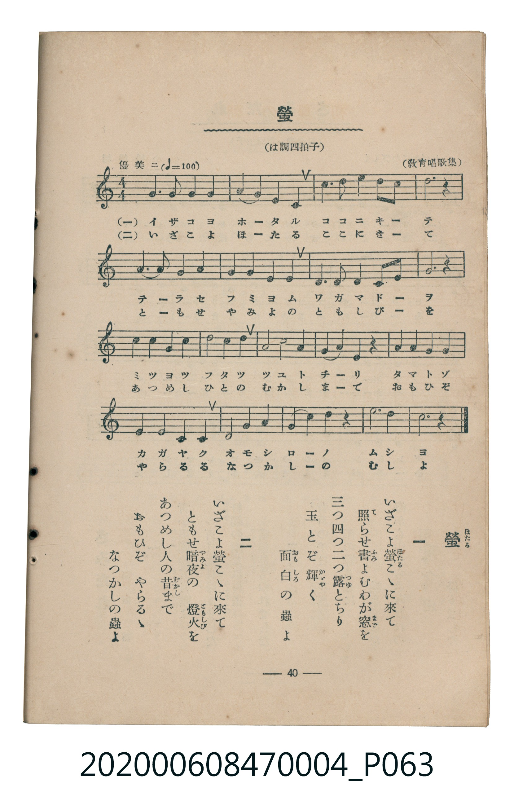

# 螢

> Re:Shōka 使用 AI 協助辨識與重建樂譜，可能會有錯誤。歡迎回報。

- **NEUTRINO 歌聲合成版**：<br><audio controls src="hotaru_neutrino.mp3"></audio>
- **鋼琴伴奏版**：<br><audio controls src="hotaru.mp3"></audio>


- 教育唱歌集
- 臺灣教育會公認《新定兒童唱歌》尋常科第四學年用（2020.006.0847.0004）

## 說明

原書資訊與歌詞全文（對應 P063.jpg，書頁 p. 40，參考教材第 6 首）：
調性與拍號：は調四拍子（C 大調 4/4 拍）
速度指示：優美ニ（♩=100）
出處註記：（教育唱歌集）


## 歌詞

```text
一
いざこよ螢（ほたる）こゝに來（き）て
照（て）らせ書（ふみ）よむわが窓（まど）を
三（み）つ四（よ）つ二（ふた）つ露（つゆ）とちり
玉（たま）とぞ輝（かゞや）く
面白（おもしろ）の蟲（むし）よ

二
いざこよ螢こゝに來て
ともせ暗夜（やみよ）の　燈火（ともしび）を
あつめし人（ひと）の昔（むかし）まで
おもひぞ　やらるゝ
なつかしの蟲よ
```

## ABC

```abc
X:1
T:螢
M:4/4
L:1/16
Q:1/4=100
K:C
V:V1 name="Piano" snm="Pia"
[V:V1]
G6 G2 G4 G4 | A4 G4 E4 C4 | c6 d2 e4 d2 c2 | d12 z4 |
w: 1.~イ ザ コ ヨ | ホ _ タ ル | コ コ ニ キ _ | テ
w: 2.~い ざ こ よ | ほ _ た る | こ こ に き _ | て
A6 A2 G4 A4 | G4 G4 E4 E4 | D6 D2 D4 C2 E2 | G12 z4 |
w: 1.~テ _ ラ セ | フ ミ ヨ ム | ワ ガ マ ド _ | ヲ
w: 2.~と _ も せ | や み よ の | と も し び _ | を
c4 c4 G4 c4 | d8 c4 d4 | A8 c4 A4 | G4 A4 E4 z4 |
w: 1.~ミ ツ ヨ ツ | フ タ ツ | ツ ユ ト | チ _ リ
w: 2.~あ つ め し | ひ と の | む か し | ま _ で
A4 A4 G4 G4 | E4 E4 C4 C4 | D8 G4 A4 | G4 c4 d4 z4 |
w: 1.~タ マ ト ゾ | カ ガ ヤ ク | オ モ シ | ロ _ ノ
w: 2.~お も ひ ぞ | や ら る る | な つ か | し _ の
e12 d4 | c12 z4 |
w: 1.~ム シ | ヨ
w: 2.~む し | よ
```

## TMD 檔案連結

- [主旋律 TMD 檔案](hotaru.tmd) [[在 TMD Studio 編輯](https://tmdlang.github.io/Tmd-TS/#tmd=s7IKdvYPcrWy4qpTUCpJTLdSSM7PyUlNLsnMz7MqzsjMK0nNjM_KTMmPL87Iz05Ugisry88pzU21Si9KTEmNN4k3MjAyiDcwMIs3sDAxBzIMTBBKi_NLi5JTrYqTM_Lzc-JLUitKkvLzsxHyBUX5Zal5iXlANQVFIBtTwIoQClLLMlNSQdKpKZkl-UWZiTlI7kgtKga7FWxJfElRYl5xclFmAcgDCFX5RSUZ-UC3FmRUWmVkFoMMSU7Mic9OzEPyUklGKtBHiXmZucgWAJWmZ-ZZ5aZmZmUiOV5LS-HFvEUKWlpcirYKhgYGXPa2Cs5cNib6JnYgrc-mznzRtOnplI3P1va8nN0GNu5F-67njYshMs_mND9tXfNiVe_jhq5n0zY8XTfraeuk56uXQnQ8buh-uqH76Y4dz5dPfL5mzdPZs5-u3fF055bnU1a839MBCms9YFjrgcIayDAweb-nU4mLS19LwZZagEtBQeFp3_xns3e82Nz-YkXXi452oLterJz3tHXFs2ntQFc83dD7rL1TIcDAzFgvqyD9_Z4eoOKXCxoVCvQUTAyA3Kf9zS8amoHefTZ3AtATCmYKL5dNA7r0_Z5ZINNfrNr_rGE5yNzu3hcz5wNFHzeuBwoCPQsUebp2AtAOZ4WnS5YDxRSAwaoAFAXqBml92TD_6a5lz3rany_ZBdT3tGXV8319j5u7gToezVxpC4wNqMKn7btezJz6YsXuFytmABUC5dHiBaQOpPDJjgYQ9bix5XHjtMeNkx83dQBjF6j-cePux43zHzcBze4Ei8993Lj6yT6gRqAUyD2PG5eBdD5vXQ4WWgYSagKKzgaGBlhk6-PG_WDBjsdNDY-b-h839jxfNRkste9x40qw1CSIG4BBAxQFq25cAgwHELepA8J9sqsHZhwwrEAiL-dsAossedwE8sfjxhWPGxc-buoCO6cPYtZ8oCUwuXkv9swFC3Y_bpr3uKkFLN4PDs-5i57P3AuW63rc1PS4cfrjJojf1r2YD7YE6PLG6RBfQMJrVw-W8EIOIGi4gGwGmTj72azpT5fMAZsF1LMf5q91jxsanrd3PG9cDbYeonj648bNiHB53AgUAnqyESjxZBcwwoHqNgGVQvQ_mzEF5sBuqBtB4bocohPiHaDqeUB7QDYDo6YJ6P-5EOlVIIPB-iBeBXkPKEF59oECBS19Li6P_JLEolKrgMzEvHyHGoOaapAVCjYWWnZgBrZcqwDML8Ak-WJhj4KGicLTDf3P1zfowLOaJhYNQItAhtUomCroAqEpmAbhGmC-g7CMgdgQLGIYB1ZkFKdgDGIBaaBIDYgGCUOgAUgl2EwfwxqFx01LwKKPm7YB8WYQq3kF2KzHzbOhOh437QeLr4aIg1WBRDcDxbrBrLVQHW3Y7TECyjW2QHQ1TgPiyWBdHRBdjbth9jTOB4uDzASJg1SBRCcDMchuYL6EyizDsAd_iO_qISfEQeGrCyRBYQxiQ-IAFuIgDAxaSICDaUOgGCyesIY1PHweN68E-xTkc5D4VLAY2Pfg0H_cvAAqsx4a1muA7HlgmU6ozCY8YQ0yA6KvCRxuoJgExRwoDoB5FB76wMwBDVGIDpB6YJ4By4BiGaRnEolhvaMTHNampIU1OOWCCVD4gRlI6RbMB_NgsQIVQ0QLiAWKErATwTxY9gBnFqRIgAQzOCiggQ1iw6IBOcHDxCFJFyQCSniPm6EJt7kRLr4KbjNMLySywIHctA8teiCRAsp4wMIPzAYFOUgGFqmQCIFHT1MDXByc4eDqQSZDxJcjXNDYBTYZYgvIRGApCXYB3ogDVkvkRBwsK4AKIEghBMkSkHBHxA8iCiGuBBdQMAiNWmjxhb2cApcAwHwAClZI0IHyBkgGFPiQaFgEFt8OEW8GlUoQ8T5E4IBzFgwi1MJyDJbcBMk1TaB8BymbECUU3GZIZIIjByQOih6IOCgCYQkDFokQGWgUgvMhqs21XFy6dgqQ2kUByFLmAgA)]
- [鋼琴伴奏 TMD 檔案](hotaru_piano.tmd) [[在 TMD Studio 編輯](https://tmdlang.github.io/Tmd-TS/#tmd=s7IKdvYPcrWy4tLSUngxb9H7PR0vu_c8n7DlyZ4tT5f2P-_seL-nU0FLi0vRVsHQwIDL3lbBmcvGRN_EjqtOQenZ1JkvmjY9nbLx2dqel7PblEBiL9p3PW9cDJF5Nqf5aeuaF6t6Hzd0PZu24em6WU9bJz1fvRSi43FD99MN3U937Hi-fOLzNWuezp79dO2Opzu3PJ-yAugMIwMjAz0DAzM9AwsTcyDDwAToEiUuLo_8ksSiUquAzMS8_CAPhxqDmmouBSCwsdCyAzP0tRRs0YEC0PwnOxpeLOxR0DBReLqh__n6Bh2FAAMzY72sgnRNLBq09MGG1SiYKugCoSmYBuEaBTMoyxiIDcEihnFgRUZxCsYgFpAGitSAaJAwBBqAVILN9DGsUXjctAQs-rhpGxBvBrGaV4DNetw8G6rjcdN-sPhqiDhYFUh0M1CsG8xaC9XRht0eI6BcYwtEV-M0IJ4M1tUB0dW4G2ZP43ywOMhMkDhIFUh0MhCD7H7c2AuVWYZhD_4Q39VDToiDwlcXSILCGMSGxAEsxEEYGLSQAAfThkAxWDxhDWt4-DxuXgn2KcjnIPGpYDGw78Gh_7h5AVRmPTSs1wDZ88AynVCZTXjCGmQGRF8TONxAMQmKOVAcPG4ExyY49B83roOGKEQHSP3jxulgGVAsg_RMIjGsd3SCw9qUtLAGp1wwAQo_MAMp3YL5YB4sVqBiiGgBsUBRAnYimAfLHuDMghQJkGAGBwU0sEFsWDQgJ3iYOCTpgkRACe9xMzThNjfCxVfBbYbphUQWOJCb9qFFDyRSQBnvcRPIDEiQg2RgkQqJEHj0NDXAxcEZDq4eZDJEfDnCBY1dYJMhtoBMfNwIcg2BiAMWe-REHCwrgAogSCEEyRKQcEfEDyIKIa4EF1AwCI1aaPGFvZwClwDAfAAKVkjQgfIGSAYU-JBoWAQW3w4RbwaVShDxPkTggHMWDCLUwnIMltwEyTVNoHwHKZsQJRTcZkhkgiMHJA6KHog4KAJhCQMWiRAZaBSC8yGqzbWolYsPcuViAq1cgIEVrxBtGAujahRM0Pjo8qbxQJZpfCyYYQD1IESbCUQZkCKgDd1khDE4tYFEQDTcJigF0QKxGWgMsjtABhBjLLJ7oZ5C1gCxFdWxwKDVtVOAhG60D1AciWcE5ilzAQA)]

## 分析

```text
================================================================================
📊 TMD Song Profile: [ 螢 ]
================================================================================
⏱  Duration:       0:43 (43.2s), 18 measures total
🎼 Key & Tempo:    首調基準 C, != 100.0 BPM, <4/4>
   - 分析範圍：      由實際發聲的音符與和弦推測調性；播放脈絡另行呈現
🎤 人聲音域:    C4 (MIDI 60) – E5 (MIDI 76) [跨度: 16 個半音 / 1.3 個八度, 難度: moderate]
   - 最低音:  C4 in [Hotaru #1 @ m.2, 0:04]
   - 最高音: E5 in [Hotaru #1 @ m.3, 0:06]
   - 適合: soprano, mezzo-soprano, contralto, tenor, baritone, bass
🏛  結構:      Hotaru (43.2s)
⚡ 編曲密度:        Peak 1 軌道同時演奏
🗝  調性診斷：       G 調性不明確（純淨自然大調，未偵測到可信轉調）
   - 風格氣質:    純淨自然大調（陽光明朗、易唱易記，無明顯調外色彩）
   - 轉調歷程:    全曲維持單一推測調性（未偵測到可信轉調）
   - 核心骨幹音:  G, C, D, A, E
   - 調性數值:    G 調性不明確 [相關度: 0.81, 穩定度: Ambiguous, 自然音純度: 100.0%]
   - 候選調性 (K-S): G 大調 (0.81), C 大調 (0.80), A 小調 (0.59)
   - 五度圈歷程:   +1
   - 各段落調性細節:
     • [Hotaru #1]: G 調性不明確 (r: 0.81, 自然音純度: 100.0%)

  [ 五度圈游移軌跡 ]
               C  
         F           [G ]*
      Bb               D  
      Eb               A  
         Ab           E  
            Db       B  
               F# 
     (* = active key center)

  [ 十二半音累積音高分佈 ]
     C  : ████████████████████      21.6%
     C# :                            0.0%
     D  : ████████████████████      20.9%
     D# :                            0.0%
     E  : ███████████████           15.7%
     F  :                            0.0%
     F# :                            0.0%
     G  : ████████████████████████  25.4%
     G# :                            0.0%
     A  : ████████████████          16.4%
     A# :                            0.0%
     B  :                            0.0%
--------------------------------------------------------------------------------
Assignment 軌道音域：
  - Piano         : C4 – E5 (16 個半音 / 1.3 個八度, 58 個音符)
================================================================================
```


## 原書掃描頁




