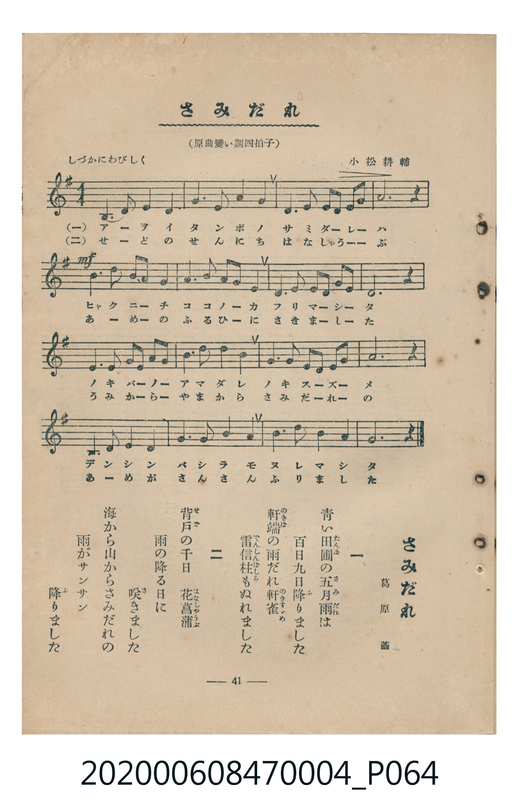

# さみだれ

> Re:Shōka 使用 AI 協助辨識與重建樂譜，可能會有錯誤。歡迎回報。

- **鋼琴伴奏版**：<br><audio controls src="samidare.mp3"></audio>
- **NEUTRINO 歌聲合成版**：<br><audio controls src="samidare_neutrino.mp3"></audio>

- 詞：葛原しげる
- 曲：小松耕輔
- 臺灣教育會公認《新定兒童唱歌》尋常科第四學年用（2020.006.0847.0004）

## 說明

原書資訊與歌詞全文（對應 P064.jpg，書頁 p. 41，參考教材第 7 首）：
調性與拍號：原曲變い調四拍子（譜面移調為 1 個升記號 G 大調 4/4 拍）
速度指示：しづかにわびしく
作者署名：葛原蘢（詞）、小松耕輔（曲）


## 歌詞

```text
一
青（あを）い田圃（たんぼ）の五月雨（さみだれ）は
百日九日（ひゃくにちここのか）降（ふ）りました
軒端（のきば）の雨（あま）だれ軒雀（のきすゞめ）
電信柱（でんしんばしら）もぬれました

二
背戸（せど）の千日（せんにち）　花菖蒲（はなしゃうぶ）
雨の降る日に　咲（さ）きました
海（うみ）から山（やま）からさみだれの
雨がサンサン　降りました
```

## ABC

<div class="abc-score" data-abc-src="samidare.abc" aria-label="五線譜載入中"></div>

[下載 ABC 原始檔](samidare.abc)

## TMD 檔案連結

- [主旋律 TMD 檔案](samidare.tmd) [[在 TMD Studio 編輯](https://tmdlang.github.io/Tmd-TS/#tmd=s7IKdvYPcrWy4qpTUCpJTLdSSM7PyUlNLsnMz7MqzsjMK0nNjM_KTMmPL87Iz05Ugisry88pzU21Si9KTEmNN4k3MjAyiDcwMIs3sDAxBzIMTBBKi_NLi5JTrYqTM_Lzc-JLUitKkvLzsxHyBUX5Zal5iXlANQVFIBtTwIoQClLLMlNSQdKpKZkl-UWZiTlI7kgtKga7FWxJfElRYl5xclFmAcgDCFX5RSUZ-UC3FmRUWmVkFoMMSU7Mic9OzEPyUklGKtBH5amJQEYRunBxamJxfl4xspGZ6Zl5ViWJmcCQAYVOeWJ8bmJmXk5iXgq63-MLEtNTrQIMzIChoqWl8Lhx6uPG_Y8bFzxu6lHQ0uJStFUwN-Oyt1Vw57Ix0TexA-l-sXLe-z2zXkyc_bRv_uPG6Y8bJz1u6gab-2z2JqDM0w39z-bue9Ew9cWeKWDhF-27njcufjZ15oumTc_mND9tXfNiVe_jhq5n0zY8XTfraeuk56uXPp2y8dnanscN3U83dD_dseP58onP16x5Onv207U7nu7c8nzKivd7OkAxqQeMST1QTAIZBibv93QqcXHpaynYUgtwKSgoAP31bPaOF5vbX6zoetHRDnQX0MtPW1c8m9YOdMXTDb3P2jsVQEGml1WQ_n5PD1DxywWNCgV6CiaGQO7T_uYXDc1A7z6bOwHoCQVzhZfLpgFdCgwakOkvVu1_1rAcZG5374uZ80EBBrJv04t1XY8bW4CyQF8DpZ6unQC07MXaOS_nLnq-fDdQ_HnTLgVDhafAIOoFumwGUK-Cu8LTJcuBUgrAuFEAagLaArLiZcP8p7uWPetpf75kF9B8cCQtfdzY_bhx9eOm_seNm8Ei_SClT_bOedHQ-nzvpqcTgLqhsfpixiKQ3aB47nzc0IgcoUBxcCx3coF172gA2zd3ElD8cWPT4yYgoxPojedTNjyd0wwWnP-4afLjxj1g8XVPdk15Nqfj5WxQdCKnNbDsepBZz2fuezZ96ZOdc4EkWNGmx03NQMeC3N648HEj0CwgWgf0DVDPy5lARwPVbAXpbwKG3z6wz-aDw3k3MF2tB0sDVfc-btwAcQLM8iagarAIyH6g4pezG5AUz3zcNO9xUyMsQGfvfrJ_4bP5G8EqloN9NB1MbgAzgHELtB9o4hqgWQhXgINoVw_YNc09zzp2gLXPfty4EuKUp73NMF_OBpsG8iI4zBtedG180T_txSRgUANl1z9uXAW2CBgSbY8bt8GdtQLkoZm9wAwINAikv6HhKVTPVLAdQK8ghcmzrdvBckAz9oOlu4Fuf7oR7K2mFliAgASRIwdoB9y2nsdNWx83b4aSDQ1gy1EDnvJMCAUKWvpcXMGJuZkpiUXAMiozMS_focagphpkiYKNhZYdmIEt9ysA8x0wbb5Y2KOgYaIATL_P1zfowLOsJhYNQKtAhtUoGMcr6AKhabyCGYgFpHWBooZgQaCIEZACcWogMmAxIIIoNwQKgxTAoAFIIdhcH8MahcdNi6Dij5s3gcimJWCDHjfth4puBuI5YFYfVGYrVGY-EDeAWWsgMs392O0xAso1zobZ07gSTK6D6IGKA1MakL0aLLMQKrMeqn4VEIOSGZBqAwuBJLdhWIU_4Hf1kBPw1blptQrGkMAH0kbQYIaEJ4QPjhHMkAdLwIWxBn3zpMfNi6G-Xw_kdoPDshEaypuhMqDwB4X84yZQ6IC0TYWGPzBcmueBZbajxBn28G-ChX8TyAZE-ENjs6kbyAanAHAsgGSg9jT2AvE-MGs6VGY-iYG_o5OcwAeHLDhIwYEJCmxgVoBGhik4AhDZAKyEqBQPDk2Qj9cC2RPAIQlL2ZC8AApV9JSNpKdpJ5i1CyoDSq24whySXIFlFhCDY7epE2pTC1RmH7oMPNRBehaAZXqgMqAYIyHUgVU2tcsaQ3CQg8IWEREIEYga7GHeDg1ZYGoGp1YQCxJ-oBiApOHHzeCSoRkUCyAZkL8hcUBJOoeFHjRcweUMiA1ioeaALiLSeS0Xl66dAqz8VwCylbkA)]
- [鋼琴伴奏 TMD 檔案](samidare_piano.tmd) [[在 TMD Studio 編輯](https://tmdlang.github.io/Tmd-TS/#tmd=s7IKdvYPcrWy4qpTUCpJTLdSyC8qychPL0osyKi0ysgsLskvykxOzInPTsxLVIIrKs4vLUpOjS9ITE-1CjAwM1Hi0tJSeNw49XHj_seNCx439bzf0_Gye8_zCVue7NnydGn_886O93s6FbS0uBRtFczNuOxtFdy5bEz0TexARr5YOe_9nlkvJs5-2jf_ceP0x42THjd1gy17NnsTUObphv5nc_e9aJj6Ys8UsPCL9l3PGxc_mzrzRdOmZ3Oan7auebGq93FD17NpG56um_W0ddLz1UufTtn4bG3P44bupxu6n-7Y8Xz5xOdr1jydPfvp2h1Pd255PmUF0IlGBkYGegYGZnoGFibmQIaBCdCVSlxcwYm5mSmJRUC_ZSbm5Qd5ONQY1FRzKQCBjYWWHZihr6Vgiw4UgDY82dHwYmGPgoaJAtDVz9c36CiAwkcvqyBdE4sGLX2wYTUKxvEKukBoGq9gBmIBaV2gqCFYEChiBKRAnBqIDFgMiCDKDYHCIAUwaABSCDbXx7BG4XHTIqj44-ZNILJpCdigx037oaKbgXgOmNUHldkKlZkPxA1g1hqITHM_dnuMgHKNs2H2NK4Ek-sgeqDij5smA9mrwTILoTLroepXAfH0x03NQKoNLASS3IZhFf6A39VDTsBX56bVKhhDAh9IG0GDGRKeED44RjBDHiwBF8Ya9M2THjcvhvp-PZDbDQ7LRmgob4bKgMIfFPKPm0ChA9I2FRr-wHBpngeW2Y4SZ9jDvwkW_k0gGxDhD43Npm4gG5wCwLEAkoHa09gLxPvArOlQmfkkBv6OTnICHxyy4CAFByYosIFZARoZpuAIQGQDsBKiUjw4NEE-XgtkTwCHJCxlQ_ICKFTRUzaSnqadYNYuqAwoteIKc0hyBRZ7QAyO3aZOqE0tUJl96DLwUAfpWQCW6YHKgGKMhFAHlmbULmsMwUEOCltERCBEIGqwh3k7NGSBqRmcWkEsSPiBYgCShh83g0uGZlAsgGRA_obEASXpHBZ60HAFlzMgNoiFmgO6iEjntejFvw9y8W8CLf6BYRGvEG0YC6PgfNN4mACMBVcBFjCNh6gxgHoJWgKhmwZXawZimMXnopuILIRpJkIXsn4cTsawAtM8HDpBFEgxXgGQKcBA1bVTgIVrtA9QBoVvBOYrcwEA)]

## 分析

```text
================================================================================
📊 TMD Song Profile: [ さみだれ ]
================================================================================
⏱  Duration:       0:50 (50.5s), 16 measures total
🎼 Key & Tempo:    首調基準 G, != 76.0 BPM, <4/4>
   - 分析範圍：      由實際發聲的音符與和弦推測調性；播放脈絡另行呈現
🎤 人聲音域:    B3 (MIDI 59) – D5 (MIDI 74) [跨度: 15 個半音 / 1.2 個八度, 難度: moderate]
   - 最低音:  B3 in [Samidare #1 @ m.1, 0:00]
   - 最高音: D5 in [Samidare #1 @ m.5, 0:13]
   - 適合: soprano, mezzo-soprano, contralto, tenor, baritone, bass
🏛  結構:      Samidare (50.5s)
⚡ 編曲密度:        Peak 1 軌道同時演奏
🗝  調性診斷：       G 大調（純淨自然大調，未偵測到可信轉調）
   - 風格氣質:    純淨自然大調（陽光明朗、易唱易記，無明顯調外色彩）
   - 轉調歷程:    全曲維持單一推測調性（未偵測到可信轉調）
   - 核心骨幹音:  G, D, A, B, E
   - 調性數值:    G 大調 [相關度: 0.81, 穩定度: Moderate, 自然音純度: 100.0%]
   - 候選調性 (K-S): G 大調 (0.81), D 大調 (0.75), E 小調 (0.65)
   - 五度圈歷程:   +1
   - 各段落調性細節:
     • [Samidare #1]: G 大調 (r: 0.81, 自然音純度: 100.0%)

  [ 五度圈游移軌跡 ]
               C  
         F           [G ]*
      Bb               D  
      Eb               A  
         Ab           E  
            Db       B  
               F# 
     (* = active key center)

  [ 十二半音累積音高分佈 ]
     C  :                            0.0%
     C# :                            0.0%
     D  : ███████████████████████   21.7%
     D# :                            0.0%
     E  : ██████████████████        16.7%
     F  :                            0.0%
     F# :                            0.0%
     G  : ████████████████████████  22.5%
     G# :                            0.0%
     A  : █████████████████████     20.0%
     A# :                            0.0%
     B  : ████████████████████      19.2%
--------------------------------------------------------------------------------
Assignment 軌道音域：
  - Piano         : B3 – D5 (15 個半音 / 1.2 個八度, 62 個音符)
================================================================================
```


## 原書掃描頁




