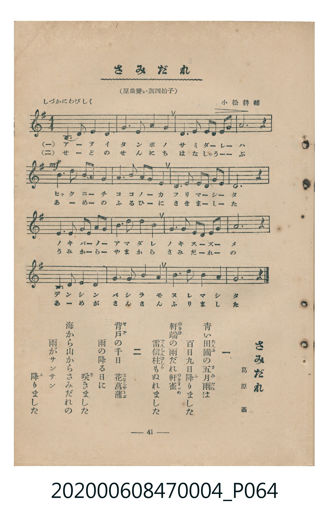

# さみだれ

> Re:Shōka 使用 AI 協助辨識與重建樂譜，可能會有錯誤。歡迎回報。

- **鋼琴伴奏版**：<br><audio controls src="samidare.mp3"></audio>
- **NEUTRINO 歌聲合成版**：<br><audio controls src="samidare_neutrino.mp3"></audio>

- 詞：葛原しげる
- 曲：小松耕輔
- 臺灣教育會公認《新定兒童唱歌》尋常科第四學年用（2020.006.0847.0004）

## 說明

原書資訊與歌詞全文（對應 P064.jpg，書頁 p. 41，參考教材第 7 首）：
調性與拍號：原曲變い調四拍子（譜面移調為 1 個升記號 G 大調 4/4 拍）
速度指示：しづかにわびしく
作者署名：葛原蘢（詞）、小松耕輔（曲）


## 歌詞

```text
一
青（あを）い田圃（たんぼ）の五月雨（さみだれ）は
百日九日（ひゃくにちここのか）降（ふ）りました
軒端（のきば）の雨（あま）だれ軒雀（のきすゞめ）
電信柱（でんしんばしら）もぬれました

二
背戸（せど）の千日（せんにち）　花菖蒲（はなしゃうぶ）
雨の降る日に　咲（さ）きました
海（うみ）から山（やま）からさみだれの
雨がサンサン　降りました
```

## ABC

```abc
X:1
T:さみだれ
C:曲：小松耕輔
M:4/4
L:1/16
Q:1/4=76
K:G
V:V1 name="Piano" snm="Pia"
[V:V1]
B,6 D2 E4 D4 | G6 E2 A4 G4 | D6 E2 E2 D2 E2 G2 | A12 z4 |
w: 1.~ア _ ヲ イ | タ ン ボ ノ | サ ミ ダ _ レ _ | ハ
w: 2.~せ _ ど の | せ ん に ち | は な しゃ う _ _ | ぶ
!mf! B6 d2 B2 A2 G4 | A6 B2 A2 G2 E4 | D6 E2 E2 D2 G2 E2 | D12 z4 |
w: 1.~ヒャ ク ニ _ チ | コ コ ノ _ カ | フ リ マ _ シ _ | タ
w: 2.~あ _ め _ の | ふ る ひ _ に | さ き ま _ し _ | た
E6 E2 G2 E2 A2 G2 | B6 d2 d4 B4 | G6 G2 E2 D2 E2 G2 | A12 z4 |
w: 1.~ノ キ バ _ ノ _ | ア マ ダ レ | ノ キ ス _ ズ _ | メ
w: 2.~う み か _ ら _ | や ま か ら | さ み だ _ れ _ | の
B,6 D2 E4 D4 | G6 G2 B4 A4 | B6 d2 B4 A4 | G12 z4 |
w: 1.~デ ン シ ン | バ シ ラ モ | ヌ レ マ シ | タ
w: 2.~あ _ め が | さ ん さ ん | ふ り ま し | た
```

## TMD 檔案連結

- [主旋律 TMD 檔案](samidare.tmd) [[在 TMD Studio 編輯](https://tmdlang.github.io/Tmd-TS/#tmd=s7IKdvYPcrWy4qpTUCpJTLdSSM7PyUlNLsnMz7MqzsjMK0nNjM_KTMmPL87Iz05Ugisry88pzU21Si9KTEmNN4k3MjAyiDcwMIs3sDAxBzIMTBBKi_NLi5JTrYqTM_Lzc-JLUitKkvLzsxHyBUX5Zal5iXlANQVFIBtTwIoQClLLMlNSQdKpKZkl-UWZiTlI7kgtKga7FWxJfElRYl5xclFmAcgDCFX5RSUZ-UC3FmRUWmVkFoMMSU7Mic9OzEPyUklGKtBH5amJQEYRunBxamJxfl4xspGZ6Zl5ViWJmcCQAYVOeWJ8bmJmXk5iXooSl5aWwuPGqY8b9z9uXPC4qUdBS4tL0VbB3IzL3lbBncvGRN_EDmTSi5Xz3u-Z9WLi7Kd98x83Tn_cOOlxUzfYjmezNwFlnm7ofzZ334uGqS_2TAELv2jf9bxx8bOpM180bXo2p_lp65oXq3ofN3Q9m7bh6bpZT1snPV-99OmUjc_W9jxu6H66ofvpjh3Pl098vmbN09mzn67d8XTnludTVrzf0wGKLz1gfOmB4gvIMDB5v6dTiYtLX0vBllqAS0FBAeivZ7N3vNjc_mJF14uOdqC7gF5-2rri2bR2oCuebuh91t6pEGBgZqKXVZD-fk8PUPHLBY0KBXoKJoZA7tP-5hcNzUDvPps7AegJBXOFl8umAV0KDBqQ6S9W7X_WsBxkbnfvi5nzQQEGsm_Ti3VdjxtbgLJAXwOlnq6dALTsxdo5L-cuer58N1D8edMuBUOFp8Ag6gW6bAZQr4K7wtMly4FSCsC4UQBqAtoCsuJlw_ynu5Y962l_vmQX0HxwJC193Nj9uHH146b-x42bwSL9IKVP9s550dD6fO-mpxOAuqGx-mLGIpDdoHjufNzQiByhQHFwLHdygXXvaADbN3cSUPxxY9PjJiCjE-iN51M2PJ3TDBac_7hp8uPGPWDxdU92TXk2p-PlbFB0Iqc1sOx6kFnPZ-57Nn3pk51zgSRY0abHTc1Ax4Lc3rjwcSPQLCBaB_QNUM_LmUBHA9VsBelvAobfPrDP5oPDeTcwXa0HSwNV9z5u3ABxAszyJqBqsAjIfqDil7MbkBTPfNw073FTIyxAZ-9-sn_hs_kbwSqWg300HUxuADOAcQu0H2jiGqBZCFeAg2hXD9g1zT3POnaAtc9-3LgS4pSnvc0wX84GmwbyIjjMG150bXzRP-3FJGBQA2XXP25cBbYIGBJtjxu3wZ21AuShmb3ADAg0CKS_oeEpVM9UsB1AryCFybOt28FyQDP2g6W7gW5_uhHsraYWWICABJEjB2gH3Laex01bHzdvhpINDWDLUQOe8kwIBQpa-lxcwYm5mSmJRalWAZmJefkONQY11SBLFGwstOzADGy5XwGY74Bp88XCHgUNEwVg-n2-vkEHnmU1sWgAWgUyrEbBOF5BFwhN4xXMQCwgrQsUNQQLAkWMgBSIUwORAYsBEUS5IVAYpAAGDUAKweb6GNYoPG5aBBV_3LwJRDYtARv0uGk_VHQzEM8Bs_qgMluhMvOBuAHMWgORae7Hbo8RUK5xNsyexpVgch1ED1QcmNKA7NVgmYVQmfVQ9auAGJTMgFQbWAgkuQ3DKvwBv6uHnICvzk2rVTCGBD6QNoIGMyQ8IXxwjGCGPFgCLow16JsnPW5eDPX9eiC3GxyWjdBQ3gyVAYU_KOQfN4FCB6RtKjT8geHSPA8ssx0lzrCHfxMs_JtANiDCHxqbTd1ANjgFgGMBJAO1p7EXiPeBWdOhMvNJDPwdneQEPjhkwUEKDkxQYAOzAjQyTMERgMgGYCVEpXhwaIJ8vBbIngAOSVjKhuQFUKiip2wkPU07waxdUBlQasUV5pDkCiyzgBgcu02dUJtaoDL70GXgoQ7SswAs0wOVAcUYCaEOrLKpXdYYgoMcFLaIiECIQNRgD_N2aMgCUzM4tYJYkPADxQAkDT9uBpcMzaBYAMmA_A2JA0rSOSz0oOEKLmdAbBALNQd0EZHOa7m4dO0UYOW_ApCtzAUA)]
- [鋼琴伴奏 TMD 檔案](samidare_piano.tmd) [[在 TMD Studio 編輯](https://tmdlang.github.io/Tmd-TS/#tmd=s7IKdvYPcrWy4tLSUnjcOPVx4_7HjQseN_W839PxsnvP8wlbnuzZ8nRp__POjvd7OhW0tLgUbRXMzbjsbRXcuWxM9E3suOoUlF6snPd-z6wXE2c_7Zv_uHH648ZJj5u6lUAyz2ZvAso83dD_bO6-Fw1TX-yZAhZ-0b7reePiZ1Nnvmja9GxO89PWNS9W9T5u6Ho2bcPTdbOetk56vnrp0ykbn63tedzQ_XRD99MdO54vn_h8zZqns2c_Xbvj6c4tz6esADrRyMDIQM_AwEzPwMLEHMgwMAG6UomLKzgxNzMlsSjVKiAzMS8_yMOhxqCmmksBCGwstOzADH0tBVt0oAC04cmOhhcLexQ0TBSArn6-vkFHIcDAzEQvqyBdE4sGLX2wYTUKxvEKukBoGq9gBmIBaV2gqCFYEChiBKRAnBqIDFgMiCDKDYHCIAUwaABSCDbXx7BG4XHTIqj44-ZNILJpCdigx037oaKbgXgOmNUHldkKlZkPxA1g1hqITHM_dnuMgHKNs2H2NK4Ek-sgeqDij5smA9mrwTILoTLroepXAfH0x03NQKoNLASS3IZhFf6A39VDTsBX56bVKhhDAh9IG0GDGRKeED44RjBDHiwBF8Ya9M2THjcvhvp-PZDbDQ7LRmgob4bKgMIfFPKPm0ChA9I2FRr-wHBpngeW2Y4SZ9jDvwkW_k0gGxDhD43Npm4gG5wCwLEAkoHa09gLxPvArOlQmfkkBv6OTnICHxyy4CAFByYosIFZARoZpuAIQGQDsBKiUjw4NEE-XgtkTwCHJCxlQ_ICKFTRUzaSnqadYNYuqAwoteIKc0hyBRZ7QAyO3aZOqE0tUJl96DLwUAfpWQCW6YHKgGKMhFAHlmbULmsMwUEOCltERCBEIGqwh3k7NGSBqRmcWkEsSPiBYgCShh83g0uGZlAsgGRA_obEASXpHBZ60HAFlzMgNoiFmgO6iEjntejFvw9y8W8CLf6BYRGvEG0YC6PgfNN4mACMBVcBFjCNh6gxgHoJWgKhmwZXawZimMXnopuILIRpJkIXsn4cTsawAtM8HDpBFEgxXgGQKcBA1bVTgIVrtA9QBoVvBOYrcwEA)]

## 分析

```text
================================================================================
📊 TMD Song Profile: [ さみだれ ]
================================================================================
⏱  Duration:       0:50 (50.5s), 16 measures total
🎼 Key & Tempo:    首調基準 G, != 76.0 BPM, <4/4>
   - 分析範圍：      由實際發聲的音符與和弦推測調性；播放脈絡另行呈現
🎤 人聲音域:    B3 (MIDI 59) – D5 (MIDI 74) [跨度: 15 個半音 / 1.2 個八度, 難度: moderate]
   - 最低音:  B3 in [Samidare #1 @ m.1, 0:00]
   - 最高音: D5 in [Samidare #1 @ m.5, 0:13]
   - 適合: soprano, mezzo-soprano, contralto, tenor, baritone, bass
🏛  結構:      Samidare (50.5s)
⚡ 編曲密度:        Peak 1 軌道同時演奏
🗝  調性診斷：       G 大調（純淨自然大調，未偵測到可信轉調）
   - 風格氣質:    純淨自然大調（陽光明朗、易唱易記，無明顯調外色彩）
   - 轉調歷程:    全曲維持單一推測調性（未偵測到可信轉調）
   - 核心骨幹音:  G, D, A, B, E
   - 調性數值:    G 大調 [相關度: 0.81, 穩定度: Moderate, 自然音純度: 100.0%]
   - 候選調性 (K-S): G 大調 (0.81), D 大調 (0.75), E 小調 (0.65)
   - 五度圈歷程:   +1
   - 各段落調性細節:
     • [Samidare #1]: G 大調 (r: 0.81, 自然音純度: 100.0%)

  [ 五度圈游移軌跡 ]
               C  
         F           [G ]*
      Bb               D  
      Eb               A  
         Ab           E  
            Db       B  
               F# 
     (* = active key center)

  [ 十二半音累積音高分佈 ]
     C  :                            0.0%
     C# :                            0.0%
     D  : ███████████████████████   21.7%
     D# :                            0.0%
     E  : ██████████████████        16.7%
     F  :                            0.0%
     F# :                            0.0%
     G  : ████████████████████████  22.5%
     G# :                            0.0%
     A  : █████████████████████     20.0%
     A# :                            0.0%
     B  : ████████████████████      19.2%
--------------------------------------------------------------------------------
Assignment 軌道音域：
  - Piano         : B3 – D5 (15 個半音 / 1.2 個八度, 62 個音符)
================================================================================
```


## 原書掃描頁




