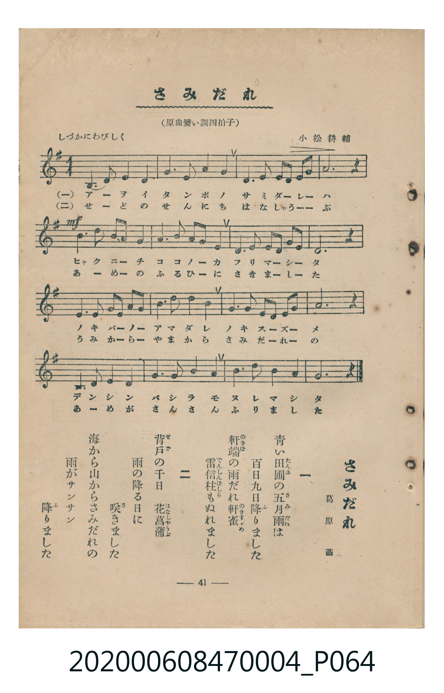

# さみだれ

> Re:Shoka 使用 AI 辨識樂譜，可能會有錯誤。歡迎回報。

<audio controls src="samidare.mp3"></audio>

- 詞：葛原しげる
- 曲：小松耕輔
- 臺灣教育會公認《新定兒童唱歌》尋常科第四學年用（2020.006.0847.0004）

## 說明

原書資訊與歌詞全文（對應 P064.jpg，書頁 p. 41，參考教材第 7 首）：
調性與拍號：原曲變い調四拍子（譜面移調為 1 個升記號 e 小調／G 大調關係音階 4/4 拍）
速度指示：しづかにわびしく

## 歌詞

```text
一
青（あを）い田圃（たんぼ）の五月雨（さみだれ）は
百日九日（ひゃくにちここのか）降（ふ）りました
軒端（のきば）の雨（あま）だれ軒雀（のきすゞめ）
電信柱（でんしんばしら）もぬれました

二
背戸（せど）の千日（せんにち）　花菖蒲（はなしゃうぶ）
雨の降る日に　咲（さ）きました
海（うみ）から山（やま）からさみだれの
雨がサンサン　降りました
```

## ABC

```abc
X:1
T:さみだれ
C:曲：小松耕輔
M:4/4
L:1/16
Q:1/4=76
K:Em
V:V1 name="Piano" snm="Pia"
[V:V1]
B,6 E2 F4 E4 | A6 A2 B4 A4 | F4 A2 F2 E3 F A3 B | B12 z4 |
!mf! e6 e2 f3 e B4 | A6 A2 B3 A F4 | E4 E2 F2 A4 F3 E | E12 z4 |
E6 F2 A3 F E3 F | B3 d B4 A8 | F4 A2 B2 A4 B3 A | B12 z4 |
B,6 E2 F4 E4 | A6 A2 B4 A4 | B6 d2 B4 A3 F | E12 z4 |
```

## TMD 檔案連結

- [主旋律 TMD 檔案](samidare.tmd) [[在 TMD Studio 編輯](https://tmdlang.github.io/Tmd-TS/#tmd=s7IKdvYPcrWy4qpTUCpJTLdSSM7PyUlNLsnMz7MqzsjMK0nNjM_KTMmPL87Iz05Ugisry88pzU21Si9KTEmNN4k3MjAyiDcwMIs3sDAxBzIMTBBKi_NLi5JTrYqTM_Lzc-JLUitKkvLzsxHyBUX5Zal5iXlANQVFIBtTwIoQClLLMlNSQdKpKZkl-UWZiTlI7kgtKga7FWxJfElRYl5xclFmAcgDCFUlGalAx5anJgIZRejCxamJxfl5xUpcWloKjxunPm7c_7hxweOmHgUtLS5FWwVzMy57WwV3ruzUSlsF11wuGxN9EzuQES9Wznu_Z9aLibOf9s1_3Dj9ceOkx03dYMOfzd4ElHm6of_Z3H0vGqa-2DMFLPyifdfzxsXPps580bTp2Zzmp61rXqzqfdzQ9WzahqfrZj1tnfR89dKnUzY-W9vzuKH76Ybupzt2PF8-8fmaNU9nz366dsfTnVueT1nxfk8HKLD1gIGtBwpsIMPA5P2eTiUuLn0tBVtqAS4FBQWgv57N3vFic_uLFV0vOtqB7gJ6-WnrimfT2oGueLqh91l7p0KAgZmJXlZB-vs9PUDFLxc0KhToKZgYArlP-5tfNDQDvfts7gSgJxTMFV4umwZ0KTBoQKa_WLX_WcNykLndvS9mzgcFGMi-TS_WdT1ubAHKAn0NlHq6dgLQshdr57ycu-j58t1A8edNuxQMFZ4Cg6gX6LIZQL0KqQrAwAZKvd_T767wdMlyIPPl9DlP9je9nL_55aw-BWCUKQDNAloOsvllw_ynu5Y962l_vmQX0Fpw3C193Nj9uHH146b-x42bwSL9XCC1T3Y0gLXMnQR0xePGpsdNQEYn0IHPp2x4OqcZLDj_cdPkx417wOLrnuya8mxOx8vZoIhCTk1g2fUgs57P3Pds-tInO-cCSbCiTY-bmoH2gaxvXPi4EWgWEK0DOgio5-VMoKuBaraC9DcBQ2Yf2HHzwSG4G5hi1oOlgap7HzdugDgBZnkTUDVYBGQ_UPHL2Q1Iimc-bpr3uKkRFiazdz_Zv_DZ_I1gFcvBPpoOJjeAGcBYA9oPNHEN0CyEK8BBtKsH7JrmnmcdO8DaZz9uXAlxytPeZpgvZ4NNA3kRJNXQ8KJr44v-aS8mAbMKUHb948ZVYIuAIdH2uHEb3FkrQB6a2QvMWkCDQPobGp5C9UwF2wH0ClKYPNu6HSwHNAOYGoDS3UC3P90I9lZTCyxAQILIkQO0A25bz-OmrY-bN0PJhgaw5agBT3n2ggIFLX0uruDE3MyUxKJUq4DMxLx8hxqDGoVqkC0KNoZmWnZgFracrQDMU8DU-WJhj4KGCSj9P1_foAPPjppYNAAtgxqmAdSoaaXwuGmRwuPmPUC8CcheolADJPcDeZuBeA4Q94FFtgJZ84G4AaJ0DYTaA5Jr7ofq36NggGL8rh6Q8Y2zIdKNK4F4HUgDSKRpMpBeDcQLwSLrgXgVEEPjHm4gSG4bpvE1CsbxCrpwaAbimMNEwDwQrFEwQlIEYhsjsSEq4LpAQmAOVDuQDVFlDLINyRxkaAAzB5wHcMfQrh6KYqh50uPmxcAwA4ZSczckMBrBsQKMIxBu7gMLNq0GR8dUIAaGZfM8iOB2pLAERyyeqGqCSDc1QmIMElvAqG_qBtKbIIJgSxqBljT2AvE-iOB05AgDpROMCKvOTatVMEOONFAgQ1mw8MUVY0aIeKpBxC8i2mG6oKqAEkjKyI20HZ2URVofMNzWAukJkNAAxxEoDkDZbR4oK4HyETwTQVU37YTEwC7kDLYQf6wBs0sjMGKBBRpYayfMohZQ_IDEQYLw2AHFHEj1AojqHuSYW4ct5lACEim4gUxEXoHlEVOMPAaDaHkNpAymBBbJFGc0YGuBsjhrhxR8TdvBNCjsJ0B5wNKreRFYpAcab8A4BMuQlrOA7B5YPIALQQgNy2hd0Dibjj83Uav4Qw5vUwwV4HglIh_VcnHp2inAqjAFIFuZiwsA)]
- [鋼琴伴奏 TMD 檔案](samidare_piano.tmd) [[在 TMD Studio 編輯](https://tmdlang.github.io/Tmd-TS/#tmd=s7IKdvYPcrWy4tLSUnjcOPVx4_7HjQseN_W839PxsnvP8wlbnuzZ8nRp__POjvd7OhW0tLgUbRXMzbjsbRXcubJTK20VXHO5bEz0Tey46hSUXqyc937PrBcTZz_tm_-4cfrjxkmPm7qVQDLPZm8Cyjzd0P9s7r4XDVNf7JkCFn7Rvut54-JnU2e-aNr0bE7z09Y1L1b1Pm7oejZtw9N1s562Tnq-eunTKRufre153ND9dEP30x07ni-f-HzNmqezZz9du-Ppzi3Pp6wAOtXIwMhAz8DATM_AwsQcyDAwAbpWiYsrODE3MyWxKNUqIDMxLz_Iw6HGoEahmksBCGwMzbTswCx9LQVbdKAAtOPJjoYXC3sUNEwUgO5-vr5BRyHAwMxEL6sgXROLBi19sGE1CsbxCrpwaAbimMNEwDwQrFEwQlIEYhsjsSEq4LpAQmAOVDuQDVFlDLINyRxkaAAzhwu_H3f1kOPH6ty0WgUzZH-C3AVlwZyEy5NGCK_VIIIEEVIwXVBVQAkkZeT6c0cnOf5EsRbJcUAmIjJgkWCKEYkwiBaZIGUwJbAgoTgmgTliIFMrsutNMVSAQ4mIOKxFz7I-KFnWBJpjQWbFK0SbxefGIrGAzgQyjYAsGI0QQVYF9HK0MZAFpA2AdqIbCJPGZhxCFTYxEAubiQi1MLMxHYipBofz8PsX0wJM5wEDWddOARbOCkC2MhcXAA)]

## 分析

```text
================================================================================
📊 TMD Song Profile: [ さみだれ ]
================================================================================
⏱  Duration:       0:50 (50.5s), 16 measures total
🎼 Key & Tempo:    首調基準 G, != 76.0 BPM, <4/4>
   - 分析範圍：      由實際發聲的音符與和弦推測調性；播放脈絡另行呈現
🎤 人聲音域:    B3 (MIDI 59) – F#5 (MIDI 78) [跨度: 19 個半音 / 1.6 個八度, 難度: challenging]
   - 最低音:  B3 in [Samidare #1 @ m.1, 0:00]
   - 最高音: F#5 in [Samidare #1 @ m.5, 0:14]
   - 適合: soprano, mezzo-soprano, tenor, baritone
🏛  結構:      Samidare (50.5s)
⚡ 編曲密度:        Peak 1 軌道同時演奏
🗝  調性診斷：       E 大調（純淨自然大調，未偵測到可信轉調）
   - 風格氣質:    純淨自然大調（陽光明朗、易唱易記，無明顯調外色彩）
   - 轉調歷程:    全曲維持單一推測調性（未偵測到可信轉調）
   - 核心骨幹音:  B, E, A, F#, D
   - 調性數值:    E 大調 [相關度: 0.79, 穩定度: Moderate, 自然音純度: 98.8%]
   - 候選調性 (K-S): E 大調 (0.79), A 大調 (0.68), E 小調 (0.56)
   - 五度圈歷程:   +4
   - 各段落調性細節:
     • [Samidare #1]: E 大調 (r: 0.79, 自然音純度: 98.8%, 調外音: D)

  [ 五度圈游移軌跡 ]
               C  
         F            G  
      Bb               D  
      Eb               A  
         Ab          [E ]*
            Db       B  
               F# 
     (* = active key center)

  [ 十二半音累積音高分佈 ]
     C  :                            0.0%
     C# :                            0.0%
     D  : █                          1.2%
     D# :                            0.0%
     E  : █████████████████████     26.7%
     F  :                            0.0%
     F# : ████████████              15.0%
     G  :                            0.0%
     G# :                            0.0%
     A  : ████████████████████      26.2%
     A# :                            0.0%
     B  : ████████████████████████  30.8%
--------------------------------------------------------------------------------
Assignment 軌道音域：
  - Piano         : B3 – F#5 (19 個半音 / 1.6 個八度, 64 個音符)
================================================================================
```


## 原書掃描頁




