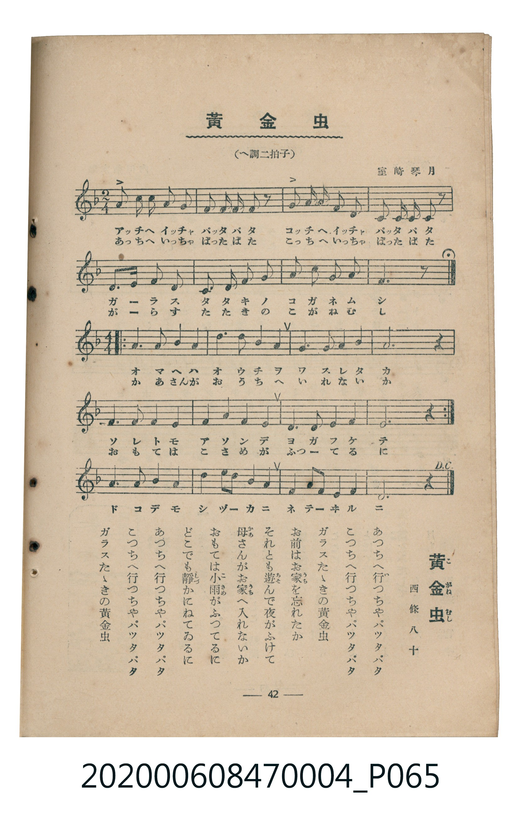

# 黃金虫

> Re:Shōka 使用 AI 協助辨識與重建樂譜，可能會有錯誤。歡迎回報。

- **鋼琴伴奏版**：<br><audio controls src="kogane_mushi.mp3"></audio>
- **NEUTRINO 歌聲合成版**：<br><audio controls src="kogane_mushi_neutrino.mp3"></audio>

- 詞：西條八十
- 曲：室崎琴月
- 臺灣教育會公認《新定兒童唱歌》尋常科第四學年用（2020.006.0847.0004）

## 說明

原書資訊與歌詞全文（對應 P065.jpg，書頁 p. 42，參考教材第 8 首）：
調性與拍號：へ調二拍子（主段 2/4 拍，中段轉 4/4 拍，末段 D.C. 返始至 Fine 記號）


## 歌詞

```text
黃（こ）金（がね）虫（むし）　西條八十

あつちへ行（い）つちやパツタパタ
こつちへ行つちやパツタパタ
ガラスたゝきの黃金虫
お前はお家（うち）を忘れたか
それとも遊（あそ）んで夜がふけて
母（かあ）さんがお家（うち）へ入れないか
おもては小雨（こさめ）がふつてるに
どこでも靜（しづ）かにねてゐるに
あつちへ行つちやパツタパタ
こつちへ行つちやパツタパタ
ガラスたゝきの黃金虫
```

## ABC

<div class="abc-score" data-abc-src="kogane_mushi.abc" aria-label="五線譜載入中"></div>

[下載 ABC 原始檔](kogane_mushi.abc)

## TMD 檔案連結

- [主旋律 TMD 檔案](kogane_mushi.tmd) [[在 TMD Studio 編輯](https://tmdlang.github.io/Tmd-TS/#tmd=s7IKdvYPcrWy4qpTUCpJTLdSSM7PyUlNLsnMz7MqzsjMK0nNjM_KTMmPL87Iz05Ugisry88pzU21Si9KTEmNN4k3MjAyiDcwMIs3sDAxBzIMTBBKi_NLi5JTrYqTM_Lzc-JLUitKkvLzsxHyBUX5Zal5iXlANQVFIBtTwIoQClLLMlNSQdKpKZkl-UWZiTlI7kgtKga7FWxJfElRYl5xclFmAcgDCFX5RSUZ-UC3FmRUWmVkFoMMSU7Mic9OzEPyUklGKtBHiXmZucgWAJWmZ-ZZlSRmAkMAFArlifG5iZl5OYl5Keh-jC9ITE-1CjAwM1Xi0tJSeLm7-WX7xBczVytoaXEp2ioYGhhw2dsquHHZGOmb2IH0vlg57_2eWS-W7n-2aO7T1tVPexvBRj6bvQko_HTdkqdb-p5P2PJsTgdY-EX7rueNi59NnfmiadOzOc1PW9e8WNX7uKHr2bQNT9fNeto66fnqpU-nbHy2tudxQ_fTDd1Pd-x4vnzi8zVrns6e_XTtjqc7tzyfsuL9ng5QZOkBI0sPFFlAhoHJ-z2dSlxc-loKttQCXAoKCk_75j-bvePF5vYXK7pedLQD3QX079PWFc-mtQNd8XRD77P2TgVQaOllFaS_39MDVPxyQaNCgZ6CiRGQ-7S_-UVDM9C7z-ZOAHpCwULh5bJpQJcCgwZk-otV-581LAeZ2937YuZ8oOjjxh1AwSe7eoAiT9dOANrxZMfuZ-u2KgCDWwEoBjTzyY61QIEXezsVTOBiz-asBily0XPWU3ixf8rT5d0v2jcruGXmpSq8WDEDbHQnF8hGYHwCzXzcOBkoAIxYMLvnceNaIBcYySBuU8PjxulA7uOGBuRIBet-3Nj0uHHJ48aFIGcu7AHrbgGphQg2tTxunvi4ueVx034Qo2k_RM9kZD14lTatedy88nHTzseN8x83zX3c2Pu4cR08BUIM63raCRRdD2Ks2wZ2QBvQPJAbmiY93T_jcRPQhvmPG7shqueC-SseNzW9bOwCqwZ6YC5YNdBVy58umQP2_tbHjRMfNy4D6Xm2HhieQHXdQKVgn00FKwUqwrCwccfT1qVgC1YBgwFuZxfQNqBhQEc-3dD_cjYotYLDAGhQI1gbxEJgMCx73AS0BuqxlWBFy0FOnTsHrGf648alYA0gRcA4AmuYgKwHJTboFgmU5ywoUNDS5-Lyzk9PzEv1LQWW1FYBmYl5-Q41BjXVIHsUbAzNtOzALGzZWgGYoZ7saACme1B5AM8KFgrAYH--vgHIROTLTizagZaDjK5RMFbQVTAFQhBtCMQ1YNIQDHUVDMAiRkDSGAhBImbxYCFTEAUkIAiqEGykTw0wFBc9bm4GijxubgTiGUCBJXCBx82LwSaAQx8s1rQfxAHTMBsfN22mzARwjgWqATtXV8E8HsPxYDZIEOQ7WDhAeCA2JBxgEM17a6DCwLQCtn4n1NEg62HkWrB8H8w7YDGQvsfNvWByAVRmO4Y1-CMdWDqCIx21DHza3_tiWdvT1pXP1gCzZ8-z9f1ABrDEJS05VNsATbSrRUoaMAhimyCxQRAYukgqQGxMFaDghEFY0IIgTCWqLcgQFBZgFYhgX4Uk_bh5HpicAef3w41EU9m0DCzfCFe5CaGyeT2KSlBEPm6GRy84KmFmriboUGi4ISccSGaCsIGJEGYaTAjmeSxKoCkXAsEcuCRMdQ1CCLej4KG3F0ka4sfHzR1w_iK4mcDcCxOF63ncDErAEFY7QmXzCmQzocl7Kpy_EUllG0GHDtJU19iNJA2sdcAkqF6EC_XATQXWfyiKQZ4G1jVw_g4klS3IKptAZgCrUrhKmCy6A7C7dVAnPNQwaYIEIChLQnwKy4AglYgwRSQieLZFCWdQGwLNZiRDm2BBBlJKZL7FXct2QgpcRGFrQlYtC4P4E7U5EGNP1MhRB2JjiRWUqMPuV1isNHciSUPrJ3jWRi0OYDXU4-ZWuHpYoD5uRgpqcM0GEYVl98fNG-AsmB6QSiLTNNZIQWroQ2Lm6ex5SF0E0is9UG8OudKjensI1FYFtVlAZQGoFAC3mKECj5tATRiQoo0wsfkgDpiGt4dATVhKTKBpewieMx83gVLV48aZUPeArIeRoLQBbEzDvAPmQUq9tWCdDVCZ6RjW1HJx6dopIDWVFYBcZS4A)]
- [鋼琴伴奏 TMD 檔案](kogane_mushi_piano.tmd) [[在 TMD Studio 編輯](https://tmdlang.github.io/Tmd-TS/#tmd=s7IKdvYPcrWy4qpTUCpJTLdSyC8qychPL0osyKi0ysgsLskvykxOzInPTsxLVIIrKs4vLUpOjS9ITE-1CjAwM1Xi0tJSeLm7-WX7xBczV7_f0_Gye8_zCVue7NnydGn_886O93s6FbS0uBRtFQwNDLjsbRXcuGyM9E3sQAa-WDnv_Z5ZL5buf7Zo7tPW1U97G8H2PJu9CSj8dN2Sp1v6gEY9m9MBFn7Rvut54-JnU2e-aNr0bE7z09Y1L1b1Pm7oejZtw9N1s562Tnq-eunTKRufre153ND9dEP30x07ni-f-HzNmqezZz9du-Ppzi3Pp6wAOtDIwMhAz8DATM_AwsQcyDAwAbpRiYvLOz89MS_Vt7Q4I9MqIDMxLz_Iw6HGoKaaSwEIbAzNtOzALH0tBVt0oAC05cmOhmfrtoLM1zdReNbd-35Pj4XC0w39z9c3AJmgoNLLKkgHBQemdi19sNE1CsYKugqmQAiiDYG4BkwagqGuggFYxAhIGgMhSMQsHixkCqKABARBFYKN9KlReNy06HFzM1DkcXMjEM8ACiyBCzxuXgw24XHzRKhY034QB0zDbHzctJkyE7ig3gM7V1fBPB7D8WA2SBDkO1g4QHggNiQcYBDNe2ugwo-bV4Kt3wl1NMh6GLkWLN8H8w5YDKTvcXMvmFwAldmOYQ3-SN_VA4n0F3s7FUzgEf-0v_fFsranrSufrVkI5D5b3w9kKJCaHKptgCba1SIlDRgEsU2Q2CAIDF0kFSA2pgpQcMIgLGhBEKYS1RZkCAoLsApEsK9Ckn7cPA9MzoDz--FGoqlsWgaWb4Sr3IRQ2bweRSUoIh83w6MXHJUwM1cTdCg03JATDiQzQdjARAgzDSYE8zwWJdCUC4FgDlwSproGIYTbUfDQ24skDfHj4-YOOH8R3Exg7oWJwvU8bgYlYAirHaGyeQWymdDkPRXO34ikso2gQwdpqmvsRpJ-3NgEJqc-bpoMF-qBm_q4sQtFMcjTjxsXwvk7kFS2IKtsApnxuBGWbBGy6A7A7tZBnfBQw6QJEoCgLAnxKSwDglQiwhSRiODZFiWctz5uXIJmM5KhTbAgAyklMt_irmU7IQUuorA1IauWhUH8idociLEnauSoA7GxxApK1GH3KyxWmjuRpKH1EzxroxYHsBrqcXMrXD0sUB83IwU1uGaDiMKy--PmDXAWTA9IJZFpGmukuOg56ym82D_l6fJuSMw8nT1Pgfw2UDW4dYhc6VG9PdTY9LgR1GYBlQWgUgCYv-ECj5tATRiQoo0wsfkgDpiGt4caJ1NmAk3bQ_Cc-bgJlKoeN86EugdkPYwEpY3Hjetg3gHzIKXeWrDOBqjMdAxrarG0lH2QW8oW0IYy0I3xCtGGsTAKmW8A9ieQaxofC_QrkGEWnwtSAhcEMYCqoCYZAUWNgAqQlUJNA-tANh5uBJqFkEBHblTZmMCdijAYZBXUBpitSEKojgZJIusFsRCORvI-xDkIhQgxmB1gg_EHwuB2I4mORKhDNhVJIVKMIUqEwZu4gNlC104BKWcoALnKXAA)]

## 分析

```text
================================================================================
📊 TMD Song Profile: [ 黃金虫 ]
================================================================================
⏱  Duration:       1:07 (67.2s), 36 measures total
🎼 Key & Tempo:    首調基準 F, != 100.0 BPM, <2/4>
   - 分析範圍：      由實際發聲的音符與和弦推測調性；播放脈絡另行呈現
🎤 人聲音域:    C4 (MIDI 60) – E5 (MIDI 76) [跨度: 16 個半音 / 1.3 個八度, 難度: moderate]
   - 最低音:  C4 in [KoganeMushi #1 @ m.4, 0:03]
   - 最高音: E5 in [KoganeMushi #1 @ m.26, 0:51]
   - 適合: soprano, mezzo-soprano, contralto, tenor, baritone, bass
🏛  結構:      KoganeMushi (67.2s)
⚡ 編曲密度:        Peak 1 軌道同時演奏
🗝  調性診斷：       D 小調（純淨自然小調，未偵測到可信轉調）
   - 風格氣質:    純淨自然小調（陰鬱抒情、旋律集中，無明顯調外色彩）
   - 轉調歷程:    全曲維持單一推測調性（未偵測到可信轉調）
   - 核心骨幹音:  A, F, D, E, A#
   - 調性數值:    D 小調 [相關度: 0.83, 穩定度: Moderate, 自然音純度: 100.0%]
   - 候選調性 (K-S): D 小調 (0.83), F 大調 (0.72), A 小調 (0.68)
   - 五度圈歷程:   +2
   - 各段落調性細節:
     • [KoganeMushi #1]: D 小調 (r: 0.83, 自然音純度: 100.0%)

  [ 五度圈游移軌跡 ]
               C  
         F            G  
      Bb              [D ]*
      Eb               A  
         Ab           E  
            Db       B  
               F# 
     (* = active key center)

  [ 十二半音累積音高分佈 ]
     C  : █████                      5.8%
     C# :                            0.0%
     D  : ███████████████           16.3%
     D# :                            0.0%
     E  : ████████████              13.5%
     F  : █████████████████████     23.6%
     F# :                            0.0%
     G  : ██████                     6.7%
     G# :                            0.0%
     A  : ████████████████████████  26.4%
     A# : ███████                    7.7%
     B  :                            0.0%
--------------------------------------------------------------------------------
Assignment 軌道音域：
  - Piano         : C4 – E5 (16 個半音 / 1.3 個八度, 129 個音符)
================================================================================
```


## 原書掃描頁




