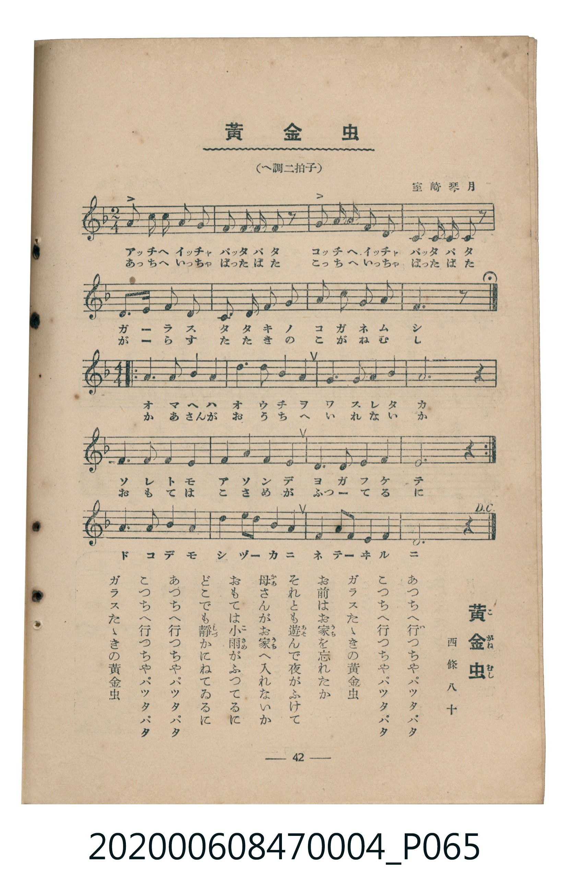

# 黃金虫

> Re:Shōka 使用 AI 協助辨識與重建樂譜，可能會有錯誤。歡迎回報。

- **NEUTRINO 歌聲合成版**：<br><audio controls src="kogane_mushi_neutrino.mp3"></audio>
- **鋼琴伴奏版**：<br><audio controls src="kogane_mushi.mp3"></audio>


- 詞：西條八十
- 曲：室崎琴月
- 臺灣教育會公認《新定兒童唱歌》尋常科第四學年用（2020.006.0847.0004）

## 說明

原書資訊與歌詞全文（對應 P065.jpg，書頁 p. 42，參考教材第 8 首）：
調性與拍號：へ調二拍子（主段 2/4 拍，中段轉 4/4 拍，末段 D.C. 返始至 Fine 記號）


## 歌詞

```text
黃（こ）金（がね）虫（むし）　西條八十

あつちへ行（い）つちやパツタパタ
こつちへ行つちやパツタパタ
ガラスたゝきの黃金虫
お前はお家（うち）を忘れたか
それとも遊（あそ）んで夜がふけて
母（かあ）さんがお家（うち）へ入れないか
おもては小雨（こさめ）がふつてるに
どこでも靜（しづ）かにねてゐるに
あつちへ行つちやパツタパタ
こつちへ行つちやパツタパタ
ガラスたゝきの黃金虫
```

## ABC

```abc
X:1
T:黃金虫
C:曲：室崎琴月
M:2/4
L:1/16
Q:1/4=100
K:F
V:V1 name="Piano" snm="Pia"
[V:V1]
A2 c c A2 F2 | F2 F F F2 z2 | G2 A A F2 D2 | C2 C C C2 z2 |
w: アッ チ ヘ イッ チャ | パッ タ パ タ | コッ チ ヘ イッ チャ | パッ タ パ タ
D3 E F2 D2 | C2 D2 F2 G2 | A2 c2 G2 A2 | F6 z2 |
w: ガ _ ラ ス | タ タ キ ノ | コ ガ ネ ム | シ
[M:4/4] A6 A2 B4 A4 | d6 d2 B4 A4 | G6 G2 A4 B4 | A12 z4 |
w: オ マ ヘ ハ | オ ウ チ ヲ | ワ ス レ タ | カ
F6 F2 F4 E4 | F4 A4 F4 E4 | D6 D2 E4 F4 | E12 z4 |
w: ソ レ ト モ | ア ソ ン デ | ヨ ガ フ ケ | テ
A6 A2 B4 A4 | d6 d2 B4 A4 | G6 G2 A4 B4 | A12 z4 |
w: か あ さん が | お う ち へ | い れ な い | か
F6 F2 F4 E4 | F4 A4 F4 E4 | D6 D2 E4 F4 | E12 z4 |
w: お も て は | こ さ め が | ふつ _ て る | に
A6 A2 B4 A4 | d4 e2 d2 B4 A4 | F4 A2 F2 E4 F4 | D12 z4 |
w: ド コ デ モ | シ ヅ _ カ ニ | ネ テ _ ヰ ル | ニ
[M:2/4] A2 c c A2 F2 | F2 F F F2 z2 | G2 A A F2 D2 | C2 C C C2 z2 |
w: あっ ち へ いっ ちゃ | ぱっ た ぱ た | こっ ち へ いっ ちゃ | ぱっ た ぱ た
D3 E F2 D2 | C2 D2 F2 G2 | A2 c2 G2 A2 | F6 z2 |
w: が _ ら す | た た き の | こ が ね む | し
```

## TMD 檔案連結

- [主旋律 TMD 檔案](kogane_mushi.tmd) [[在 TMD Studio 編輯](https://tmdlang.github.io/Tmd-TS/#tmd=s7IKdvYPcrWy4qpTUCpJTLdSSM7PyUlNLsnMz7MqzsjMK0nNjM_KTMmPL87Iz05Ugisry88pzU21Si9KTEmNN4k3MjAyiDcwMIs3sDAxBzIMTBBKi_NLi5JTrYqTM_Lzc-JLUitKkvLzsxHyBUX5Zal5iXlANQVFIBtTwIoQClLLMlNSQdKpKZkl-UWZiTlI7kgtKga7FWxJfElRYl5xclFmAcgDCFX5RSUZ-UC3FmRUWmVkFoMMSU7Mic9OzEPyUklGKtBHiXmZuSALtLQUXu5uftk-8cXM1QpaWlyKtgqGBgZc9rYKblw2RvomdiB9L1bOe79n1oul-58tmvu0dfXT3kawcc9mbwIKP1235OmWvucTtjyb0wEWftG-63nj4mdTZ75o2vRsTvPT1jUvVvU-buh6Nm3D03WznrZOer566dMpG5-t7Xnc0P10Q_fTHTueL5_4fM2ap7NnP1274-nOLc-nrHi_pwMU2HrAwNYDBTaQYWDyfk-nEheXvpaCLbUAl4KCwtO--c9m73ixuf3Fiq4XHe1AdwH9-7R1xbNp7UBXPN3Q-6y9UyHAwMxUL6sg_f2eHqDilwsaFQr0FEyMgNyn_c0vGpqB3n02dwLQEwoWCi-XTQO6FBg0INNfrNr_rGE5yNzu3hcz5wNFHzfuAAo-2dUDFHm6dgLQjic7dj9bt1UBGNwKQDGgmU92rAUKvNjbqWACF3s2ZzVIkYues57Ci_1Tni7vftG-WcEtMy9V4cWKGWCjO7lANgLjE2jm48bJQAFgxILZPY8b1wK5wEgGcZsaHjdOB3IfNzQgRypY9-PGpseNSx43LgQ5c2EPWHcLSC1EsKnlcfPEx80tj5v2gxhN-yF6JiPrwau0ac3j5pWPm3Y-bpz_uGnu48bex43r4CkQYljX006g6HoQY902sAPagOaB3NA06en-GY-bgDbMf9zYDVE9F8xf8bip6WVjF1g10ANzwaqBrlr-dMkcsPe3Pm6c-LhxGUjPs_XA8ASq6wYqBftsKlgpUBGGhY07nrYuBVuwChgMcDu7gLYBDQM68umG_pezQakVHAZAgxrB2iAWAoNh2eMmoDVQj60EK1oOcurcOWA90x83LgVrACkCxhFYwwRkPSixQbdIoDxnQYGClj4Xl3d-emJeqm8psKS1CshMzMt3qDGoqQbZo2BjaKZlB2Zhy9YKwAz1ZEcDMN2DygN4VrBQAAb78_UNQCYiX3Zi0Q60HGR0jYKxgq6CKRCCaEMgrgGThmCoq2AAFjECksZACBIxiwcLmYIoIAFBUIVgI31qgKG46HFzM1DkcXMjEM8ACiyBCzxuXgw2ARz6YLGm_SAOmIbZ-LhpM2UmgHMsUA3YuboK5vEYjgezQYIg38HCAcIDsSHhAINo3lsDFQamFbD1O6GOBlkPI9eC5ftg3gGLgfQ9bu4FkwugMtsxrMEf6cDSERzpqGXg0_7eF8vanraufLYGmD17nq3vBzKAJS5pyaHaBmiiXS1S0oBBENsEiQ2CwNBFUgFiY6oABScMwoIWBGEqUW1BhqCwAKtABPsqJOnHzfPA5Aw4vx9uJJrKpmVg-Ua4yk0Ilc3rUVSCIvJxMzx6wVEJM3M1QYdCww054UAyE4QNTIQw02BCMM9jUQJNuRAI5sAlYaprEEK4HQUPvb1I0hA_Pm7ugPMXwc0E5l6YKFzP42ZQAoaw2hEqm1cgmwlN3lPh_I1IKtsIOnSQprrGbiRpYK0DJkH1IlyoB24qsP5DUQzyNLCugfN3IKlsQVbZBDIDWJXCVcJk0R2A3a2DOuGhhkkTJABBWRLiU1gGBKlEhCkiEcGzLUo4g9oQaDYjGdoECzKQUiLzLe5athNS4CIKWxOyalkYxJ-ozYEYe6JGjjoQG0usoEQddr_CYqW5E0kaWj_BszZqcQCroR43t8LVwwL1cTNSUINrNogoLLs_bt4AZ8H0gFQSmaaxRgpSQx8SM09nz0PqIpBe6YF6c8iVHtXbQ6C2KqjNAioLQKUAuMUMFXjcBGrCgBRthInNB3HANLw9BGrCUmICTdtD8Jz5uAmUqh43zoS6B2Q9jASlDWBjGuYdMA9S6q0F62yAykzHsKaWi0vXTgGpqawA5CpzAQA)]
- [鋼琴伴奏 TMD 檔案](kogane_mushi_piano.tmd) [[在 TMD Studio 編輯](https://tmdlang.github.io/Tmd-TS/#tmd=s7IKdvYPcrWy4tLSUni5u_ll-8QXM1e_39PxsnvP8wlbnuzZ8nRp__POjvd7OhW0tLgUbRUMDQy47G0V3LhsjPRN7LjqFJRerJz3fs-sF0v3P1s092nr6qe9jUog4WezNwGFn65b8nRLH9CoZ3M6wMIv2nc9b1z8bOrMF02bns1pftq65sWq3scNXc-mbXi6btbT1knPVy99OmXjs7U9jxu6n27ofrpjx_PlE5-vWfN09uyna3c83bnl-ZQVQAcaGRgZ6BkYmOkZWJiYAxkGJkA3KnFxeeenJ-al-pYWZ2RaBWQm5uUHeTjUGNRUcykAgY2hmZYdmKWvpWCLDhSAtjzZ0fBs3VaQ-fomCs-6e9_v6bFQeLqh__n6BiAzwMDMVC-rIB0UHJjatfTBRtcoGCvoKpgCIYg2BOIaMGkIhroKBmARIyBpDIQgEbN4sJApiAISEARVCDbSp0bhcdOix83NQJHHzY1APAMosAQu8Lh5MdiEx80ToWJN-0EcMA2z8XHTZspM4IJ6D-xcXQXzeAzHg9kgQZDvYOEA4YHYkHCAQTTvrYEKP25eCbZ-J9TRIOth5FqwfB_MO2AxkL7Hzb1gcgFUZjuGNfgjfVcPJNJf7O1UMIFH_NP-3hfL2p62rny2ZiGQ-2x9P5ChQGpyqLYBmmhXi5Q0YBDENkFigyAwdJFUgNiYKkDBCYOwoAVBmEpUW5AhKCzAKhDBvgpJ-nHzPDA5A87vhxuJprJpGVi-Ea5yE0Jl83oUlaCIfNwMj15wVMLMXE3QodBwQ044kMwEYQMTIcw0mBDM81iUQFMuBII5cEmY6hqEEG5HwUNvL5I0xI-Pmzvg_EVwM4G5FyYK1_O4GZSAIax2hMrmFchmQpP3VDh_I5LKNoIOHaSprrEbSfpxYxOYnPq4aTJcqAdu6uPGLhTFIE8_blwI5-9AUtmCrLIJZMbjRliyRciiOwC7Wwd1wkMNkyZIAIKyJMSnsAwIUokIU0QigmdblHDe-rhxCZrNSIY2wYIMpJTIfIu7lu2EFLiIwtaErFoWBvEnanMgxp6okaMOxMYSKyhRh92vsFhp7kSShtZP8KyNWhzAaqjHza1w9bBAfdyMFNTgmg0iCsvuj5s3wFkwPSCVRKZprJHiouesp_Bi_5Sny7shMfN09jwF8ttA1eDWIXKlR_X2UGPT40ZQmwVUFoBKAWD-hgs8bgI1YUCKNsLE5oM4YBreHmqcTJkJNG0PwXPm4yZQqnrcOBPqHpD1MBKUNh43roN5B8yDlHprwToboDLTMaypxdJS9kFuKVtAG8pAN8YrRBvGwihkvgHYn0CuaXws0K9Ahll8LkgJXBDEAKqCmmQEFDUCKkBWCjUNrAPZeLgRaBZCAh25UWVjAncqwmCQVVAbYLYiCaE6GiSJrBfEQjgayfsQ5yAUIsRgdoANxh8Ig9uNJDoSoQ7ZVCSFSDGGKBEGb-ICZgtdOwWknKEA5CpzAQA)]

## 分析

```text
================================================================================
📊 TMD Song Profile: [ 黃金虫 ]
================================================================================
⏱  Duration:       1:07 (67.2s), 36 measures total
🎼 Key & Tempo:    首調基準 F, != 100.0 BPM, <2/4>
   - 分析範圍：      由實際發聲的音符與和弦推測調性；播放脈絡另行呈現
🎤 人聲音域:    C4 (MIDI 60) – E5 (MIDI 76) [跨度: 16 個半音 / 1.3 個八度, 難度: moderate]
   - 最低音:  C4 in [KoganeMushi #1 @ m.4, 0:03]
   - 最高音: E5 in [KoganeMushi #1 @ m.26, 0:51]
   - 適合: soprano, mezzo-soprano, contralto, tenor, baritone, bass
🏛  結構:      KoganeMushi (67.2s)
⚡ 編曲密度:        Peak 1 軌道同時演奏
🗝  調性診斷：       D 小調（純淨自然小調，未偵測到可信轉調）
   - 風格氣質:    純淨自然小調（陰鬱抒情、旋律集中，無明顯調外色彩）
   - 轉調歷程:    全曲維持單一推測調性（未偵測到可信轉調）
   - 核心骨幹音:  A, F, D, E, A#
   - 調性數值:    D 小調 [相關度: 0.83, 穩定度: Moderate, 自然音純度: 100.0%]
   - 候選調性 (K-S): D 小調 (0.83), F 大調 (0.72), A 小調 (0.68)
   - 五度圈歷程:   +2
   - 各段落調性細節:
     • [KoganeMushi #1]: D 小調 (r: 0.83, 自然音純度: 100.0%)

  [ 五度圈游移軌跡 ]
               C  
         F            G  
      Bb              [D ]*
      Eb               A  
         Ab           E  
            Db       B  
               F# 
     (* = active key center)

  [ 十二半音累積音高分佈 ]
     C  : █████                      5.8%
     C# :                            0.0%
     D  : ███████████████           16.3%
     D# :                            0.0%
     E  : ████████████              13.5%
     F  : █████████████████████     23.6%
     F# :                            0.0%
     G  : ██████                     6.7%
     G# :                            0.0%
     A  : ████████████████████████  26.4%
     A# : ███████                    7.7%
     B  :                            0.0%
--------------------------------------------------------------------------------
Assignment 軌道音域：
  - Piano         : C4 – E5 (16 個半音 / 1.3 個八度, 129 個音符)
================================================================================
```


## 原書掃描頁




