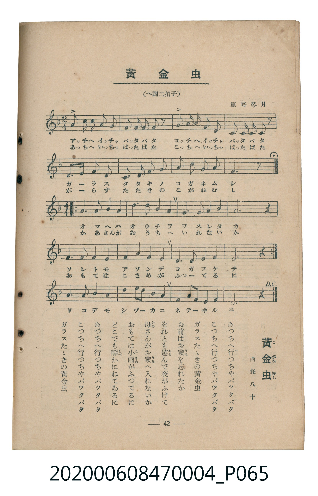

# 黃金虫

<audio controls src="kogane_mushi.mp3"></audio>

- 詞：西條八十
- 曲：室崎琴月
- 臺灣教育會公認《新定兒童唱歌》尋常科第四學年用（2020.006.0847.0004）

## 說明

原書資訊與歌詞全文（對應 P065.jpg，書頁 p. 42，參考教材第 8 首）：
調性與拍號：へ調二拍子（F 大調，主段 2/4 拍，中段轉 4/4 拍，末段 D.C. 返始至 Fine）

## 歌詞

```text
あつちへ行（い）つちやパツタパタ
こつちへ行つちやパツタパタ
ガラスたゝきの黃金虫（こがねむし）
お前（まへ）はお家（うち）を忘（わす）れたか
それとも遊（あそ）んで夜（よ）がふけて
母（かあ）さんがお家（うち）へ入（い）れないか
おもては小雨（こさめ）がふつてるに
どこでも靜（しづ）かにねてゐるに
あつちへ行つちやパツタパタ
こつちへ行つちやパツタパタ
ガラスたゝきの黃金虫
```

## 原書掃描頁



## 分析

```text
================================================================================
📊 TMD Song Profile: [ 黃金虫 ]
================================================================================
⏱  Duration:       1:07 (67.2s), 36 measures total
🎼 Key & Tempo:    首調基準 F, != 100.0 BPM, <2/4>
   - 分析範圍：      由實際發聲的音符與和弦推測調性；播放脈絡另行呈現
🎤 人聲音域:    C4 (MIDI 60) – D5 (MIDI 74) [跨度: 14 個半音 / 1.2 個八度, 難度: moderate]
   - 最低音:  C4 in [KoganeMushi #1 @ m.5, 0:04]
   - 最高音: D5 in [KoganeMushi #1 @ m.7, 0:07]
   - 適合: soprano, mezzo-soprano, contralto, tenor, baritone, bass
🏛  結構:      KoganeMushi (67.2s)
⚡ 編曲密度:        Peak 1 軌道同時演奏
🗝  調性診斷：       F 調性不明確（純淨自然大調，未偵測到可信轉調）
   - 風格氣質:    純淨自然大調（陽光明朗、易唱易記，無明顯調外色彩）
   - 轉調歷程:    全曲維持單一推測調性（未偵測到可信轉調）
   - 核心骨幹音:  A, F, G, D, C
   - 調性數值:    F 調性不明確 [相關度: 0.71, 穩定度: Ambiguous, 自然音純度: 100.0%]
   - 候選調性 (K-S): F 大調 (0.71), D 小調 (0.68), A 小調 (0.61)
   - 五度圈歷程:   -1
   - 各段落調性細節:
     • [KoganeMushi #1]: F 調性不明確 (r: 0.71, 自然音純度: 100.0%)

  [ 五度圈游移軌跡 ]
               C  
        [F ]*          G  
      Bb               D  
      Eb               A  
         Ab           E  
            Db       B  
               F# 
     (* = active key center)

  [ 十二半音累積音高分佈 ]
     C  : ████████                   9.6%
     C# :                            0.0%
     D  : ███████████               13.9%
     D# :                            0.0%
     E  :                            0.0%
     F  : ████████████████████      25.0%
     F# :                            0.0%
     G  : ████████████████          20.7%
     G# :                            0.0%
     A  : ████████████████████████  30.8%
     A# :                            0.0%
     B  :                            0.0%
--------------------------------------------------------------------------------
Assignment 軌道音域：
  - Piano         : C4 – D5 (14 個半音 / 1.2 個八度, 129 個音符)
================================================================================
```

## ABC

```abc
X:1
T:黃金虫
C:曲：室崎琴月
M:2/4
L:1/16
Q:1/4=100
K:F
V:V1 name="Piano" snm="Pia"
[V:V1]
a2 a a g2 f2 | g g f2 a2 z2 | g2 g g f2 d2 | d d f2 d2 z2 |
c3 d f2 f2 | g2 g2 a2 c2 | d2 d2 c2 a2 | f6 z2 |
M:4/4 a6 a2 a4 a4 | c6 d2 c4 a4 | g4 g4 a4 g4 | a12 z4 |
f6 f2 f4 f4 | g6 a2 g4 f4 | d6 d2 f4 g4 | a12 z4 |
a6 a2 a4 a4 | c6 d2 c4 a4 | g4 g4 a4 g4 | a12 z4 |
f6 f2 f4 f4 | g6 a2 g4 f4 | d6 d2 f4 g4 | a12 z4 |
f6 f2 f4 f4 | g4 a2 c2 d4 c4 | a4 g2 a2 g4 f4 | d12 z4 |
M:2/4 a2 a a g2 f2 | g g f2 a2 z2 | g2 g g f2 d2 | d d f2 d2 z2 |
c3 d f2 f2 | g2 g2 a2 c2 | d2 d2 c2 a2 | f6 z2 |
```

- [主旋律 TMD 檔案](kogane_mushi.tmd)
- [鋼琴伴奏 TMD 檔案](kogane_mushi_piano.tmd)
