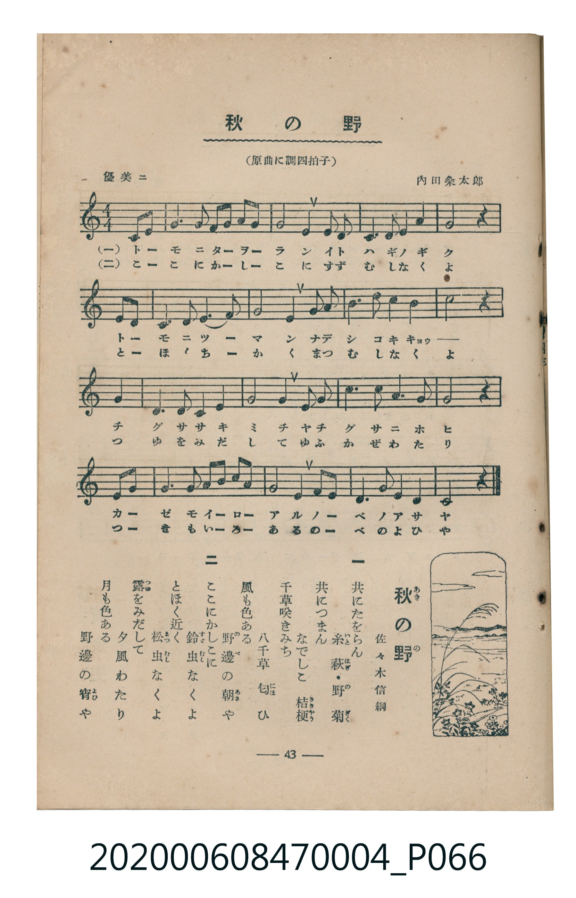

# 秋の野

> Re:Shōka 使用 AI 協助辨識與重建樂譜，可能會有錯誤。歡迎回報。

- **鋼琴伴奏版**：<br><audio controls src="aki_no_no.mp3"></audio>
- **NEUTRINO 歌聲合成版**：<br><audio controls src="aki_no_no_neutrino.mp3"></audio>

- 詞：佐々木信綱
- 曲：内田粂太郎
- 臺灣教育會公認《新定兒童唱歌》尋常科第四學年用（2020.006.0847.0004）

## 說明

原書資訊與歌詞全文（對應 P066.jpg，書頁 p. 43，參考教材第 9 首）：
調性與拍號：原曲に調四拍子（譜面移調為 C 大調 4/4 拍，弱起 1 拍）
速度指示：優美ニ
秋（あき）の野（の）　佐々木信綱


## 歌詞

```text
一
共にたをらん　糸（いと）萩（はぎ）・野（の）菊（ぎく）
共につまん　なでしこ　桔梗（ききやう）
千草咲きみち　八千草　匂（にほ）ひ
風も色ある　野（の）邊（べ）の朝（あさ）や

二
ここにかしこに　鈴（すゞ）虫（むし）なくよ
とほく近く　松（まつ）虫（むし）なくよ
露（つゆ）をみだして　夕風わたり
月も色ある　野邊の宵（よひ）や
```

## ABC

<div class="abc-score" data-abc-src="aki_no_no.abc" aria-label="五線譜載入中"></div>

[下載 ABC 原始檔](aki_no_no.abc)

## TMD 檔案連結

- [主旋律 TMD 檔案](aki_no_no.tmd) [[在 TMD Studio 編輯](https://tmdlang.github.io/Tmd-TS/#tmd=s7IKdvYPcrWy4qpTUCpJTLdSSM7PyUlNLsnMz7MqzsjMK0nNjM_KTMmPL87Iz05Ugisry88pzU21Si9KTEmNN4k3MjAyiDcwMIs3sDAxBzIMTBBKi_NLi5JTrYqTM_Lzc-JLUitKkvLzsxHyBUX5Zal5iXlANQVFIBtTwIoQClLLMlNSQdKpKZkl-UWZiTlI7kgtKga7FWxJfElRYl5xclFmAcgDCFX5RSUZ-UC3FmRUWmVkFoMMSU7Mic9OzEPyUklGKtBHxamJxfl5xch6M9Mz86xyUzOzMpFcr6Wl8Hx59-PGdS_b-xS0tLgUbRUsLLjsbRWcuWxM9E3sQPpfrJz3fs-sJ3snPG5ofTZnxZP9C59v2wg2-dnsTUCZp22tz6dseL6p6emSVS-b-8AyL9p3PW9c_GzqzBdNm57NaX7auubFqt7HDV3Ppm14um7W09ZJz1cvfTpl47O1PY8bup9u6H66Y8fz5ROfr1nzdPbsp2t3PN255fmUFe_3dIBiRA8YI3qgGAEyDEze7-lU4uLS11KwpRbgUlBQeNo3_9nsHS82t79Y0fWiox3oLqCvn7aueDatHeiKpxt6n7V3KgQYmJnpZRWkv9_TA1T8ckGjQoGegokxkPu0v_lFQzPQu8_mTgB6QsFS4eWyaUCXAkMHZPqLVfufNSwHmdvd-2LmfFCYgezb9LhxNVAK6GWg-NO1E4A2vVg75-XcRc-X7waKP2_apeCs8HTJciBbARgZCkBVILv2bHyxdbuCIYTbCTL_ZcP8p7uWPetpf75kF8jwllXP9_U9bu7mAkkC4xdo8OPGpseNIPWQuAaLrANxGxrQYhas6cmOBnCwtG4EuvFx4_zHTZMeN3U-bpoMVP988w6w9pbHjcAo6nwxYSWYu_5xI9DYzsfNu5HNf9HfBWb3PW7sh7oWZuiSx437ICY-blz1uHH548bpjxtB3GcLpzxbNB2srReEmoA2tcE09za_6O18OgkYdkC5_Y8bFwI1PG1dDREHsXuawDqBFuwGe3cTOIQWrXjc1PSiE6it6XFTN1AdsiNfNkEcuRMSPs_mzIWF2FSQSFMLJEx29YAokBtBCGgBMOOAnQxkAw3s2ALWNfNxEzC_dL6YuRrEbQJ6DugVoLFAL_Y_buqAGLEC6Dog_8X-iSBRoJfn7gNr3gcMFgKaX84BZjqg0iWPm0CBAooZUDgsALtlGSgElkwFe7cfHG9dID3P5gANQ_c-0NdAzz5dtxVsFdBEoLlgzwI1UJ6roEBBS5-LyzE70y_fL98qIDMxL9-hRtewphpkiYKNhZYdmIEtOytAEjow1wBzFDA9vljYo6ABy4KaWNQDbQKZVaNgoKALx4YKxgo1YHEfQ1SZx80dQBIqZ4Qm1zgZLAc10BTI0QWSJkBsBsQwEV2g4SBsBBQxBPONwCJmIM1wNSADwWrgznjcvAgsA8yiCo-b9oNZm8B6HjevhOp63LwZRDYtATsUJNMPEW9aB2T3QVlgPU3rkWxC9xbEKyAvrQbibjBrOkQfVAYiByJnAvEssIkNUPHpQLwKzALZDpIBmQ63q3EFIpiwxiEo6nb1EB91yKGoCwxv1JAGhX6NgjmYbxgHQrpgHlAfiAlzFkgLjsBuboGqA4nPQw3q5i4gbgd7cjs0qDcD8VpIUD9uXv64aRlYJ0QXLLgb0YJ7NzTo-oF4IcI2cNDDZEDkPiBeQlJgLyEisHd0Eh_YRtDABgU6KHgRgQ2ijcEJHRqwQAqUqEEy6AkbKIII66YN0JDbCsYgFij8QKE9Hx7aoBB73AxK2I1gXyLpAcYRRM1ssJ5JyP5vAiVSpJBuaoPqmwQMG3AmalwADWtQAoeEKSjGQCofN25FioXHjXOAotAM1Tgf7IouUsMaWG8TH9awIsQMmGDBgYmask1AxRQ0QkzBIiA2LD8gCibkoN4DDapF4FICxIIGdRMkwYNEwPkaXFqAgnMmVLQPqgYSRSAZkH4s9oATdC80mJuAbFD2edwEEgHJNMHsaYKUK9DyqHEnNGCBJRU4CQOrFqjLYNkPYU8tF5eunQK0hlAAMpW5AA)]
- [鋼琴伴奏 TMD 檔案](aki_no_no_piano.tmd) [[在 TMD Studio 編輯](https://tmdlang.github.io/Tmd-TS/#tmd=s7IKdvYPcrWy4tLSUni-vPtx47qX7X3v93S87N7zfMKWJ3u2PF3a_7yz4_2eTgUtLS5FWwULCy57WwVnLhsTfRM7rjoFpRcr573fM-vJ3gmPG1qfzVnxZP_C59s2KoFkns3eBJR52tb6fMqG55uani5Z9bK5Dyzzon3X88bFz6bOfNG06dmc5qeta16s6n3c0PVs2oan62Y9bZ30fPXSp1M2Plvb87ih--mG7qc7djxfPvH5mjVPZ89-unbH051bnk9ZAXSlkYGRgZ6BgZmegYWJOZBhYAJ0qBIXl2N2pl--X75VQGZiXn6Qh0ONrmFNNZcCENhYaNmBGfpaCrboQOHpno0vtm5_0dEOtOrJjoYXC3sUNAIMzMz0sgrSNbGo19IHm1WjYKCgC8eGCsYKNWBxH0NUmcfNHUASKmeEJtc4GSwHNdAUyNEFkiZAbAbEMBFdoOEgbAQUMQTzjcAiZiDNcDUgA8Fq4M543LwILPO4uVvhcdN-MGsTWM_j5pVQXY-bN4PIpiVgh4Jk-iHiTeuA7D4oC6ynaT2STejegngF5KXVQNwNZk2H6IPKQORA5EwgngU2sQEqPh2IV4FZINtBMiDT4XY1rkAEE9Y4BEXdrh7iow45FHWB4Y0a0qDQr1EwB_MN40BIF8wD6gMxYc4CacER2M0tUHUg8XmoQd3cBcTtYE9uhwb1ZiBeCwnqx83LHzctA-uE6IIFdyNacO-GBl0_EC9E2AYOepgMiNwHxEtICuwlRAT2jk7iA9sIGtigQAcFLyKwQbQxOKFDAxZIgRI1SAY9YQNFEGHdtAEaclvBGMQChR8otOfDQxsUYo-bQQm7EexLJD3AOIKomQ3WMwnZ_02gRIoU0k1tUH2TgGEDzkSNC6BhDUrgkDAFxRhI5ePGrUix8LhxDlAUmqEa54Nd0UVqWAOLP-LDGlaEmAETLDgwUVO2CaiYgkaIKVgExIblB0TBhBzUe6BBtQhcSoBY0KBugiR4kAg4X4NLC1BwzoSK9kHVQKIIJAPSj8UecILuhQZzE5ANyj6Pm0AiIJkmmD1NkHIFWh417oQGLLCkAifhx43Q0q0Jlv0Q9tSiVRA-KBWECbSCABXPIGgYD3UaMGjiFaINYxVM4yE0XABEmcaDBMxAUmbxubFILGCwg9ggBQZgJppxCN1IAiYwfUbxmApQHAU3HCqJYgyYbwIxD0SB-UjOweE5sO0YzkOxCc1BBpBw1bVTgAZttA9QHJlrBOYqcwEA)]

## 分析

```text
================================================================================
📊 TMD Song Profile: [ 秋の野 ]
================================================================================
⏱  Duration:       0:43 (43.6s), 16 measures total
🎼 Key & Tempo:    首調基準 C, != 88.0 BPM, <4/4>
   - 分析範圍：      由實際發聲的音符與和弦推測調性；播放脈絡另行呈現
🎤 人聲音域:    C4 (MIDI 60) – C5 (MIDI 72) [跨度: 12 個半音 / 1.0 個八度, 難度: easy]
   - 最低音:  C4 in [AkiNoNo #1 @ m.1, 0:02]
   - 最高音: C5 in [AkiNoNo #1 @ m.8, 0:20]
   - 適合: soprano, mezzo-soprano, contralto, tenor, baritone, bass
🏛  結構:      AkiNoNo (43.6s)
⚡ 編曲密度:        Peak 1 軌道同時演奏
🗝  調性診斷：       G 調性不明確（純淨自然大調，未偵測到可信轉調）
   - 風格氣質:    純淨自然大調（陽光明朗、易唱易記，無明顯調外色彩）
   - 轉調歷程:    全曲維持單一推測調性（未偵測到可信轉調）
   - 核心骨幹音:  G, C, E, D, A
   - 調性數值:    G 調性不明確 [相關度: 0.85, 穩定度: Ambiguous, 自然音純度: 97.5%]
   - 候選調性 (K-S): G 大調 (0.85), C 大調 (0.83), E 小調 (0.73)
   - 五度圈歷程:   +1
   - 各段落調性細節:
     • [AkiNoNo #1]: G 大調 (r: 0.86, 自然音純度: 97.4%, 調外音: F)

  [ 五度圈游移軌跡 ]
               C  
         F           [G ]*
      Bb               D  
      Eb               A  
         Ab           E  
            Db       B  
               F# 
     (* = active key center)

  [ 十二半音累積音高分佈 ]
     C  : ██████████████            20.8%
     C# :                            0.0%
     D  : ███████                   10.8%
     D# :                            0.0%
     E  : ████████████              17.5%
     F  : ██                         2.5%
     F# :                            0.0%
     G  : ████████████████████████  35.8%
     G# :                            0.0%
     A  : █████                      7.5%
     A# :                            0.0%
     B  : ███                        5.0%
--------------------------------------------------------------------------------
Assignment 軌道音域：
  - Piano         : C4 – C5 (12 個半音 / 1.0 個八度, 63 個音符)
================================================================================
```


## 原書掃描頁




