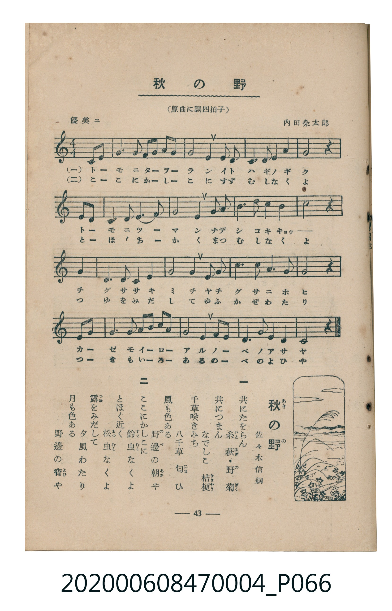

# 秋の野

> Re:Shoka 使用 AI 辨識樂譜，可能會有錯誤。歡迎回報。

<audio controls src="aki_no_no.mp3"></audio>

- 詞：佐々木信綱
- 曲：内田粂太郎
- 臺灣教育會公認《新定兒童唱歌》尋常科第四學年用（2020.006.0847.0004）

## 說明

原書資訊與歌詞全文（對應 P066.jpg，書頁 p. 43，參考教材第 9 首）：
調性與拍號：原曲に調四拍子（譜面移調為 C 大調 4/4 拍，弱起 1 拍）
速度指示：優美ニ

## 歌詞

```text
一
共（とも）にたをらん　糸萩（いとはぎ）・野菊（のぎく）
共につまん　なでしこ　桔梗（ききゃう）
千草（ちぐさ）咲（さ）きみち　八千草（やちぐさ）匂（にほ）ひ
風（かぜ）も色（いろ）ある　野邊（のべ）の朝（あさ）や

二
ここにかしこに　鈴虫（すゞむし）なくよ
とほく近（ちか）く　松虫（まつむし）なくよ
露（つゆ）をみだして　夕風（ゆふかぜ）わたり
月（つき）も色ある　野邊の宵（よひ）や
```

## ABC

```abc
X:1
T:秋の野
C:曲：内田粂太郎
M:4/4
L:1/16
Q:1/4=88
K:C
V:V1 name="Piano" snm="Pia"
[V:V1]
z4 z4 z4 E3 F | G6 A2 G2 F2 E2 D2 | C8 D4 G2 G2 | A6 G2 A4 c4 |
G8 z4 A3 G | E6 G2 c4 e4 | d8 G4 A2 c2 | d6 e2 d4 c4 |
d8 z4 G4 | e6 d2 c4 A4 | c8 G4 E2 G2 | A6 c2 G4 E4 |
D8 z4 E3 F | G6 A2 G2 A2 c2 d2 | c8 A4 G4 | D6 E2 G4 D4 |
C8 z4 z4 |
```

## TMD 檔案連結

- [主旋律 TMD 檔案](aki_no_no.tmd) [[在 TMD Studio 編輯](https://tmdlang.github.io/Tmd-TS/#tmd=s7IKdvYPcrWy4qpTUCpJTLdSSM7PyUlNLsnMz7MqzsjMK0nNjM_KTMmPL87Iz05Ugisry88pzU21Si9KTEmNN4k3MjAyiDcwMIs3sDAxBzIMTBBKi_NLi5JTrYqTM_Lzc-JLUitKkvLzsxHyBUX5Zal5iXlANQVFIBtTwIoQClLLMlNSQdKpKZkl-UWZiTlI7kgtKga7FWxJfElRYl5xclFmAcgDCFUlGalAxxanJhbn5xXjFNbSUni-vPtx47qX7X0KWlpcirYKFhZc9rYKzlw2JvomdiB9L1bOe79n1pO9Ex43tD6bs-LJ_oXPt20Em_hs9iagzNO21udTNjzf1PR0yaqXzX1gmRftu543Ln42deaLpk3P5jQ_bV3zYlXv44auZ9M2PF0362nrpOerlz6dsvHZ2p7HDd1PN3Q_3bHj-fKJz9eseTp79tO1O57u3PJ8yor3ezpAgawHDGQ9UCADGQYm7_d0KnFx6Wsp2FILcCkoKDztm_9s9o4Xm9tfrOh60dEOdBfQ109bVzyb1g50xdMNvc_aOxUCDMzM9LIK0t_v6QEqfrmgUaFAT8HEGMh92t_8oqEZ6N1ncycAPaFgqfBy2TSgS4GhAzL9xar9zxqWg8zt7n0xcz4ozED2bXrcuBooBfQyUPzp2glAm16snfNy7qLny3cDxZ837VJwVni6ZDmQrQCMDAWgKpBdeza-2LpdwRDC7QSZ_7Jh_tNdy571tD9fsgtkeMuq5_v6Hjd3c4Ekn-xoAPuwdSPQ_MeNKx43NQG1Aa1-3Dj_cdOkx02dj5smP25oeL55x4sJK8FqWkDKGtc_buwDqWzeDUwcL_q7wFLrgIKPG_uhFgMNBRu05HHjPogpjxtXPW5c_rhx-uNGEPfZwinPFk0H6-wFoabmx41tMM29zS96gUEElFv4uHHC48apQImnk4BJCigCYoP17AfJNjQ8bV2NUN8EdCCSlh6gh4BagO7YDda1CRwmi0Dp53EjMHHPAYk2Nb3ohBjd8rgJFHCPG5seN3UDjQb67mUT3Hc7wVLrns2ZCxZpgjqlqQUSmLt6QBTIcyAEtBJoPtivQDbQqI4tL2auBmuc-bhp3uMmYHgAfQ80EBgq_Y-bOiCagYG7G8h_sX8izPfdYEX9oBCbuw9mxD5QwGI14uUciFeA0qDQBEUjKKAWgN2yDBRcS6ZCA6Cp7XHjVqRg6AdHexfIlGdzOqCmNIIDBBxEaMECDIqn67aCDQKqBNoKDgqgZsrzHRQoaOlzcTlmZ_rl--VbBWQm5uU71BjUKFSDLFGwMTTTsgOzsOV4BUheAGYsYKYDpvMXC3sUNGC5VBOLeqBVULM0gMo1rRQeN3cA8R6FGiC5CMwCZhuFx037oexNcNmVUJHNQNklYH0g0X6IaNM6IN0HpoGiTevBogYo1u3qAVnXOBlmIJQFTDdADLQSzJ6OVXYmEM8CG9yAUNe4Coj7waIQL8CtqwEydcEQnTYGkyYKNVB1plBxEDQDYhDfBKrOCIhrgKUMQgUIgkRBEKQShGvA-mAQJALjG8ZBGajWIDsHotQU6BzcMQyK2F095EQsUnQ2t0DZ88CRBo3G5i4gbgeH4HZoNIIidy0oGh83L3_ctAyuGkdk7oZGBzAVNC6EsrthmsCi-4B4CY6oA8UAlsiDRBIiQOEBaYwIUSMYE1khLEjBGtDUgPXCRZDiBsMkWOTATCQUOTs6yYicpg3QAN8KxWvBoTYfGtyNQAzKY43gEEJSC47M2WC1k3BGS1MbVANQSSMwIzcuAOcoSN4CFo8QFY1bwaKwnDcHKAqKsPlgK0EpAzVSkIMJHGbwMIQleGBmwRUroCjFzC1g5chKoDGCI0IQmRdvhABbE-RECCSVg3MNuHgDsYE5AVIaNcHyErA0AhZzoOAHlklgEVChB9IDDk1wpOHIK73QSGkCsqHZsQkiBooGoChYBBgdjeAytHEnNGKAJSsojzRuAjsEohMpYrAVYfBMAI4oLPECiwV4GkcJdFhsgaMargK9JEQvW2u4arm4dO0UoDWZApCpzMUFAA)]
- [鋼琴伴奏 TMD 檔案](aki_no_no_piano.tmd) [[在 TMD Studio 編輯](https://tmdlang.github.io/Tmd-TS/#tmd=s7IKdvYPcrWy4tLSUni-vPtx47qX7X3v93S87N7zfMKWJ3u2PF3a_7yz4_2eTgUtLS5FWwULCy57WwVnLhsTfRM7rjoFpRcr573fM-vJ3gmPG1qfzVnxZP_C59s2KoFkns3eBJR52tb6fMqG55uani5Z9bK5Dyzzon3X88bFz6bOfNG06dmc5qeta16s6n3c0PVs2oan62Y9bZ30fPXSp1M2Plvb87ih--mG7qc7djxfPvH5mjVPZ89-unbH051bnk9ZAXSlkYGRgZ6BgZmegYWJOZBhYAJ0qBIXl2N2pl--X75VQGZiXn6Qh0ONQY1CNZcCENgYmmnZgVn6Wgq26EDh6Z6NL7Zuf9HRDrTryY6GFwt7FDQCDMzM9LIK0jWxqNfSB5tVo2CgoAuG6LQxmDRRqIGqM4WKg6AZEIP4JlB1RkBco2CIpAIEQaIgCFIJwjVgfTAIEoHxDeOgDFRrkJ0DUWoKdA7uMAB5fVcP8V6HeBHhHLgzjBHuMYIxkRXCHATWgKYGrBcuguQzDJNgXoOZSMhrOzpJ8BqyZWCb4S6BBTowwnD5DRQwmDEGVo6sBOovHN5CJCC83gJmDOK9hS0RwiMC7E0svoL5AR7OKE6G-RUcUHAV6GkZPXfUcNWiZVYflMxqAs2roPwFgobx8IwEZEYbxiqYxgNp0_hYrCImQJZJLIyCq8BmDpQChg1MO5I5cKYRkDZCETEAM9EMQ7cQbjhUAtMyvE7Cocsc7kYgC8lzBpBg1bVTgIasApCpzMUFAA)]

## 分析

```text
================================================================================
📊 TMD Song Profile: [ 秋の野 ]
================================================================================
⏱  Duration:       0:46 (46.4s), 17 measures total
🎼 Key & Tempo:    首調基準 C, != 88.0 BPM, <4/4>
   - 分析範圍：      由實際發聲的音符與和弦推測調性；播放脈絡另行呈現
🎤 人聲音域:    C4 (MIDI 60) – E5 (MIDI 76) [跨度: 16 個半音 / 1.3 個八度, 難度: moderate]
   - 最低音:  C4 in [AkiNoNo #1 @ m.3, 0:05]
   - 最高音: E5 in [AkiNoNo #1 @ m.6, 0:15]
   - 適合: soprano, mezzo-soprano, contralto, tenor, baritone, bass
🏛  結構:      AkiNoNo (46.4s)
⚡ 編曲密度:        Peak 1 軌道同時演奏
🗝  調性診斷：       G 調性不明確（純淨自然大調，未偵測到可信轉調）
   - 風格氣質:    純淨自然大調（陽光明朗、易唱易記，無明顯調外色彩）
   - 轉調歷程:    全曲維持單一推測調性（未偵測到可信轉調）
   - 核心骨幹音:  G, C, D, A, E
   - 調性數值:    G 調性不明確 [相關度: 0.81, 穩定度: Ambiguous, 自然音純度: 98.3%]
   - 候選調性 (K-S): G 大調 (0.81), C 大調 (0.81), A 小調 (0.56)
   - 五度圈歷程:   +1
   - 各段落調性細節:
     • [AkiNoNo #1]: G 調性不明確 (r: 0.81, 自然音純度: 98.3%, 調外音: F)

  [ 五度圈游移軌跡 ]
               C  
         F           [G ]*
      Bb               D  
      Eb               A  
         Ab           E  
            Db       B  
               F# 
     (* = active key center)

  [ 十二半音累積音高分佈 ]
     C  : ██████████████████████    22.5%
     C# :                            0.0%
     D  : ██████████████████████    22.5%
     D# :                            0.0%
     E  : ██████████████            14.2%
     F  : ██                         1.7%
     F# :                            0.0%
     G  : ████████████████████████  24.6%
     G# :                            0.0%
     A  : ██████████████            14.6%
     A# :                            0.0%
     B  :                            0.0%
--------------------------------------------------------------------------------
Assignment 軌道音域：
  - Piano         : C4 – E5 (16 個半音 / 1.3 個八度, 62 個音符)
================================================================================
```


## 原書掃描頁




