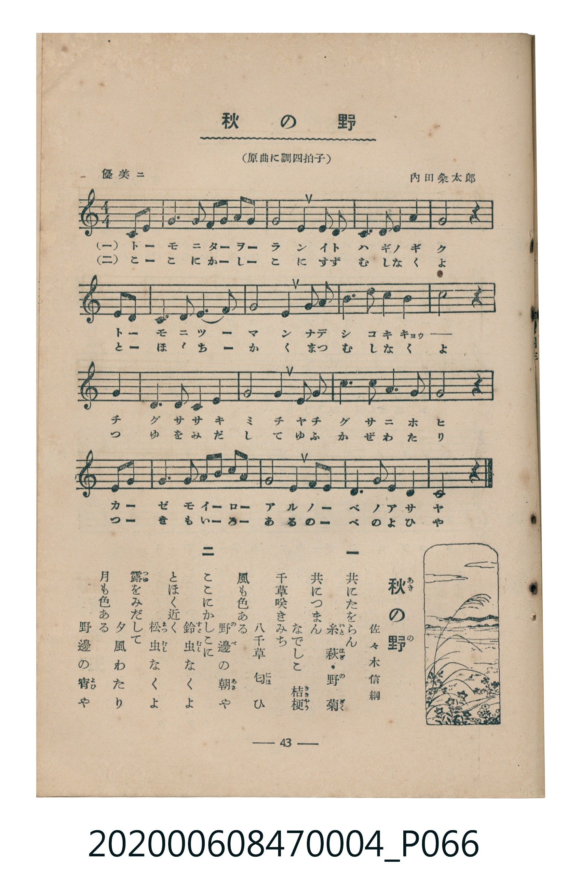

# 秋の野

> Re:Shōka 使用 AI 協助辨識與重建樂譜，可能會有錯誤。歡迎[回報](https://github.com/TMDLang/reshoka/issues)。

- **鋼琴伴奏版**：<br><audio controls src="aki_no_no.mp3"></audio>
- **NEUTRINO 歌聲合成版**：<br><audio controls src="aki_no_no_neutrino.mp3"></audio>

- 詞：佐々木信綱
- 曲：内田粂太郎
- 臺灣教育會公認《新定兒童唱歌》尋常科第四學年用（2020.006.0847.0004）

## 說明

原書資訊與歌詞全文（對應 P066.jpg，書頁 p. 43，參考教材第 9 首）：
調性與拍號：原曲に調四拍子（譜面移調為 C 大調 4/4 拍，弱起 1 拍）
速度指示：優美ニ
秋（あき）の野（の）　佐々木信綱


## 歌詞

```text
一
共にたをらん　糸（いと）萩（はぎ）・野（の）菊（ぎく）
共につまん　なでしこ　桔梗（ききやう）
千草咲きみち　八千草　匂（にほ）ひ
風も色ある　野（の）邊（べ）の朝（あさ）や

二
ここにかしこに　鈴（すゞ）虫（むし）なくよ
とほく近く　松（まつ）虫（むし）なくよ
露（つゆ）をみだして　夕風わたり
月も色ある　野邊の宵（よひ）や
```

## ABC

<div class="abc-score" data-abc-src="aki_no_no.abc" aria-label="五線譜載入中"></div>

[下載 ABC 原始檔](aki_no_no.abc)

## TMD 檔案連結

- [主旋律 TMD 檔案](aki_no_no.tmd) [[在 TMD Studio 編輯](https://tmdlang.github.io/Tmd-TS/#tmd=s7IKdvYPcrWy4qpTUCpJTLdSSM7PyUlNLsnMz7MqzsjMK0nNjM_KTMmPL87Iz05Ugisry88pzU21Si9KTEmNN4k3MjAyiDcwMIs3sDAxBzIMTBBKi_NLi5JTrYqTM_Lzc-JLUitKkvLzsxHyBUX5Zal5iXlANQVFIBtTwIoQClLLMlNSQdKpKZkl-UWZiTlI7kgtKga7FWxJfElRYl5xclFmAcgDCFX5RSUZ-UC3FmRUWmVkFoMMSU7Mic9OzEPyUklGKtBHxamJxfl5xch6M9Mz86xyUzOzMrG4HmpxQWJ6qlWAgZmZEpeWlsLz5d2PG9e9bO9T0NLiUrRVsLDgsrdVcOayMdE3sQNpfbFy3vs9s57snfC4ofXZnBVP9i98vm0j2NBnszcBZZ62tT6fsuH5pqanS1a9bO4Dy7xo3_W8cfGzqTNfNG16Nqf5aeuaF6t6Hzd0PZu24em6WU9bJz1fvfTplI3P1vY8buh-uqH76Y4dz5dPfL5mzdPZs5-u3fF055bnU1a839MBiis9YFzpgeIKyDAweb-nU4mLS19LwZZagEtBQeFp3_xns3e82Nz-YkXXi452oLuAvn7auuLZtHagK55u6H3W3qkACjK9rIL093t6gIpfLmhUKNBTMDEGcp_2N79oaAZ699ncCUBPKFgqvFw2DehSYOiATH-xav-zhuUgc7t7X8ycDwozkH2bHjeuBkoBvQwUf7p2AtCmF2vnvJy76Pny3UDx5027FJwVni5ZDmQrACNDAagKZNeejS-2blcwhHA7Qea_bJj_dNeyZz3tz5fsAhnesur5vr7Hzd1cIElg_AINftzY9LgRpB4S12CRdSBuQwNazII1PdnRAA6W1o1ANz5unP-4adLjps7HTZOB6p9v3gHW3vK4ERhFnS8mrARz1z9uBBrb-bh5N7L5L_q7wOy-x439UNfCDF3yuHEfxMTHjaseNy5_3Dj9cSOI-2zhlGeLpoO19YJQE9CmNpjm3uYXvZ1PJwHDDii3_3HjQqCGp62rIeIgdk8TWCfQgt1g724Ch9CiFY-bml50ArU1PW7qBqpDduTLJogjd0LC59mcubAQmwoSaWqBhMmuHhAFciMIAS0AZhywk4FsoIEdW8C6Zj5uAuaXzhczV4O4TUDPAb0CNBboxf7HTR0QI1YAXQfkv9g_ESQK9PLcfWDN-4DBQkDzyznATAdUuuRxEyhQQDEDCocFYLcsA4XAkqlg7_aD460LpOfZHKBh6N4H-hro2afrtoKtApoINBfsWaAGynMVFCho6XNxOWZn-uX75VsFZCbm5TvU6BrWVIMsUbCx0LIDM7BlZwVIQgfmGmCOAqbHFwt7FDRgWVATi3qgTSCzahQMFHTh2FDBWKEGLO5jiCrzuLkDSELljNDkGieD5aAGmgI5ukDSBIjNgBgmogs0HISNgCKGYL4RWMQMpBmuBmQgWA3cGY-bF4FlgFlU4XHTfjBrE1jP4-aVUF2PmzeDyKYlYIeCZPoh4k3rgOw-KAusp2k9kk3o3oJ4BeSl1UDcDWZNh-iDykDkQORMIJ4FNrEBKj4diFeBWSDbQTIg0-F2Na5ABBPWOARF3a4e4qMOORR1geGNGtKg0K9RMAfzDeNASBfMA-oDMWHOAmnBEdjNLVB1IPF5qEHd3AXE7WBPbocG9WYgXgsJ6sfNyx83LQPrhOiCBXcjWnDvhgZdPxAvRNgGDnqYDIjcB8RLSArsJUQE9o5O4gPbCBrYoEAHBS8isEG0MTihQwMWSIESNUgGPWEDRRBh3bQBGnJbwRjEAoUfKLTnw0MbFGKPm0EJuxHsSyQ9wDiCqJkN1jMJ2f9NoESKFNJNbVB9k4BhA85EjQugYQ1K4JAwBcUYSOXjxq1IsfC4cQ5QFJqhGueDXdFFalgD623iwxpWhJgBEyw4MFFTtgmomIJGiClYBMSG5QdEwYQc1HugQbUIXEqAWNCgboIkeJAIOF-DSwtQcM6EivZB1UCiCCQD0o_FHnCC7oUGcxOQDco-j5tAIiCZJpg9TZByBVoeNe6EBiywpAInYWDVAnUZLPsh7Knl4tK1U4DWEApApjIXAA)]
- [鋼琴伴奏 TMD 檔案](aki_no_no_piano.tmd) [[在 TMD Studio 編輯](https://tmdlang.github.io/Tmd-TS/#tmd=s7IKdvYPcrWy4qpTUCpJTLdSyC8qychPL0osyKi0ysgsLskvykxOzInPTsxLVIIrKs4vLUpOjS9ITE-1CjAwM1Pi0tJSeL68-3Hjupftfe_3dLzs3vN8wpYne7Y8Xdr_vLPj_Z5OBS0tLkVbBQsLLntbBWcuGxN9EzuQeS9Wznu_Z9aTvRMeN7Q-m7Piyf6Fz7dtBNv0bPYmoMzTttbnUzY839T0dMmql819YJkX7bueNy5-NnXmi6ZNz-Y0P21d82JV7-OGrmfTNjxdN-tp66Tnq5c-nbLx2dqexw3dTzd0P92x4_nyic_XrHk6e_bTtTue7tzyfMoKoCuNDIwM9AwMzPQMLEzMgQwDE6BDlbi4HLMz_fL98q0CMhPz8oM8HGp0DWuquRSAwMZCyw7M0NdSsEUHCk_3bHyxdfuLjnagVU92NLxY2KOgAQoevayCdE0s6rX0wWbVKBgo6MKxoYKxQg1Y3McQVeZxcweQhMoZock1TgbLQQ00BXJ0gaQJEJsBMUxEF2g4CBsBRQzBfCOwiBlIM1wNyECwGrgzHjcvAss8bu5WeNy0H8zaBNbzuHklVNfj5s0gsmkJ2KEgmX6IeNM6ILsPygLraVqPZBO6tyBeAXlpNRB3g1nTIfqgMhA5EDkTiGeBTWyAik8H4lVgFsh2kAzIdLhdjSsQwYQ1DkFRt6uH-KhDDkVdYHijhjQo9GsUzMF8wzgQ0gXzgPpATJizQFpwBHZzC1QdSHwealA3dwFxO9iT26FBvRmI10KC-nHz8sdNy8A6Ibpgwd2IFty7oUHXD8QLEbaBgx4mAyL3AfESkgJ7CRGBvaOT-MA2ggY2KNBBwYsIbBBtDE7o0IAFUqBEDZJBT9hAEURYN22AhtxWMAaxQOEHCu358NAGhdjjZlDCbgT7EkkPMI4gamaD9UxC9n8TKJEihXRTG1TfJGDYgDNR4wJoWIMSOCRMQTEGUvm4cStSLDxunAMUhWaoxvlgV3SRGtbA4o_4sIYVIWbABAsOTNSUbQIqpqARYgoWAbFh-QFRMCEH9R5oUC0ClxIgFjSomyAJHiQCztfg0gIUnDOhon1QNZAoAsmA9GOxB5yge6HB3ARkg7LP4yaQCEimCWZPE6RcgZZHjTuhAQssqcBJ-HEjtHRrgmU_hD21aBWED0oFYQKtIEDFMwgaxkOdBgyaeIVow1gF03gIDRcAUabxIAEzkJRZfG4sEgsY7CA2SIEBmIlmHEI3koAJTJ9RPKYCFEfBDYdKohgD5ptAzANRYD6Sc3B4Dmw7hvNQbEJzkAEkXHXtFKBBG-0DFEfmGoG5ylwA)]

## 分析

```text
================================================================================
📊 TMD Song Profile: [ 秋の野 ]
================================================================================
⏱  Duration:       0:43 (43.6s), 16 measures total
🎼 Key & Tempo:    首調基準 C, != 88.0 BPM, <4/4>
   - 分析範圍：      由實際發聲的音符與和弦推測調性；播放脈絡另行呈現
🎤 人聲音域:    C4 (MIDI 60) – C5 (MIDI 72) [跨度: 12 個半音 / 1.0 個八度, 難度: easy]
   - 最低音:  C4 in [AkiNoNo #1 @ m.1, 0:02]
   - 最高音: C5 in [AkiNoNo #1 @ m.8, 0:20]
   - 適合: soprano, mezzo-soprano, contralto, tenor, baritone, bass
🏛  結構:      AkiNoNo (43.6s)
⚡ 編曲密度:        Peak 1 軌道同時演奏
🗝  調性診斷：       G 調性不明確（純淨自然大調，未偵測到可信轉調）
   - 風格氣質:    純淨自然大調（陽光明朗、易唱易記，無明顯調外色彩）
   - 轉調歷程:    全曲維持單一推測調性（未偵測到可信轉調）
   - 核心骨幹音:  G, C, E, D, A
   - 調性數值:    G 調性不明確 [相關度: 0.85, 穩定度: Ambiguous, 自然音純度: 97.5%]
   - 候選調性 (K-S): G 大調 (0.85), C 大調 (0.83), E 小調 (0.73)
   - 五度圈歷程:   +1
   - 各段落調性細節:
     • [AkiNoNo #1]: G 大調 (r: 0.86, 自然音純度: 97.4%, 調外音: F)

  [ 五度圈游移軌跡 ]
               C  
         F           [G ]*
      Bb               D  
      Eb               A  
         Ab           E  
            Db       B  
               F# 
     (* = active key center)

  [ 十二半音累積音高分佈 ]
     C  : ██████████████            20.8%
     C# :                            0.0%
     D  : ███████                   10.8%
     D# :                            0.0%
     E  : ████████████              17.5%
     F  : ██                         2.5%
     F# :                            0.0%
     G  : ████████████████████████  35.8%
     G# :                            0.0%
     A  : █████                      7.5%
     A# :                            0.0%
     B  : ███                        5.0%
--------------------------------------------------------------------------------
Assignment 軌道音域：
  - Piano         : C4 – C5 (12 個半音 / 1.0 個八度, 63 個音符)
================================================================================
```


## 原書掃描頁




