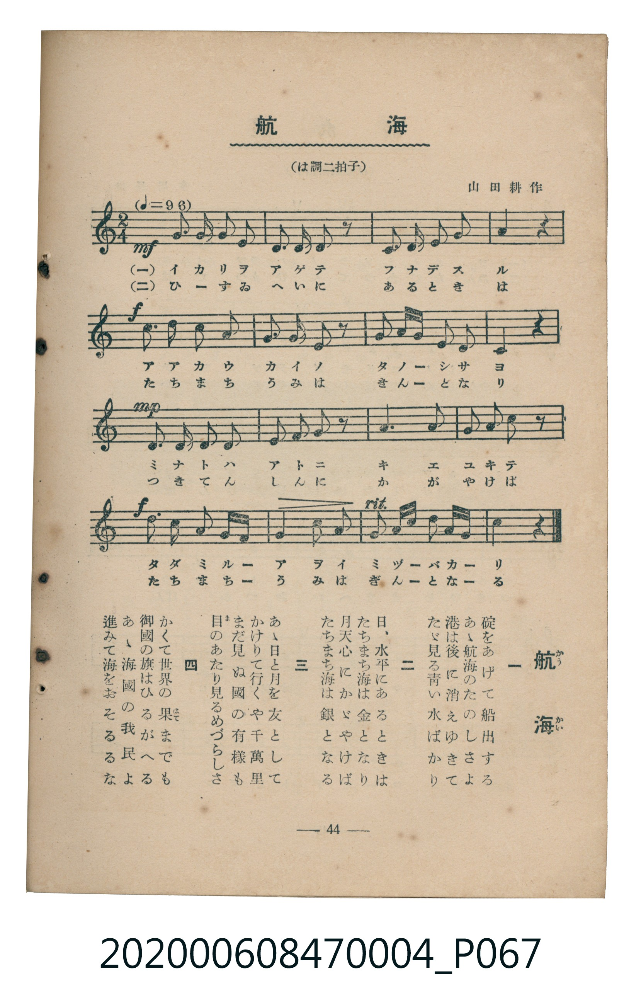

# 航海

> Re:Shōka 使用 AI 協助辨識與重建樂譜，可能會有錯誤。歡迎回報。

- **NEUTRINO 歌聲合成版**：<br><audio controls src="kokai_neutrino.mp3"></audio>
- **鋼琴伴奏版**：<br><audio controls src="kokai.mp3"></audio>


- 曲：山田耕作
- 臺灣教育會公認《新定兒童唱歌》尋常科第四學年用（2020.006.0847.0004）

## 說明

原書資訊與歌詞全文（對應 P067.jpg，書頁 p. 44，參考教材第 10 首）：
調性與拍號：は調二拍子（C 大調 2/4 拍，♩=96）
航（かう）海（かい）


## 跨冊／重複收錄參照

> 同曲＋同名異曲（《公學校唱歌》與《新定兒童唱歌》第五學年〈航海〉為同曲；《新定兒童唱歌》四年級與《共益商社唱歌教科書》卷一為同名異曲）

- **[同名異曲]** 《共益商社唱歌教科書》卷一・生徒用（明治38年／1905）：[**〈航海〉**](../../../kyoeki_shoka/kan_1_854862/18_kokai/index.md)（`G` / `4/4` — [原始 TMD](../../../kyoeki_shoka/kan_1_854862/18_kokai/kokai.tmd)）
- **[同名異曲]** 《新定兒童唱歌》尋常科第五學年用（2020.006.0847.0005）：[**〈航海〉**](../../grade_5_2020.006.0847.0005/2_05_kokai/index.md)（`F` / `3/4` — [原始 TMD](../../grade_5_2020.006.0847.0005/2_05_kokai/kokai.tmd)）
- 總表：[跨冊重複與同名歌曲總索引](../../../duplicate_songs.md)

## 歌詞

```text
一
碇をあげて船出する
あゝ航海のたのしさよ
港は後に消えゆきて
たゞ見る青い水ばかり

二
日、水平にあるときは
たちまち海は金となり
月天心にかゞやけば
たちまち海は銀となる

三
あゝ日と月を友として
かけりて行くや千萬里
まだ見ぬ國の有樣も
目（ま）のあたり見るめづらしさ

四
かくて世界の果（はて）までも
御國の旗はひるがへる
あゝ海國の我民よ
進みて海をおそるるな
```

## ABC

```abc
X:1
T:航海
C:曲：山田耕作
M:2/4
L:1/16
Q:1/4=96
K:C
V:V1 name="Piano" snm="Pia"
[V:V1]
!mf! G3 G G2 E2 | D3 D D2 z2 | C3 D E2 G2 | A4 z4 |
w: 1.~イ カ リ ヲ | ア ゲ テ | フ ナ デ ス | ル
w: 2.~ひ _ す ゐ | へ い に | あ る と き | は
!f! c3 d c2 A2 | G3 G E2 z2 | G2 A G E2 D2 | C4 z4 |
w: 1.~ア ア カ ウ | カ イ ノ | タ ノ _ シ サ | ヨ
w: 2.~た ち ま ち | う み は | き ん _ と な | り
!mp! D3 D D2 D2 | E2 F2 G2 z2 | A6 A2 | G2 A2 c2 z2 |
w: 1.~ミ ナ ト ハ | ア ト ニ | キ エ | ユ キ テ
w: 2.~つ き て ん | し ん に | か が | や け ば
!f! d3 c A2 G F | G4 c2 A2 | G2 A c d2 A G | c4 z4 |
w: 1.~タ ダ ミ ル _ | ア ヲ イ | ミ ヅ _ バ カ _ | リ
w: 2.~た ち ま ち _ | う み は | ぎ ん _ と な _ | る
```

## TMD 檔案連結

- [主旋律 TMD 檔案](kokai.tmd) [[在 TMD Studio 編輯](https://tmdlang.github.io/Tmd-TS/#tmd=s7IKdvYPcrWy4qpTUCpJTLdSSM7PyUlNLsnMz7MqzsjMK0nNjM_KTMmPL87Iz05Ugisry88pzU21Si9KTEmNN4k3MjAyiDcwMIs3sDAxBzIMTBBKi_NLi5JTrYqTM_Lzc-JLUitKkvLzsxHyBUX5Zal5iXlANQVFIBtTwIoQClLLMlNSQdKpKZkl-UWZiTlI7kgtKga7FWxJfElRYl5xclFmAcgDCFX5RSUZ-UC3FmRUWmVkFoMMSU7Mic9OzEPyUklGKtBH5YklqUXogkBjy1KBtmppKbzoWPVs63YFLS0uRVsFSzMue1sFZy4bI30TO5CeZ7M3vd8z6-nGjc-nbHjRMPXJ3jlgo16073reuPjZ1JkvmjY9m9P8tHXNi1W9jxu6nk3b8HTdrKetk56vXvp0ysZna3seN3Q_3dD9dMeO58snPl-z5uns2U_X7ni6c8vzKSve7-kABbMeMJj1QMEMZBiYvN_TqcTFpa-lYEstwKWgoPC0b_6z2TtebG5_saLrRUc70F0vVs572rri2bR2oCuebuh91t6pEGBgZq6XVZD-fk8PUPHLBY0KBXoKJkAX9Tztb37R0Az07rO5E4CeUDA0UHi5bBrQqcCwARn_YtX-Zw3LQQZ3976YOR8o-rhxPVDwya4eoMjTtROAljgrPF2yHCimAAxaBaAo0NhHM1faWpoBjeECG9KxCqjscWP348Y2oBgwUmDcFpiSJzsaQNTzRe2PmyY9bmx63Agkl73o2Pm0fdfjxpmPm7pB0iCJprmQeH3cuO5x43wwOf1x49THTR0gFc92rAc68Om-nseNq59tA1rS8bip7XFjL9AwiAHzHzfNe7GsG2jgy7lAK1qebdjyuHEDyDFNXRCX7OoBGzR96eOGRqDs052bgWaBbQY6eAXYrPUwsxoXPm7cByTB7ln_sn0iWMUqkFkgM-Z0PF2y8un-ZrABQBvmPW5qedwIVLQBhwFdDTADuqHB0onwN8hJjSuAhgKD6Gk_xDFAr0M9BuRPBNoLCrWFQN_3A6162tv8YsKal-1gD4HtWQDyeuOap3OA5LpnczqfrVj8uKkJHPKz14EjZR8wRsCBCowCYFh1QcLqcVPj48alj5uAUqDABrsNmODhNvcDrX2yY9rzqUCb1z2bNwdsFDAmloFNA1q8HGrN030LoZZPBxoEVLEJHKxAbTtQ4hgYHlB1HROfbQB6DBy7Lxs2PW7cDzQWFFygdAL07lyw84BKV4FUUJ6poEBBS5-LyxtYkGZaBWQm5uU71BjUVINsULAxNNOyA7Ow5WUFYC4CJmZgHChomCg83dD_fH2DDjwDamLRALQIZFiNQnVuWq2CqYIuEJqCaWMgrlEwAosYgWkDsIghVAQkD1JXo2AGFoHIg2AN2EgfwxqFx01LwCKPm1YrPG5eBWI1bwLredy0CCqzCSjWBjf9cfNUiHhzFxC3g1XshMqsxm6PEVCuEWQqWF_jTLCeCRA9jTugoi1ADNIPtaWxCWp7N5C9AqyiFyqzHsMW_MG9q4es4AaGtmEcJCjjICxQMNbAowAUvBDHgkTMoCKgaIBFAfYAhwXrInCgg1jLoAEOCT5QlDxu7kMERdN-cHCDRB43bQeTW6EBDgoYXAE-HxqwC0F5G8qCBCAoMkH8_dDAhAU5KIAfN00Gy0GCHJQgQC7oIjHId3SSl8ILalHSMyQwQcFqAg5ymFNh6RkEEZECYoHjCawIEeLN0JAAJ9gOMKsf6i9QXMDEupFCfC2SBY-bQGEBMgcUTxA5pAyBFOLQrAQMR2AZBA9LkMx0pJBFTuQgO-H2NPZAbW8B8yaCyQ1we_CGOLC0JTeRA1M3yHpgyIEC0BQY1LA0Dg1O5BAGCoDVg5I7MJlDtGJP56BUCwqpBmgMQIoHRA6AFTWQIggWT4-bW8EkqHiA5AiQDCgdkpvOISkdRILSOkgckpOwpXNYfCDsqeXi0rVTAJf0CkCGMhcA)]
- [鋼琴伴奏 TMD 檔案](kokai_piano.tmd) [[在 TMD Studio 編輯](https://tmdlang.github.io/Tmd-TS/#tmd=s7IKdvYPcrWy4tLSUnjRserZ1u3v93S87N7zfMKWJ3u2PF3a_7yz4_2eTgUtLS5FWwVLMy57WwVnLhsjfRM7rjoFpWezN73fM-vpxo3Pp2x40TD1yd45SiDhF-27njcufjZ15oumTc_mND9tXfNiVe_jhq5n0zY8XTfraeuk56uXPp2y8dnanscN3U83dD_dseP58onP16x5Onv207U7nu7c8nzKCqBDjAyMDPQMDMz0DCxMzIEMAxOgW5S4uLzzsxMzrQIyE_PygzwcagxqqrkUgMDG0EzLDszS11KwRQcKQPOf7Gh4sbBHQcNE4emG_ufrG3QUAgzMzPWyCtI1sWjQ0gcbVqNQnZtWq2CqoAuEpmDaGIhrFIzAIkZg2gAsYggVAcmD1NUomIFFIPIgWAM20sewRuFx0xKwyOOm1QqPm1eBWM2bwHoeNy2CymwCirXBTX_cPBUi3twFxO1gFTuhMqux22MElGsEmQrW1zgTrGcCRE_jDqhoCxCD9ENtaWyC2t4NZK8Aq-iFyqzHsAV_cO_qISu4gaFtGAcJyjgICxSMNfAoAAUvxLEgETOoCCgaYFGAPcBhwboIHOgg1jJogEOCDxQlj5v7EEHRtB8c3CCRx03bweRWaICDAgZXgM-HBuxCIN4HZUECEBSZIP5-aGDCghwUwI-bJoPlIEEOShAgF3SRGOQ7OslL4QW1KOkZEpigYDUBBznMqbD0DIKISAGxwPEEVoQI8WZoSIATbAeY1Q_1FyguYGLdSCG-FsmCx02gsACZA4oniBxShkAKcWhWAobj40aIWlBYgmSmI4UsciIH2Qm3p7EHansLmDcRTG6A24M3xIFlFrmJHJi6QdYDQw4UgKbAoIalcWhwIocwUACsHpTcgckcohV7OgelWlBINUBjAFI8IHIArKiBFEGweHrc3AomQcUDJEeAZEDpkNx0DknpIBKU1kHikJyELZ3D4gNhTy1KQe-DXNBbQMt5YDjEK0QbxsIoYFjFA1mm8bFghgEWBSZAhkksiALKQg1BiIEoZD1IJsBNRpOHmoFiMZI6EAtqEDZrgAwUY4yAYka5sXAabhm643A6BxhsunYK4JCL9gEKIzhGYI4yFwA)]

## 分析

```text
================================================================================
📊 TMD Song Profile: [ 航海 ]
================================================================================
⏱  Duration:       0:20 (20.0s), 16 measures total
🎼 Key & Tempo:    首調基準 C, != 96.0 BPM, <2/4>
   - 分析範圍：      由實際發聲的音符與和弦推測調性；播放脈絡另行呈現
🎤 人聲音域:    C4 (MIDI 60) – D5 (MIDI 74) [跨度: 14 個半音 / 1.2 個八度, 難度: moderate]
   - 最低音:  C4 in [Kokai #1 @ m.3, 0:02]
   - 最高音: D5 in [Kokai #1 @ m.5, 0:05]
   - 適合: soprano, mezzo-soprano, contralto, tenor, baritone, bass
🏛  結構:      Kokai (20.0s)
⚡ 編曲密度:        Peak 1 軌道同時演奏
🗝  調性診斷：       G 調性不明確（純淨自然大調，未偵測到可信轉調）
   - 風格氣質:    純淨自然大調（陽光明朗、易唱易記，無明顯調外色彩）
   - 轉調歷程:    全曲維持單一推測調性（未偵測到可信轉調）
   - 核心骨幹音:  G, D, A, C, E
   - 調性數值:    G 調性不明確 [相關度: 0.78, 穩定度: Ambiguous, 自然音純度: 97.2%]
   - 候選調性 (K-S): G 大調 (0.78), C 大調 (0.76), A 小調 (0.63)
   - 五度圈歷程:   +1
   - 各段落調性細節:
     • [Kokai #1]: G 調性不明確 (r: 0.78, 自然音純度: 97.2%, 調外音: F)

  [ 五度圈游移軌跡 ]
               C  
         F           [G ]*
      Bb               D  
      Eb               A  
         Ab           E  
            Db       B  
               F# 
     (* = active key center)

  [ 十二半音累積音高分佈 ]
     C  : ████████████████████      20.4%
     C# :                            0.0%
     D  : ████████████████████      21.3%
     D# :                            0.0%
     E  : █████████                  9.3%
     F  : ███                        2.8%
     F# :                            0.0%
     G  : ████████████████████████  25.0%
     G# :                            0.0%
     A  : ████████████████████      21.3%
     A# :                            0.0%
     B  :                            0.0%
--------------------------------------------------------------------------------
Assignment 軌道音域：
  - Piano         : C4 – D5 (14 個半音 / 1.2 個八度, 52 個音符)
================================================================================
```


## 原書掃描頁




