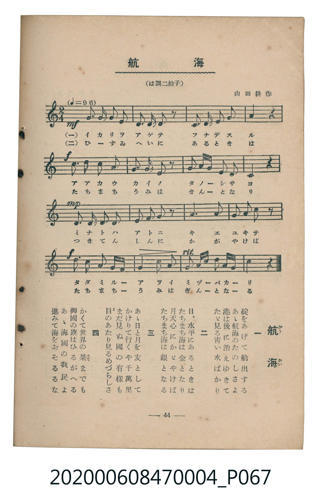

# 航海

<audio controls src="kokai.mp3"></audio>

- 曲：山田耕作
- 臺灣教育會公認《新定兒童唱歌》尋常科第四學年用（2020.006.0847.0004）

- note

原書資訊與歌詞全文（對應 P067.jpg，書頁 p. 44，參考教材第 10 首）：
調性與拍號：は調二拍子（C 大調 2/4 拍，♩=96）

## 歌詞

```text
一
碇（いかり）をあげて船出（ふなで）する
あゝ航海（かうかい）のたのしさよ
港（みなと）は後（あと）に消（き）えゆきて
たゞ見る青（あを）い水（みづ）ばかり

二
日（ひ）、水平（すゐへい）にあるときは
たちまち海（うみ）は金（きん）となり
月（つき）天心（てんしん）にかゞやけば
たちまち海は銀（ぎん）となる

三
あゝ日と月を友（とも）として
かけりて行（ゆ）くや千萬里（せんまんり）
まだ見（み）ぬ國（くに）の有様（ありさま）も
目（ま）のあたり見るめづらしさ

四
かくて世界（せかい）の果（はて）までも
御國（みくに）の旗（はた）はひるがへる
あゝ海國（かいこく）の我民（わがたみ）よ
進（すゝ）みて海をおそるるな
```

## 原書掃描頁



## 調性分析

```text
================================================================================
📊 TMD Song Profile: [ 航海 ]
================================================================================
⏱  Duration:       0:20 (20.0s), 16 measures total
🎼 Key & Tempo:    首調基準 C, != 96.0 BPM, <2/4>
   - 分析範圍：      由實際發聲的音符與和弦推測調性；播放脈絡另行呈現
🎤 人聲音域:    D4 (MIDI 62) – E5 (MIDI 76) [跨度: 14 個半音 / 1.2 個八度, 難度: moderate]
   - 最低音:  D4 in [Kokai #1 @ m.3, 0:02]
   - 最高音: E5 in [Kokai #1 @ m.15, 0:17]
   - 適合: soprano, mezzo-soprano, contralto, tenor, baritone, bass
🏛  結構:      Kokai (20.0s)
⚡ 編曲密度:        Peak 1 軌道同時演奏
🗝  調性診斷：       G 調性不明確（流行色彩大調，未偵測到可信轉調）
   - 風格氣質:    流行大調（略帶和弦色彩音與裝飾副屬和弦）
   - 轉調歷程:    全曲維持單一推測調性（未偵測到可信轉調）
   - 核心骨幹音:  G, A, E, F, C
   - 調性數值:    G 調性不明確 [相關度: 0.76, 穩定度: Ambiguous, 自然音純度: 87.0%]
   - 候選調性 (K-S): G 大調 (0.76), C 大調 (0.74), E 小調 (0.64)
   - 五度圈歷程:   +1
   - 各段落調性細節:
     • [Kokai #1]: G 調性不明確 (r: 0.76, 自然音純度: 87.0%, 調外音: F)

  [ 五度圈游移軌跡 ]
               C  
         F           [G ]*
      Bb               D  
      Eb               A  
         Ab           E  
            Db       B  
               F# 
     (* = active key center)

  [ 十二半音累積音高分佈 ]
     C  : ████████                  10.2%
     C# :                            0.0%
     D  : ███████                    9.3%
     D# :                            0.0%
     E  : ███████████               13.9%
     F  : ██████████                13.0%
     F# : █                          1.9%
     G  : ████████████████████████  30.6%
     G# :                            0.0%
     A  : ████████████              14.8%
     A# :                            0.0%
     B  : █████                      6.5%
--------------------------------------------------------------------------------
Assignment 軌道音域：
  - Piano         : D4 – E5 (14 個半音 / 1.2 個八度, 52 個音符)
================================================================================
```

## ABC

```abc
X:1
T:航海
C:曲：山田耕作
M:2/4
L:1/16
Q:1/4=96
K:C

V:V1 name="Piano" snm="Pia"

[V:V1]
!mf! g3 g g2 g2 | e2 e2 g2 z2 | d3 e f2 a2 | g4 z4 |
!f! c3 c b2 a2 | g2 a2 g2 z2 | a2 b c e2 ^f2 | g4 z4 |
!mp! f3 f f2 f2 | e2 f2 g2 z2 | a6 g2 | g2 f2 e2 z2 |
!f! d3 d e2 b c | d2 b2 g4 | e2 c g a2 b d | c4 z4 |
```

- [主旋律 TMD 檔案](kokai.tmd)
- [鋼琴伴奏 TMD 檔案](kokai_piano.tmd)
