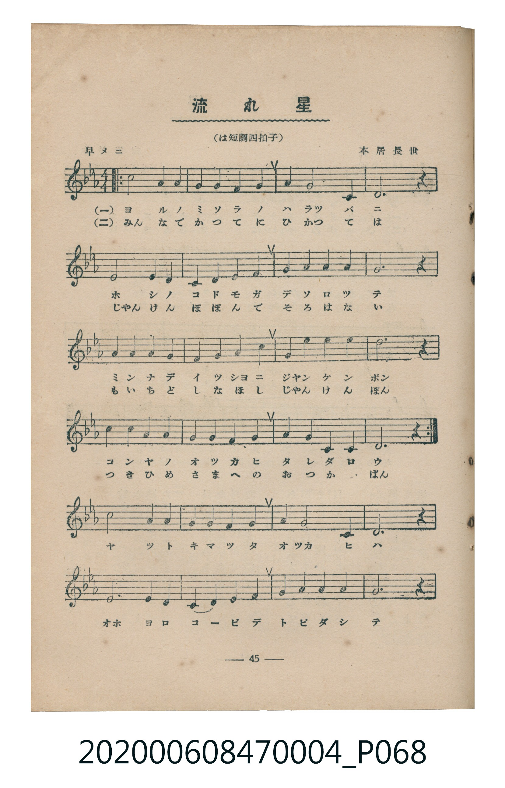
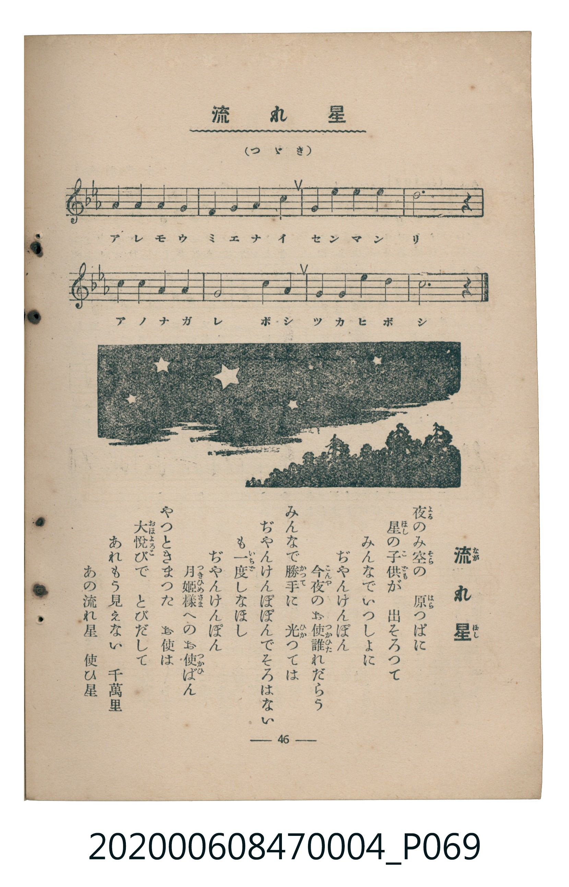

# 流れ星

<audio controls src="nagareboshi.mp3"></audio>

- 曲：本居長世
- 臺灣教育會公認《新定兒童唱歌》尋常科第四學年用（2020.006.0847.0004）

## 說明

原書資訊與歌詞全文（對應 P068.jpg–P069.jpg，書頁 pp. 45–46，參考教材第 11 首）：
調性與拍號：は短調四拍子（c 小調 4/4 拍）
速度指示：早メニ

## 歌詞

```text
夜（よる）のみ空（そら）の　原（はら）つぱに
星（ほし）の子供（こども）が　出そろつて
みんなでいつしよに　ぢやんけんぽん
今夜（こんや）のお使（つかひ）誰（たれ）だらう

みんなで勝手（かつて）に　光（ひか）つては
ぢやんけんぽぽんでそろはない
も一度（いちど）しなほし　ぢやんけんぽん
月姫様（つきひめさま）へのお使（つかひ）ばん

やつときまつた　お使は
大悦（おほよろこ）びで　とびだして
あれもう見えない　千萬里（せんまんり）
あの流れ星　使ひ星
```

## 原書掃描頁





## 分析

```text
================================================================================
📊 TMD Song Profile: [ 流れ星 ]
================================================================================
⏱  Duration:       1:42 (102.9s), 48 measures total
🎼 Key & Tempo:    首調基準 E,, != 112.0 BPM, <4/4>
   - 分析範圍：      由實際發聲的音符與和弦推測調性；播放脈絡另行呈現
🎤 人聲音域:    C4 (MIDI 60) – D5 (MIDI 74) [跨度: 14 個半音 / 1.2 個八度, 難度: moderate]
   - 最低音:  C4 in [Nagareboshi #1 @ m.3, 0:05]
   - 最高音: D5 in [Nagareboshi #1 @ m.12, 0:23]
   - 適合: soprano, mezzo-soprano, contralto, tenor, baritone, bass
🏛  結構:      Nagareboshi (102.9s)
⚡ 編曲密度:        Peak 1 軌道同時演奏
🗝  調性診斷：       C 調性不明確（純淨自然大調，未偵測到可信轉調）
   - 風格氣質:    純淨自然大調（陽光明朗、易唱易記，無明顯調外色彩）
   - 轉調歷程:    全曲維持單一推測調性（未偵測到可信轉調）
   - 核心骨幹音:  G, C, D, G#, F
   - 調性數值:    C 調性不明確 [相關度: 0.67, 穩定度: Ambiguous, 自然音純度: 100.0%]
   - 候選調性 (K-S): C 小調 (0.67), G 大調 (0.66), C 大調 (0.61)
   - 五度圈歷程:   +0
   - 各段落調性細節:
     • [Nagareboshi #1]: C 調性不明確 (r: 0.67, 自然音純度: 100.0%)

  [ 五度圈游移軌跡 ]
              [C ]*
         F            G  
      Bb               D  
      Eb               A  
         Ab           E  
            Db       B  
               F# 
     (* = active key center)

  [ 十二半音累積音高分佈 ]
     C  : ██████████████            20.6%
     C# :                            0.0%
     D  : ███████████               16.1%
     D# : ████                       6.1%
     E  :                            0.0%
     F  : █████                      6.7%
     F# :                            0.0%
     G  : ████████████████████████  35.6%
     G# : ██████████                15.0%
     A  :                            0.0%
     A# :                            0.0%
     B  :                            0.0%
--------------------------------------------------------------------------------
Assignment 軌道音域：
  - Piano         : C4 – D5 (14 個半音 / 1.2 個八度, 146 個音符)
================================================================================
```

## ABC

```abc
X:1
T:流れ星
C:曲：本居長世
M:4/4
L:1/16
Q:1/4=112
K:Cm

V:V1 name="Piano" snm="Pia"

[V:V1]
c8 g4 g4 | a4 g4 f4 g4 | a4 g8 c4 | d12 z4 |
e8 d4 d4 | c4 d4 e4 f4 | g4 a4 a4 a4 | g12 z4 |
g4 g4 a4 g4 | f4 g4 a4 g4 | c4 c4 c4 c4 | d12 z4 |
c4 g4 g4 g4 | a4 g4 f4 g4 | a4 g4 d4 e4 | c12 z4 |
c8 g4 g4 | a4 g4 f4 g4 | a4 g8 c4 | d12 z4 |
e8 d4 d4 | c4 d4 e4 f4 | g4 a4 a4 a4 | g12 z4 |
g4 g4 a4 g4 | f4 g4 a4 g4 | c4 c4 c4 c4 | d12 z4 |
c4 g4 g4 g4 | a4 g4 f4 g4 | a4 g4 d4 e4 | c12 z4 |
c8 g4 g4 | a4 g4 f4 g4 | a4 g8 c4 | d12 z4 |
e8 d4 d4 | c4 d4 e4 f4 | g4 a4 a4 a4 | g12 z4 |
g4 g4 a4 g4 | f4 g4 a4 g4 | g4 c4 c4 c4 | d12 z4 |
c4 c4 g4 g4 | a8 g4 f4 | g4 g4 c4 g4 | c12 z4 |
```

- [主旋律 TMD 檔案](nagareboshi.tmd)
- [鋼琴伴奏 TMD 檔案](nagareboshi_piano.tmd)
