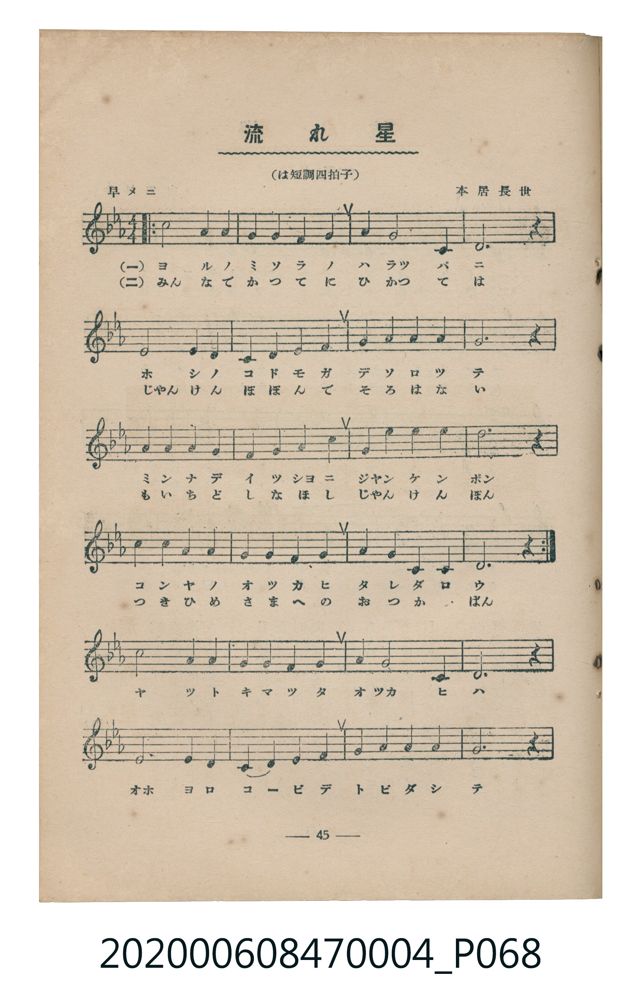
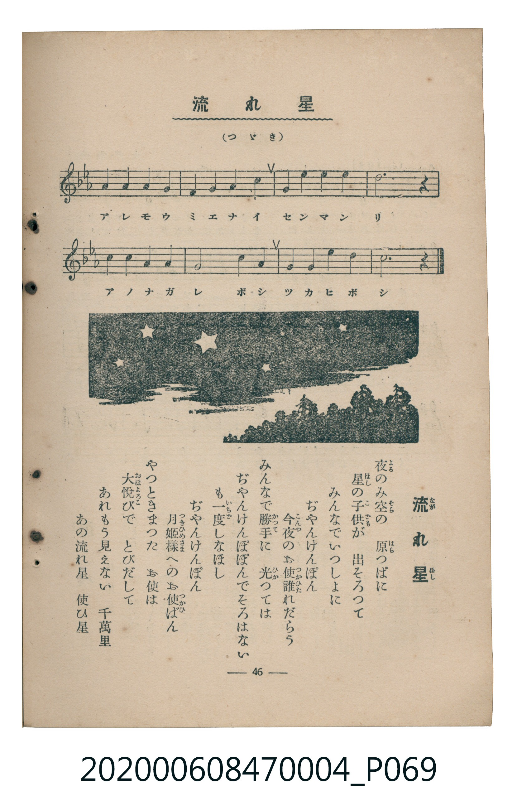

# 流れ星

> Re:Shōka 使用 AI 協助辨識與重建樂譜，可能會有錯誤。歡迎回報。

- **NEUTRINO 歌聲合成版**：<br><audio controls src="nagareboshi_neutrino.mp3"></audio>
- **鋼琴伴奏版**：<br><audio controls src="nagareboshi.mp3"></audio>


- 曲：本居長世
- 臺灣教育會公認《新定兒童唱歌》尋常科第四學年用（2020.006.0847.0004）

## 說明

原書資訊與歌詞全文（對應 P068.jpg–P069.jpg，書頁 pp. 45–46，參考教材第 11 首）：
調性與拍號：は短調四拍子（c 小調 4/4 拍）
速度指示：早メニ

## 歌詞

```text
夜（よる）のみ空（そら）の　原（はら）つぱに
星（ほし）の子供（こども）が　出そろつて
みんなでいつしよに　ぢやんけんぽん
今夜（こんや）のお使（つかひ）誰（たれ）だらう

みんなで勝手（かつて）に　光（ひか）つては
ぢやんけんぽぽんでそろはない
も一度（いちど）しなほし　ぢやんけんぽん
月姫様（つきひめさま）へのお使（つかひ）ばん

やつときまつた　お使は
大悦（おほよろこ）びで　とびだして
あれもう見えない　千萬里（せんまんり）
あの流れ星　使ひ星
```

## ABC

```abc
X:1
T:流れ星
C:曲：本居長世
M:4/4
L:1/16
Q:1/4=112
K:Cm
V:V1 name="Piano" snm="Pia"
[V:V1]
c8 G4 G4 | F4 F4 E4 F4 | G4 F8 C4 | D12 z4 |
w: ヨ ル ノ | ミ ソ ラ ノ | ハ ラツ パ | ニ
E8 E4 D4 | C4 D4 E4 F4 | G4 A4 A4 A4 | G12 z4 |
w: ホ シ ノ | コ ド モ ガ | デ ソ ロ ツ | テ
G4 G4 G4 F4 | E4 F4 G4 c4 | F4 e4 e4 e4 | d12 z4 |
w: ミ ン ナ デ | イ ツ シヨ ニ | ジ ヤン ケ ン | ポン
c4 c4 G4 G4 | F4 F4 E4 F4 | G4 F4 C4 C4 | D12 z4 |
w: コ ン ヤ ノ | オ ツ カ ヒ | タ レ ダ ロ | ウ
c8 G4 G4 | F4 F4 E4 F4 | G4 F8 C4 | D12 z4 |
w: みん な で | か つ て に | ひ かつ て | は
E8 E4 D4 | C4 D4 E4 F4 | G4 A4 A4 A4 | G12 z4 |
w: ぢやん け ん | ぽ ぽ ん で | そ ろ は な | い
G4 G4 G4 F4 | E4 F4 G4 c4 | F4 e4 e4 e4 | d12 z4 |
w: も い ち ど | し な ほ し | ぢ やん け ん | ぽん
c4 c4 G4 G4 | F4 F4 E4 F4 | G4 F4 C4 C4 | D12 z4 |
w: つ き ひ め | さ ま へ の | お つ か ひ | ばん
c8 G4 G4 | F4 F4 E4 F4 | G4 F8 C4 | D12 z4 |
w: ヤ ツ ト | キ マ ツ タ | オ ツカ ヒ | ハ
E8 E4 D4 | C4 D4 E4 F4 | G4 A4 A4 A4 | G12 z4 |
w: オホ ヨ ロ | コ _ ビ デ | ト ビ ダ シ | テ
G4 G4 G4 F4 | E4 F4 G4 c4 | F4 e4 e4 e4 | d12 z4 |
w: ア レ モ ウ | ミ エ ナ イ | セ ン マ ン | リ
c4 c4 G4 G4 | F8 c4 G4 | F4 F4 e4 d4 | c12 z4 |
w: ア ノ ナ ガ | レ ボ シ | ツ カ ヒ ボ | シ
```

## TMD 檔案連結

- [主旋律 TMD 檔案](nagareboshi.tmd) [[在 TMD Studio 編輯](https://tmdlang.github.io/Tmd-TS/#tmd=s7IKdvYPcrWy4qpTUCpJTLdSSM7PyUlNLsnMz7MqzsjMK0nNjM_KTMmPL87Iz05Ugisry88pzU21Si9KTEmNN4k3MjAyiDcwMIs3sDAxBzIMTBBKi_NLi5JTrYqTM_Lzc-JLUitKkvLzsxHyBUX5Zal5iXlANQVFIBtTwIoQClLLMlNSQdKpKZkl-UWZiTlI7kgtKga7FWxJfElRYl5xclFmAcgDCFX5RSUZ-UC3FmRUWmVkFoMMSU7Mic9OzEPyUklGKtBHeYklpUWpSlxaWgrPtjY-bup5NmO-gpYWl6KtgqGhEZe9rYKrDld2aqWtgnMul42JvokdyIBnsze93zPr2Zw1Tze2vpy6_cmOaWBzX7Tvet64-NnUmS-aNj2b0_y0dc2LVb2PG7qeTdvwdN2sp62Tnq9e-nTKxmdrex43dD_d0P10x47nyyc-X7Pm6ezZT9fueLpzy_MpK97v6QAFrx4wePVAwQtkGJi839OpxMWlr6VgSy3ApaCg8LRv_rPZO15sbn-xoutFRzvQXS9WznvauuLZtHagK55u6H3W3qkQYGBmoZdVkP6oYTKQaQlivt_TA9T3ckGjQkGBnoKJKVDKxAwo-LS_-UVDM9D_z-ZOAPoKGIIKL5dNA7odGFgg-16s2v-sYTnIpu7eFzPnA0UfN65_Pn8tUBwYAkDBp2snAC1OVni6oR8opgAMbgWgKNAAkO6XDfOf7lr2rKf9-ZJdoNCfvvJx88LHzd1cYK8smQPU-bgJiLqB6h83rnvcuP_5SqDCjseNcx83AZ0AFmxoAHoaLLgeJrjkcePGx42rQaYAIx8st_tx43SIBqCLnuybDRac_Lhx5eOmJrA4MAIbnrbvAhvdCzZiGUg_0M7HTUB1qx43Ln_c2AKWmA5yVONqoIbHjYseN7WAFUwEk3uBJEjbk91dUPcDLQFKNLXAvND1ZO9-sDjQoO7HjcBU1_li1QawyHxgYgUrWwD0yOPGNnAwIDvgaffcZ53AwACqBWoFORGsHOSSp61ArwPFNwGlYGGwDBgkECMwXAl2KNhLEO-uB1vQAlbd1PRkRwMwXsDmAX28EBhKYCOngxWBQhKf15_N6Xi6fPWz5TNgvgQav-lxU-PjxqmPG_eBDdqBKyQeN24AmQJxBiSwV4AN2AdmzwfbC9IH9dnTJcufNUEc2gVyGSixAFVPBhu1GeQ_kAagEUD2ArAHoJHaBAxqoEeBgfxiGdBuoH6Q90Hh2Nv8YsKal-3AiAAKzgb7bB84BrugiRakuXEdvGgB6gG7ZxOQDZKmPB9DgYKWPheXX2J6YlFqUj6wJLcKyEzMy3eoMaipBtmjYGOiZQdmYCtDFJ529j7t7Xq2biso2_f3vljW9rR15bM1C0EZfX0_kKFgaAbKlM_XNwCFYCUC0ItYzAI6BGoPsAgApg2gbiuFx80rFHSB5Gog7lOoAZLzgXG2F0ivhIv0g3iPm1vACieChbqBbF0FA5iZNQpmQK4xENYoGAGhIRDXAHlGQFGzeCDTPB6qoQas3gdkBkUWQ8xB98tskMqm7TADmjYDWZ1AvAjIXgPW3w61ZC0Qt4BF2tC9YgjkGoJcDPRVPIiG-cYEDEEsDL9QYjF2rwBDoxlkShdYL8jMJWCdQFtAQQcKCZDgDiBrCVhl00awDpDJc0EMNF-BIgcUISD_GQFZZuCoMoyDImAUYfqKSm7A6kFwEIEwyEhIoK2CGg5KEpPAIvuBrDVA3AAOOJDIMsyEZ4Y14QGjDlfKo9DqGnDBBvPPrh6If8DlOygVNALNalwO0tHYDcRAOxqXAfFqsMgmkChIEKRwGVhoPeVZiWK7UWII7iNozQBWPxEYAJPBeoCJGISBPJhVc4G8XrBpIAeAREA5ltI8RQXrsXqrqQmsAlghAvFKsPrp0JDbDWaD7QZXXGBLkKyGuIbSbEUVB2CPMVCEg4ICGNVNjWAtU4F4HxAD82jjOrAIMDOD1YESyCawCKiypkK2otx2RM7CUhPu64HXhNjqPJRWMP7qD5TxQTUKMA6aO8BZG1Qoz4MWAfsRBQKoPAApBJcIwNqI8jqPIovhcQ5UBa1ywKUwpHgCFWh7gBiYZCCFNdAKCA9YhAGrJmrVddjtBvGJsRnJD8AkDi5hQUkdXByBWwAgQ4GJBFjTgAwGZghwSQ0KI0i9sooaOZAyq9H80AfVBqnn14CDYg7c44haBSQKMng7vrwGTDuIFBUHdDskmWFxP7nW1nDVcnHp2ikgtUkVgFxlLgA)]
- [鋼琴伴奏 TMD 檔案](nagareboshi_piano.tmd) [[在 TMD Studio 編輯](https://tmdlang.github.io/Tmd-TS/#tmd=s7IKdvYPcrWy4tLSUni2tfFxU8-zGfPf7-l42b3n-YQtT_Zsebq0_3lnx_s9nQpaWlyKtgqGhkZc9rYKrjpc2amVtgrOuVw2Jvomdlx1CkrPZm96v2fWszlrnm5sfTl1-5Md05RAwi_adz1vXPxs6swXTZuezWl-2rrmxarexw1dz6ZteLpu1tPWSc9XL306ZeOztT2PG7qfbuh-umPH8-UTn69Z83T27KdrdzzdueX5lBVAJxkZGBnoGRiY6RlYmJgDGQYmQFcpcXH5JaYnFqUm5RdnZFoFZCbm5Qd5ONQY1FRzKQCBjYmWHZihr6Vgiw4Unnb2Pu3terZuK9D4p_29L5a1PW1d-WzNwvd7ep6t7wcyFAzNFJ5u6H--vgEoFGBgZqGXVZAOCgxMs7T0wfbUKJgp6CoYA2GNghEQGgJxDZBnBBQ1iwcyzeOBLF0FA4UasHqfGoXHzSuAAo-bVwNxH1DF4-b5Co-b9gLplXCRfhDvcXMLWOFEsFA3ijk1QJt0gRhoPNAJ8SAaZrUJGIJYGBbPBpnXtB1mTdNmIKsTiBcB2WvAtrRDnbIWiFvAIm1o9oL8CvIfyAVGQJYZ2OeGcVAE9DGmvUAPNoPs6gLbALJ5Cdh8oFtAoQHyHEhwB5C1BKyyaSNYB0jvXBAD1QlmQIgtyIHhgCvMwV4FYZDFEM-vgjoBFA-TwCL7gaw1QNwADgCQyDK4QWTHduP-x02TQeHeCLSwcTnI2MZuIAY6pHEZEK8Gi2wCiYIEQQqXgYXWUx7hjYseN7XArJ8I9M9ksMnACAZhIA_moLlAXi_YTpAzQSKgpEdhtDc1gc153LgQiFeCTZ0ODYbdYDbYhUB1YCeiOBDiZgrjHBzEIF8BA7epEWzwVCDeB8TAlNa4DiwCTJJgdaAo2QQW2YBsOZ7CZF8PvDDBVmw8apgMZFrSpgQBpxNQ6m3uAKdTUHadB03P-xGpG5S4QQrByRtYqFCcoJpWQQsRcK6F5BFQ7nzcDIxASNYGugjCA-YiYFFDpSKkCZhOwHkTlF7A-QNcaoJcAYxBYHECUgNMVeA8DgoJSOGxCk8qAgYvItDjgHZCYgKLvX1QWyBF5Bqwf-fAfYcoQ0CiID3b4cbUYqmvfLDVV6AoiFeINovPjUViAR0HZBoBWSbxICYwwOIVTIHSQDZIVQ2YE20aHwtmIPkTxTCQHEQMxALRMLMgxoJtAPOjDWNBFDaDoDYjzAEKQNwAdQyys4lyFgE_4jVvNNBGA438QMMlhrAWoReajXXtFJBysgKQq8wFAA)]

## 分析

```text
================================================================================
📊 TMD Song Profile: [ 流れ星 ]
================================================================================
⏱  Duration:       1:42 (102.9s), 48 measures total
🎼 Key & Tempo:    首調基準 E,, != 112.0 BPM, <4/4>
   - 分析範圍：      由實際發聲的音符與和弦推測調性；播放脈絡另行呈現
🎤 人聲音域:    C4 (MIDI 60) – D#5 (MIDI 75) [跨度: 15 個半音 / 1.2 個八度, 難度: moderate]
   - 最低音:  C4 in [Nagareboshi #1 @ m.3, 0:05]
   - 最高音: D#5 in [Nagareboshi #1 @ m.11, 0:21]
   - 適合: soprano, mezzo-soprano, contralto, tenor, baritone, bass
🏛  結構:      Nagareboshi (102.9s)
⚡ 編曲密度:        Peak 1 軌道同時演奏
🗝  調性診斷：       C 小調（純淨自然小調，未偵測到可信轉調）
   - 風格氣質:    純淨自然小調（陰鬱抒情、旋律集中，無明顯調外色彩）
   - 轉調歷程:    全曲維持單一推測調性（未偵測到可信轉調）
   - 核心骨幹音:  G, F, D, D#, C
   - 調性數值:    C 小調 [相關度: 0.69, 穩定度: High, 自然音純度: 100.0%]
   - 候選調性 (K-S): C 小調 (0.69), C 大調 (0.53), G 小調 (0.52)
   - 五度圈歷程:   +0
   - 各段落調性細節:
     • [Nagareboshi #1]: C 小調 (r: 0.69, 自然音純度: 100.0%)

  [ 五度圈游移軌跡 ]
              [C ]*
         F            G  
      Bb               D  
      Eb               A  
         Ab           E  
            Db       B  
               F# 
     (* = active key center)

  [ 十二半音累積音高分佈 ]
     C  : █████████████████         16.1%
     C# :                            0.0%
     D  : ██████████████████        17.2%
     D# : █████████████████         16.7%
     E  :                            0.0%
     F  : ██████████████████████    21.7%
     F# :                            0.0%
     G  : ████████████████████████  23.3%
     G# : █████                      5.0%
     A  :                            0.0%
     A# :                            0.0%
     B  :                            0.0%
--------------------------------------------------------------------------------
Assignment 軌道音域：
  - Piano         : C4 – D#5 (15 個半音 / 1.2 個八度, 146 個音符)
================================================================================
```


## 原書掃描頁






