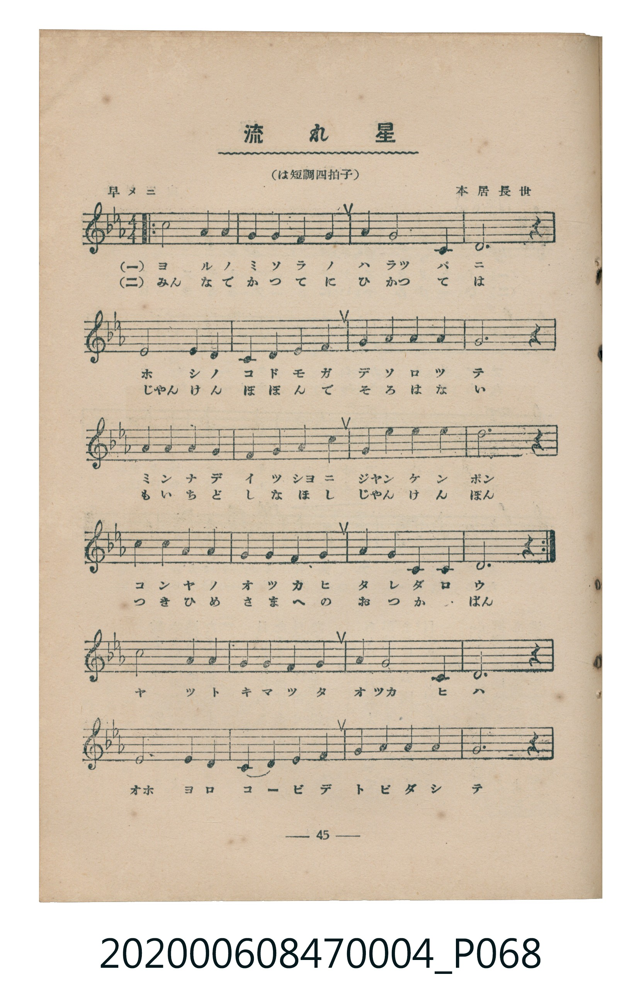
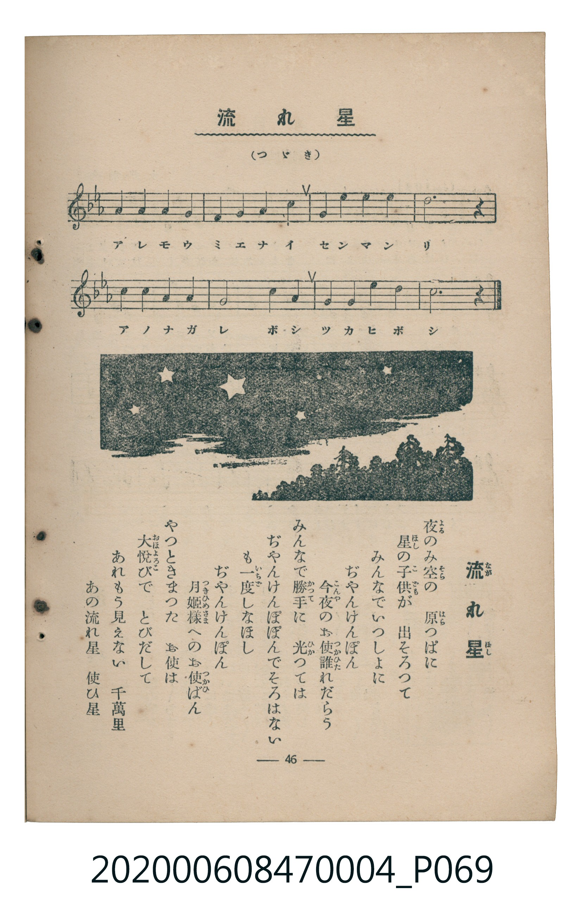

# 流れ星

> Re:Shōka 使用 AI 協助辨識與重建樂譜，可能會有錯誤。歡迎回報。

- **鋼琴伴奏版**：<br><audio controls src="nagareboshi.mp3"></audio>
- **NEUTRINO 歌聲合成版**：<br><audio controls src="nagareboshi_neutrino.mp3"></audio>

- 曲：本居長世
- 臺灣教育會公認《新定兒童唱歌》尋常科第四學年用（2020.006.0847.0004）

## 說明

原書資訊與歌詞全文（對應 P068.jpg–P069.jpg，書頁 pp. 45–46，參考教材第 11 首）：
調性與拍號：は短調四拍子（c 小調 4/4 拍）
速度指示：早メニ


## 歌詞

```text
夜（よる）のみ空（そら）の　原（はら）つぱに
星（ほし）の子供（こども）が　出そろつて
みんなでいつしよに　ぢやんけんぽん
今夜（こんや）のお使（つかひ）誰（たれ）だらう

みんなで勝手（かつて）に　光（ひか）つては
ぢやんけんぽぽんでそろはない
も一度（いちど）しなほし　ぢやんけんぽん
月姫様（つきひめさま）へのお使（つかひ）ばん

やつときまつた　お使は
大悦（おほよろこ）びで　とびだして
あれもう見えない　千萬里（せんまんり）
あの流れ星　使ひ星
```

## ABC

<div class="abc-score" data-abc-src="nagareboshi.abc" aria-label="五線譜載入中"></div>

[下載 ABC 原始檔](nagareboshi.abc)

## TMD 檔案連結

- [主旋律 TMD 檔案](nagareboshi.tmd) [[在 TMD Studio 編輯](https://tmdlang.github.io/Tmd-TS/#tmd=s7IKdvYPcrWy4qpTUCpJTLdSSM7PyUlNLsnMz7MqzsjMK0nNjM_KTMmPL87Iz05Ugisry88pzU21Si9KTEmNN4k3MjAyiDcwMIs3sDAxBzIMTBBKi_NLi5JTrYqTM_Lzc-JLUitKkvLzsxHyBUX5Zal5iXlANQVFIBtTwIoQClLLMlNSQdKpKZkl-UWZiTlI7kgtKga7FWxJfElRYl5xclFmAcgDCFX5RSUZ-UC3FmRUWmVkFoMMSU7Mic9OzEPyUklGKtBHeYklpUWpyFoz0zPzrEoSM4EhAAqF8sT43MTMvJzEvBR0P8YXJKanWgUYmFnoAglLJS4tLYVnWxsfN_U8mzFfQUuLS9FWwdDQiMveVsFVhys7tdJWwTmXy8ZE38QOZNKz2Zve75n1bM6apxtbX07d_mTHNLAFL9p3PW9c_GzqzBdNm57NaX7auubFqt7HDV3Ppm14um7W09ZJz1cvfTpl47O1PY8bup9u6H66Y8fz5ROfr1nzdPbsp2t3PN255fmUFe_3dIDiSA8YR3qgOAIyDEze7-lU4uLS11KwpRbgUlBQeNo3_9nsHS82t79Y0fWiox3orhcr5z1tXfFsWjvQFU839D5r71QABZJeVkH6o4bJoKACMd_v6QHqe7mgUaGgQE_BxBQoZWIGFHza3_yioRno_2dzJwB9BQxBhZfLpgHdDgwskH0vVu1_1rAcZFN374uZ84GijxvXP5-_FigODAGg4NO1E4AWJys83dAPFFMABrcCUBRoAEj3y4b5T3cte9bT_nzJLlDoT1_5uHnh4-ZuLrBXlswB6nzcBETdQPWPG9c9btz_fCVQYcfjxrmPm4BOAAs2NAA9DRZcDxNc8rhx4-PG1SBTgJEPltv9uHE6RAPQRU_2zQYLTn7cuPJxUxNYHBiBDU_bd4GN7gUbsQykH2jn4yagulWPG5c_bmwBS0wHOapxNVDD48ZFj5tawAomgsm9QBKk7cnuLqj7gZYAJZpaYF7oerJ3P1gcaFD340Zgqut8sWoDWGQ-MLGClS0AeuRxYxs4GJAd8LR77rNOYGAA1QK1gpwIVg5yydNWoNeB4puAUrAwWAYMEogRGK4EOxTsJYh314MtaAGrbmp6sqMBGC9g84A-XggMJbCR08GKQCGJz-vP5nQ8Xb762fIZMF8Cjd_0uKnxcePUx437wAbtwBUSjxs3gEyBOAMS2CvABuwDs-eD7QXpg_rs6ZLlz5ogDu0CuQyUWICqJ4ON2gzyH0gD0AggewHYA9BIbQIGNdCjwEB-sQxoN1A_yPugcOxtfjFhzct2YEQABWeDfbYPHINd0EQL0ty4Dl60APWA3bMJyAZJU56PoUBBS5-Lyy8xPbEoNSkfWB1YBWQm5uU71BjUVIPsUbAx0bIDM7CVIQpPO3uf9nY9W7cVlO37e18sa3vauvLZmoWgjL6-H8hQMDQDZcrn6xuAQrASAehFLGYBHQK1B1gEANMGULeVwuPmFQq6QHI1EPcp1ADJ-cA42wukV8JF-kG8x80tYIUTwULdQLauggHMzBoFMyDXGAhrFIyA0BCIa4A8I6CoWTyQaR4P1VADVu8DMoMiiyHmoPtlNkhl03aYAU2bgaxOIF4EZK8B62-HWrIWiFvAIm3oXjEEcg1BLgb6Kh5Ew3xjAoYgFoZfKLEYu1eAodEMMqULrBdk5hKwTqAtoKADhQRIcAeQtQSssmkjWAfI5LkgBpqvQJEDihCQ_4yALDNwVBnGQREwijB9RSU3YPUgOIhAGGQkJNBWQQ0HJYlJYJH9QNYaIG4ABxxIZBlmwjPDmvCAUYcr5VFodQ24YIP5Z1cPxD_g8h2UChqBZjUuB-lo7AZioB2Ny4B4NVhkE0gUJAhSuAwstJ7yrESx3SgxBPcRtGYAq58IDIDJYD3ARAzCQB7MqrlAXi_YNJADQCKgHEtpnqKC9Vi91dQEVgGsEIF4JVj9dGjI7QazwXaDKy6wJUhWQ1xDabaiigOwxxgowkFBAYzqpkawlqlAvA-IgXm0cR1YBJiZwepACWQTWARUWVMhW1FuOyJnYakJ9_XAa0JsdR5KKxh_9QfK-KAaBRgHzR3grA0qlOdBi4D9iAIBVB6AFIJLBGBtRHmdR5HF8DgHqoJWOeBSGFI8gQq0PUAMTDKQwhpoBYQHLMKAVRO16jrsdoP4xNiM5AdgEgeXsKCkDi6OwC0AkKHARAKsaUAGAzMEuKQGhRGkXllFjRxImdVofuiDaoPU82vAQTEH7nFErQISBRm8HV9eA6YdRIqKA7odksywuJ9ca2u4arm4dO0UkNqkCkCuMhcA)]
- [鋼琴伴奏 TMD 檔案](nagareboshi_piano.tmd) [[在 TMD Studio 編輯](https://tmdlang.github.io/Tmd-TS/#tmd=s7IKdvYPcrWy4qpTUCpJTLdSyC8qychPL0osyKi0ysgsLskvykxOzInPTsxLVIIrKs4vLUpOjS9ITE-1CjAws9AFEpZKXFpaCs-2Nj5u6nk2Y_77PR0vu_c8n7DlyZ4tT5f2P-_seL-nU0FLi0vRVsHQ0IjL3lbBVYcrO7XSVsE5l8vGRN_EDmT8s9mb3u-Z9WzOmqcbW19O3f5kxzSwrS_adz1vXPxs6swXTZuezWl-2rrmxarexw1dz6ZteLpu1tPWSc9XL306ZeOztT2PG7qfbuh-umPH8-UTn69Z83T27KdrdzzdueX5lBVAJxkZGBnoGRiY6RlYmJgDGQYmQFcpcXH5JaYnFqUm5RdnZFoFZCbm5Qd5ONQY1FRzKQCBjYmWHZihr6Vgiw4Unnb2Pu3terZuK9D4p_29L5a1PW1d-WzNwvd7ep6t7wcyFAzNFJ5u6H--vgEoBAotvayCdFBgYJqlpQ-2p0bBTEFXwRgIaxSMgNAQiGuAPCOgqFk8kGkeD2TpKhgo1IDV-9QoPG5eARR43LwaiPuAKh43z1d43LQXSK-Ei_SDeI-bW8AKJ4KFulHMqQHapAvEQOOBTogH0TCrTcAQxMKweDbIvKbtMGuaNgNZnUC8CMheA7alHeqUtUDcAhZpQ7MX5FeQ_0AuMAKyzMA-N4yDIqCPMe0FerAZZFcX2AaQzUvA5gPdAgoNkOdAgjuArCVglU0bwTpAeueCGKhOMANCbEEODAdcYQ72KgiDLIZ4fhXUCaB4mAQW2Q9krQHiBnAAgESWwQ0iO7Yb9z9umgwK90aghY3LQcY2dgMx0CGNy4B4NVhkE0gUJAhSuAwstJ7yCG9c9LipBWb9RKB_JoNNBkYwCAN5MAfNBfJ6wXaCnAkSASU9CqO9qQlszuPGhUC8EmzqdGgw7AazwS4EqgM7EcWBEDdTGOfgIAb5Chi4TY1gg6cC8T4gBqa0xnVgEWCSBKsDRckmsMgGZMvxFCb7euCFCbZi41HDZFBRS5sSBJxOQKm3uQOcTkHZdR40Pe9HpG5Q4gYpBCdvYKFCcYJqWgUtRMC5FpJHQLnzcTMwAiFZG-giCA-Yi4BFDZWKkCZgOgHnTVB6AecPcKkJcgUwBoHFCUgNMFWB8zgoJCCFxyo8qQgYvIhAjwPaCYkJLPb2QW2BFJFrwP6dA_cdogwBiYL0bIcbU4ulvvLBVl-BoiBeIdosPjcWiQV0HJBpBGSZxIOYwACLVzAFSgPZIFU1YE60aXwsmIHkTxTDQHIQMRALRMPMghgLtgHMjzaMBVHYDILajDAHKABxA9QxyM4mylkE_IjXvNFAGw008gMNlxjCWoReaDbWtVNAyskKQK4yFwA)]

## 分析

```text
================================================================================
📊 TMD Song Profile: [ 流れ星 ]
================================================================================
⏱  Duration:       1:42 (102.9s), 48 measures total
🎼 Key & Tempo:    首調基準 E,, != 112.0 BPM, <4/4>
   - 分析範圍：      由實際發聲的音符與和弦推測調性；播放脈絡另行呈現
🎤 人聲音域:    C4 (MIDI 60) – D#5 (MIDI 75) [跨度: 15 個半音 / 1.2 個八度, 難度: moderate]
   - 最低音:  C4 in [Nagareboshi #1 @ m.3, 0:05]
   - 最高音: D#5 in [Nagareboshi #1 @ m.11, 0:21]
   - 適合: soprano, mezzo-soprano, contralto, tenor, baritone, bass
🏛  結構:      Nagareboshi (102.9s)
⚡ 編曲密度:        Peak 1 軌道同時演奏
🗝  調性診斷：       C 小調（純淨自然小調，未偵測到可信轉調）
   - 風格氣質:    純淨自然小調（陰鬱抒情、旋律集中，無明顯調外色彩）
   - 轉調歷程:    全曲維持單一推測調性（未偵測到可信轉調）
   - 核心骨幹音:  G, F, D, D#, C
   - 調性數值:    C 小調 [相關度: 0.69, 穩定度: High, 自然音純度: 100.0%]
   - 候選調性 (K-S): C 小調 (0.69), C 大調 (0.53), G 小調 (0.52)
   - 五度圈歷程:   +0
   - 各段落調性細節:
     • [Nagareboshi #1]: C 小調 (r: 0.69, 自然音純度: 100.0%)

  [ 五度圈游移軌跡 ]
              [C ]*
         F            G  
      Bb               D  
      Eb               A  
         Ab           E  
            Db       B  
               F# 
     (* = active key center)

  [ 十二半音累積音高分佈 ]
     C  : █████████████████         16.1%
     C# :                            0.0%
     D  : ██████████████████        17.2%
     D# : █████████████████         16.7%
     E  :                            0.0%
     F  : ██████████████████████    21.7%
     F# :                            0.0%
     G  : ████████████████████████  23.3%
     G# : █████                      5.0%
     A  :                            0.0%
     A# :                            0.0%
     B  :                            0.0%
--------------------------------------------------------------------------------
Assignment 軌道音域：
  - Piano         : C4 – D#5 (15 個半音 / 1.2 個八度, 146 個音符)
================================================================================
```


## 原書掃描頁






