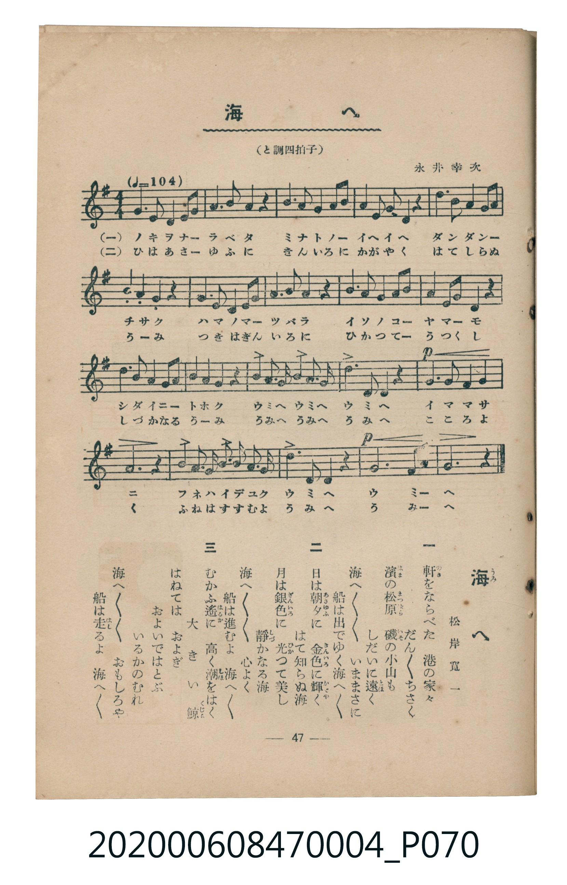

# 海へ

> Re:Shōka 使用 AI 協助辨識與重建樂譜，可能會有錯誤。歡迎回報。

- **鋼琴伴奏版**：<br><audio controls src="umi_e.mp3"></audio>
- **NEUTRINO 歌聲合成版**：<br><audio controls src="umi_e_neutrino.mp3"></audio>

- 詞：松岸寬一
- 曲：永井幸次
- 臺灣教育會公認《新定兒童唱歌》尋常科第四學年用（2020.006.0847.0004）

## 說明

原書資訊與歌詞全文（對應 P070.jpg，書頁 p. 47，參考教材第 12 首）：
調性與拍號：と調四拍子（G 大調 4/4 拍，♩=104）


## 歌詞

```text
一
軒（のき）をならべた　港（みなと）の家々（いへ／＼）
だん／＼ちさく
濱（はま）の松原（まつばら）　磯（いそ）の小山（こやま）も
しだいに遠（とほ）く
海（うみ）へ／＼／＼　いままさに
船（ふね）は出（い）でゆく海へ／＼

二
日（ひ）は朝夕（あさゆふ）に　金色（きんいろ）に輝（かゞや）く
はて知（し）らぬ海
月（つき）は銀色（ぎんいろ）に　光（ひか）つて美（うつく）し
靜（しづ）かなる海
海へ／＼／＼　心（こゝろ）よく
船は進（すゝ）むよ　海へ／＼

三
むかふ遙（はるか）に　高（たか）く潮（しほ）をはく
大（おほ）きい鯨（くぢら）
はねては　およぎ　およいではとぶ
いるかのむれ
海へ／＼／＼　おもしろや
船は走（はし）るよ　海へ／＼
```

## ABC

<div class="abc-score" data-abc-src="umi_e.abc" aria-label="五線譜載入中"></div>

[下載 ABC 原始檔](umi_e.abc)

## TMD 檔案連結

- [主旋律 TMD 檔案](umi_e.tmd) [[在 TMD Studio 編輯](https://tmdlang.github.io/Tmd-TS/#tmd=s7IKdvYPcrWy4qpTUCpJTLdSSM7PyUlNLsnMz7MqzsjMK0nNjM_KTMmPL87Iz05Ugisry88pzU21Si9KTEmNN4k3MjAyiDcwMIs3sDAxBzIMTBBKi_NLi5JTrYqTM_Lzc-JLUitKkvLzsxHyBUX5Zal5iXlANQVFIBtTwIoQClLLMlNSQdKpKZkl-UWZiTlI7kgtKga7FWxJfElRYl5xclFmAcgDCFX5RSUZ-UC3FmRUWmVkFoMMSU7Mic9OzEPyUklGKtBHeYklpUWp6KLliSWpRcjmZaZn5lmVJGYCgwUUNOWJ8bmJmXk5iXkp6B6PL0hMT7UKMDA3UOLS0lJ4tnX748YdClpaXIq2CoYGJlz2tgruXDYm-iZ2II0vVs57v2fWs7n7nm7a8XT9mic7GsDmPZu9CSS8YceTXVOf7tzxbM1CsPCL9l3PGxc_mzrzRdOmZ3Oan7auebGq93FD17NpG56um_W0ddLz1UufTtn4bG3P44bupxu6n-7Y8Xz5xOdr1jydPfvp2h1Pd255PmXF-z0doOjTA0afHij6gAwDk_d7OpW4uPS1FGypBbgUFBSe9s1_NnvHi83tL1Z0vehoB7oL6N-nrSueTWsHuuLpht5n7Z0KoKDSyypIf7-nB6j45YJGhQI9BRNzIPdpf_OLhmagd5_NnQD0hIKhkcLLZdOATgWGDcj4F6v2P2tYDjK4u_fFzPlA0ceNK4CCQN8CRZ6unQC0xF3h6ZLlQDEFYIgrAEWBxj6audIWGBNAc7hApgDDHGzY7klA5Y8b1z1uBCrqfNw06XHjqsdNnY8bdz5unP-4oeHZjvVgBftB4o3AYARKrXu6btvjhlaweAswnt_v6X-_Zw_IZKCJjxsXPG6aDBF63LjwcePUx439IIln-zeCdax_3LgPYgwoAfQBPQAU3Pe4ccnjxg1Am0FSDQ3PF0OsBRo_F2rnhv6nGyEmTH7cBBQHG9LUBLFzOshakOrVLxsXgBWteNy4G6wTYvnW7WDRNqBPwKJwR4Pd2dAA1gx0BRABHbwaHDYdO8F6tj5uXAvWs_5p-y6Iq8Dc5Y-bgMb1Q9I6xCBI0O7qAVs5fSlYMTBNg_Q-mzP36ZKpYJEmkB0gvVvBUquB1r9sn_iiE6gSKNsLDD6Qa5rAEdK4-sUeYAgAxbsfN80DehzhJ3BQLns-H2LNdHBwAOXWAB0Etn9OB1gCGK4Qk9a_7GqAWdKHZgnQCU9bgWEPci_QKrAgUOOy5_v6YOEG5AK9CBSfDjL95dw5EGsfNwLtB4p2gxNON8xypECBh_HT_c2w-JsLtbkJyAV7BhjYIBc2QJw3E6gCLN0AUgFMhRhhvAOS2IAKQDZvfdk4E5q4moBciPvB4bp6Blh8Pkyw_9nedTCHg9MHKMUDwxHsCGCmAct1wdJOLzCMXq4HFR5AFY8bF0HSJzzw1wJDCMQAJZ8usF_6kNjABLUcrAyYFLdB9AADHOQ8UH4DeQ2STrAFFdgMYDqZDgwnYKQjQujF1g2wXASJcWCywAghoGrKizIoUNDS5-IKzc10tQrITMzLd6gxqKkGWaBgY2imZQdmYStAFYBFF7CMebGwR0HDVAGYeZ-vb9CBl3qaWDQA7YEapgHUqGml8Li5DxjBa4H0JiDuAuI9CjVAciUQzwTK7FcwAPPnQ2U7IDogqpqWAFkz4DREZQMQb0ai96BYuqsHZGkj0LLG9UDcBMRT4ca1AXlbgXg1xKjGXqDYZFCMAmkgGygOEu0G4h6gCFC0sR-qEmTWMlARBRTvBNJrYJbWKBgq6MKhWTyQMAURcB5IukbBCEmRMRDD-AZQugYsCoMgWZixIDZIDmEG3Fi4RQhTTHHYA1IOYteAHe1jCArIPiS1oCgCksBIgvKBkQEi94BNBUUXklpgxIF07MewHRSNyOogZnTA-SAb4WYCIxUmPgNsHogPYaOb2oBi6mYwCROD8cGmQnxnBIoxmE_AaoDxByKb4PypKC5pQ1G7FUyuxnQHML0gh9hksLoWOB8kC9EHSUUw83rAsiB1oPSEaSrIbQjbl4HJ6XBTO8H8NWDf4c-ou3ooy6iNQNuAuaNpPTSj9QPxPGh2BNGQjAvMFc0TwCkCrAqUNZv2QrM5JDuCVIEyLETP4-ZFQJVYsigwM4KkG6ElQCNQCyhDgrMayLDJYFFE1oSoAmVsUAYFqQZmSIh1ILPAIkAnA4MObh0iVyHnA9TwH0zZFylzNsITACg5QliwhIKcNWAJCqwCGOSwbIbMh2ViWFKFyE0Ak7CMjWQmPGNCbN2LaiYwkpHNRGRihF2gKMfqM3DGhGU2iFowC5gGMFwBjE8kV4CzHiKrgFIILAtCUgmyiyFqsWVg1EIBlEUR9kCzHsxnCHeCVUCyLiJjInxGoPbspChTNm2H1HTgGhCY7qHZC1RLzkZk1SZQTgDVoKC6EsFGlYFnV3DGBGJgysKSLYE1XONSaCZbBVTUDctgKJkVlOH2A_EOFDaqDEQlqH4FYlAmbupAZEyCFRURWRdVhSEGH9UWcHbDUmVWF9SiFAIgtjlMGUwCKWsCowQpEYHrIeS6DJyo4NkDUffNhrGwZWNgNMHUQWpQWFRiiiKrRshhrTdRMzI0g4JIiDtgBQty5oQlb7AKYDqAZRMIfxVYH4hPSkZGZCSILCzVYIoiq0bIgWQwTQVlfYQ6cF0MzvgQv8HCnUD2BHa3KaszIWEDqS9B7UxgKgfVm-Bs1g7EwOwHjG9sGREShxAxSKaGxCDWuhJSykMyFKgBuxZcFgK7WBDcBCohOrBmP0hwgsWgdSUkMJHqSOTKDRkSymjGFGY0ZAjOcJB8j0sJtloSljRxOx0ULRA2KHIgNCSCIGxIJIHZ8IhCmIMvcyGrQ4YwPbAiAKaXgH_A2Q-5NsfhH3DzFGwPMBVAaEhKgLAhqQHiH1iKQHIbngyFrA7FPxA98HoRphe3f2q5uHTtFEDdTQUgrcwFAA)]
- [鋼琴伴奏 TMD 檔案](umi_e_piano.tmd) [[在 TMD Studio 編輯](https://tmdlang.github.io/Tmd-TS/#tmd=s7IKdvYPcrWy4qpTUCpJTLdSyC8qychPL0osyKi0ysgsLskvykxOzInPTsxLVIIrKs4vLUpOjS9ITE-1CjAwN1Di0tJSeLZ1--PGHe_3dLzs3vN8wpYne7Y8Xdr_vLPj_Z5OBS0tLkVbBUMDEy57WwV3LhsTfRM7kGkvVs57v2fWs7n7nm7a8XT9mic7GsCWPJu9CSS8YceTXVOf7tzxbM1CsPCL9l3PGxc_mzrzRdOmZ3Oan7auebGq93FD17NpG56um_W0ddLz1UufTtn4bG3P44bupxu6n-7Y8Xz5xOdr1jydPfvp2h1Pd255PmUF0IFGBkYGegYGZnoGFibmQIaBCdCNSlxcobmZrlYBmYl5-UEeDjUGNdVcCkBgY2imZQdm6Wsp2KIDBaDxQGe_WNijoGGq8HRD__P1DToKoEDRyypI18SiQUsfbFiNgqGCLhyaxQMJUxAB54GkaxSMkBQZAzGMbwCla8CiMAiShRkLYoPkEGbAjYVbhDDFFIc9IOUgdg3Y0T6GNQqPm_uQ1D5uWgsimzfB-M1dYHIP2NTHzSuR1TbPBOvYj2H74-b5KOogZnTA-SAb4WY2LYGLzwCbB-JD2OimNqCYuhlMwsRgfLCpEN8ZAfU0wnwCVtO4Hkw2wflTUVzShqJ2K5hcjemOxl5kdU2Twepa4HyQLEQfSG033LwesCxI3ePGfiymgtyGsH0ZmJwON7UTzF8D9h3-5Lurh5zkC0t3yCkF1YWDKYEjJd9GeBCBIgzCggUlcuKBBTlYRfM8MAlL-jA-LJnDIhMiNwFMwpI-kpnwpAuxdS-qmU1ICRJII5I5wq7HzYuw-wycdGHJEaIWzGrEktkaUVwBTpyIxPS4EZzZwIkUpBbFZ0hJFd1M1GwDSsQIe6CJE-YzhDvBKiCJG5F0ET4jUOp2kpNsCRZ0RCRsVBWGGHxUW8CJEUuRW11Qi5JFQGxzmDKYBFLCbdqOpBhSjiGXheAghyceRNk5G8bClsibQBEDUQcpgUHlKHZRZNUIOazlLmoyhyZfEAlxByzbISddWOSDVTTOApOIknAVWB-IT0oyRyQziCyweYJDFFk1Qg4kg2kqKGMg1IHLcnC2gPgNFu4EEi-wRUJO4kUuLJEhoaRpTGHSRIbgJArJKbiUYCt1YZGJ2-mPm0GVKzgYm3uhdD88MT1ubgdiSAIEJWVSkiOyOmQI0wPLNDC9BPwDTrDItQMO_4AbBGB7GtdC6fVADGoEgdgzgS6DNEZAyYaUJIisDsU_ED3wchamF7d_apFbvT7IrV4TaKMXGMvxCtGGscBkAqGBKQjEMo2HCBkgVEApiAIzIEaTB3GN4qGhCBYFiQApNDXk2YLpWpBdmLZAeSAKtyVQRTBDsSkjyhy4AgQf5FRgsOvaKYBCPtoHKApnG4HZylwA)]

## 分析

```text
================================================================================
📊 TMD Song Profile: [ 海へ ]
================================================================================
⏱  Duration:       0:46 (46.2s), 20 measures total
🎼 Key & Tempo:    首調基準 G, != 104.0 BPM, <4/4>
   - 分析範圍：      由實際發聲的音符與和弦推測調性；播放脈絡另行呈現
🎤 人聲音域:    D4 (MIDI 62) – D5 (MIDI 74) [跨度: 12 個半音 / 1.0 個八度, 難度: easy]
   - 最低音:  D4 in [UmiE #1 @ m.1, 0:01]
   - 最高音: D5 in [UmiE #1 @ m.5, 0:09]
   - 適合: soprano, mezzo-soprano, contralto, tenor, baritone, bass
🏛  結構:      UmiE (46.2s)
⚡ 編曲密度:        Peak 1 軌道同時演奏
🗝  調性診斷：       G 調性不明確（純淨自然大調，未偵測到可信轉調）
   - 風格氣質:    純淨自然大調（陽光明朗、易唱易記，無明顯調外色彩）
   - 轉調歷程:    全曲維持單一推測調性（未偵測到可信轉調）
   - 核心骨幹音:  A, G, D, B, E
   - 調性數值:    G 調性不明確 [相關度: 0.76, 穩定度: Ambiguous, 自然音純度: 100.0%]
   - 候選調性 (K-S): G 大調 (0.76), D 大調 (0.74), B 小調 (0.48)
   - 五度圈歷程:   +1
   - 各段落調性細節:
     • [UmiE #1]: G 調性不明確 (r: 0.76, 自然音純度: 100.0%)

  [ 五度圈游移軌跡 ]
               C  
         F           [G ]*
      Bb               D  
      Eb               A  
         Ab           E  
            Db       B  
               F# 
     (* = active key center)

  [ 十二半音累積音高分佈 ]
     C  :                            0.0%
     C# :                            0.0%
     D  : ███████████████           18.6%
     D# :                            0.0%
     E  : ████                       4.3%
     F  :                            0.0%
     F# : ██                         2.1%
     G  : ███████████████████████   28.6%
     G# :                            0.0%
     A  : ████████████████████████  29.3%
     A# :                            0.0%
     B  : ██████████████            17.1%
--------------------------------------------------------------------------------
Assignment 軌道音域：
  - Piano         : D4 – D5 (12 個半音 / 1.0 個八度, 78 個音符)
================================================================================
```


## 原書掃描頁




