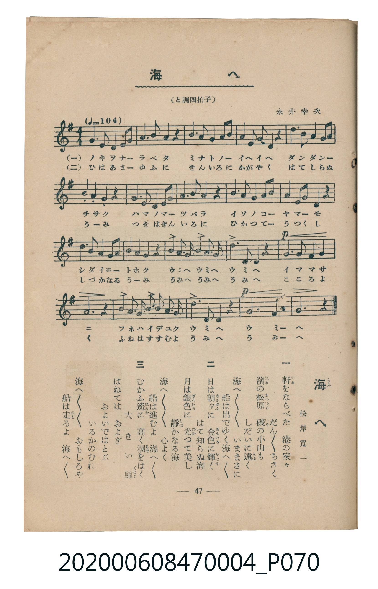

# 海へ

<audio controls src="umi_e.mp3"></audio>

- 詞：松岸寬一
- 曲：永井幸次
- 臺灣教育會公認《新定兒童唱歌》尋常科第四學年用（2020.006.0847.0004）

## 說明

原書資訊與歌詞全文（對應 P070.jpg，書頁 p. 47，參考教材第 12 首）：
調性與拍號：と調四拍子（G 大調 4/4 拍，♩=104）

## 歌詞

```text
一
軒（のき）をならべた　港（みなと）の家々（いへ／＼）
だん／＼ちさく
濱（はま）の松原（まつばら）　磯（いそ）の小山（こやま）も
しだいに遠（とほ）く
海（うみ）へ／＼／＼　いままさに
船（ふね）は出（い）でゆく海へ／＼

二
日（ひ）は朝夕（あさゆふ）に　金色（きんいろ）に輝（かゞや）く
はて知（し）らぬ海
月（つき）は銀色（ぎんいろ）に　光（ひか）つて美（うつく）し
靜（しづ）かなる海
海へ／＼／＼　心（こゝろ）よく
船は進（すゝ）むよ　海へ／＼

三
むかふ遙（はるか）に　高（たか）く潮（しほ）をはく
大（おほ）きい鯨（くぢら）
はねては　およぎ　およいではとぶ
いるかのむれ
海へ／＼／＼　おもしろや
船は走（はし）るよ　海へ／＼
```

## 原書掃描頁



## 分析

```text
================================================================================
📊 TMD Song Profile: [ 海へ ]
================================================================================
⏱  Duration:       0:46 (46.2s), 20 measures total
🎼 Key & Tempo:    首調基準 G, != 104.0 BPM, <4/4>
   - 分析範圍：      由實際發聲的音符與和弦推測調性；播放脈絡另行呈現
🎤 人聲音域:    D4 (MIDI 62) – G5 (MIDI 79) [跨度: 17 個半音 / 1.4 個八度, 難度: challenging]
   - 最低音:  D4 in [UmiE #1 @ m.1, 0:00]
   - 最高音: G5 in [UmiE #1 @ m.11, 0:23]
   - 適合: soprano, mezzo-soprano, tenor, baritone
🏛  結構:      UmiE (46.2s)
⚡ 編曲密度:        Peak 1 軌道同時演奏
🗝  調性診斷：       B 調性不明確（純淨自然大調，未偵測到可信轉調）
   - 風格氣質:    純淨自然大調（陽光明朗、易唱易記，無明顯調外色彩）
   - 轉調歷程:    全曲維持單一推測調性（未偵測到可信轉調）
   - 核心骨幹音:  B, G, D, A, E
   - 調性數值:    B 調性不明確 [相關度: 0.78, 穩定度: Ambiguous, 自然音純度: 100.0%]
   - 候選調性 (K-S): B 小調 (0.78), G 大調 (0.78), D 大調 (0.65)
   - 五度圈歷程:   +5
   - 各段落調性細節:
     • [UmiE #1]: B 調性不明確 (r: 0.78, 自然音純度: 100.0%)

  [ 五度圈游移軌跡 ]
               C  
         F            G  
      Bb               D  
      Eb               A  
         Ab           E  
            Db      [B ]*
               F# 
     (* = active key center)

  [ 十二半音累積音高分佈 ]
     C  :                            0.0%
     C# :                            0.0%
     D  : ████████████████          20.4%
     D# :                            0.0%
     E  : █████████                 11.6%
     F  :                            0.0%
     F# : █                          1.4%
     G  : █████████████████         21.1%
     G# :                            0.0%
     A  : ████████████              14.8%
     A# :                            0.0%
     B  : ████████████████████████  30.6%
--------------------------------------------------------------------------------
Assignment 軌道音域：
  - Piano         : D4 – G5 (17 個半音 / 1.4 個八度, 78 個音符)
================================================================================
```

## ABC

```abc
X:1
T:海へ
C:曲：永井幸次
M:4/4
L:1/16
Q:1/4=104
K:G

V:V1 name="Piano" snm="Pia"

[V:V1]
g6 d2 e4 g2 a2 | b6 d2 b4 a4 | b4 b4 b4 a2 b2 | d4 b2 a2 g4 z4 |
e4 d4 b4 a2 b2 | d6 b2 e4 z4 | g6 d2 e4 g2 a2 | b6 d2 a4 z4 |
b4 b4 b4 a2 b2 | d4 b2 d2 e4 z4 | f4 g4 e4 d2 e2 | b4 d4 a4 z4 |
d3 b g4 e3 d b4 | d6 b2 g4 z4 | !p! a4 g4 a4 b4 | g12 z4 |
d4 b2 d2 e2 d2 b2 a2 | d6 e2 a4 z4 | !p! b12 a4 | g12 z4 |
```

- [主旋律 TMD 檔案](umi_e.tmd)
- [鋼琴伴奏 TMD 檔案](umi_e_piano.tmd)
