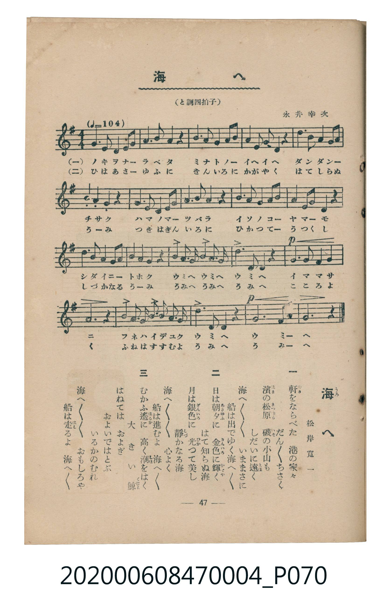

# 海へ

> Re:Shōka 使用 AI 協助辨識與重建樂譜，可能會有錯誤。歡迎回報。

<audio controls src="umi_e.mp3"></audio>

- 詞：松岸寬一
- 曲：永井幸次
- 臺灣教育會公認《新定兒童唱歌》尋常科第四學年用（2020.006.0847.0004）

## 說明

原書資訊與歌詞全文（對應 P070.jpg，書頁 p. 47，參考教材第 12 首）：
調性與拍號：と調四拍子（G 大調 4/4 拍，♩=104）

## 歌詞

```text
一
軒（のき）をならべた　港（みなと）の家々（いへ／＼）
だん／＼ちさく
濱（はま）の松原（まつばら）　磯（いそ）の小山（こやま）も
しだいに遠（とほ）く
海（うみ）へ／＼／＼　いままさに
船（ふね）は出（い）でゆく海へ／＼

二
日（ひ）は朝夕（あさゆふ）に　金色（きんいろ）に輝（かゞや）く
はて知（し）らぬ海
月（つき）は銀色（ぎんいろ）に　光（ひか）つて美（うつく）し
靜（しづ）かなる海
海へ／＼／＼　心（こゝろ）よく
船は進（すゝ）むよ　海へ／＼

三
むかふ遙（はるか）に　高（たか）く潮（しほ）をはく
大（おほ）きい鯨（くぢら）
はねては　およぎ　およいではとぶ
いるかのむれ
海へ／＼／＼　おもしろや
船は走（はし）るよ　海へ／＼
```

## ABC

```abc
X:1
T:海へ
C:曲：永井幸次
M:4/4
L:1/16
Q:1/4=104
K:G
V:V1 name="Piano" snm="Pia"
[V:V1]
G6 E2 D4 E2 G2 | A6 B2 A4 z4 | B6 A2 G4 A2 B2 | A4 E2 G2 D4 z4 |
w: 1.~ノ キ ヲ ナ ー | ラ ベ タ | ミ ナ ト ノ ー | イ ヘ イ ヘ
w: 2.~ひ は あ さ ー | ゆ ふ に | き ん い ろ に | か が や く
d6 B2 A4 G2 A2 | B4 A4 G4 z4 | G6 E2 D4 E2 G2 | A6 B2 A4 z4 |
w: 1.~ダ ン ダ ン ー | チ サ ク | ハ マ ノ マ ー | ツ バ ラ
w: 2.~は て し ら ぬ | う ー み | つ き は ぎ ん | い ろ に
B6 A2 G4 A2 B2 | A4 E2 G2 D4 z4 | d6 B2 A4 G2 A2 | B4 A4 G4 z4 |
w: 1.~イ ソ ノ コ ー | ヤ マ ー モ | シ ダ イ ニ ー | ト ホ ク
w: 2.~ひ か つ て ー | う つ く し | し づ か な る | う ー み
B4 A3 G B4 A3 G | d6 D2 D4 z4 | !p! G6 G2 F4 G4 | A12 z4 |
w: 1.~ウ ミ ヘ ウ ミ ヘ | ウ ミ ヘ | イ マ マ サ | ニ
w: 2.~う み へ う み へ | う み へ | こ こ ろ よ | く
B4 A3 G B3 B A3 G | d6 D2 D4 z4 | !p! G12 F2 A2 | G12 z4 |
w: 1.~フ ネ ハ イ デ ユ ク | ウ ミ ヘ | ウ ミ ー | ヘ
w: 2.~ふ ね は す す む よ | う み へ | う み ー | へ
```

## TMD 檔案連結

- [主旋律 TMD 檔案](umi_e.tmd) [[在 TMD Studio 編輯](https://tmdlang.github.io/Tmd-TS/#tmd=s7IKdvYPcrWy4qpTUCpJTLdSSM7PyUlNLsnMz7MqzsjMK0nNjM_KTMmPL87Iz05Ugisry88pzU21Si9KTEmNN4k3MjAyiDcwMIs3sDAxBzIMTBBKi_NLi5JTrYqTM_Lzc-JLUitKkvLzsxHyBUX5Zal5iXlANQVFIBtTwIoQClLLMlNSQdKpKZkl-UWZiTlI7kgtKga7FWxJfElRYl5xclFmAcgDCFX5RSUZ-UC3FmRUWmVkFoMMSU7Mic9OzEPyUklGKtBHeYklpUWp6KLliSWpRUpcWloKz7Zuf9y4Q0FLi0vRVsHQwITL3lbBncvGRN_EDqTnxcp57_fMejZ339NNO56uX_NkRwPYqGezN4GEN-x4smvq0507nq1ZCBZ-0b7reePiZ1Nnvmja9GxO89PWNS9W9T5u6Ho2bcPTdbOetk56vnrp0ykbn63tedzQ_XRD99MdO54vn_h8zZqns2c_Xbvj6c4tz6eseL-nAxT8esDg1wMFP5BhYPJ-T6cSF5e-loIttQCXgoLC0775z2bveLG5_cWKrhcd7UB3Af37tHXFs2ntQFc83dD7rL1TIcDA3EAvqyD9_Z4eoOKXCxoVCvQUTMyB3Kf9zS8amoHefTZ3AtATCoZGCi-XTQM6FRg2IONfrNr_rGE5yODu3hcz5wNFHzeuAAoCfQsUebp2AtASd4WnS5YDxRSAIa4AFAUa-2jmSltgTADN4QKZAgxzsGG7JwGVP25c97gRqKjzcdOkx42rHjd1Pm7c-bhx_uOGhmc71oMV7AeJNwKDESi17um6bY8bWsHiLcB4fr-n__2ePSCTgSY-blzwuGkyROhx48LHjVMfN_aDJJ7t3wjWsf5x4z6IMaAE0Af0AFBw3-PGJY8bNwBtBkk1NDxfDLEWaPxcqJ0b-p9uhJgw-XETUBxsSFMTxM7pIGtBqle_bFwAVrTiceNusE6I5Vu3g0XbgD4Bi8IdDXZnQwNYM9AVQAR08Gpw2HTsBOvZ-rhxLVjP-qftuyCuAnOXP24CGtcPSesQgyBBu6sHbOX0pWDFwDQN0vtsztynS6aCRZpAdoD0bgVLrQZa_7J94otOoEqgbC8w-ECuaQJHSOPqF3uAIQAU737cNA_ocYSfwEG57Pl8iDXTwcEBlFsDdBDY_jkdYAlguEJMWv-yqwFmSR-aJUAnPG0Fhj3IvUCrwIJAjcue7-uDhRuQC_QiUHw6yPSXc-dArH3cCLQfKNoNTjjdMMuRAgUexk_3N8Piby7U5iYgF-wZYGCDXNgAcd5MoAqwdANIBTAVYoTxDkhiAyoA2bz1ZeNMaOJqAnIh7geH6-oZYPH5MMH-Z3vXwRwOTh-gFA8MR7AjgJkGLNcFSzu9wDB6uR5UeABVPG5cBEmf8MBfCwwhEAOUfLrAfulDYgMT1HKwMmBS3AbRAwxwkPNA-Q3kNUg6wRZUYDOA6WQ6MJyAkY4IoRdbN8ByESTGgckCI4SAqikvyqBAQUufiys0N9PVKiAzMS_focagphpkgYKNoZmWHZiFrQBVABZdwDLmxcIeBQ1TBWDmfb6-QQde6mli0QC0B2qYBlCjppXC4-Y-YASvBdKbgLgLiPco1ADJlUA8EyizX8EAzJ8Ple2A6ICoaloCZM2A0xCVDUC8GYneg2Lprh6QpY1AyxrXA3ETEE-FG9cG5G0F4tUQoxp7gWKTQTEKpIFsoDhItBuIe4AiQNHGfqhKkFnLQEUUULwTSK-BWVqjYKigC4dm8UDCFETAeSDpGgUjJEXGQAzjG0DpGrAoDIJkYcaC2CA5hBlwY-EWIUwxxWEPSDmIXQN2tI8hKCD7kNSCoghIAiMJygdGBojcAzYVFF1IaoERB9KxH8N2UDQiq4OY0QHng2yEmwmMVJj4DLB5ID6EjW5qA4qpm8EkTAzGB5sK8Z0RKMZgPgGrAcYfiGyC86eiuKQNRe1WMLka0x3A9IIcYpPB6lrgfJAsRB8kFcHM6wHLgtSB0hOmqSC3IWxfBianw03tBPPXgH2HP6Pu6qEsozYCbQPmjqb10IzWD8TzoNkRREMyLjBXNE8ApwiwKlDWbNoLzeaQ7AhSBcqwED2PmxcBVWLJosDMCJJuhJYAjUAtoAwJzmogwyaDRRFZE6IKlLFBGRSkGpghIdaBzAKLAJ0MDDq4dYhchZwPUMN_MGVfpMzZCE8AoOQIYcESCnLWgCUosApgkMOyGTIflolhSRUiNwFMwjI2kpnwjAmxdS-qmcBIRjYTkYkRdoGiHKvPwBkTltkgasEsYBrAcAUwPpFcAc56iKwCSiGwLAhJJcguhqjFloFRCwVQFkXYA816MJ8h3AlWAcm6iIyJ8BmB2rOTokzZtB1S04FrQGC6h2YvUC05G5FVm0A5AVSDgupKBBtVBp5dwRkTiIEpC0u2BNZwjUuhmWwVUFE3LIOhZFZQhtsPxDtQ2KgyEJWg-hWIQZm4qQORMQlWVERkXVQVhhh8VFvA2Q1LlVldUItSCIDY5jBlMAmkrAmMEqREBK6HkOsycKKCZw9E3TcbxsKWjYHRBFMHqUFhUYkpiqwaIYe13kTNyNAMCiIh7oAVLMiZE5a8wSqA6QCWTSD8VWB9ID4pGRmRkSCysFSDKYqsGiEHksE0FZT1EerAdTE440P8Bgt3AtkT2N2mrM6EhA2kvgS1M4GpHFRvgrNZOxADsx8wvrFlREgcQsQgmRoSg1jrSkgpD8lQoAbsWnBZCOxiQXATqITowJr9IMEJFoPWlZDARKojkSs3ZEgooxlTmNGQITjDQfI9LiXYaklY0sTtdFC0QNigyIHQkAiCsCGRBGbDIwphDr7MhawOGcL0wIoAmF4C_gFnP-TaHId_wM1TsD3AVAChISkBwoakBoh_YCkCyW14MhSyOhT_QPTA60WYXtz-qeXi0rVTAHU3FYC0MhcA)]
- [鋼琴伴奏 TMD 檔案](umi_e_piano.tmd) [[在 TMD Studio 編輯](https://tmdlang.github.io/Tmd-TS/#tmd=s7IKdvYPcrWy4tLSUni2dfvjxh3v93S87N7zfMKWJ3u2PF3a_7yz4_2eTgUtLS5FWwVDAxMue1sFdy4bE30TO646BaUXK-e93zPr2dx9TzfteLp-zZMdDUog4WezN4GEN-x4smvq0507nq1ZCBZ-0b7reePiZ1Nnvmja9GxO89PWNS9W9T5u6Ho2bcPTdbOetk56vnrp0ykbn63tedzQ_XRD99MdO54vn_h8zZqns2c_Xbvj6c4tz6esADrQyMDIQM_AwEzPwMLEHMgwMAG6UYmLKzQ309UqIDMxLz_Iw6HGoKaaSwEIbAzNtOzALH0tBVt0oAA0HujsFwt7FDRMFZ5u6H--vkFHIcDA3EAvqyBdE4sGLX2wYTUKhgq6cGgWDyRMQQScB5KuUTBCUmQMxDC-AZSuAYvCIEgWZiyIDZJDmAE3Fm4RwhRTHPaAlIPYNWBH-xjWKDxu7kNS-7hpLYhs3gTjN3eByT1gUx83r0RW2zwTrGM_hu2Pm-ejqIOY0QHng2yEm9m0BC4-A2weiA9ho5vagGLqZjAJE4PxwaZCfGcE1NMI8wlYTeN6MNkE509FcUkbitqtYHI1pjsae5HVNU0Gq2uB80GyEH0gtd1w83rAsiB1jxv7sZgKchvC9mVgcjrc1E4wfw3Yd_iT764ecpIvLN0hpxRUFw6mBI6UfBvhQQSKMAgLFpTIiQcW5GAVzfPAJCzpw_iwZA6LTIjcBDAJS_pIZsKTLsTWvahmNiElSCCNSOYIux43L8LuM3DShSVHiFowqxFLZmtEcQU4cSIS0-NGcGYDJ1KQWhSfISVVdDNRsw0oESPsgSZOmM8Q7gSrgCRuRNJF-IxAqdtJTrIlWNARkbBRVRhi8FFtASdGLEVudUEtShYBsc1hymASSAm3aTuSYkg5hlwWgoMcnngQZedsGAtbIm8CRQxEHaQEBpWj2EWRVSPksJa7qMkcmnxBJMQdsGyHnHRhkQ9W0bgUTCJKwlVgfSA-KckckcwgssDmCQ5RZNUIOZAMpqmgjIFQBy7LwdkC4jdYuBNIvMAWCTmJF7mwRIaEkqYxhUkTGYKTKCSn4FKCrdSFRSZupz9uBlWu4GBs7oXS_fDE9Li5HYghCRCUlElJjsjqkCFMDyzTwPQS8A84wSLXDjj8A24QgO1pXAul1wMxqBEEYs8EugzSGAElG1KSILI6FP9A9MDLWZhe3P6pRW71-iC3ek2gjV5gLMcrRBvGApMJhAamIBDLNB4iZIBQAaUgCsyAGE0exDWKh4YiWBQkAqTQ1JBnC6ZrQXZh2gLlgSjclkAVwQzFpowoc-AKEHyQU4HBrmunAAr5aB-gKJxtBGYrcwEA)]

## 分析

```text
================================================================================
📊 TMD Song Profile: [ 海へ ]
================================================================================
⏱  Duration:       0:46 (46.2s), 20 measures total
🎼 Key & Tempo:    首調基準 G, != 104.0 BPM, <4/4>
   - 分析範圍：      由實際發聲的音符與和弦推測調性；播放脈絡另行呈現
🎤 人聲音域:    D4 (MIDI 62) – D5 (MIDI 74) [跨度: 12 個半音 / 1.0 個八度, 難度: easy]
   - 最低音:  D4 in [UmiE #1 @ m.1, 0:01]
   - 最高音: D5 in [UmiE #1 @ m.5, 0:09]
   - 適合: soprano, mezzo-soprano, contralto, tenor, baritone, bass
🏛  結構:      UmiE (46.2s)
⚡ 編曲密度:        Peak 1 軌道同時演奏
🗝  調性診斷：       G 調性不明確（純淨自然大調，未偵測到可信轉調）
   - 風格氣質:    純淨自然大調（陽光明朗、易唱易記，無明顯調外色彩）
   - 轉調歷程:    全曲維持單一推測調性（未偵測到可信轉調）
   - 核心骨幹音:  A, G, D, B, E
   - 調性數值:    G 調性不明確 [相關度: 0.76, 穩定度: Ambiguous, 自然音純度: 100.0%]
   - 候選調性 (K-S): G 大調 (0.76), D 大調 (0.74), B 小調 (0.48)
   - 五度圈歷程:   +1
   - 各段落調性細節:
     • [UmiE #1]: G 調性不明確 (r: 0.76, 自然音純度: 100.0%)

  [ 五度圈游移軌跡 ]
               C  
         F           [G ]*
      Bb               D  
      Eb               A  
         Ab           E  
            Db       B  
               F# 
     (* = active key center)

  [ 十二半音累積音高分佈 ]
     C  :                            0.0%
     C# :                            0.0%
     D  : ███████████████           18.6%
     D# :                            0.0%
     E  : ████                       4.3%
     F  :                            0.0%
     F# : ██                         2.1%
     G  : ███████████████████████   28.6%
     G# :                            0.0%
     A  : ████████████████████████  29.3%
     A# :                            0.0%
     B  : ██████████████            17.1%
--------------------------------------------------------------------------------
Assignment 軌道音域：
  - Piano         : D4 – D5 (12 個半音 / 1.0 個八度, 78 個音符)
================================================================================
```


## 原書掃描頁




