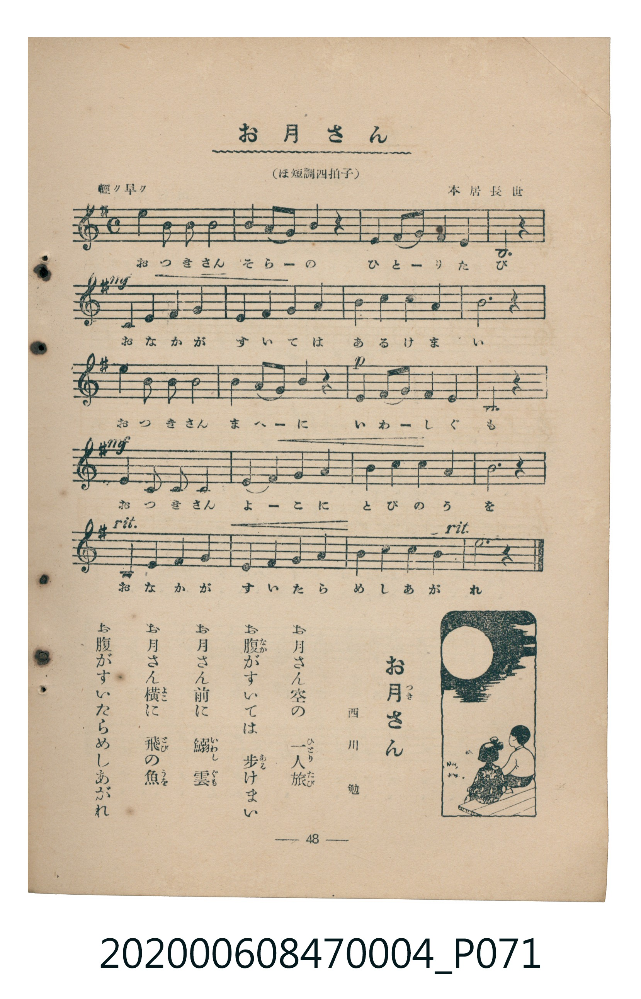

# お月さん

> Re:Shōka 使用 AI 協助辨識與重建樂譜，可能會有錯誤。歡迎回報。

- **鋼琴伴奏版**：<br><audio controls src="otsukisan.mp3"></audio>
- **NEUTRINO 歌聲合成版**：<br><audio controls src="otsukisan_neutrino.mp3"></audio>

- 詞：西川勉
- 曲：本居長世
- 臺灣教育會公認《新定兒童唱歌》尋常科第四學年用（2020.006.0847.0004）

## 說明

原書資訊與歌詞全文（對應 P071.jpg，書頁 p. 48，參考教材第 13 首）：
調性與拍號：ほ短調四拍子（e 小調 4/4 拍）
速度指示：輕ク早ク


## 歌詞

```text
お月（つき）さん空（そら）の　一人旅（ひとりたび）
お腹（なか）がすいては　歩（ある）けまい
お月さん前（まへ）に　鰯雲（いわしぐも）
お月さん横（よこ）に　飛（とび）の魚（うを）
お腹がすいたらめしあがれ
```

## ABC

```abc
X:1
T:お月さん
C:曲：本居長世
M:4/4
L:1/16
Q:1/4=108
K:Em
V:V1 name="Piano" snm="Pia"
[V:V1]
e4 B2 B2 B8 | B4 A2 G2 B4 z4 | E4 F2 G2 F4 E4 | B,12 z4 |
w: お つ き さん | そ ら _ の | ひ と _ り た | び
!mf! B,4 E4 F4 G4 | E4 F4 G4 A4 | B4 c4 c4 A4 | B12 z4 |
w: お な か が | す い て は | あ る け ま | い
e4 B2 B2 B8 | B4 A2 G2 B4 z4 | !p! E4 F2 G2 F4 E4 | B,12 z4 |
w: お つ き さん | ま へ _ に | い わ _ し ぐ | も
!mf! E4 B,2 B,2 B,8 | E4 F4 G4 A4 | B4 c4 c4 A4 | B12 z4 |
w: お つ き さん | よ _ こ に | と び の う | を
B,4 E4 F4 G4 | E4 F4 G4 A4 | B4 c4 c4 B4 | e12 z4 |
w: お な か が | す い た ら | め し あ が | れ
```

## TMD 檔案連結

- [主旋律 TMD 檔案](otsukisan.tmd) [[在 TMD Studio 編輯](https://tmdlang.github.io/Tmd-TS/#tmd=s7IKdvYPcrWy4qpTUCpJTLdSSM7PyUlNLsnMz7MqzsjMK0nNjM_KTMmPL87Iz05Ugisry88pzU21Si9KTEmNN4k3MjAyiDcwMIs3sDAxBzIMTBBKi_NLi5JTrYqTM_Lzc-JLUitKkvLzsxHyBUX5Zal5iXlANQVFIBtTwIoQClLLMlNSQdKpKZkl-UWZiTlI7kgtKga7FWxJfElRYl5xclFmAcgDCFX5RSUZ-UC3FmRUWmVkFoMMSU7Mic9OzEPyUklGKtBHeYklpUWpyFoz0zPzrEoSM4EhAAqF8sT43MTMvJzEvBQlLi0thceNXc_mdDxunPq4abKClhaXoq2CoYEFl72tgjtXdmqlrYJrLpeNib6JHcjIFyvnvd8z68XS_U-3z33a3Qm25tnsTUCxZ3PWPN3Y-nLq9ic7poGFX7Tvet64-NnUmS-aNj2b0_y0dc2LVb2PG7qeTdvwdN2sp62Tnq9e-nTKxmdrex43dD_d0P10x47nyyc-X7Pm6ezZT9fueLpzy_MpK97v6QBFjR4wavRAUQNkGJi83wO0mEtfS8GWWoBLQUHhad_8Z7N3vNjc_mJF14uOdqC7gJ592rri2bR2oCuebuh91t6pEGBgbqiXVZD-fk8PUPHLBY0KBXoKJhZA7tP-5hcNzUDvPps7AegJBUNjhZfLpgGdCgwbkPEvVu1_1rAcZHB374uZ84Gijxt3P5-_FigO9DBQ8OnaCUB7UhWebugHiikAQ1wBKAo0AKT7ZcP8p7uWPetpf75kFygC9gBja_2z6SuBJBdIHhKJQP2PG5c8bgTpgkTo85VA5UDBuY-bgA4BCq573NDwZEfDk127nk1vBUttety44nFT1-PG-Y8bN0OtAxr3onUnWHrV48ZusM6ex40zHze2PG5c9rhxPdCUZ2tXghU0PW6CKJj4uHEfUAHCORAnPO0EOgfIBsrtAKtbDdT8csP6l6BkAxRvedzU_7hx-uPGCY-bmhD2w_U_W7EKpK4JyJ2M0L94NljzCoibgf56uXYWWKTtcdMkFF8guXw-MBQeNzWCbWsCiTf1gNRRnn6gQEFLn4vLv6S4NDuzODHPKiAzMS_focagphpki4KNhZYdmIEt5SoA0wwwXl4s7FHQMAGlgefrG3TgyU0TiwagXVDDgP4E4iVA3AvE4HxcA2TMVQB6V0EXyFqnYAAW2QTEK0AiTSAN88Fim4FyUKNqFMyAksZgqAuGNWCWkYIhmDYAi5jFAynzeKAYkNCFcIHqQBQMghWCjfQBWdEFdgSK-2DGg1wJcg_MnTBLQG4FicBcC2LPh8psxrAJf6ju6qEgVFcBcTcQ94CtngnELUC8DIjXg0WagM4DyU8E4n1gkRbkAK3OTauFhA0s2HSBAYccjBC-ETywTaAYIYI3VFeByW4w2QMNoJlgXguYXAYm10NlmsDBCVE9EUzug8qAVJMSqDs6qZlU9wHxDrB7VkOTKjCUm_rBItOBeAJIrKmJ1KRaXVBL7eQKCi-EWxHJFRzacBeDyAkQGaCrSQpZYGVAxZBt6gC7ZTLYtSB3rgBnIFBWAxaVYBWTMNIrOIyAIQRBML9TKcFiD1ewO0EQ5FZY2ELcC-KBsjykeAC5GqJjEmnh-mTXFKoXA_PBJRfIMY3QhAosDiBqmnqQg5WsEgDEhqRzikoAULEJKWAhDkWkUHBpANMDdDC6RbVcXLp2CvD6TAHIUeYCAA)]
- [鋼琴伴奏 TMD 檔案](otsukisan_piano.tmd) [[在 TMD Studio 編輯](https://tmdlang.github.io/Tmd-TS/#tmd=s7IKdvYPcrWy4tLSUnjc2PVsTsfjxqmPmya_39PxsnvP8wlbnuzZ8nRp__POjvd7OhW0tLgUbRUMDSy47G0V3LmyUyttFVxzuWxM9E3suOoUlF6snPd-z6wXS_c_3T73aXenEkjs2exNQLFnc9Y83dj6cur2JzumgYVftO963rj42dSZL5o2PZvT_LR1zYtVvY8bup5N2_B03aynrZOer176dMrGZ2t7Hjd0P93Q_XTHjufLJz5fs-bp7NlP1-54unPL8ykrgK40MjAy0DMwMNMzsDAxBzIMTIAOVeLi8i8pLs3OLE7MswrITMzLD_JwqDGoqeZSAAIbCy07MENfS8EWHSgArXiyo-HFwh4FDROFpxv6n69v0FEIMDA31MsqSNfEokFLH2xYjYKZgq6CMRjqgmENmGWkYAimDcAiZvFAyjweKAYkdCFcoDoQBYNghWAjfWpAcQLkPm5cAsS9QAyKG7jxjxvngiSbOsFK1sEtedy4CSyyAiwLMWA-VGYzhk34g2JXDzlBUZ2bVgvxFczDukAvIwcAhG8EDyYTKEaI4A2PVWCyG0z2QL02E8xrAZPLwOR6qEwTOCAgqieCyX1QGZBqUoJjRyetUkZ1QS21UwfIk48bd4DJ1XCLoEHU1A8Wnw4mJ0BkmkABRUJwAPMi2akD7Dmg1yAI5mgqJQ_sAdLUAWU_bgSJQgIFpAmcUcBZA5KNHje2QXVMIi1AnuyaQk6AkJVTQGxI0qIop4AKBkgRAvJvI1gMkijAuQampwlEo1pUi1HK-iCXsibQUhbkk3iFaLP43FgkFrIo0PsGUAEgM9oYKARTBObDVGAYBxQ2jEfoBLKjjRBmm8QqGMFF8BtEZXehG0eR24jyJFA7ugNAZgGjSNdOAR5LCkCOMhcA)]

## 分析

```text
================================================================================
📊 TMD Song Profile: [ お月さん ]
================================================================================
⏱  Duration:       0:44 (44.4s), 20 measures total
🎼 Key & Tempo:    首調基準 G, != 108.0 BPM, <4/4>
   - 分析範圍：      由實際發聲的音符與和弦推測調性；播放脈絡另行呈現
🎤 人聲音域:    B3 (MIDI 59) – E5 (MIDI 76) [跨度: 17 個半音 / 1.4 個八度, 難度: challenging]
   - 最低音:  B3 in [Otsukisan #1 @ m.4, 0:06]
   - 最高音: E5 in [Otsukisan #1 @ m.1, 0:00]
   - 適合: soprano, mezzo-soprano, contralto, tenor, baritone, bass
🏛  結構:      Otsukisan (44.4s)
⚡ 編曲密度:        Peak 1 軌道同時演奏
🗝  調性診斷：       E 調性不明確（純淨自然大調，未偵測到可信轉調）
   - 風格氣質:    純淨自然大調（陽光明朗、易唱易記，無明顯調外色彩）
   - 轉調歷程:    全曲維持單一推測調性（未偵測到可信轉調）
   - 核心骨幹音:  B, E, F#, G, C
   - 調性數值:    E 調性不明確 [相關度: 0.68, 穩定度: Ambiguous, 自然音純度: 100.0%]
   - 候選調性 (K-S): E 小調 (0.68), B 大調 (0.67), B 小調 (0.66)
   - 五度圈歷程:   +4
   - 各段落調性細節:
     • [Otsukisan #1]: E 調性不明確 (r: 0.68, 自然音純度: 100.0%)

  [ 五度圈游移軌跡 ]
               C  
         F            G  
      Bb               D  
      Eb               A  
         Ab          [E ]*
            Db       B  
               F# 
     (* = active key center)

  [ 十二半音累積音高分佈 ]
     C  : █████                      8.2%
     C# :                            0.0%
     D  :                            0.0%
     D# :                            0.0%
     E  : ████████████              20.5%
     F  :                            0.0%
     F# : ██████                    11.0%
     G  : █████                      9.6%
     G# :                            0.0%
     A  : █████                      8.2%
     A# :                            0.0%
     B  : ████████████████████████  42.5%
--------------------------------------------------------------------------------
Assignment 軌道音域：
  - Piano         : B3 – E5 (17 個半音 / 1.4 個八度, 67 個音符)
================================================================================
```


## 原書掃描頁




