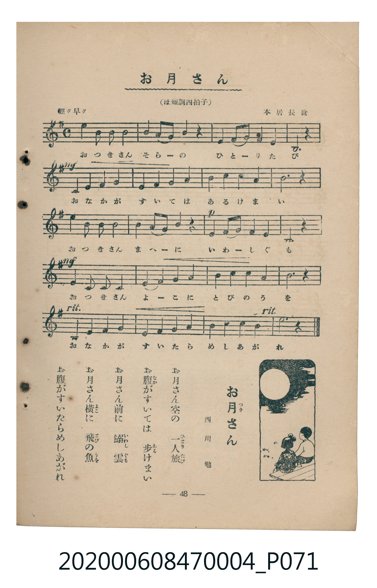

# お月さん

<audio controls src="otsukisan.mp3"></audio>

- 詞：西川勉
- 曲：本居長世
- 臺灣教育會公認《新定兒童唱歌》尋常科第四學年用（2020.006.0847.0004）

## 說明

原書資訊與歌詞全文（對應 P071.jpg，書頁 p. 48，參考教材第 13 首）：
調性與拍號：ほ短調四拍子（e 小調 4/4 拍）
速度指示：輕ク早ク

## 歌詞

```text
お月（つき）さん空（そら）の　一人旅（ひとりたび）
お腹（なか）がすいては　歩（ある）けまい
お月さん前（まへ）に　鰯雲（いわしぐも）
お月さん横（よこ）に　飛（とび）の魚（うを）
お腹がすいたらめしあがれ
```

## ABC

```abc
X:1
T:お月さん
C:曲：本居長世
M:4/4
L:1/16
Q:1/4=108
K:Em
V:V1 name="Piano" snm="Pia"
[V:V1]
e4 b2 b2 b4 b4 | c4 b2 a2 b4 z4 | e4 f2 g2 a4 e4 | B12 z4 |
!mf! e4 f4 g4 a4 | g4 a4 b4 b4 | c4 c4 b4 a4 | b12 z4 |
e4 b2 b2 b4 b4 | c4 b2 a2 b4 z4 | !p! b4 a2 g2 a4 e4 | B12 z4 |
!mf! e4 b2 b2 f4 e4 | f4 b4 b4 b4 | c4 c4 b4 c4 | b12 z4 |
B4 e4 f4 g4 | f4 g4 a4 b4 | c4 c4 b4 b4 | e12 z4 |
```

## TMD 檔案連結

- [主旋律 TMD 檔案](otsukisan.tmd)
- [鋼琴伴奏 TMD 檔案](otsukisan_piano.tmd)

## 分析

```text
================================================================================
📊 TMD Song Profile: [ お月さん ]
================================================================================
⏱  Duration:       0:44 (44.4s), 20 measures total
🎼 Key & Tempo:    首調基準 G, != 108.0 BPM, <4/4>
   - 分析範圍：      由實際發聲的音符與和弦推測調性；播放脈絡另行呈現
🎤 人聲音域:    B3 (MIDI 59) – E5 (MIDI 76) [跨度: 17 個半音 / 1.4 個八度, 難度: challenging]
   - 最低音:  B3 in [Otsukisan #1 @ m.4, 0:06]
   - 最高音: E5 in [Otsukisan #1 @ m.1, 0:00]
   - 適合: soprano, mezzo-soprano, contralto, tenor, baritone, bass
🏛  結構:      Otsukisan (44.4s)
⚡ 編曲密度:        Peak 1 軌道同時演奏
🗝  調性診斷：       B 調性不明確（流行色彩大調，未偵測到可信轉調）
   - 風格氣質:    流行大調（略帶和弦色彩音與裝飾副屬和弦）
   - 轉調歷程:    全曲維持單一推測調性（未偵測到可信轉調）
   - 核心骨幹音:  B, E, C, A, F#
   - 調性數值:    B 調性不明確 [相關度: 0.63, 穩定度: Ambiguous, 自然音純度: 87.7%]
   - 候選調性 (K-S): B 小調 (0.63), B 大調 (0.62), E 小調 (0.58)
   - 五度圈歷程:   +5
   - 各段落調性細節:
     • [Otsukisan #1]: B 調性不明確 (r: 0.63, 自然音純度: 87.7%, 調外音: C)

  [ 五度圈游移軌跡 ]
               C  
         F            G  
      Bb               D  
      Eb               A  
         Ab           E  
            Db      [B ]*
               F# 
     (* = active key center)

  [ 十二半音累積音高分佈 ]
     C  : ██████                    12.3%
     C# :                            0.0%
     D  :                            0.0%
     D# :                            0.0%
     E  : ████████                  16.4%
     F  :                            0.0%
     F# : ████                       7.5%
     G  : ████                       6.8%
     G# :                            0.0%
     A  : █████                     10.3%
     A# :                            0.0%
     B  : ████████████████████████  46.6%
--------------------------------------------------------------------------------
Assignment 軌道音域：
  - Piano         : B3 – E5 (17 個半音 / 1.4 個八度, 70 個音符)
================================================================================
```


## 原書掃描頁




