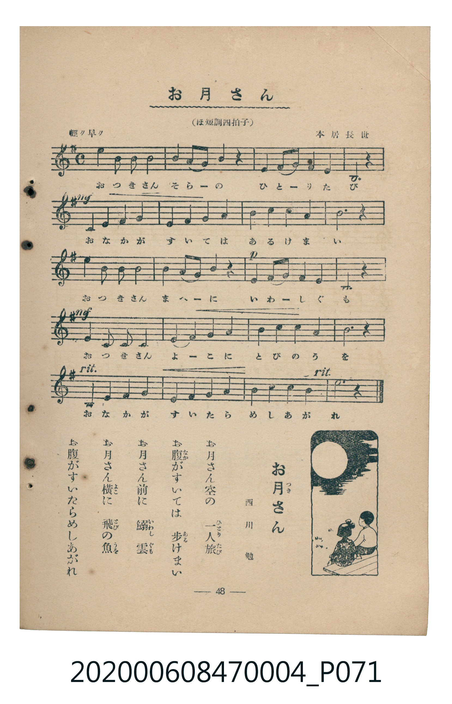

# お月さん

> Re:Shōka 使用 AI 協助辨識與重建樂譜，可能會有錯誤。歡迎[回報](https://github.com/TMDLang/reshoka/issues)。

- **鋼琴伴奏版**：<br><audio controls src="otsukisan.mp3"></audio>
- **NEUTRINO 歌聲合成版**：<br><audio controls src="otsukisan_neutrino.mp3"></audio>

- 詞：西川勉
- 曲：本居長世
- 臺灣教育會公認《新定兒童唱歌》尋常科第四學年用（2020.006.0847.0004）

## 說明

原書資訊與歌詞全文（對應 P071.jpg，書頁 p. 48，參考教材第 13 首）：
調性與拍號：ほ短調四拍子（e 小調 4/4 拍）
速度指示：輕ク早ク


## 歌詞

```text
お月（つき）さん空（そら）の　一人旅（ひとりたび）
お腹（なか）がすいては　歩（ある）けまい
お月さん前（まへ）に　鰯雲（いわしぐも）
お月さん横（よこ）に　飛（とび）の魚（うを）
お腹がすいたらめしあがれ
```

## ABC

<div class="abc-score" data-abc-src="otsukisan.abc" aria-label="五線譜載入中"></div>

[下載 ABC 原始檔](otsukisan.abc)

## TMD 檔案連結

- [主旋律 TMD 檔案](otsukisan.tmd) [[在 TMD Studio 編輯](https://tmdlang.github.io/Tmd-TS/#tmd=s7IKdvYPcrWy4qpTUCpJTLdSSM7PyUlNLsnMz7MqzsjMK0nNjM_KTMmPL87Iz05Ugisry88pzU21Si9KTEmNN4k3MjAyiDcwMIs3sDAxBzIMTBBKi_NLi5JTrYqTM_Lzc-JLUitKkvLzsxHyBUX5Zal5iXlANQVFIBtTwIoQClLLMlNSQdKpKZkl-UWZiTlI7kgtKga7FWxJfElRYl5xclFmAcgDCFX5RSUZ-UC3FmRUWmVkFoMMSU7Mic9OzEPyUklGKtBHeYklpUWpyFoz0zPzrEoSM4EhAAqF8sT43MTMvJzEvBR0P8YXJKanWgUYmBsqcWlpKTxu7Ho2p-Nx49THTZMVtLS4FG0VDA0suOxtFdy5slMrbRVcc7lsTPRN7EDGvFg57_2eWS-W7n-6fe7T7k6w0c9mbwKKPZuz5unG1pdTtz_ZMQ0s_KJ91_PGxc-mznzRtOnZnOanrWterOp93ND1bNqGp-tmPW2d9Hz10qdTNj5b2_O4ofvphu6nO3Y8Xz7x-Zo1T2fPfrp2x9OdW55PWfF-Twco0vSAkaYHijQgw8Dk_R6gxVz6Wgq21AJcCgoKT_vmP5u948Xm9hcrul50tAPdBfTs09YVz6a1A13xdEPvs_ZOBVCo6WUVpL_f0wNU_HJBo0KBnoKJBZD7tL_5RUMz0LvP5k4AekLB0Fjh5bJpQKcCwwZk_ItV-581LAcZ3N37YuZ8oOjjxt3P568FigM9DBR8unYC0J5Uhacb-oFiCsAQVwCKAg0A6X7ZMP_prmXPetqfL9kFioA9wNha_2z6SiDJBZKHRCJQ_-PGJY8bQbogEfp8JVA5UHDu4yagQ4CC6x43NDzZ0fBk165n01vBUpseN6543NT1uHH-48bNUOuAxr1o3QmWXvW4sRuss-dx48zHjS2PG5c9blwPNOXZ2pVgBU2PmyAKJj5u3AdUgHAOxAlPO4HOAbKBcjvA6lYDNb_csP4lKNkAxVseN_U_bpz-uHHC46YmhP1w_c9WrAKpawJyJyP0L54N1rwC4magv16unQUWaXvcNAnFF0gunw8MhcdNjWDbmkDiTT0gdZSnHyhQ0NLn4vIvKS7NzixOzLMKyEzMy3eoMaipBtmiYGOhZQdmYEu5CsA0A4yXFwt7FDRMQGng-foGHXhy08SiAWgX1DCgP4F4CRD3AjE4H9cAGXMVgN5V0AWy1ikYgEU2AfEKkEgTSMN8sNhmoBzUqBoFM6CkMRjqgmENmGWkYAimDcAiZvFAyjweKAYkdCFcoDoQBYNghWAjfUBWdIEdgeI-mPEgV4LcA3MnzBKQW0EiMNeC2POhMpsxbMIfqrt6KAjVVUDcDcQ9YKtnAnELEC8D4vVgkSag80DyE4F4H1ikBTlAq3PTaiFhAws2XWDAIQcjhG8ED2wTKEaI4A3VVWCyG0z2QANoJpjXAiaXgcn1UJkmcHBCVE8Ek_ugMiDVpATqjk5qJtV9QLwD7J7V0KQKDOWmfrDIdCCeABJraiI1qVYX1FI7uYLCC-FWRHIFhzbcxSByAkQG6GqSQhZYGVAxZJs6wG6ZDHYtyJ0rwBkIlNWARSVYxSSM9AoOI2AIQRDM71RKsNjDFexOEAS5FRa2EPeCeKAsDykeQK6G6JhEWrg-2TWF6sXAfHDJBXJMIzShAosDiJqmHuRgJasEALEh6ZyiEgBUbEIKWIhDESkUXBrA9AAdjG5RLReXrp0CvD5TAHKUuQA)]
- [鋼琴伴奏 TMD 檔案](otsukisan_piano.tmd) [[在 TMD Studio 編輯](https://tmdlang.github.io/Tmd-TS/#tmd=s7IKdvYPcrWy4qpTUCpJTLdSyC8qychPL0osyKi0ysgsLskvykxOzInPTsxLVIIrKs4vLUpOjS9ITE-1CjAwN1Ti0tJSeNzY9WxOx-PGqY-bJr_f0_Gye8_zCVue7NnydGn_886O93s6FbS0uBRtFQwNLLjsbRXcubJTK20VXHO5bEz0TexAZr9YOe_9nlkvlu5_un3u0-5OsH3PZm8Cij2bs-bpxtaXU7c_2TENLPyifdfzxsXPps580bTp2Zzmp61rXqzqfdzQ9WzahqfrZj1tnfR89dKnUzY-W9vzuKH76Ybupzt2PF8-8fmaNU9nz366dsfTnVueT1kBdKWRgZGBnoGBmZ6BhYk5kGFgAnSoEheXf0lxaXZmcWKeVUBmYl5-kIdDjUFNNZcCENhYaNmBGfpaCrboQAFoxZMdDS8W9ihomCg83dD_fH2DjgIojPSyCtI1sWjQ0gcbVqNgpqCrYAyGumBYA2YZKRiCaQOwiFk8kDKPB4oBCV0IF6gORMEgWCHYSJ8aUJwAuY8blwBxLxCD4gZu_OPGuSDJpk6wknVwSx43bgKLrADLQgyYD5XZjGET_qDY1UNOUFTnptVCfAXzsC7Qy8gBAOEbwYPJBIoRInjDYxWY7AaTPVCvzQTzWsDkMjC5HirTBA4IiOqJYHIfVAakmpTg2NFJq5RRXVBL7dQB8uTjxh1gcjXcImgQNfWDxaeDyQkQmSZQQJEQHMC8SHbqAHsO6DUIgjmaSskDe4A0dUDZjxtBopBAAWkCZxRw1oBko8eNbVAdk0gLkCe7ppATIGTlFBAbkrQoyimgggFShID82wgWgyQKcK6B6WkC0agW1WKUsj7IpawJtJQF-SReIdosPjcWiYUsCvS-AVQAyIw2BgrBFIH5MBUYxgGFDeMROoHsaCOE2SaxCkZwEfwGUdld6MZR5DaiPAnUju4AkFnAKNK1U4DHkgKQo8wFAA)]

## 分析

```text
================================================================================
📊 TMD Song Profile: [ お月さん ]
================================================================================
⏱  Duration:       0:44 (44.4s), 20 measures total
🎼 Key & Tempo:    首調基準 G, != 108.0 BPM, <4/4>
   - 分析範圍：      由實際發聲的音符與和弦推測調性；播放脈絡另行呈現
🎤 人聲音域:    B3 (MIDI 59) – E5 (MIDI 76) [跨度: 17 個半音 / 1.4 個八度, 難度: challenging]
   - 最低音:  B3 in [Otsukisan #1 @ m.4, 0:06]
   - 最高音: E5 in [Otsukisan #1 @ m.1, 0:00]
   - 適合: soprano, mezzo-soprano, contralto, tenor, baritone, bass
🏛  結構:      Otsukisan (44.4s)
⚡ 編曲密度:        Peak 1 軌道同時演奏
🗝  調性診斷：       E 調性不明確（純淨自然大調，未偵測到可信轉調）
   - 風格氣質:    純淨自然大調（陽光明朗、易唱易記，無明顯調外色彩）
   - 轉調歷程:    全曲維持單一推測調性（未偵測到可信轉調）
   - 核心骨幹音:  B, E, F#, G, C
   - 調性數值:    E 調性不明確 [相關度: 0.68, 穩定度: Ambiguous, 自然音純度: 100.0%]
   - 候選調性 (K-S): E 小調 (0.68), B 大調 (0.67), B 小調 (0.66)
   - 五度圈歷程:   +4
   - 各段落調性細節:
     • [Otsukisan #1]: E 調性不明確 (r: 0.68, 自然音純度: 100.0%)

  [ 五度圈游移軌跡 ]
               C  
         F            G  
      Bb               D  
      Eb               A  
         Ab          [E ]*
            Db       B  
               F# 
     (* = active key center)

  [ 十二半音累積音高分佈 ]
     C  : █████                      8.2%
     C# :                            0.0%
     D  :                            0.0%
     D# :                            0.0%
     E  : ████████████              20.5%
     F  :                            0.0%
     F# : ██████                    11.0%
     G  : █████                      9.6%
     G# :                            0.0%
     A  : █████                      8.2%
     A# :                            0.0%
     B  : ████████████████████████  42.5%
--------------------------------------------------------------------------------
Assignment 軌道音域：
  - Piano         : B3 – E5 (17 個半音 / 1.4 個八度, 67 個音符)
================================================================================
```


## 原書掃描頁




