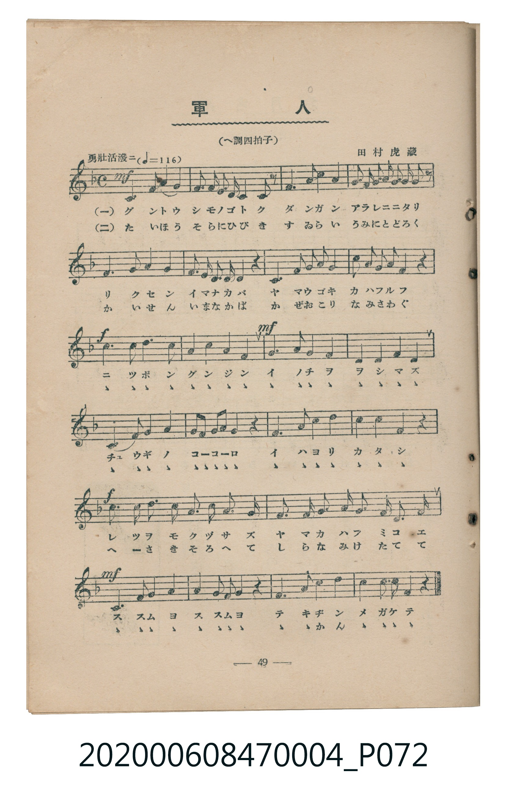
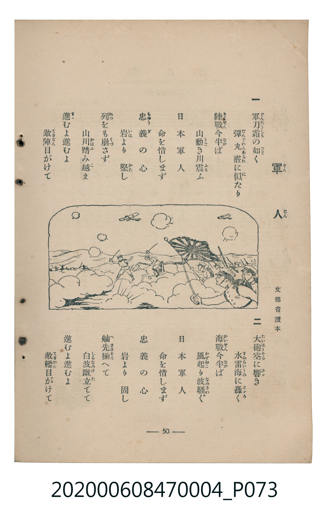

# 軍人

> Re:Shōka 使用 AI 協助辨識與重建樂譜，可能會有錯誤。歡迎回報。

- **NEUTRINO 歌聲合成版**：<br><audio controls src="gunjin_neutrino.mp3"></audio>
- **鋼琴伴奏版**：<br><audio controls src="gunjin.mp3"></audio>


- 詞：文部省讀本
- 曲：田村虎藏
- 臺灣教育會公認《新定兒童唱歌》尋常科第四學年用（2020.006.0847.0004）

## 說明

原書資訊與歌詞全文（對應 P072.jpg–P073.jpg，書頁 pp. 49–50，參考教材第 14 首）：
調性與拍號：へ調四拍子（F 大調 4/4 拍）
速度指示：勇壯活潑ニ（♩=116）


## 歌詞

```text
一
軍刀（ぐんたう）霜（しも）の如（ごと）く　彈丸（だんぐわん）霰（あられ）に似（に）たり
陸戰（りくせん）今半（いまなか）ば　山動（やまうご）き川震（かはふる）ふ
日本軍人（につぽんぐんじん）　命（いのち）を惜（を）しまず
忠義（ちゅうぎ）の心（こゝろ）　岩（いは）より堅（かた）し
列（れつ）をも崩（くづ）さず　山川（やまかは）踏（ふ）み越（こ）え
進（すゝ）むよ進むよ　敵陣（てきぢん）目がけて

二
大砲（たいはう）空（そら）に響（ひゞ）き　水雷（すゐらい）海（うみ）に轟（とゞろ）く
海戰（かいせん）今半（いまなか）ば　風起（かぜおこ）り波騷（なみさわ）ぐ
日本軍人　命を惜しまず
忠義の心　岩より固（かた）し
舳先（へさき）揃（そろ）へて　白波（しらなみ）蹴立（けた）てて
進むよ進むよ　敵艦（てきかん）目がけて
```

## ABC

```abc
X:1
T:軍人
C:曲：田村虎藏
M:4/4
L:1/16
Q:1/4=116
K:F
V:V1 name="Piano" snm="Pia"
[V:V1]
!mf! C6 F2 A4 G4 | F3 F E3 D C4 C2 z2 | F6 A2 c4 A4 | G3 F G3 A G3 G G2 z2 |
w: 1.~グ ン ト ウ | シ モ ノ ゴ ト ク | ダ ン ガ ン | ア ラ レ ニ ニ タ リ
w: 2.~た い ほ う | そ ら に ひ び き | す ゐ ら い | う み に と ど ろ く
F6 G2 A4 G4 | F3 E D3 D D4 z4 | C6 F2 G3 A G4 | c2 A2 G2 A2 F4 z4 |
w: 1.~リ ク セ ン | イ マ ナ カ バ | ヤ マ ウ ゴ キ | カ ハ フ ル フ
w: 2.~か い せ ん | い ま な か ば | か ぜ お こ り | な み さ わ ぐ
!f! c6 c2 d6 c2 | A4 c4 A4 F4 | !mf! G6 A2 G4 F4 | D4 D4 F4 D4 |
w: 1.~ニ ツ ポ ン | グ ン ジ ン | イ ノ チ ヲ | ヲ シ マ ズ
w: 2.~に つ ぽ ん | ぐ ん じ ん | い の ち を | を し ま ず
C6 F2 G4 A4 | G3 F G3 A G4 z4 | F6 A2 c4 d4 | c4 c4 F4 z4 |
w: 1.~チュ ウ ギ ノ | コ _ コ _ ロ | イ ハ ヨ リ | カ タ シ
w: 2.~ちゅ う ぎ の | こ _ こ _ ろ | い は よ り | か た し
!f! c3 c d3 c A3 c A3 F | F3 F G3 A G3 F D3 F | !mf! C6 F2 G4 A4 | A4 G3 F G4 z4 |
w: 1.~レ ツ ヲ モ ク ヅ サ ズ | ヤ マ カ ハ フ ミ コ エ | ス ス ム ヨ | ス ス ム ヨ
w: 2.~へ _ さ き そ ろ へ て | し ら な み け た て て | す す む よ | す す む よ
F6 A2 c4 d4 | c4 c3 c F4 z4 |
w: 1.~テ キ ヂ ン | メ ガ ケ テ
w: 2.~て き か ん | め が け て
```

## TMD 檔案連結

- [主旋律 TMD 檔案](gunjin.tmd) [[在 TMD Studio 編輯](https://tmdlang.github.io/Tmd-TS/#tmd=s7IKdvYPcrWy4qpTUCpJTLdSSM7PyUlNLsnMz7MqzsjMK0nNjM_KTMmPL87Iz05Ugisry88pzU21Si9KTEmNN4k3MjAyiDcwMIs3sDAxBzIMTBBKi_NLi5JTrYqTM_Lzc-JLUitKkvLzsxHyBUX5Zal5iXlANQVFIBtTwIoQClLLMlNSQdKpKZkl-UWZiTlI7kgtKga7FWxJfElRYl5xclFmAcgDCFX5RSUZ-UC3FmRUWmVkFoMMSU7Mic9OzEPyUklGKtBHuZk5mSWJRZVKXFpaCi929z7ZtUtBS4tL0VbB0NCMy95WwY3LxkTfxA6k7cXKee_3zHo2rf1l84rncxpfrGt4NmcN2MBnszcBZZ5P2fBs7sQXM_teTO8HC79o3_W8cfGzqTNfNG16Nqf5aeuaF6t6Hzd0PZu24em6WU9bJz1fvfTplI3P1vY8buh-uqH76Y4dz5dPfL5mzdPZs5-u3fF055bnU1a839MBCm49YHDrgYIbyDAweb-nU4mLS19LwZZagEtBQeFp3_xns3e82Nz-YkXXi452oLuAXn7augLoZaArnm7ofdbeqRBgYG6kl1WQ_qhhMpBpDGK-39MD1PdyQaNCQYGegoklUMrUACj4tL_5RUMz0P_P5k4A-krB0ETh5bJpQLcDAwtk34tV-581LAfZ1N37YuZ8oOjjxh1AQaD3gSJP104A2uqm8HTJcqCYAjAWFICiQN0grS8b5j_dtexZT_vzJbuA-p52tz9dvP7Zlt3P9k583NwN1Pdo5kpbYBSClIPUP9nRALZxd-_Tjgag9OPGCY-bJj9unP-4sQ2o5uWcOWDB6Y-bmoDcx43rni4DMoAiUx43AqMAKNL_uKHh6d6OJzt2gMUXgLUDDekHMsAmbACLNz1u6nzc1APWsvrJnj1gwdVg7vzHTV1gt8_c8awDrLqpC2Ru42yIEU92dz3t7QJraHncuO9x46rHjUCvAHVuANm9cePT7qlgXRDZNqDjwLK9T7fPfTkHFEVA9Y8b1z9u3Pq4CaJxK8i-Z9OXAhMqJHFDnPO4ccnjxr0wHwDJGRAXgKyZuBfmgnWPGxeCBJsmPWsGB0_TJLCh08HWg2Pw6f4Fz_etBGtY-LipFeyoPmgA7m8Gi09-3DT3cRMo3kCmb4IoBpq-Hmw0KAyeLmiFuR2YBkAWgI3umA62swfoWIgrgHHzdAtEPzDQloKVTgU6BBo42-ciBQ4oHIAKXuzoB6vfCla8_8U2SPCC_drYAUlIwKwLFJoJdCbYmgago4CCEAbQ6GdTt76cuRisZhkwrB83LoKE1fPZwPABOm4iUBySxHb1gN29ZPnzBRAzgYkL5FFIEnu-EhL4wMAApn9Q6ng5fz9YBGgXsGABRSTIug1bXs7eDnMSMHaA4i1A2WdbIYLAAAbqAml_sRcYWkCRFUDt0ABu7AfH99bt0PQFCgagC4hKXy8XrXgBtQOoa87jRmDaBIdTU9ezzYteroBIAbXsB4V6EzBcgRonoKcvSAqCJBksKQWSLiAJARr5syHBghr5Lzo2P23tAEvsAEcyyHvP-iEpCpacQFLLgGY9n7kX6EJY_gWKgxwJinxg-bkaVBaAIwliOjAKl0GjHWtUv-hchhTV3ViiGqiZ8tIWChS09Lm43EvzsjLzrAIyE_PyHWoMaqpBVijYGJpp2YFZ2Ep5BWBxCizSXizsUdAwUXi6of_5-gYdeNGsiUUD0CaoYRpAjZpWCo-bNig8bt4MxB1A9jKFGiC5HchbBMR9QPYWqMx6BQOQXHMDRHXTGjANUg1SuRKIQSLdENy0H0ivAupAtm5XD8i6xvlA3ALEu4G4DWRA41yghk4gvRqINwEx0PjGXoh1jTOBchOg8i1gkTYgBhoPVr0CiIFWN_UC6X6EdTUK1blptQqm8Qq6cGgIxMZQthGUrgGLguTMIUrN4hGawAwDJFUQCDLDFIkNMQdioiGUNobSRmAabAbYXT6GoPDagGQaKAxBZAeMD4wBmJmgeICogcQFRB4SHzDV6-FuBMUMhrnAWELmw8xdBBWDxBqEDYk5iKmQ2ENxuREo6Ocj2wCMDhC5G85vQ9gAjFKISZBohchDohamuhfhcmAkI5kLjG6ITmR7YOZC7IAlAAgbkgggeiEJAeZy_PlmVw9F-QYYQqDwf9wETMjQnLAEyJoHxF1ANjB5Nk-A5hmoODBuwfHXtBasGqSiH4inAjGIPRV7fgFGDDi_zAZqmQwOBBBvHxADHQCW3QDNKyD2HCAGWt84Gai6CywKUgUKLqA1TUDrGkGOgucT5JQNSqu4cggwfwDzBogFpKAsSChDVGFkNdSMAFYCNR5mDcxquCGILAJOfIgEAUrkoGDGlpSXQMUgwQ5RDwl6dCeCogHJVKAORHaDRQvCXFDiAkUPiJwKJiEiIDYWV4OzByT7ICdbUKzBfDEZYTo0ScNiEcKGxCSGq9FMnQMmoT6FxjJCLcgsUGyDSLCrgTEOYmOEBoGssaOTsqwBKkyAqbQZWLJDswa0kmnagZJZgBVMcyMQbwLHD7CAAFc9oKwC7H7By3JQUY4UCCC2GRq_Bp5y0ctmWDKD1gmw9AhTAuMjlMFTN5wBk4MLICdVlOgBehpEQko_mBgouSKX-4gEDAoOdDFEoobJgEp-UDDB-JsQKuFsWF0BS9gQsV2o7gUnUkipCVXRCLIJ2AVAFgMnVJBKWKJBJF1gBwFDDJGcYWrWgcmFcJWTkHwGYwObaHDWPjhrFty9eJMnsF9IWfJsfNy8FFocrwMHMMhpkAoTUh2vhZSo4DQKKqKBVQywTIIW2qDqERjcSKUojtKPcAMBOafjamTAkjqkBAVBGI2vBAV7ETlWQQUdyLtQPrQ9AYkVRHqEs4BBgO5A9HQJKRxXwPmwQhtWfEJMBBVGEBYshWIrOkG9RmTDwRU9sA8J58McDlKMSI5wFrDix3AuWrKE1CKIphNyuQnLxIgmDiKBEltm7poCTpRG5CZKUPMZVGYCS0FQgw_UtGhuBdJbwRkZuRmB3HAAtqaBkfa4aQW2pgOodAFX_MDWFqSZDaKBRXAjuJ0P9CKkhQZrIkwEBwBIFoSxFMCm0NRoCk3ZMNoQqSmNmsINYaUmUAlS8oS1OiEehrAhnoawIR6HRBTM8xAZSADAUiCsQoYFBETHCpS0BS9jwVUiiIaEBizhwFQgQgUiAwkZiAwkdGBJBKQSroNAWdW6lrLe2U4Ibl4AzmugvIUqAmlhtoGbL4-bm2DVa_NCoAgwSTVtBMtibVkC-1bg_hWwSwfMF9DeFpIIpFUJSgygQAJ168DtzyZgjd3YA00uywj3ujALQ9RWJizJUFIYmuIrDIGhhTANwgOFHpQPL8GQVcJYsFBGdx8oTJHNXAtW2wQ3E6k2B8YETBU01UPjBKt7wSkWpT8E5oGiBGYKrAhDVgljwaIOw73QFAtT3Qsm4cUecm0OjF6Yqh4oDYlodPfWcnHp2ilAhi0UgCxlLgA)]
- [鋼琴伴奏 TMD 檔案](gunjin_piano.tmd) [[在 TMD Studio 編輯](https://tmdlang.github.io/Tmd-TS/#tmd=s7IKdvYPcrWy4tLSUnixu_fJrl3v93S87N7zfMKWJ3u2PF3a_7yz4_2eTgUtLS5FWwVDQzMue1sFNy4bE30TO646BaUXK-e93zPr2bT2l80rns9pfLGu4dmcNUogmWezNwFlnk_Z8GzuxBcz-15M7wcLv2jf9bxx8bOpM180bXo2p_lp65oXq3ofN3Q9m7bh6bpZT1snPV-99OmUjc_W9jxu6H66ofvpjh3Pl098vmbN09mzn67d8XTnludTVgDdaGRgZKBnYGCmZ2BhYg5kGJgAnanExeVempeVmWcVkJmYlx_k4VBjUFPNpQAENoZmWnZglr6Wgi06UABa8GRHw4uFPQoaJgpPN_Q_X9-goxBgYG6kl1WQrolFg5Y-2LAaherctFoF03gFXTg0BGJjKNsISteARUFy5hClZvEITWCGAZIqCASZYYrEhpgDMdEQShtDaSMwDTYD7C4fwxqFx00bkEx73LwZTHbA-E3L4GY-btoOVbMIiPug8ltQVK-Hu_FxcwOmuU1rUPgwcxdBxVYCMUTF4-ZuMIaYuh_IXoXqciOgvsb5yDY0toDJ3XB-G8KGxrlQkzqB7NVQ-U1ADHPF48ZehMsbZyKb2zQBqhPZHpi5EDseNwJdCDd3BRCvhOrtBbL74S7Hn7J29ZCTspDTAih2caUpYIoCpiYQC0hBWRB3QVRhJE7UpANWAjUeZg3MarghiEQFji5EEIKSxeMmeNSgRP4SqNg8IO6Cql8NZIOCHdWJj5shamGmzAOrhSRQcEJsWotkLig6HjeDAv9x81QwCREBsbG4GpygIAkOOaIfN86G-2IywnRoInjcuA-IIX4F6X7cCMtMSK5GM3UOmIT6tHEy0FwIG6IWZBYoOYFIsKubwD5oxAgNAolpRydZxRSolEJyLYhthsavgScx9GIHlh6gxR0s4cCUwPgIZfBkCGfA5OACyGkKJRybwbHTDMnYMDFQukIu0hAp7XHTDgwxROqDyYAKtcfNjXD-JoRKOBtWDMJSIERsF6p7wakJUiBAVTSCbHrcuBdZDJyiQCphsYtIY48bZ2CIIdIdTM06MLkQrnISks9g7MeN0-GsfXDWLLh78aYjYH1KTjrCUZgQrqGQMw6uWg6WICEFEgjCaHwFUuPj5qVIBkLKjcdNoBAE86EVGiTsEKkGzmpei-FA9NQDKWtWwPmwMhBWGkFMBOVtCAuWjrCVRAsfN7UiGw6uaR43whwJiXqo4cBCBCYKZwFrHgznoiUeSKGMqLuRiyFYVkPUsYhkRGwRtGsKOOkYkVsEmUJj2hSaamC0IVI7CTX1GMLKDaASpKiHNSla4LkY3IQB10ogdiuQvRUaCLuQ6hlwnQSNOVDswuqOx83z4SnjcdMKlHiDlzLg0htE9yI1P0BsiIrHjcvAAQ0JVEjDBFaPgBoTE-HBD1IJ10Egt7aupV7jFDPLojYtYIFPSZY1xZdlm3YimQbhPW5eAOPD8xmyShgLpA6hArkFAWsUQlSvBattgpuJVDM0I0pVaPpp2oikH1ueRWk2gnmPm2CNYERGQ1YJY4HUIVQgZ1lY8xuiuhdMwjMncs3QBK-1Gnug9EQk_Qj31qJ2f3yQuz8m0N4PMCbjFaINY8GUaXwsVADEAtIGqPJAClTig7sqIAoojTAEKIYwwwjIMsqNBdFIZgCVIOyAqEcxAqTGBCyM01qwfogIzA6gDjCNZhBIA6ZWNB-ZYHoYM1jAhkBcDDYUpAmXXWBlBO0yh1sGjCNdOwVINEX7AFUi8YzAPGUuAA)]

## 分析

```text
================================================================================
📊 TMD Song Profile: [ 軍人 ]
================================================================================
⏱  Duration:       0:45 (45.5s), 22 measures total
🎼 Key & Tempo:    首調基準 F, != 116.0 BPM, <4/4>
   - 分析範圍：      由實際發聲的音符與和弦推測調性；播放脈絡另行呈現
🎤 人聲音域:    C4 (MIDI 60) – D5 (MIDI 74) [跨度: 14 個半音 / 1.2 個八度, 難度: moderate]
   - 最低音:  C4 in [Gunjin #1 @ m.1, 0:00]
   - 最高音: D5 in [Gunjin #1 @ m.9, 0:17]
   - 適合: soprano, mezzo-soprano, contralto, tenor, baritone, bass
🏛  結構:      Gunjin (45.5s)
⚡ 編曲密度:        Peak 1 軌道同時演奏
🗝  調性診斷：       C 調性不明確（純淨自然大調，未偵測到可信轉調）
   - 風格氣質:    純淨自然大調（陽光明朗、易唱易記，無明顯調外色彩）
   - 轉調歷程:    全曲維持單一推測調性（未偵測到可信轉調）
   - 核心骨幹音:  C, F, G, A, D
   - 調性數值:    C 調性不明確 [相關度: 0.83, 穩定度: Ambiguous, 自然音純度: 100.0%]
   - 候選調性 (K-S): C 大調 (0.83), F 大調 (0.81), A 小調 (0.59)
   - 五度圈歷程:   +0
   - 各段落調性細節:
     • [Gunjin #1]: C 調性不明確 (r: 0.83, 自然音純度: 100.0%)

  [ 五度圈游移軌跡 ]
              [C ]*
         F            G  
      Bb               D  
      Eb               A  
         Ab           E  
            Db       B  
               F# 
     (* = active key center)

  [ 十二半音累積音高分佈 ]
     C  : ████████████████████████  24.7%
     C# :                            0.0%
     D  : ████████████              12.7%
     D# :                            0.0%
     E  : █                          1.2%
     F  : ██████████████████████    22.5%
     F# :                            0.0%
     G  : ██████████████████████    22.2%
     G# :                            0.0%
     A  : ████████████████          16.7%
     A# :                            0.0%
     B  :                            0.0%
--------------------------------------------------------------------------------
Assignment 軌道音域：
  - Piano         : C4 – D5 (14 個半音 / 1.2 個八度, 104 個音符)
================================================================================
```


## 原書掃描頁






