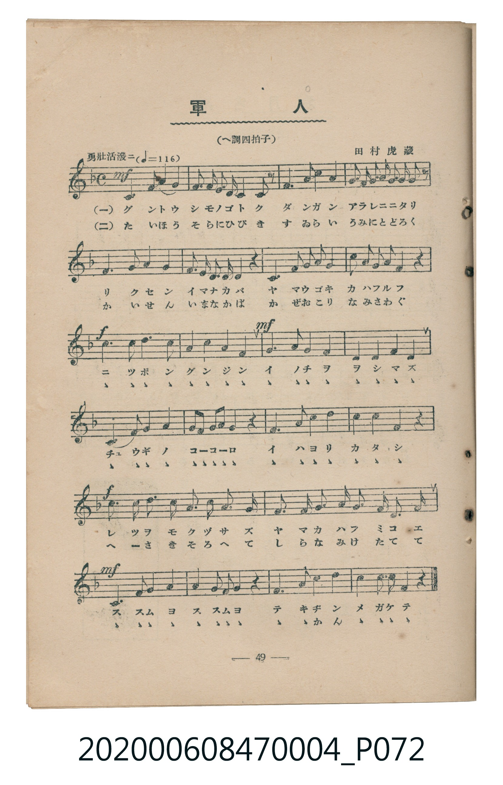
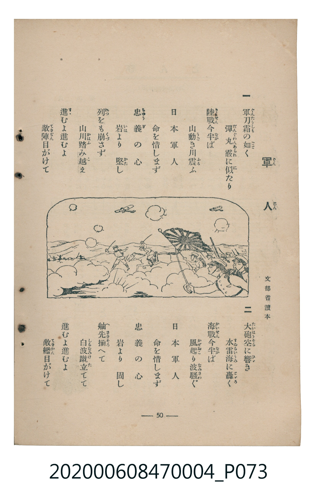

# 軍人

> Re:Shōka 使用 AI 協助辨識與重建樂譜，可能會有錯誤。歡迎[回報](https://github.com/TMDLang/reshoka/issues)。

- **鋼琴伴奏版**：<br><audio controls src="gunjin.mp3"></audio>
- **NEUTRINO 歌聲合成版**：<br><audio controls src="gunjin_neutrino.mp3"></audio>

- 詞：文部省讀本
- 曲：田村虎藏
- 臺灣教育會公認《新定兒童唱歌》尋常科第四學年用（2020.006.0847.0004）

## 說明

原書資訊與歌詞全文（對應 P072.jpg–P073.jpg，書頁 pp. 49–50，參考教材第 14 首）：
調性與拍號：へ調四拍子（F 大調 4/4 拍）
速度指示：勇壯活潑ニ（♩=116）


## 歌詞

```text
一
軍刀（ぐんたう）霜（しも）の如（ごと）く　彈丸（だんぐわん）霰（あられ）に似（に）たり
陸戰（りくせん）今半（いまなか）ば　山動（やまうご）き川震（かはふる）ふ
日本軍人（につぽんぐんじん）　命（いのち）を惜（を）しまず
忠義（ちゅうぎ）の心（こゝろ）　岩（いは）より堅（かた）し
列（れつ）をも崩（くづ）さず　山川（やまかは）踏（ふ）み越（こ）え
進（すゝ）むよ進むよ　敵陣（てきぢん）目がけて

二
大砲（たいはう）空（そら）に響（ひゞ）き　水雷（すゐらい）海（うみ）に轟（とゞろ）く
海戰（かいせん）今半（いまなか）ば　風起（かぜおこ）り波騷（なみさわ）ぐ
日本軍人　命を惜しまず
忠義の心　岩より固（かた）し
舳先（へさき）揃（そろ）へて　白波（しらなみ）蹴立（けた）てて
進むよ進むよ　敵艦（てきかん）目がけて
```

## ABC

<div class="abc-score" data-abc-src="gunjin.abc" aria-label="五線譜載入中"></div>

[下載 ABC 原始檔](gunjin.abc)

## TMD 檔案連結

- [主旋律 TMD 檔案](gunjin.tmd) [[在 TMD Studio 編輯](https://tmdlang.github.io/Tmd-TS/#tmd=s7IKdvYPcrWy4qpTUCpJTLdSSM7PyUlNLsnMz7MqzsjMK0nNjM_KTMmPL87Iz05Ugisry88pzU21Si9KTEmNN4k3MjAyiDcwMIs3sDAxBzIMTBBKi_NLi5JTrYqTM_Lzc-JLUitKkvLzsxHyBUX5Zal5iXlANQVFIBtTwIoQClLLMlNSQdKpKZkl-UWZiTlI7kgtKga7FWxJfElRYl5xclFmAcgDCFX5RSUZ-UC3FmRUWmVkFoMMSU7Mic9OzEPyUklGKtBHuZk5mSWJRZXImjPTM_OscvPzkkqBoYApkZqZlYnFX1AnFSSmp1oFGJgb6QIJYyUuLS2FF7t7n-zapaClxaVoq2BoaMZlb6vgxmVjom9iB9L9YuW893tmPZvW_rJ5xfM5jS_WNTybswZs7rPZm4Ayz6dseDZ34ouZfS-m94OFX7Tvet64-NnUmS-aNj2b0_y0dc2LVb2PG7qeTdvwdN2sp62Tnq9e-nTKxmdrex43dD_d0P10x47nyyc-X7Pm6ezZT9fueLpzy_MpK97v6QDFoh4wFvVAsQhkGJi839OpxMWlr6VgSy3ApaCg8LRv_rPZO15sbn-xoutFRzvQXUAvP21dAfQy0BVPN_Q-a-9UAAWZXlZB-qOGyaCAAzHf7-kB6nu5oFGhoEBPwcQSKGVqABR82t_8oqEZ6P9ncycAfaVgaKLwctk0oNuBgQWy78Wq_c8aloNs6u59MXM-UPRx4w6gIND7QJGnaycAbXVTeLpkOVBMARgLCkBRoG6Q1pcN85_uWvasp_35kl1AfU-7258uXv9sy-5neyc-bu4G6ns0c6UtMApBykHqn-xoANu4u_dpRwNQ-nHjhMdNkx83zn_c2AZU83LOHLDg9MdNTUDu48Z1T5cBGUCRKY8bgVEAFOl_3NDwdG_Hkx07wOILwNqBhvQDGWATNoDFmx43dT5u6gFrWf1kzx6w4Gowd_7jpi6w22fueNYBVt3UBTK3cTbEiCe7u572doE1tDxu3Pe4cdXjRqBXgDo3gOzeuPFp91SwLohsG9BxYNnep9vnvpwDiiKg-seN6x83bn3cBNG4FWTfs-lLgQkVkrghznncuORx416YD4DkDIgLQNZM3AtzwbrHjQtBgk2TnjWDg6dpEtjQ6WDrwTH4dP-C5_tWgjUsfNzUCnZUHzQA9zeDxSc_bpr7uAkUbyDTN0EUA01fDzYaFAZPF7TC3A5MAyALwEZ3TAfb2QN0LMQVwLh5ugWiHxhoS8FKpwIdAg2c7XORAgcUDkAFL3b0g9VvBSve_2IbJHjBfm3sgCQkYNYFCs0EOhNsTQPQUUBBCANo9LOpW1_OXAxWswwY1o8bF0HC6vlsYPgAHTcRKA5JYrt6wO5esvz5AoiZwMQF8igkiT1fCQl8YGAA0z8odbycvx8sArQLWLCAIhJk3YYtL2dvhzkJGDtA8Rag7LOtEEFgAAN1gbS_2AsMLaDICqB2aAA39oPje-t2aPoCBQPQBUSlr5eLVryA2gHUNedxIzBtgsOpqevZ5kUvV0CkgFr2g0K9CRiuQI0T0NMXJAVBkgyWlAJJF5CEAI382ZBgQY38Fx2bn7Z2gCV2gCMZ5L1n_ZAUBUtOIKllQLOez9wLdCEs_wLFQY4ERT6w_FwNKgvAkQQxHRiFy6DRjjWqX3QuQ4rqbixRDdRMeWkLBQpa-lxc7qV5WcDqKiAzMS_focagphpkhYKNoZmWHZiFrZRXABanwCLtxcIeBQ0Thacb-p-vb9CBF82aWDQAbYIapgHUqGml8Lhpg8Lj5s1A3AFkL1OoAZLbgbxFQNwHZG-ByqxXMADJNTdAVDetAdMg1SCVK4EYJNINwU37gfQqoA5k63b1gKxrnA_ELUC8G4jbQAY0zgVq6ATSq4F4ExADjW_shVjXOBMoNwEq3wIWaQNioPFg1SuAGGh1Uy-Q7kdYV6NQnZtWq2Aar6ALh4ZAbAxlG0HpGrAoSM4cotQsHqEJzDBAUgWBIDNMkdgQcyAmGkJpYyhtBKbBZoDd5WMICq8NSKaBwhBEdsD4wBiAmQmKB4gaSFxA5CHxAVO9Hu5GUMxgmAuMJWQ-zNxFUDFIrEHYkJiDmAqJPRSXG4GCfj6yDcDoAJG74fw2hA3AKIWYBIlWiDwkamGqexEuB0YykrnA6IboRLYHZi7EDlgCgLAhiQCiF5IQYC7Hn2929VCUb4AhBAr_x03AhAzNCUuArHlA3AVkA5Nn8wRonoGKA-MWHH9Na8GqQSr6gXgqEIPYU7HnF2DEgPPLbKCWyeBAAPH2ATHQAWDZDdC8AmLPAWKg9Y2Tgaq7wKIgVaDgAlrTBLSuEeQoeD5BTtmgtIorhwDzBzBvgFhACsqChDJEFUZWQ80IYCVQ42HWwKyGG4LIIuDEh0gQoEQOCmZsSXkJVAwS7BD1kKBHdyIoGpBMBepAZDdYtCDMBSUuUPSAyKlgEiICYmNxNTh7QLIPcrIFxRrMF5MRpkOTNCwWIWxITGK4Gs3UOWAS6lNoLCPUgswCxTaIBLsaGOMgNkZoEMgaOzopyxqgwgSYSpuBJTs0a0ArmaYdKJkFWME0NwLxJnD8AAsIcNUDyirA7he8LAcV5UiBAGKbofFr4CkXvWyGJTNonQBLjzAlMD5CGTx1wxkwObgAclJFiR6gp0EkpPSDiYGSK3K5j0jAoOBAF0MkapgMqOQHBROMvwmhEs6G1RWwhA0R24XqXnAihZSaUBWNIJuAXQBkMXBCBamEJRpE0gV2EDDEEMkZpmYdmFwIVzkJyWcwNrCJBmftg7Nmwd2LN3kC-4WUJc_Gx81LocXxOnAAg5wGqTAh1fFaSIkKTqOgIhpYxQDLJGihDaoegcGNVIriKP0INxCQczquRgYsqUNKUBCE0fhKULAXkWMVVNCBvAvlQ9sTkFhBpEc4CxgE6A5ET5eQwnEFnA8rtGHFJ8REUGEEYcFSKLaiE9RrRDYcXNED-5BwPszhIMWI5AhnASt-DOeiJUtILYJoOiGXm7BMjGjiIBIosWXmringRGlEbqIENZ9BZSawFAQ1-EBNi-ZWIL0VnJGRmxHIDQdgaxoYaY-bVmBrOoBKF3DFD2xtQZrZIBpYBDeC2_lAL0JaaLAmwkRwAIBkQRhLAWwKTY2m0JQNow2RmtKoKdwQVmoClSAlT1irE-JhCBviaQgb4nFIRME8D5GBBAAsBcIqZFhAQHSsQElb8DIWXCWCaEhowBIOTAUiVCAykJCByEBCB5ZEQCrhOgiUVa1rKeud7YTg5gXgvAbKW6gikBZmG7j58ri5CVa9Ni8EigCTVNNGsCzWliWwbwXuXwG7dMB8Ae1tIYlAWpWgxAAKJFC3Dtz-bALW2I090OSyjHCvC7MwRG1lwpIMJYWhKb7CEBhaCNMgPFDoQfnwEgxZJYwFC2V094HCFNnMtWC1TXAzkWpzYEzAVEFTPTROsLoXnGJR-kNgHihKYKbAijBklTAWLOow3AtNsTDVvWASXuwh1-bA6IWp6oHSkIhGd28tF5eunQJk2EIByFLmAgA)]
- [鋼琴伴奏 TMD 檔案](gunjin_piano.tmd) [[在 TMD Studio 編輯](https://tmdlang.github.io/Tmd-TS/#tmd=s7IKdvYPcrWy4qpTUCpJTLdSyC8qychPL0osyKi0ysgsLskvykxOzInPTsxLVIIrKs4vLUpOjS9ITE-1CjAwN9IFEsZKXFpaCi929z7Ztev9no6X3XueT9jyZM-Wp0v7n3d2vN_TqaClxaVoq2BoaMZlb6vgxmVjom9iBzLyxcp57_fMejat_WXziudzGl-sa3g2Zw3YsmezNwFlnk_Z8GzuxBcz-15M7wcLv2jf9bxx8bOpM180bXo2p_lp65oXq3ofN3Q9m7bh6bpZT1snPV-99OmUjc_W9jxu6H66ofvpjh3Pl098vmbN09mzn67d8XTnludTVgDdaGRgZKBnYGCmZ2BhYg5kGJgAnanExeVempeVmWcVkJmYlx_k4VBjUFPNpQAENoZmWnZglr6Wgi06UABa8GRHw4uFPQoaJgpPN_Q_X9-gowAKHr2sgnRNLBq09MGG1ShU56bVKpjGK-jCoSEQG0PZRlC6BiwKkjOHKDWLR2gCMwyQVEEgyAxTJDbEHIiJhlDaGEobgWmwGWB3-RjWKDxu2oBk2uPmzWCyA8ZvWgY383HTdqiaRUDcB5XfgqJ6PdyNj5sbMM1tWoPCh5m7CCq2EoghKh43d4MxxNT9QPYqVJcbAfU1zke2obEFTO6G89sQNjTOhZrUCWSvhspvAmKYKx439iJc3jgT01ygTmQ-zFyIHY8bgS6Em7sCiFdC7esFsvvhLsefsnb1kJOykNMCKHZxpSlgigKmJhALSEFZEHdBVGEkTtSkA1YCNR5mDcxquCGIRAWOLngQgpPF4yZ41KBE_hKo2Dwg7oKqXw1kT8Bw4uNmiFqYKfPAaiEJFJwQm9YimQuKjsfNoMB_3DwVTEJEQGwsrgYnKEiCQ4n4xtlwX0xGmA5NBI8b9wExxK8g3Y8bYZkJydVops4Bk1CfNk4GmgthQ9SCzAIlJxAJdnUT2AeNGKFBIDHt6CSrmAKVUkiuBbHN0Pg18CSGXuzA0gO0uIMlHJgSGB-hDJ4M4QyYHFwAOU2hhGMzOHaaIRkbJgZKV8hFGiKlPW7agSGGSH0wGVCh9ri5Ec7fhFAJZ8OKQVgKhIjtQnUvODVBCgSoikaQTY8b9yKLgVMUSCUsdhFp7HHjDAwxRLqDqVkHJhfCVU5C8hmM_bhxOpy1D86aBXcv3nQErE_JSUc4ChPCNRRyxsFVy8ESJKRAAkEYja9AanzcvBTJQEi58bgJFIJgPrRCg4QdItXAWc1rMRyInnogZc0KOB9WBsJKI4iJoLwNYcHSEbaSaOHjplZkw8E1zeNGmCMhUQ81HFiIwEThLGDNg-FctMQDKZQRdTdyMQTLaog6FpGMiC2Cdk0BJx0jcosgU2hMm0JTDYw2RGonoaYeQ1i5AVSCFPWwJkULPBeDmzDgWgmSdx83bYWzEfUMuE6CxhwodmF1x-Pm-fCU8bhpBUq8wUsZcOkNonuRmh8gNkTF48Zl4ICGBCqkYQKrR0CNiYnw4AephOsgkFtb11KvcYqZZVGbFrDApyTLmuLLsk07kUyD8B43L4Dx4fkMWSWMBVKHUIHcgoA1CiGq14JJrDVDM6JUhaafpo1I-rHlWdRmI4j3uAnWCEZkNGSVMBZIHUIFcpaFNb8hqnvBJDxzItcMTfBaq7EHSk9E0o9wby1q98cHuftjAu39AGMyXiHaMBZMmcbHQgVALCBtgCoPpEAlPrirAqKA0ghDgGIIM4yALKPcWBCNZAZQCcIOiHoUI0BqTMDCOK0F64eIwOwA6gDTaAaBNGBqRfORCaaHMYMFbAjExWBDQZpw2QVWRtAuc7hlwDjStVOARFO0D1AlEs8IzFPmAgA)]

## 分析

```text
================================================================================
📊 TMD Song Profile: [ 軍人 ]
================================================================================
⏱  Duration:       0:45 (45.5s), 22 measures total
🎼 Key & Tempo:    首調基準 F, != 116.0 BPM, <4/4>
   - 分析範圍：      由實際發聲的音符與和弦推測調性；播放脈絡另行呈現
🎤 人聲音域:    C4 (MIDI 60) – D5 (MIDI 74) [跨度: 14 個半音 / 1.2 個八度, 難度: moderate]
   - 最低音:  C4 in [Gunjin #1 @ m.1, 0:00]
   - 最高音: D5 in [Gunjin #1 @ m.9, 0:17]
   - 適合: soprano, mezzo-soprano, contralto, tenor, baritone, bass
🏛  結構:      Gunjin (45.5s)
⚡ 編曲密度:        Peak 1 軌道同時演奏
🗝  調性診斷：       C 調性不明確（純淨自然大調，未偵測到可信轉調）
   - 風格氣質:    純淨自然大調（陽光明朗、易唱易記，無明顯調外色彩）
   - 轉調歷程:    全曲維持單一推測調性（未偵測到可信轉調）
   - 核心骨幹音:  C, F, G, A, D
   - 調性數值:    C 調性不明確 [相關度: 0.83, 穩定度: Ambiguous, 自然音純度: 100.0%]
   - 候選調性 (K-S): C 大調 (0.83), F 大調 (0.81), A 小調 (0.59)
   - 五度圈歷程:   +0
   - 各段落調性細節:
     • [Gunjin #1]: C 調性不明確 (r: 0.83, 自然音純度: 100.0%)

  [ 五度圈游移軌跡 ]
              [C ]*
         F            G  
      Bb               D  
      Eb               A  
         Ab           E  
            Db       B  
               F# 
     (* = active key center)

  [ 十二半音累積音高分佈 ]
     C  : ████████████████████████  24.7%
     C# :                            0.0%
     D  : ████████████              12.7%
     D# :                            0.0%
     E  : █                          1.2%
     F  : ██████████████████████    22.5%
     F# :                            0.0%
     G  : ██████████████████████    22.2%
     G# :                            0.0%
     A  : ████████████████          16.7%
     A# :                            0.0%
     B  :                            0.0%
--------------------------------------------------------------------------------
Assignment 軌道音域：
  - Piano         : C4 – D5 (14 個半音 / 1.2 個八度, 104 個音符)
================================================================================
```


## 原書掃描頁






