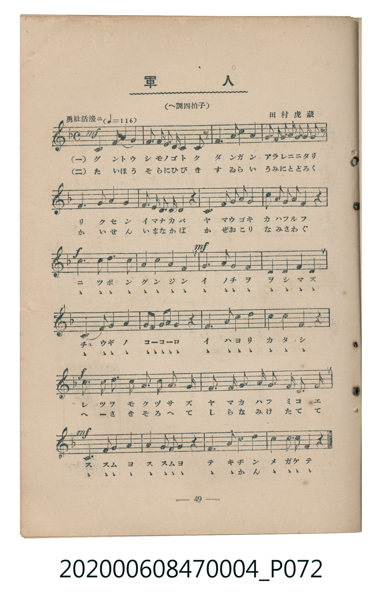
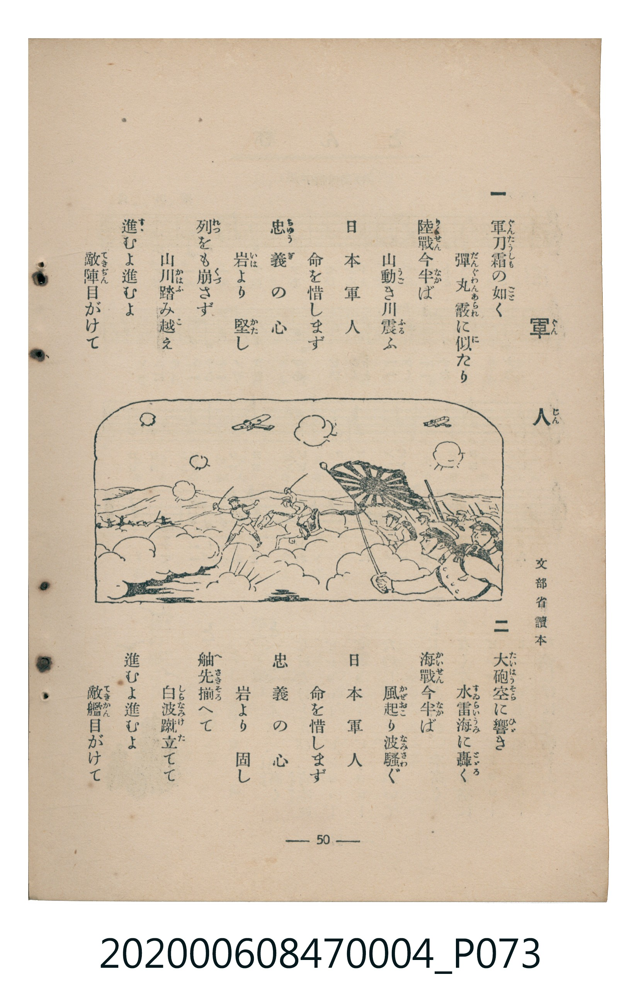

# 軍人

> Re:Shoka 使用 AI 協助辨識與重建樂譜，可能會有錯誤。歡迎回報。

<audio controls src="gunjin.mp3"></audio>

- 詞：文部省讀本
- 曲：田村虎藏
- 臺灣教育會公認《新定兒童唱歌》尋常科第四學年用（2020.006.0847.0004）

## 說明

原書資訊與歌詞全文（對應 P072.jpg–P073.jpg，書頁 pp. 49–50，參考教材第 14 首）：
調性與拍號：へ調四拍子（F 大調 4/4 拍）
速度指示：勇壯活潑ニ（♩=116）

## 歌詞

```text
一
軍刀（ぐんたう）霜（しも）の如（ごと）く　彈丸（だんぐわん）霰（あられ）に似（に）たり
陸戰（りくせん）今半（いまなか）ば　山動（やまうご）き川震（かはふる）ふ
日本軍人（につぽんぐんじん）　命（いのち）を惜（を）しまず
忠義（ちゅうぎ）の心（こゝろ）　岩（いは）より堅（かた）し
列（れつ）をも崩（くづ）さず　山川（やまかは）踏（ふ）み越（こ）え
進（すゝ）むよ進むよ　敵陣（てきぢん）目がけて

二
大砲（たいはう）空（そら）に響（ひゞ）き　水雷（すゐらい）海（うみ）に轟（とゞろ）く
海戰（かいせん）今半（いまなか）ば　風起（かぜおこ）り波騷（なみさわ）ぐ
日本軍人　命を惜しまず
忠義の心　岩より固（かた）し
舳先（へさき）揃（そろ）へて　白波（しらなみ）蹴立（けた）てて
進むよ進むよ　敵艦（てきかん）目がけて
```

## ABC

```abc
X:1
T:軍人
C:曲：田村虎藏
M:4/4
L:1/16
Q:1/4=116
K:F
V:V1 name="Piano" snm="Pia"
[V:V1]
!mf! A6 G2 F4 G4 | A3 A G3 F D4 C2 z2 | F6 A2 c4 A4 | c3 d c3 A G3 A G2 z2 |
F6 G2 A4 c4 | d3 c A3 G F4 z4 | D6 F2 G3 A G4 | c3 d c3 A F4 z4 |
!f! d6 A2 c6 A2 | G4 c4 d4 c4 | !mf! F6 G2 A4 c4 | G4 A4 G4 F4 |
D6 F2 G4 A4 | G3 F G3 A G4 z4 | F6 A2 c4 d4 | c4 c4 A4 z4 |
!f! f6 d2 c6 A2 | G4 F4 D4 C4 | F6 G2 A6 G2 | F6 D2 C4 F4 |
!mf! D6 F2 F4 G4 | A6 G2 G2 A2 z4 | F6 A2 c4 d4 | c6 d2 c2 F2 z4 |
```

## TMD 檔案連結

- [主旋律 TMD 檔案](gunjin.tmd) [[在 TMD Studio 編輯](https://tmdlang.github.io/Tmd-TS/#tmd=s7IKdvYPcrWy4qpTUCpJTLdSSM7PyUlNLsnMz7MqzsjMK0nNjM_KTMmPL87Iz05Ugisry88pzU21Si9KTEmNN4k3MjAyiDcwMIs3sDAxBzIMTBBKi_NLi5JTrYqTM_Lzc-JLUitKkvLzsxHyBUX5Zal5iXlANQVFIBtTwIoQClLLMlNSQdKpKZkl-UWZiTlI7kgtKga7FWxJfElRYl5xclFmAcgDCFUlGalAx-Zm5mSWJBZVKnFpaSm82N37ZNcuBS0tLkVbBUNDMy57WwU3LhsTfRM7kLYXK-e93zPr2bT2l80rns9pfLGu4dmcNWADn83eBJR5PmXDs7kTX8zsezG9Hyz8on3X88bFz6bOfNG06dmc5qeta16s6n3c0PVs2oan62Y9bZ30fPXSp1M2Plvb87ih--mG7qc7djxfPvH5mjVPZ89-unbH051bnk9Z8X5PBygk9YAhqQcKSSDDwOT9nk4lLi59LQVbagEuBQWFp33zn83e8WJz-4sVXS862oHuAnr5aesKoJeBrni6ofdZe6dCgIG5kV5WQfqjhslApjGI-X5PD1DfywWNCgUFegomlkApUwOg4NP-5hcNzUD_P5s7AegrBUMThZfLpgHdDgwskH0vVu1_1rAcZFN374uZ84Gijxt3AAWB3geKPF07AWirm8LTJcuBYgrAWFAAigJ1g7S-bJj_dNeyZz3tz5fsAup72t3-dPH6Z1t2P9s78XFzN1Dfo5krbYFRCFIOUv9kRwPYxt29TzsagNKPGyc8bpr8uHH-48Y2oJqXc-aABac_bmoCch83rnu6DMgAikx53AiMAqBI_-OGhqd7O57s2AEWXwDWDjSkH8gAm7ABLN70uKnzcVMPWMvqJ3v2gAVXg7nzHzd1gd0-c8ezDrDqpi6QuY2zIUY82d31tLcLrKHlceO-x42rHjcCvQLUuQFk98aNT7ungnVBZNuAjgPL9j7dPvflHFAUAdU_blz_uHHr4yaIxq0g-55NXwpMqJDEDXHO48Yljxv3wnwAJGdAXACyZuJemAvWPW5cCBJsmvSsGRw8TZPAhk4HWw-Owaf7FzzftxKsYeHjplawo_qgAbi_GSw--XHT3MdNoHgDmb4Johho-nqw0aAweLqgFeZ2YBoAWQA2umM62M4eoGMhrgDGzdMtEP3AQFsKVjoV6BBo4GyfixQ4oHAAKnixox-sfitY8f4X2yDBC_ZrYwckIQGzLlBoJtCZYGsagI4CCkIYQKOfTd36cuZisJplwLB-3LgIElbPZwPDB-i4iUBxSBLb1QN295LlzxdAzAQmLpBHIUns-UpI4AMDA5j-Qanj5fz9YBGgXcCCBRSRIOs2bHk5ezvMScDYAYq3AGWfbYUIAgMYqAuk_cVeYGgBRVYAtUMDuLEfHN9bt0PTFygYgC4gKn29XLTiBdQOoK45jxuBaRMcTk1dzzYverkCIgXUsh8U6k3AcAVqnICeviApCJJksKQUSLqAJARo5M-GBAtq5L_o2Py0tQMssQMcySDvPeuHpChYcgJJLQOa9XzmXqALYfkXKA5yJCjygeXnalBZAI4kiOnAKFwGjXasUf2icxlSVHdjiWqgZspLWyhQ0NLn4nIvzcvKzLMKyEzMy3eoMahRqAbZoWBjaKZlB2ZhK-YVgOUpsEx7sbBHQcNE4emG_ufrG3TgZbMmFg1Aq6CGaQA1alopPG7aoPC4eTMQdwDZyxRqgOR2IG8REPcB2VugMusVDEByzQ0Q1U1rwDRINUjlSiAGiXRDcNN-IL0KqAPZul09IOsa5wNxCxDvBuI2kAGNc4EaOoH0aiDeBMRA4xt7IdY1zgTKTYDKt4BF2oAYaDxY9QogBlrd1Auk-xHWAQMvN61WwVhBFw6NgNgQiQ2CNVAVxlARQwWzeKiUKYhhAFYD0wVRCZRCYkNMgYiYQWmYaRAabAa4YMAdgbt6KIpAYECDoudxEzBEoVGyBMiaB8RdQDYwnJonQCMPKg6MZnDENq0Fqwap6AfiqUAMYk_FHnHAeAVH3GyglsngqADx9gEx0AFg2Q3QSAOx5wAx0PrGyUDVXWBRkCpQxAGtaQJa1whyFDzCkEMZFG6w0IWFdg0wfCF8iIwRXAcohKEqYLEHiUxYRMMiBFtUYRhCIKp2dFIWVaD8AQy1ZmCSh0YVNPc17UCJPGDOa24E4k3gaANmCnCeBEUdsGEKT-TANA4JFczUCePXwD0Pk4HpQIQsOLMQjgCYQTAZGB-mk0DYAZtzlIVd4-PmpdC0uw4cRKDA2vy4eQ-cal4LSYDgIASlaGD5AMwd0DQOKpSAwYiU6HAkGOS8DSsZ0JMSItXhKh9g4QxLdJglB7GJbtcUygIOVDCDEh0wGQGLdVBoAEuL5lYgvRWcoJBLBkhZABIBlQbAsroJlDhXYCsPQCkWGOig_AwsrmEFOagoBso0gmuSxunQohuS90EiE6FVADAagRglLRvGIQUlKPhwJ2ZYoKMW2JgRgpySYXxUFWAT4LqJTcutaymrc3dCcPMCcCIFRQmqCKS4BlZ1wCL6cXMTrGxoXgipeZs2gmWxFtPAGhNcawIr6qYOWB2KJAIpokHBD4oqUGUNLsybgMVNYw80gpZh1KUYWQVXZYoQhYU9OVkFOQWAdCGySi0Xl66dAqS1pABkKXNxAQA)]
- [鋼琴伴奏 TMD 檔案](gunjin_piano.tmd) [[在 TMD Studio 編輯](https://tmdlang.github.io/Tmd-TS/#tmd=s7IKdvYPcrWy4tLSUnixu_fJrl3v93S87N7zfMKWJ3u2PF3a_7yz4_2eTgUtLS5FWwVDQzMue1sFNy4bE30TO646BaUXK-e93zPr2bT2l80rns9pfLGu4dmcNUogmWezNwFlnk_Z8GzuxBcz-15M7wcLv2jf9bxx8bOpM180bXo2p_lp65oXq3ofN3Q9m7bh6bpZT1snPV-99OmUjc_W9jxu6H66ofvpjh3Pl098vmbN09mzn67d8XTnludTVgDdaGRgZKBnYGCmZ2BhYg5kGJgAnanExeVempeVmWcVkJmYlx_k4VBjUKNQzaUABDaGZlp2YJa-loItOlAA2vBkR8OLhT0KGiYKTzf0P1_foKMQYGBupJdVkK6JRYOWPtgwoPG5abUKxgq6cGgExIZIbBCsgaowhooYKpjFQ6VMQQwDsBqYLohKoBQSG2IKRMQMSsNMg9BgM7jwe3FXDzleRHYXyCaYe2DuqwG6CMKHyBjBdYDcBFUB8y_E-7CggXkBm-cwDCHguR2dZMUfMPogzscMeBi_Bu5KmAxMByIIwOmAcEjBDILJwPgwnQQ8CcwG5HgSR-gjJy1YwkSPF0QU4kqesLCAxSBmwiU2BndNITcGDeOQHAdyEO4ohHkDNQdiehE5_mB8VBVgE-C6iY3B1rVkFzMY0YirnEGIwnxBTjQihyVIFyIaa1FLWh-UktYEWtACrYpXiDaMBVOm8bEIAaN4oFko0kAKzjeNB0tjmgFWZALng4wAmhRtlAvRg2SHabw5TAnUGJhCuDlwHejWo6uAmAQWQjMLyVI4E-p4ZMNMEK5CcxTIL0BZVBsh4YMaYKghCLcbi5tARiKHAzyk0B2E4juQk4BxqmunAIlWBSBLmYsLAA)]

## 分析

```text
================================================================================
📊 TMD Song Profile: [ 軍人 ]
================================================================================
⏱  Duration:       0:49 (49.7s), 24 measures total
🎼 Key & Tempo:    首調基準 F, != 116.0 BPM, <4/4>
   - 分析範圍：      由實際發聲的音符與和弦推測調性；播放脈絡另行呈現
🎤 人聲音域:    C4 (MIDI 60) – F5 (MIDI 77) [跨度: 17 個半音 / 1.4 個八度, 難度: challenging]
   - 最低音:  C4 in [Gunjin #1 @ m.2, 0:03]
   - 最高音: F5 in [Gunjin #1 @ m.17, 0:33]
   - 適合: soprano, mezzo-soprano, contralto, tenor, baritone, bass
🏛  結構:      Gunjin (49.7s)
⚡ 編曲密度:        Peak 1 軌道同時演奏
🗝  調性診斷：       F 大調（純淨自然大調，未偵測到可信轉調）
   - 風格氣質:    純淨自然大調（陽光明朗、易唱易記，無明顯調外色彩）
   - 轉調歷程:    全曲維持單一推測調性（未偵測到可信轉調）
   - 核心骨幹音:  F, C, G, A, D
   - 調性數值:    F 大調 [相關度: 0.83, 穩定度: Moderate, 自然音純度: 100.0%]
   - 候選調性 (K-S): F 大調 (0.83), C 大調 (0.75), D 小調 (0.64)
   - 五度圈歷程:   -1
   - 各段落調性細節:
     • [Gunjin #1]: F 大調 (r: 0.83, 自然音純度: 100.0%)

  [ 五度圈游移軌跡 ]
               C  
        [F ]*          G  
      Bb               D  
      Eb               A  
         Ab           E  
            Db       B  
               F# 
     (* = active key center)

  [ 十二半音累積音高分佈 ]
     C  : ██████████████████████    22.2%
     C# :                            0.0%
     D  : ███████████████           15.4%
     D# :                            0.0%
     E  :                            0.0%
     F  : ████████████████████████  24.2%
     F# :                            0.0%
     G  : ███████████████████       19.1%
     G# :                            0.0%
     A  : ███████████████████       19.1%
     A# :                            0.0%
     B  :                            0.0%
--------------------------------------------------------------------------------
Assignment 軌道音域：
  - Piano         : C4 – F5 (17 個半音 / 1.4 個八度, 104 個音符)
================================================================================
```


## 原書掃描頁






