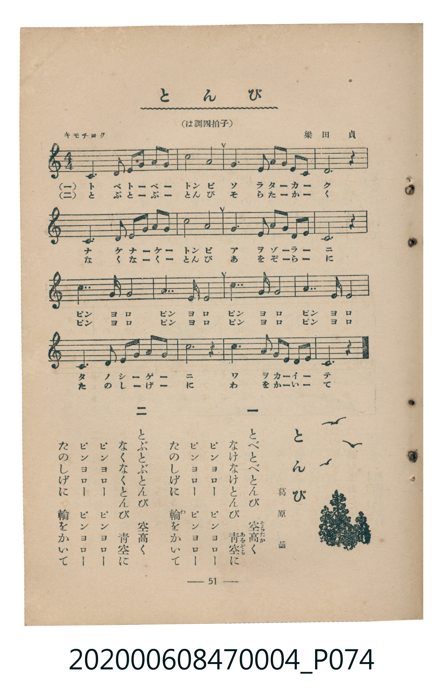

# とんび

> Re:Shōka 使用 AI 協助辨識與重建樂譜，可能會有錯誤。歡迎回報。

- **鋼琴伴奏版**：<br><audio controls src="tonbi.mp3"></audio>
- **NEUTRINO 歌聲合成版**：<br><audio controls src="tonbi_neutrino.mp3"></audio>

- 詞：葛原葎
- 曲：梁田貞
- 臺灣教育會公認《新定兒童唱歌》尋常科第四學年用（2020.006.0847.0004）

## 說明

原書資訊與歌詞全文（對應 P074.jpg，書頁 p. 51，參考教材第 15 首）：
調性與拍號：は調四拍子（C 大調 4/4 拍）
速度指示：キモチヨク


## 歌詞

```text
一
とべとべとんび　空高（そらたか）く
なけなけとんび　青空（あをぞら）に
ピンヨロー　ピンヨロー
ピンヨロー　ピンヨロー
たのしげに　輪（わ）をかいて

二
とぶとぶとんび　空高く
なくなくとんび　青空に
ピンヨロー　ピンヨロー
ピンヨロー　ピンヨロー
たのしげに　輪をかいて
```

## ABC

<div class="abc-score" data-abc-src="tonbi.abc" aria-label="五線譜載入中"></div>

[下載 ABC 原始檔](tonbi.abc)

## TMD 檔案連結

- [主旋律 TMD 檔案](tonbi.tmd) [[在 TMD Studio 編輯](https://tmdlang.github.io/Tmd-TS/#tmd=s7IKdvYPcrWy4qpTUCpJTLdSSM7PyUlNLsnMz7MqzsjMK0nNjM_KTMmPL87Iz05Ugisry88pzU21Si9KTEmNN4k3MjAyiDcwMIs3sDAxBzIMTBBKi_NLi5JTrYqTM_Lzc-JLUitKkvLzsxHyBUX5Zal5iXlANQVFIBtTwIoQClLLMlNSQdKpKZkl-UWZiTlI7kgtKga7FWxJfElRYl5xclFmAcgDCFX5RSUZ-UC3FmRUWmVkFoMMSU7Mic9OzEPyUklGKtBHiXmZucgWAJWmZ-ZZ5aZmZmVicTxUuiQxExhAoEAqT4zPTczMy0nMS0EPgviCxPRUqwADc2DgaGkpPG5c8bhp8uPGzQpaWlyKtgqWZlz2tgrOXDYm-iZ2IK0vVs57v2fWi4mzn_bNfzGxD2zcs9mbgGLPFjU-n7LhxaZ5YLEX7bueNy5-NnXmi6ZNz-Y0P21d82JV7-OGrmfTNjxdN-tp66Tnq5c-nbLx2dqexw3dTzd0P92x4_nyic_XrHk6e_bTtTue7tzyfMqK93s6QJGoB4xEPVAkAhkGJu_3dCpxcelrKdhSC3ApKCgAvfNs9o4Xm9tfrOh60dEOdBfQp09bVzyb1g50xdMNvc_aOxVAwaSXVZD-fk8PUPHLBY0KBXoKpoZA7tP-5hcNzUDvPps7AegJBUNThZfLpgGdCgwYkPEvVu1_1rAcZHB374uZ84GijxvXAwWBvgWKPF07AWiJs8LTJcuBYgrAsFYAigJ1g7S-bJj_dNeyZz3tz5fsAulrWvu4edHj5sbHzcCoWs8FUvJkRwOIAkVe404ECY7Ixw0Nz1fuerl6BtCGx41zHzd1Pm6c_7ixG2j648Z-iLZVjxsnwkiEtpdzJwF1grU1PW6a9LhxHlAzWNtqsLbmKY-bN4Nc0Qx00R6gBjQR4hWBHLTuceP0x41AW1YDFb3Yswpkb1M_yDqQ1d2PG1seNy6D-HZXD9y32xAkqm-R_dYPI9H9Rh-foHgAqIjyBAsFClr6XFwh-XlJmVYBmYl5-Q41BjXVIBsUbAzNtOzALGz5RAGYQoFJ5sXCHgUNE4WnG_qfr2_QgSduTSwagBZBDdMAatS0AoZGBxDPhNJ7oOw9CjUgEWCoAKnJIE7TXiBrJZDeD1HWtBqmrGm9ggGKubt6QOY2rgDibRAapAHEhmgAxx6Q2gzmzAWa0AkKb6iybriyfoS5NQqGCrpwaATExkBsCsRmUBqoIg5JCQiCpJBhDVghDIIMgGkGsUEW1ICNxgYNYGaAneNjCA4eJHlQsIFImBiED7EVGpCoBoKCFd15oEBGVrESRAIDHMoHBjlC5XriHGoEDm9kU4HxACJhYhA-1FRIzKA5FBhPGA4FxhqSCmD8gdTNh-voRlLZT9Ch-JP3rh7KkncX0H0bITQ43YLYWJL3IiBrE5DeB80FwKQOVdaNPXmvAvsNTIPTLZCNLXk3Ac2cBKTnQa0HJnWostV0S94wA1GtwR4ZiOTdhSQPCjZQioSJQfjQKCY-eS9CUbEJbNA-OB-U3GFGwlIQAYeCk_cqZFPB6Q0hhkh_JCXvJmQVwPgDqZsH54OSO0wlLE_idiiB0ruTsuQNqrmAFKiQXQsOORIFECkQNX2ZoqQmiG9RU5wxOE2hqqCGIUhJEOxSZEmYq9ENHWiliNQ4hNyMN2EC27MUJUxwO6EPSG-HFnzAwhWpQAXR66FFLqQl8bhpCVxFG_YiF9hEaFwHxNOhRS6wXEUqS0EFDLAQBpe2kEYEsKUGV7GMwtIWBuH5GlUJckuCrOIWXs1DYqwPRALDDsoHhh4iggmWjeCwRTYNUtLCiipQSCNUthHnRnBJC6vhwaYAowJETofzQcUk1FTCxSI4spBMgxayML-Bog5h2jKCbqzl4tK1UwA3oRWADGUuAA)]
- [鋼琴伴奏 TMD 檔案](tonbi_piano.tmd) [[在 TMD Studio 編輯](https://tmdlang.github.io/Tmd-TS/#tmd=s7IKdvYPcrWy4qpTUCpJTLdSyC8qychPL0osyKi0ysgsLskvykxOzInPTsxLVIIrKs4vLUpOjS9ITE-1CjAwN1Hi0tJSeNy44nHT5MeNm9_v6XjZvef5hC1P9mx5urT_eWfH-z2dClpaXIq2CpZmXPa2Cs5cNib6JnYg816snPd-z6wXE2c_7Zv_YmIf2I5nszcBxZ4tanw-ZcOLTfPAYi_adz1vXPxs6swXTZuezWl-2rrmxarexw1dz6ZteLpu1tPWSc9XL306ZeOztT2PG7qfbuh-umPH8-UTn69Z83T27KdrdzzdueX5lBVAlxkZGBnoGRiY6RlYmJgDGQYmQMcpcXGF5OclZVoFZCbm5Qd5ONQY1FRzKQCBjaGZlh2Ypa-lYIsOFIDmP9nR8GJhj4KGicLTDf3P1zfoKIBCRC-rIF0TiwYtfbBhNQqGCrpwaATExkBsCsRmUBqoIg5JCQiCpJBhDVghDIIMgGkGsUEW1ICNxgYNYGaAneNjWKPwuLkDSf5x80wwCROD8CG2AkUfN29GM_Bx82QM5z1u2ouiYiWIbNoP4zetRlK5njiHGgHVNq5ANrVxG5iEiUH4UFPBKRLdoY3oTgcpnIusoqkTrG4-XEc3ksp-gg7Fn1x29Qy65AIzENUa7J5DJJcuJPnHTRtBJFwMwocGGfHJZRGKik1gg_bB-aDkAzMSFiMEHApOLquQTQXHH0IMEZ8kJZcmZBVNk8Dq5sH5oOQDUwlL47gdSqB06SQruaAmBlOUqIc4DTV5GIMTAKoKahiClF6moKeCx80rgHgthqEDrRSRdIaQm_GmImAdSKdCBwbhyRtVCXIFRVapA689IGHRByKbtsP4TaAiAxZ0BIsIoBrkWgdW4MBy7OOmJUgq24hzI7jAgVUcYFMa14HJ6XA-qLSAmkq4dAC6ArnCgZU1ML89bmxBMm0ZQTfWojR0fJAbOibQdg4wOuIVog1jQZRpPJBrAuSaxMIouDSID6SAtUo8kGUaHwtmGEADggRTQNqQlWMzAmKTGcgms_hcJCHCSvA6B2IdEg-bY4CBpmunAA63aB-gMIJjBOYocwEA)]

## 分析

```text
================================================================================
📊 TMD Song Profile: [ とんび ]
================================================================================
⏱  Duration:       0:40 (40.0s), 16 measures total
🎼 Key & Tempo:    首調基準 C, != 96.0 BPM, <4/4>
   - 分析範圍：      由實際發聲的音符與和弦推測調性；播放脈絡另行呈現
🎤 人聲音域:    C4 (MIDI 60) – C5 (MIDI 72) [跨度: 12 個半音 / 1.0 個八度, 難度: easy]
   - 最低音:  C4 in [Tonbi #1 @ m.1, 0:00]
   - 最高音: C5 in [Tonbi #1 @ m.2, 0:02]
   - 適合: soprano, mezzo-soprano, contralto, tenor, baritone, bass
🏛  結構:      Tonbi (40.0s)
⚡ 編曲密度:        Peak 1 軌道同時演奏
🗝  調性診斷：       C 大調（純淨自然大調，未偵測到可信轉調）
   - 風格氣質:    純淨自然大調（陽光明朗、易唱易記，無明顯調外色彩）
   - 轉調歷程:    全曲維持單一推測調性（未偵測到可信轉調）
   - 核心骨幹音:  C, G, A, E, D
   - 調性數值:    C 大調 [相關度: 0.90, 穩定度: High, 自然音純度: 100.0%]
   - 候選調性 (K-S): C 大調 (0.90), A 小調 (0.72), G 大調 (0.56)
   - 五度圈歷程:   +0
   - 各段落調性細節:
     • [Tonbi #1]: C 大調 (r: 0.90, 自然音純度: 100.0%)

  [ 五度圈游移軌跡 ]
              [C ]*
         F            G  
      Bb               D  
      Eb               A  
         Ab           E  
            Db       B  
               F# 
     (* = active key center)

  [ 十二半音累積音高分佈 ]
     C  : ████████████████████████  38.3%
     C# :                            0.0%
     D  : ██████                     9.2%
     D# :                            0.0%
     E  : █████████                 15.0%
     F  :                            0.0%
     F# :                            0.0%
     G  : █████████████             20.0%
     G# :                            0.0%
     A  : ███████████               17.5%
     A# :                            0.0%
     B  :                            0.0%
--------------------------------------------------------------------------------
Assignment 軌道音域：
  - Piano         : C4 – C5 (12 個半音 / 1.0 個八度, 56 個音符)
================================================================================
```


## 原書掃描頁




