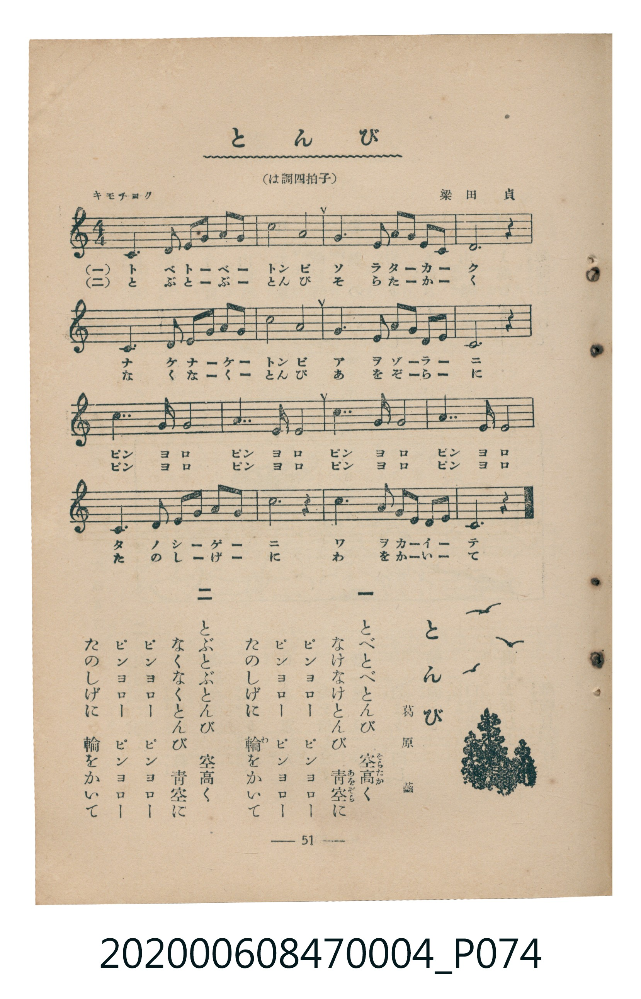

# とんび

> Re:Shōka 使用 AI 協助辨識與重建樂譜，可能會有錯誤。歡迎回報。

- **NEUTRINO 歌聲合成版**：<br><audio controls src="tonbi_neutrino.mp3"></audio>
- **鋼琴伴奏版**：<br><audio controls src="tonbi.mp3"></audio>


- 詞：葛原葎
- 曲：梁田貞
- 臺灣教育會公認《新定兒童唱歌》尋常科第四學年用（2020.006.0847.0004）

## 說明

原書資訊與歌詞全文（對應 P074.jpg，書頁 p. 51，參考教材第 15 首）：
調性與拍號：は調四拍子（C 大調 4/4 拍）
速度指示：キモチヨク

## 跨冊／重複收錄參照

> 同曲（《大正幼年唱歌》第一集〈とんび〉；收錄於《新定兒童唱歌》四年級與《唱歌帖》P109）

- **[同曲]** 楊金土手抄《唱歌帖》第 2 冊・II（2020.006.0843）：[**〈とんび〉**](../../../shokacho/vol_02/p109_tonbi/index.md)（`D` / `4/4` — [原始 TMD](../../../shokacho/vol_02/p109_tonbi/tonbi.tmd)）
- 總表：[跨冊重複與同名歌曲總索引](../../../duplicate_songs.md)

## 歌詞

```text
一
とべとべとんび　空高（そらたか）く
なけなけとんび　青空（あをぞら）に
ピンヨロー　ピンヨロー
ピンヨロー　ピンヨロー
たのしげに　輪（わ）をかいて

二
とぶとぶとんび　空高く
なくなくとんび　青空に
ピンヨロー　ピンヨロー
ピンヨロー　ピンヨロー
たのしげに　輪をかいて
```

## ABC

```abc
X:1
T:とんび
C:曲：梁田貞
M:4/4
L:1/16
Q:1/4=96
K:C
V:V1 name="Piano" snm="Pia"
[V:V1]
C6 D2 E2 G2 A2 G2 | c8 A8 | G6 E2 A2 G2 E2 C2 | D12 z4 |
w: 1.~ト ベ ト _ ベ _ | トン ビ | ソ ラ タ _ カ _ | ク
w: 2.~と ぶ と _ ぶ _ | とん び | そ ら た _ か _ | く
C6 D2 E2 G2 A2 G2 | c8 A8 | G6 E2 A2 G2 D2 E2 | C12 z4 |
w: 1.~ナ ケ ナ _ ケ _ | トン ビ | ア ヲ ゾ _ ラ _ | ニ
w: 2.~な く な _ く _ | とん び | あ を ぞ _ ら _ | に
c7 G G8 | A7 E E8 | c7 G G8 | A7 E E8 |
w: 1.~ピン ヨ ロ | ピン ヨ ロ | ピン ヨ ロ | ピン ヨ ロ
w: 2.~ピン ヨ ロ | ピン ヨ ロ | ピン ヨ ロ | ピン ヨ ロ
C6 D2 E2 G2 A2 G2 | c12 z4 | c6 A2 G2 E2 D2 E2 | C12 z4 |
w: 1.~タ ノ シ _ ゲ _ | ニ | ワ ヲ カ _ イ _ | テ
w: 2.~た の し _ げ _ | に | わ を か _ い _ | て
```

## TMD 檔案連結

- [主旋律 TMD 檔案](tonbi.tmd) [[在 TMD Studio 編輯](https://tmdlang.github.io/Tmd-TS/#tmd=s7IKdvYPcrWy4qpTUCpJTLdSSM7PyUlNLsnMz7MqzsjMK0nNjM_KTMmPL87Iz05Ugisry88pzU21Si9KTEmNN4k3MjAyiDcwMIs3sDAxBzIMTBBKi_NLi5JTrYqTM_Lzc-JLUitKkvLzsxHyBUX5Zal5iXlANQVFIBtTwIoQClLLMlNSQdKpKZkl-UWZiTlI7kgtKga7FWxJfElRYl5xclFmAcgDCFX5RSUZ-UC3FmRUWmVkFoMMSU7Mic9OzEPyUklGKtBHiXmZuSALtLQUHjeueNw0-XHjZgUtLS5FWwVLMy57WwVnLhsTfRM7kLYXK-e93zPrxcTZT_vmv5jYBzbq2exNQLFnixqfT9nwYtM8sNiL9l3PGxc_mzrzRdOmZ3Oan7auebGq93FD17NpG56um_W0ddLz1UufTtn4bG3P44bupxu6n-7Y8Xz5xOdr1jydPfvp2h1Pd255PmXF-z0doFDWA4ayHiiUgQwDk_d7OpW4uPS1FGypBbgUFBSA3nk2e8eLze0vVnS96GgHugvo06etK55Nawe64umG3mftnQoBBuYmelkF6e_39AAVv1zQqFCgp2BqCOQ-7W9-0dAM9O6zuROAnlAwNFV4uWwa0KnAgAEZ_2LV_mcNy0EGd_e-mDkfKPq4cT1QEOhboMjTtROAljgrPF2yHCimAAxrBaAoUDdI68uG-U93LXvW0_58yS6Qvqa1j5sXPW5ufNwMjKr1XCAlT3Y0gChQ5DXuRJDgiHzc0PB85a6Xq2cAbXjcOPdxU-fjxvmPG7uBpj9u7IdoW_W4cSKMRGh7OXcSUCdYW9PjpkmPG-cBNYO1rQZra57yuHkzyBXNQBftAWpAEyFeEchB6x43Tn_cCLRlNVDRiz2rQPY29YOsA1nd_bix5XHjMohvd_XAfbsNQaL6Ftlv_TAS3W_08QmKB4CKKE-wUKCgpc_FFZKfl5RpFZCZmJfvUGNQUw2yQcHG0EzLDszClk8UgCkUmGReLOxR0DBReLqh__n6Bh144tbEogFoEdQwDaBGTStgaHQA8UwovQfK3qNQAxIBhgqQmgziNO0FslYC6f0QZU2rYcqa1isYoJi7qwdkbuMKIN4GoUEaQGyIBnDsAanNYM5coAmdoPCGKuuGK-tHmFujYKigC4dGQGwMxKZAbAalgSrikJSAIEgKGdaAFcIgyACYZhAbZEEN2Ghs0ABmBtg5Pobg4EGSBwUbiISJQfgQW6EBiWogKFjRnQcKZGQVK0EkMMChfGCQI1SuJ86hRuDwRjYVGA8gEiYG4UNNhcQMmkOB8YThUGCsIakAxh9I3Xy4jm4klf0EHYo_ee_qoSx5dwHdtxFCg9MtiI0leS8CsjYB6X3QXABM6lBl3diT9yqw38A0ON0C2diSdxPQzElAeh7UemBShypbTbfkDTMQ1RrskYFI3l1I8qBgA6VImBiED41i4pP3IhQVm8AG7YPzQckdZiQsBRFwKDh5r0I2FZzeEGKI9EdS8m5CVgGMP5C6eXA-KLnDVMLyJG6HEii9OylL3qCaC0iBCtm14JAjUQCRAlHTlylKaoL4FjXFGYPTFKoKahiClATBLkWWhLka3dCBVopIjUPIzXgTJrA9S1HCBLcT-oD0dmjBByxckQpUEL0eWuRCWhKPm5bAVbRhL3KBTYTGdUA8HVrkAstVpLIUVMAAC2FwaQtpRABbanAVyygsbWEQnq9RlSC3JMgqbuHVPCTG-kAkMOygfGDoISKYYNkIDltk0yAlLayoAoU0QmUbcW4El7SwGh5sCjAqQOR0OB9UTEJNJVwsgiMLyTRoIQvzGyjqEKYtI-jGWi4uXTsFcBNaAchQ5gIA)]
- [鋼琴伴奏 TMD 檔案](tonbi_piano.tmd) [[在 TMD Studio 編輯](https://tmdlang.github.io/Tmd-TS/#tmd=s7IKdvYPcrWy4tLSUnjcuOJx0-THjZvf7-l42b3n-YQtT_Zsebq0_3lnx_s9nQpaWlyKtgqWZlz2tgrOXDYm-iZ2XHUKSi9Wznu_Z9aLibOf9s1_MbFPCST2bPYmoNizRY3Pp2x4sWkeWOxF-67njYufTZ35omnTsznNT1vXvFjV-7ih69m0DU_XzXraOun56qVPp2x8trbncUP30w3dT3fseL584vM1a57Onv107Y6nO7c8n7IC6DIjAyMDPQMDMz0DCxNzIMPABOg4JS6ukPy8pEyrgMzEvPwgD4cag5pqLgUgsDE007IDs_S1FGzRgQLQ_Cc7Gl4s7FHQMFF4uqH_-foGHYUAA3MTvayCdE0sGrT0wYbVKBgq6MKhERAbA7EpEJtBaaCKOCQlIAiSQoY1YIUwCDIAphnEBllQAzYaGzSAmQF2jo9hjcLj5g4k-cfNM8EkTAzCh9gKFH3cvBnNwMfNkzGc97hpL4qKlSCyaT-M37QaSeV64hxqBFTbuALZ1MZtYBImBuFDTQWnSHSHNqI7HaRwLrKKpk6wuvlwHd1IKvsJOhR_ctnVM-iSC8xAVGuwew6RXLqQ5B83bQSRcDEIHxpkxCeXRSgqNoEN2gfng5IPzEhYjBBwKDi5rEI2FRx_CDFEfJKUXJqQVTRNAqubB-eDkg9MJSyN43YogdKlk6zkgpoYTFGiHuI01ORhDE4AqCqoYQhSepmCngoeN68A4rUYhg60UkTSGUJuxpuKgHUgnQodGIQnb1QlyBUUWaUOvPaAhEUfiGzaDuM3gYoMWNARLCKAapBrHViBA8uxj5uWIKlsI86N4AIHVnGATWlcByanw_mg0gJqKuHSAegK5AoHVtbA_Pa4sQXJtGUE3ViL0tDxQW7omEDbOcDoiFeINowFUabxQK4JkGsSC6Pg0iA-kALWKvFAlml8LJhhAA0IEkwBaUNWjs0IiE1mIJvM4nORhAgrwesciHVIPGyOAQaarp0CONyifYDCCI4RmKPMBQA)]

## 分析

```text
================================================================================
📊 TMD Song Profile: [ とんび ]
================================================================================
⏱  Duration:       0:40 (40.0s), 16 measures total
🎼 Key & Tempo:    首調基準 C, != 96.0 BPM, <4/4>
   - 分析範圍：      由實際發聲的音符與和弦推測調性；播放脈絡另行呈現
🎤 人聲音域:    C4 (MIDI 60) – C5 (MIDI 72) [跨度: 12 個半音 / 1.0 個八度, 難度: easy]
   - 最低音:  C4 in [Tonbi #1 @ m.1, 0:00]
   - 最高音: C5 in [Tonbi #1 @ m.2, 0:02]
   - 適合: soprano, mezzo-soprano, contralto, tenor, baritone, bass
🏛  結構:      Tonbi (40.0s)
⚡ 編曲密度:        Peak 1 軌道同時演奏
🗝  調性診斷：       C 大調（純淨自然大調，未偵測到可信轉調）
   - 風格氣質:    純淨自然大調（陽光明朗、易唱易記，無明顯調外色彩）
   - 轉調歷程:    全曲維持單一推測調性（未偵測到可信轉調）
   - 核心骨幹音:  C, G, A, E, D
   - 調性數值:    C 大調 [相關度: 0.90, 穩定度: High, 自然音純度: 100.0%]
   - 候選調性 (K-S): C 大調 (0.90), A 小調 (0.72), G 大調 (0.56)
   - 五度圈歷程:   +0
   - 各段落調性細節:
     • [Tonbi #1]: C 大調 (r: 0.90, 自然音純度: 100.0%)

  [ 五度圈游移軌跡 ]
              [C ]*
         F            G  
      Bb               D  
      Eb               A  
         Ab           E  
            Db       B  
               F# 
     (* = active key center)

  [ 十二半音累積音高分佈 ]
     C  : ████████████████████████  38.3%
     C# :                            0.0%
     D  : ██████                     9.2%
     D# :                            0.0%
     E  : █████████                 15.0%
     F  :                            0.0%
     F# :                            0.0%
     G  : █████████████             20.0%
     G# :                            0.0%
     A  : ███████████               17.5%
     A# :                            0.0%
     B  :                            0.0%
--------------------------------------------------------------------------------
Assignment 軌道音域：
  - Piano         : C4 – C5 (12 個半音 / 1.0 個八度, 56 個音符)
================================================================================
```


## 原書掃描頁




