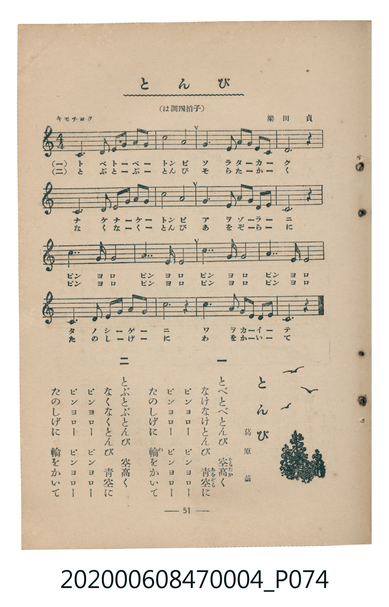

# とんび

<audio controls src="tonbi.mp3"></audio>

- 詞：葛原しげる
- 曲：梁田貞
- 臺灣教育會公認《新定兒童唱歌》尋常科第四學年用（2020.006.0847.0004）

## 說明

原書資訊與歌詞全文（對應 P074.jpg，書頁 p. 51，參考教材第 15 首）：
調性與拍號：は調四拍子（C 大調 4/4 拍）
速度指示：キモチヨク

## 歌詞

```text
一
とべとべとんび　空高（そらたか）く
なけなけとんび　青空（あをぞら）に
ピンヨロー　ピンヨロー
ピンヨロー　ピンヨロー
たのしげに　輪（わ）をかいて

二
とぶとぶとんび　空高く
なくなくとんび　青空に
ピンヨロー　ピンヨロー
ピンヨロー　ピンヨロー
たのしげに　輪をかいて
```

## ABC

```abc
X:1
T:とんび
C:曲：梁田貞
M:4/4
L:1/16
Q:1/4=96
K:C
V:V1 name="Piano" snm="Pia"
[V:V1]
C6 E2 G3 A G3 E | c8 A8 | G6 E2 A3 G E3 C | D12 z4 |
C6 E2 G3 A G3 E | d8 c8 | A6 c2 G3 A G3 E | C12 z4 |
c7 A G8 | A7 G E8 | d7 c A8 | c7 A G8 |
C6 E2 G3 A c3 d | e12 z4 | d6 c2 A3 c G3 E | C12 z4 |
```

## TMD 檔案連結

- [主旋律 TMD 檔案](tonbi.tmd) [[在 TMD Studio 編輯](https://tmdlang.github.io/Tmd-TS/#tmd=s7IKdvYPcrWy4tLSUnjcuOJx0-THjZsVtLS4FG0VLM247G0VnLlsTPRN7LjqFJRerJz3fs-sFxNnP-2b_7hx-uPGSY-bupVAMs9mbwLKPFvU-HzKhheb5oHFXrTvet64-NnUmS-aNj2b0_y0dc2LVb2PG7qeTdvwdN2sp62Tnq9e-nTKxmdrex43dD_d0P10x47nyyc-X7Pm6ezZT9fueLpzy_MpK97v6TAyMDLQMzAw0zOwMDEHMgxM3u_pVOLi0tdSsKUW4FJQUAB66tnsHS82t79Y0fWiox3oLqB_n7aueDatHeiKpxt6n7V3KgQYmJvoZRWkv9_TA1T8ckGjQoGegqkhkPu0v_lFQzPQu8_mTgB6QsHQVOHlsmlApwIDBmT8i1X7nzUsBxnc3fti5nyg6OPG9UBBoG-BIk_XTgBa4qzwdMlyoJgCMMQVgKJA3SCtLxvmP9217FlP-_Mlu0D6mtY-bl70uLnxcTMwwtZzgZQ82dEAokBR2LgTQYKj83FDw_OVu16ungG04XHj3MdNnY8bgfHXDTT9cWM_RNuqx40TYSRC28u5k4A6wdqaHjdNetw4D6gZrG01WFvzlMfNm0GuaAa6aA9QA5oI8YpADloHTVONq4GKXuxZBbK3qR9kHcjq7seNLY8bl0F8u6sH7tttCBLVt8h-64eR6H6jj09QPABURHmChQIFLX0urpD8vKRMq4DMxLx8hxqDGoVqkBUKNoZmWnZgFraMogBMosA082Jhj4KGicLTDf3P1zfowFO3JhYNQJughmkANWpaAYOjA4j3APFMNPYehRqQCDBooIKTYYJNe6EiK4Hs_RB202q47Hqo7B4FAxT7dvWA7GtcAZFu3IbKhmgGRy1UEGIvSHAu1I5OUMRAZbvhsv2Y9tUoGCrowqExEJuCWWZQ2hikIg5JCUQSlV8DVYwwBKLCFMzWBVpRo2CEpgcGDWBmgFM67sjb1UNZ5HVBQ2YjGhtP5C2CimwCsvchIhKqBRKsOCNvFTT0gWGOzMYXeU1QZ00CsuchIhIqC0k2JEeeEXrkYcRmDUp8gqWxpAEKo29HJ2XRByp4oAEAygpr4dFAJQlEiKIGDywMcAUXIpEjq0ALdKCZmFmGsEX4gxRYkVIUpLDyqLkPyN4OTW7ApI4leYP4sLIKlBmgSbFpCVx1G_7MACuK1gHxdCgbmMqxpGxQvoMWU-B8AHVGYwtc9TJS8gE0kIHxUaNgjJ7wMdIwaryB9ULiDcgkJSvUcnHp2imA6ykFIEOZiwsA)]
- [鋼琴伴奏 TMD 檔案](tonbi_piano.tmd) [[在 TMD Studio 編輯](https://tmdlang.github.io/Tmd-TS/#tmd=s7IKdvYPcrWy4tLSUnjcuOJx0-THjZvf7-l42b3n-YQtT_Zsebq0_3lnx_s9nQpaWlyKtgqWZlz2tgrOXDYm-iZ2XHUKSi9Wznu_Z9aLibOf9s1_3Dj9ceOkx03dSiCZZ7M3AWWeLWp8PmXDi03zwGIv2nc9b1z8bOrMF02bns1pftq65sWq3scNXc-mbXi6btbT1knPVy99OmXjs7U9jxu6n27ofrpjx_PlE5-vWfN09uyna3c83bnl-ZQVQPcZGRgZ6BkYmOkZWJiYAxkGJkAnKnFxheTnJWVaBWQm5uUHeTjUGNQoVHMpAIGNoZmWHZilr6Vgiw4UgBY82dHwYmGPgoaJwtMN_c_XN-goBBiYm-hlFaRrYtGgpQ82rEbBUEEXDo2B2BTMMoPSxiAVcUhKIJKo_BqoYoQhEBWmYLYu0IoaBSM0PTBoADODC7_ndvXQxnNG6J7D8G0Nin_B0ljCiELv7egky3uoboU5CJfbETGCrAItBIBmYsYvYYvw-w-Y-KkZfVDnAF1eo2CMHl8YQY_qQ7BeiA-BTFJisBYld_qg5E4TaOYEmhOvEG0YC6NqFEyADJNYGIUpbxoPZJnGx4IZBkBrsBsDV4ZuMFTCHNVs3AZBtcH5RkCGUS6mA-EW4jIIxTJUb2B3DzD8dO0UwEGoAGQoc3EBAA)]

## 分析

```text
================================================================================
📊 TMD Song Profile: [ とんび ]
================================================================================
⏱  Duration:       0:40 (40.0s), 16 measures total
🎼 Key & Tempo:    首調基準 C, != 96.0 BPM, <4/4>
   - 分析範圍：      由實際發聲的音符與和弦推測調性；播放脈絡另行呈現
🎤 人聲音域:    C4 (MIDI 60) – E5 (MIDI 76) [跨度: 16 個半音 / 1.3 個八度, 難度: moderate]
   - 最低音:  C4 in [Tonbi #1 @ m.1, 0:00]
   - 最高音: E5 in [Tonbi #1 @ m.14, 0:32]
   - 適合: soprano, mezzo-soprano, contralto, tenor, baritone, bass
🏛  結構:      Tonbi (40.0s)
⚡ 編曲密度:        Peak 1 軌道同時演奏
🗝  調性診斷：       C 大調（純淨自然大調，未偵測到可信轉調）
   - 風格氣質:    純淨自然大調（陽光明朗、易唱易記，無明顯調外色彩）
   - 轉調歷程:    全曲維持單一推測調性（未偵測到可信轉調）
   - 核心骨幹音:  C, G, A, E, D
   - 調性數值:    C 大調 [相關度: 0.89, 穩定度: High, 自然音純度: 100.0%]
   - 候選調性 (K-S): C 大調 (0.89), A 小調 (0.71), G 大調 (0.63)
   - 五度圈歷程:   +0
   - 各段落調性細節:
     • [Tonbi #1]: C 大調 (r: 0.89, 自然音純度: 100.0%)

  [ 五度圈游移軌跡 ]
              [C ]*
         F            G  
      Bb               D  
      Eb               A  
         Ab           E  
            Db       B  
               F# 
     (* = active key center)

  [ 十二半音累積音高分佈 ]
     C  : ████████████████████████  34.2%
     C# :                            0.0%
     D  : ██████████                14.2%
     D# :                            0.0%
     E  : ██████████                14.6%
     F  :                            0.0%
     F# :                            0.0%
     G  : ██████████████            20.0%
     G# :                            0.0%
     A  : ████████████              17.1%
     A# :                            0.0%
     B  :                            0.0%
--------------------------------------------------------------------------------
Assignment 軌道音域：
  - Piano         : C4 – E5 (16 個半音 / 1.3 個八度, 56 個音符)
================================================================================
```


## 原書掃描頁




