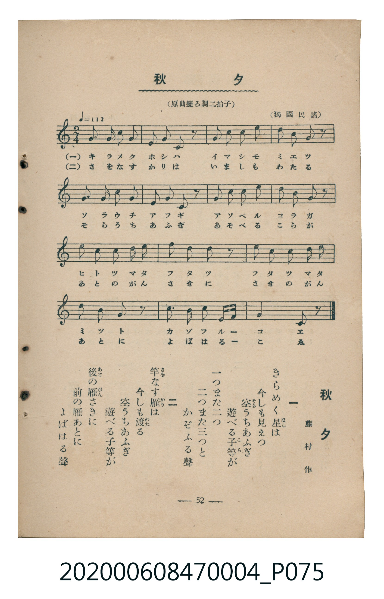

# 秋夕

> Re:Shōka 使用 AI 協助辨識與重建樂譜，可能會有錯誤。歡迎[回報](https://github.com/TMDLang/reshoka/issues)。

- **鋼琴伴奏版**：<br><audio controls src="shuseki.mp3"></audio>
- **NEUTRINO 歌聲合成版**：<br><audio controls src="shuseki_neutrino.mp3"></audio>

- 詞：島崎藤村
- 曲：獨國民謠
- 臺灣教育會公認《新定兒童唱歌》尋常科第四學年用（2020.006.0847.0004）

## 說明

原書資訊與歌詞全文（對應 P075.jpg，書頁 p. 52，參考教材第 16 首）：
調性與拍號：原曲變ろ調二拍子（譜面移調為 C 大調 2/4 拍，♩=112，獨國民謠）


## 歌詞

```text
一
きらめく星（ほし）は　今（いま）しも見（み）えつ
空（そら）うちあふぎ　遊（あそ）べる子等（こら）が
一（ひと）つまた二（ふた）つ　二つまた三（み）つと
かぞふる聲（こゑ）

二
竿（さを）なす雁（かり）は　今しも渡（わた）る
空うちあふぎ　遊べる子等が
後（あと）の雁（がん）さきに　前（さき）の雁あとに
よばはる聲
```

## ABC

<div class="abc-score" data-abc-src="shuseki.abc" aria-label="五線譜載入中"></div>

[下載 ABC 原始檔](shuseki.abc)

## TMD 檔案連結

- [主旋律 TMD 檔案](shuseki.tmd) [[在 TMD Studio 編輯](https://tmdlang.github.io/Tmd-TS/#tmd=s7IKdvYPcrWy4qpTUCpJTLdSSM7PyUlNLsnMz7MqzsjMK0nNjM_KTMmPL87Iz05Ugisry88pzU21Si9KTEmNN4k3MjAyiDcwMIs3sDAxBzIMTBBKi_NLi5JTrYqTM_Lzc-JLUitKkvLzsxHyBUX5Zal5iXlANQVFIBtTwIoQClLLMlNSQdKpKZkl-UWZiTlI7kgtKga7FWxJfElRYl5xclFmAcgDCFX5RSUZ-UC3FmRUWmVkFoMMSU7Mic9OzEPyUklGKtBHxamJxfl5xch6M9Mz86zKU4tLUovy4nNTc_JTKjGkSxIzgSEECqXyxPjcxMy8nMS8FPQwiC9ITE-1CjAwN1Xi0tJSeL68--mSqQpaWlyKtgqGhkZc9rYKzlw2RvomdiCNL1bOe79n1tPN255u6XsxfcmzuRPB5j2bvQko_Lx3xdM53c82THyxZgFY-EX7rueNi59NnfmiadOzOc1PW9e8WNX7uKHr2bQNT9fNeto66fnqpU-nbHy2tudxQ_fTDd1Pd-x4vnzi8zVrns6e_XTtjqc7tzyfsuL9ng5QTOoBY1IPFJNAhoHJ-z2dSlxc-loKttQCXAoKCk_75j-bvePF5vYXK7pedLQD3QX079PWFc-mtQNd8XRD77P2TgVQUOllFaS_39MDVPxyQaNCgZ6CqRGQ-7S_-UVDM9C7z-ZOAHpCwdBM4eWyaUCnAsMGZPyLVfufNSwHGdzd-2LmfFBAgizc9GJd1-OmXqDsk109QKmnaycAbXuxds7LuYueL98NFH_etEvBWeHpkuVAtgIwKhSAqoD2PZq50hYYRUAWcsgD7eMC2fZkRwOIetzY-7ip83FT4-PG_mczgJZ2PG7c_bhxOlDZ48b1jxsanuzuAgu2PG7cBxac_rip6cWybrDgfrAIkLEEZNbzlbvAonOBJoIl2h43Lnzc2PS4cevjxj6gWS8bIWYBReaCFex83NQN9M_ztUD1QPHJMI09UBeCRTc9bgTGMlB0CdAJjxvnA4MBLA40FOhesDjQmbt6EAp2QIyDuA4ouALi0-7HjfNA2pq6XzQCEyTEwonwANkFtvX5aqA2oNTUx02TwPpXPW6c-XJ2I1iw-3ET0AeIkIGExrMdC0GyTf1QBzV1Q0MDawgg-xrq06f7ID4CqoP4dB3Mwp7HTZPBIlNBEdW4GmjE005g5IId2AhkQBVD9AIVgH3aBJTeAHIk2KcgIcozABQoaOlzcQVnlBanZmdaBWQm5uU71BjUVIPsULAxNNOyA7Ow5TwFYJoHRumLhT0KGiYKTzf0P1_foAPPLppYNACtghqmAdSoaQX02FqFx80rgXghkL1eoQbImg1kbQfS_QoGIH7TEiB7HlRsEVjFfCBvBZBuAapANnJXD8jIxqlA6UlAehUQzwRpaOwGinQB6fUQIxtbgHgfEE8HijeBLekH8kDGdiOMrFEwVdAFQlMFwzgwpQsUMoayDIHYACwC5oEUgAljEFGjYASizKFqwerARvoYguxaCzYW5m0gC-hxkCaQ10G87WDZfrgNoCAAicxDkl0E1TEfLLYCLNaCapcRyKdTIXZBwwPIAoYIWCcwTEDiXWAxkP1Qu4BhAxLZByang9U0QV0BchEolEBiIN0Qu_Anj109lCWPvZBwaloGpBvBrlgEZIFieB00eQD5YFUzgXg1WGQzVM8a7MljLlCqE0i3AfFCsJebgHgrEPdBkweID1TVuBPsUZDIZKieHjokj72I5AH0NojVCI0AUKSDPA-KgHVIyQMsDtYHCgYQuRoqsxlqEkh-DZbkMReaPCDhAYpeUIKEhAGItxVM9iElD4g4SB8ofGBJARJGEJNAMj1EJo8dneDkYUxm8mgGJuvmDnDSh5QR-8GZApQ89kPLB1Q-TBWWZAGKdGCh0rgO7HxgKQ32FFBrYy8Qr4YmDRgfoQqeHMBxi4hqYBwDRWoUTKAcKAEJR3gCAGGgciAfKQkAvQWKtg4wCc6PKJ4DBfN-uBw0YjDE4XqQohsSeeDSAugDSEQhfAri94JJUPKBRTiyOIoe_FELbNFRFrXA0hgcYR3QfL4aiIFlNigygcn7cfMeWF4Hln5Y8zksQqFR1wRMJ40bwIUdKM1CDQDn7InIuRoRjfDMCeGCIguSiRVM4LkfKasjxR-4jITGAigWYRkVFK6gWIL4Az2jQuRAsYOeTZHjDSlugF4C64F6Cz0zQsybCDevlotL104BWtUrAJnKXAA)]
- [鋼琴伴奏 TMD 檔案](shuseki_piano.tmd) [[在 TMD Studio 編輯](https://tmdlang.github.io/Tmd-TS/#tmd=s7IKdvYPcrWy4qpTUCpJTLdSyC8qychPL0osyKi0ysgsLskvykxOzInPTsxLVIIrKs4vLUpOjS9ITE-1CjAwN1Xi0tJSeL68--mSqe_3dLzs3vN8wpYne7Y8Xdr_vLPj_Z5OBS0tLkVbBUNDIy57WwVnLhsjfRM7kGkvVs57v2fW083bnm7pezF9ybO5E8GWPJu9CSj8vHfF0zndzzZMfLFmAVj4Rfuu542Ln02d-aJp07M5zU9b17xY1fu4oevZtA1P18162jrp-eqlT6dsfLa253FD99MN3U937Hi-fOLzNWuezp79dO2Opzu3PJ-yAuhAIwMjAz0DAzM9AwsTcyDDwAToRiUuruCM0uLU7EyrgMzEvPwgD4cag5pqLgUgsDE007IDs_S1FGzRgQLQhic7Gl4s7FHQMFF4uqH_-foGHQVQuOhlFaRrYtGgpQ82rEbBVEEXCE0VDOPAlC5QyBjKMgRiA7AImAdSACaMQUSNghGIMoeqBasDG-ljWKPwuGkt2NjHzSuBeCGI1bQerOlx82wwbztYth9uw-OmJWCReUiyi6A65oPFVoDFWlDtMgLKN06F2NU0CcheBWI1zoTobOwGi3eBxUD2Q-1qBJnyuHEfmJwOVtMEdQXIRY8bITaCdEPswh_wu3oGUcDvRQR80zIwqxHqNVBwPm4GBdbjpnVIAQ8WB-t73AwKuMfNq6Eym6EmgeTXYAn4udCA7wSy28ABB4pqkAwoOB83bgWTfUgBDxEH6XvcuBMeyCCZyVCTQDI9RAb8jk5wwBuTFvDgUEQEKjA0gSI1CiZQDpSAuBge1CAMVA7kIwV28yRwAHWASXCaAqbfx037wakWEtD74XLQIMAQh-tBClhIMIFTfCMoqkBB8rhpMjigwPobe8EkKKJgQYssjqIHfyACCybKAhGeCCFcUFBBEquCCTyVIyVppNAD5zJoGIDCEJYgQb4ChdE-WGihJEiIHChs0JMjcqghhUwTyGyQ2AZoKYCa6CBycPu5atFKYR_kUtgCWggDPRuvEG0YC6OQ-QZYZE3jgSzT-FgwA6iANoaYxoPSMZBrlAtXhKoLpAJDG9QuoByQNAOqQtIEkQYFiq6dAjRcon2A-pC5RmCuMhcA)]

## 分析

```text
================================================================================
📊 TMD Song Profile: [ 秋夕 ]
================================================================================
⏱  Duration:       0:15 (15.0s), 14 measures total
🎼 Key & Tempo:    首調基準 C, != 112.0 BPM, <2/4>
   - 分析範圍：      由實際發聲的音符與和弦推測調性；播放脈絡另行呈現
🎤 人聲音域:    C4 (MIDI 60) – F5 (MIDI 77) [跨度: 17 個半音 / 1.4 個八度, 難度: challenging]
   - 最低音:  C4 in [Shuseki #1 @ m.2, 0:01]
   - 最高音: F5 in [Shuseki #1 @ m.10, 0:09]
   - 適合: soprano, mezzo-soprano, contralto, tenor, baritone, bass
🏛  結構:      Shuseki (15.0s)
⚡ 編曲密度:        Peak 1 軌道同時演奏
🗝  調性診斷：       C 大調（純淨自然大調，未偵測到可信轉調）
   - 風格氣質:    純淨自然大調（陽光明朗、易唱易記，無明顯調外色彩）
   - 轉調歷程:    全曲維持單一推測調性（未偵測到可信轉調）
   - 核心骨幹音:  C, G, E, D, B
   - 調性數值:    C 大調 [相關度: 0.88, 穩定度: Moderate, 自然音純度: 100.0%]
   - 候選調性 (K-S): C 大調 (0.88), G 大調 (0.80), E 小調 (0.64)
   - 五度圈歷程:   +0
   - 各段落調性細節:
     • [Shuseki #1]: C 大調 (r: 0.88, 自然音純度: 100.0%)

  [ 五度圈游移軌跡 ]
              [C ]*
         F            G  
      Bb               D  
      Eb               A  
         Ab           E  
            Db       B  
               F# 
     (* = active key center)

  [ 十二半音累積音高分佈 ]
     C  : ████████████████████████  30.6%
     C# :                            0.0%
     D  : ██████████                12.2%
     D# :                            0.0%
     E  : ███████████               14.3%
     F  : ██                         3.1%
     F# :                            0.0%
     G  : ████████████████████████  30.6%
     G# :                            0.0%
     A  :                            0.0%
     A# :                            0.0%
     B  : ███████                    9.2%
--------------------------------------------------------------------------------
Assignment 軌道音域：
  - Piano         : C4 – F5 (17 個半音 / 1.4 個八度, 51 個音符)
================================================================================
```


## 原書掃描頁




