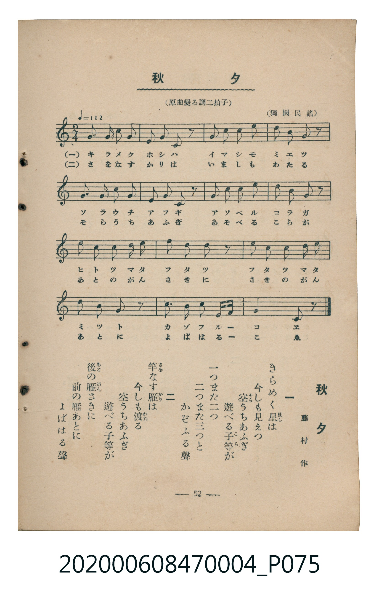

# 秋夕

<audio controls src="shuseki.mp3"></audio>

- 詞：島崎藤村
- 曲：獨國民謠
- 臺灣教育會公認《新定兒童唱歌》尋常科第四學年用（2020.006.0847.0004）

## 說明

原書資訊與歌詞全文（對應 P075.jpg，書頁 p. 52，參考教材第 16 首）：
調性與拍號：原曲變ろ調二拍子（譜面移調為 F 大調 2/4 拍，♩=112，獨國民謠）

## 歌詞

```text
一
きらめく星（ほし）は　今（いま）しも見（み）えつ
空（そら）うちあふぎ　遊（あそ）べる子等（こら）が
一（ひと）つまた二（ふた）つ　二つまた三（み）つと
かぞふる聲（こゑ）

二
竿（さを）なす雁（かり）は　今しも渡（わた）る
空うちあふぎ　遊べる子等が
後（あと）の雁（がん）さきに　前（さき）の雁あとに
よばはる聲
```

## ABC

```abc
X:1
T:秋夕
C:曲：獨國民謠
M:2/4
L:1/16
Q:1/4=112
K:F
V:V1 name="Piano" snm="Pia"
[V:V1]
A2 A2 A2 A2 | G2 A2 G2 z2 | A2 c2 c2 c2 | B2 d2 c2 z2 |
A2 A2 A2 A2 | G2 A2 G2 z2 | A2 c2 c2 c2 | B2 d2 c2 z2 |
c2 c2 A2 A2 | d2 c2 A2 z2 | c2 c2 A2 A2 | d2 c2 A2 z2 |
G2 A2 B2 c d | c4 F2 z2 |
```

## TMD 檔案連結

- [主旋律 TMD 檔案](shuseki.tmd) [[在 TMD Studio 編輯](https://tmdlang.github.io/Tmd-TS/#tmd=s7IKdvYPcrWy4tLSUni-vPvpkqkKWlpcirYKhoZGXPa2Cm5cNkb6JnZcdQpKL1bOe79n1tPN255u6XsxfcmzuROVQMLPZm8CCj_vXfF0TvezDRNfrFkAFn7Rvut54-JnU2e-aNr0bE7z09Y1L1b1Pm7oejZtw9N1s562Tnq-eunTKRufre153ND9dEP30x07ni-f-HzNmqezZz9du-Ppzi3Pp6x4v6fDyMDIQM_AwEzPwMLEHMgwMHm_p1OJi0tfS8GWWoBLQUHhad_8Z7N3vNjc_mJF14uOdqC7gP592rri2bR2oCuebuh91t6pEGBgbqqXVZD-fk8PUPHLBY0KBXoKpkZA7tP-5hcNzUDvPps7AegJBUMzhZfLpgGdCgwbkPEvVu1_1rAcZHB374uZ80EBCbJw04t1XY-beoGyT3b1AKWerp0AtO3F2jkv5y56vnw3UPx50y4FN4WnS5YD2QrAqFAAqgLa92jmSltgFAFZyCEPtI8LZNuTHQ0g6nFj7-OmzsdNjY8b-5_NAFra8bhx9-PG6UBljxvXP25oeLK7CyzY8rhxH1hw-uOmphfLusGC-8EiQMYSkFnPV-4Ci84FmgiWaHvcuPBxY9Pjxq2PG_uAZr1shJgFFJkLVrDzcVM30D_P1wLVA8UnwzT2QF0IFt30uBEYy0DRJUAnPG6cDwwGsDjQUKB7weJAZ-7qQSjYATEO4jqg4AqIT7sfN84DaWvqftEITJAQCyfCA2QX2Nbnq4HagFJTHzdNAutf9bhx5svZjWDB7sdNQB8gQgYSGs92LATJNvVDHdTUDQ0NrCGA7GuoT5_ug_gIqA7i03UwC3seN00Gi0wFRVTjaqARTzuBkQt2YCOQAVUM0QtUAPZpE1B6A8iRYJ-ChCjPAFCgoKXPxRWcUVqcmp1pFZCZmJfvUGNQo1ANskTBxtBMyw7Mwpb1FICJHhinLxb2KGiYKDzd0P98fYMOPL9oYtEAtAtqmAZQo6YV0GdrFR43rwTihUD2eoUaIGs2kLUdSPcrGID4TUuA7HlQsUVgFfOBvBVAugWoAtnIXT0gIxunAqUnAelVQDwTpKGxGyjSBaTXQ4xsbAHifUA8HSjeBLakH8gDGduNMLJGwVhBFwXXKBhBWSDaACwC4pki4RoFEyBpBuWB1YBTI-4Q3NVDWQjuhYRg0zIg3Qj2zCIgCxQI66AhCOSDVc0E4tVgkc1QPWuwh-BcoFQnkG4D4oXgEGsC4q1A3AcNQRAfqKpxJzjMQCKToXp66B-COzrBIWhMZgg2AxNLcwc4PQFT2uOm_eBEBgrA_dBEhsqHKsISbqBQASbMxnWgcADmdHDAADU29gLxamjQwfhwRfDQgoUAIrRgoQDiQUILQw3-sAHWrJSFDTBTgL3cAU1Lq4EYmHVAwQFMS4-b98DT0x5wrsSanmDhAg2CJmBgN24A50dQ6oEaAkpBYEMmIqcgzBCApSBQKjEFykPCBAQN4emllotL104BWqwpAJnKXFwA)]
- [鋼琴伴奏 TMD 檔案](shuseki_piano.tmd) [[在 TMD Studio 編輯](https://tmdlang.github.io/Tmd-TS/#tmd=s7IKdvYPcrWy4tLSUni-vPvpkqnv93S87N7zfMKWJ3u2PF3a_7yz4_2eTgUtLS5FWwVDQyMue1sFNy4bI30TO646BaUXK-e93zPr6eZtT7f0vZi-5NnciUog4WezNwGFn_eueDqn-9mGiS_WLAALv2jf9bxx8bOpM180bXo2p_lp65oXq3ofN3Q9m7bh6bpZT1snPV-99OmUjc_W9jxu6H66ofvpjh3Pl098vmbN09mzn67d8XTnludTVgAdaGRgZKBnYGCmZ2BhYg5kGJgA3ajExRWcUVqcmp1pFZCZmJcf5OFQY1CjUM2lAAQ2hmZadmCWvpaCLTpQAFrxZEfDi4U9ChomCk839D9f36CjEGBgbqqXVZCuiUWDlj7YsBoFYwVdFFyjYARlgWgDsAiIZ4qEaxRMgKQZlAdWw4Xfbbt6Bq_bdnSC3WZMmttg9iHcBrMTxIO4DUMNfpcAEwk5LsG0FxZKoJAwBcpDXAKChvAwqUVLbT4oqc0CmthqFAzjFaINY2EU0KR4IMs0PhbMMMCiwATIMAHzgbK0NASkBsLHYgJUD6oaqLXmsTDzkYWgdgHDRddOARo0CkCmMhcXAA)]

## 分析

```text
================================================================================
📊 TMD Song Profile: [ 秋夕 ]
================================================================================
⏱  Duration:       0:15 (15.0s), 14 measures total
🎼 Key & Tempo:    首調基準 F, != 112.0 BPM, <2/4>
   - 分析範圍：      由實際發聲的音符與和弦推測調性；播放脈絡另行呈現
🎤 人聲音域:    F4 (MIDI 65) – D5 (MIDI 74) [跨度: 9 個半音 / 0.8 個八度, 難度: easy]
   - 最低音:  F4 in [Shuseki #1 @ m.14, 0:14]
   - 最高音: D5 in [Shuseki #1 @ m.4, 0:03]
   - 適合: soprano, mezzo-soprano, contralto, tenor, baritone, bass
🏛  結構:      Shuseki (15.0s)
⚡ 編曲密度:        Peak 1 軌道同時演奏
🗝  調性診斷：       A 小調（流行色彩小調，未偵測到可信轉調）
   - 風格氣質:    流行小調（略帶和弦色彩音與裝飾副屬和弦）
   - 轉調歷程:    全曲維持單一推測調性（未偵測到可信轉調）
   - 核心骨幹音:  A, C, G, D, A#
   - 調性數值:    A 小調 [相關度: 0.81, 穩定度: High, 自然音純度: 93.9%]
   - 候選調性 (K-S): A 小調 (0.81), C 大調 (0.58), F 大調 (0.52)
   - 五度圈歷程:   +3
   - 各段落調性細節:
     • [Shuseki #1]: A 小調 (r: 0.81, 自然音純度: 93.9%, 調外音: A#)

  [ 五度圈游移軌跡 ]
               C  
         F            G  
      Bb               D  
      Eb              [A ]*
         Ab           E  
            Db       B  
               F# 
     (* = active key center)

  [ 十二半音累積音高分佈 ]
     C  : █████████████████████     33.7%
     C# :                            0.0%
     D  : ██████                     9.2%
     D# :                            0.0%
     E  :                            0.0%
     F  : █                          2.0%
     F# :                            0.0%
     G  : ██████                    10.2%
     G# :                            0.0%
     A  : ████████████████████████  38.8%
     A# : ████                       6.1%
     B  :                            0.0%
--------------------------------------------------------------------------------
Assignment 軌道音域：
  - Piano         : F4 – D5 (9 個半音 / 0.8 個八度, 49 個音符)
================================================================================
```


## 原書掃描頁




