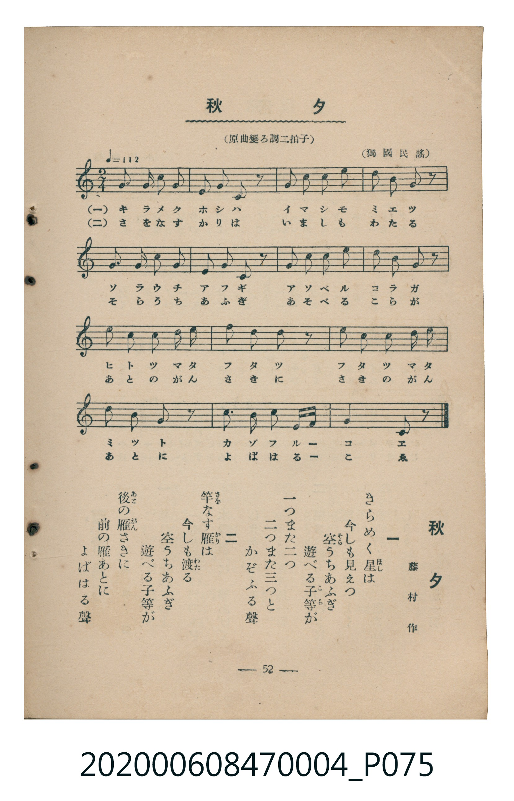

# 秋夕

> Re:Shōka 使用 AI 協助辨識與重建樂譜，可能會有錯誤。歡迎回報。

<audio controls src="shuseki.mp3"></audio>

- 詞：島崎藤村
- 曲：獨國民謠
- 臺灣教育會公認《新定兒童唱歌》尋常科第四學年用（2020.006.0847.0004）

## 說明

原書資訊與歌詞全文（對應 P075.jpg，書頁 p. 52，參考教材第 16 首）：
調性與拍號：原曲變ろ調二拍子（譜面移調為 C 大調 2/4 拍，♩=112，獨國民謠）

## 歌詞

```text
一
きらめく星（ほし）は　今（いま）しも見（み）えつ
空（そら）うちあふぎ　遊（あそ）べる子等（こら）が
一（ひと）つまた二（ふた）つ　二つまた三（み）つと
かぞふる聲（こゑ）

二
竿（さを）なす雁（かり）は　今しも渡（わた）る
空うちあふぎ　遊べる子等が
後（あと）の雁（がん）さきに　前（さき）の雁あとに
よばはる聲
```

## ABC

```abc
X:1
T:秋夕
C:曲：獨國民謠
M:2/4
L:1/16
Q:1/4=112
K:C
V:V1 name="Piano" snm="Pia"
[V:V1]
G3 G c2 G2 | E2 G2 C2 z2 | G2 c2 c2 e2 | d2 B2 G2 z2 |
w: 1.~キ ラ メ ク | ホ シ ハ | イ マ シ モ | ミ エ ツ
w: 2.~さ を な す | か り は | い ま し も | わ た る
G3 G c2 G2 | E2 G2 C2 z2 | G2 c2 c2 e2 | d2 B2 G2 z2 |
w: 1.~ソ ラ ウ チ | ア フ ギ | ア ソ ベ ル | コ ラ ガ
w: 2.~そ ら う ち | あ ふ ぎ | あ そ べ る | こ ら が
e2 c2 c2 d e | f2 d2 d2 z2 | d2 B2 B2 c d | e2 c2 G2 z2 |
w: 1.~ヒ ト ツ マ タ | フ タ ツ | フ タ ツ マ タ | ミ ツ ト
w: 2.~あ と の が ん | さ き に | さ き の が ん | あ と に
c3 B c2 E F | G4 C2 z2 |
w: 1.~カ ゾ フ ル _ | コ エ
w: 2.~よ ば は る _ | こ ゑ
```

## TMD 檔案連結

- [主旋律 TMD 檔案](shuseki.tmd) [[在 TMD Studio 編輯](https://tmdlang.github.io/Tmd-TS/#tmd=s7IKdvYPcrWy4qpTUCpJTLdSSM7PyUlNLsnMz7MqzsjMK0nNjM_KTMmPL87Iz05Ugisry88pzU21Si9KTEmNN4k3MjAyiDcwMIs3sDAxBzIMTBBKi_NLi5JTrYqTM_Lzc-JLUitKkvLzsxHyBUX5Zal5iXlANQVFIBtTwIoQClLLMlNSQdKpKZkl-UWZiTlI7kgtKga7FWxJfElRYl5xclFmAcgDCFX5RSUZ-UC3FmRUWmVkFoMMSU7Mic9OzEPyUklGKtBHxamJxfl5xUpcWloKz5d3P10yVUFLi0vRVsHQ0IjL3lbBmcvGSN_EDqTrxcp57_fMerp529MtfS-mL3k2dyLYsGezNwGFn_eueDqn-9mGiS_WLAALv2jf9bxx8bOpM180bXo2p_lp65oXq3ofN3Q9m7bh6bpZT1snPV-99OmUjc_W9jxu6H66ofvpjh3Pl098vmbN09mzn67d8XTnludTVrzf0wEKaj1gUOuBghrIMDB5v6dTiYtLX0vBllqAS0FB4Wnf_Gezd7zY3P5iRdeLjnagu4D-fdq64tm0dqArnm7ofdbeqRBgYG6ql1WQ_n5PD1DxywWNCgV6CqZGQO7T_uYXDc1A7z6bOwHoCQVDM4WXy6YBnQoMG5DxL1btf9awHGRwd--LmfNBAQmycNOLdV2Pm3qBsk929QClnq6dALTtxdo5L-cuer58N1D8edMuBWeFp0uWA9kKwKhQAKoC2vdo5kpbYBQBWcghD7SPC2Tbkx0NIOpxY-_jps7HTY2PG_ufzQBa2vG4cffjxulAZY8b1z9uaHiyuwss2PK4cR9YcPrjpqYXy7rBgvvBIkDGEpBZz1fuAovOBZoIlmh73LjwcWPT48atjxv7gGa9bISYBRSZC1aw83FTN9A_z9cC1QPFJ8M09kBdCBbd9LgRGMtA0SVAJzxunA8MBrA40FCge8HiQGfu6kEo2AExDuI6oOAKiE-7HzfOA2lr6n7RCEyQEAsnwgNkF9jW56uB2oBSUx83TQLrX_W4cebL2Y1gwe7HTUAfIEIGEhrPdiwEyTb1Qx3U1A0NDawhgOxrqE-f7oP4CKgO4tN1MAt7HjdNBotMBUVU42qgEU87gZELdmAjkAFVDNELVAD2aRNQegPIkWCfgoQozwBQoKClz8UVnFFanJqdaRWQmZiX71BjUFMNskPBxtBMyw7MwpbzFIBpHhilLxb2KGiYKDzd0P98fYMOPLtoYtEAtApqmAZQo6YV0GNrFR43rwTihUD2eoUaIGs2kLUdSPcrGID4TUuA7HlQsUVgFfOBvBVAugWoAtnIXT0gIxunAqUnAelVQDwTpKGxGyjSBaTXQ4xsbAHifUA8HSjeBLakH8gDGduNMLJGwVRBFwhNFQzjwJQuUMgYyjIEYgOwCJgHUgAmjEFEjYIRiDKHqgWrAxvpYwiyay3YWJi3gSygx0GaQF4H8baDZfvhNoCCACQyD0l2EVTHfLDYCrBYC6pdRiCfToXYBQ0PIAsYImCdwDABiXeBxUD2Q-0Chg1IZB-YnA5W0wR1BchFoFACiYF0Q-zCnzx29VCWPPZCwqlpGZBuBLtiEZAFiuF10OQB5INVzQTi1WCRzVA9a7Anj7lAqU4g3QbEC8FebgLirUDcB00eID5QVeNOsEdBIpOhenrokDz2IpIH0NsgViM0AkCRDvI8KALWISUPsDhYHygYQORqqMxmqEkg-TVYksdcaPKAhAcoekEJEhIGIN5WMNmHlDwg4iB9oPCBJQVIGEFMAsn0EJk8dnSCk4cxmcmjGZismzvASR9SRuwHZwpQ8tgPLR9Q-TBVWJIFKNKBhUrjOrDzgaU02FNArY29QLwamjRgfIQqeHIAxy0iqoFxDBSpUTCBcqAEJBzhCQCEgcqBfKQkAPQWKNo6wCQ4P6J4DhTM--Fy0IjBEIfrQYpuSOSBSwugDyARhfApiN8LJkHJBxbhyOIoevBHLbBFR1nUAktjcIR1QPP5aiAGltmgyAQm78fNe2B5HVj6Yc3nsAiFRl0TMJ00bgAXdqA0CzUAnLMnIudqRDTCMyeEC4osSCZWMIHnfqSsjhR_4DISGgugWIRlVFC4gmIJ4g_0jAqRA8UOejZFjjekuAF6CawH6i30zAgxbyLcvFouLl07BWhVrwBkKnMBAA)]
- [鋼琴伴奏 TMD 檔案](shuseki_piano.tmd) [[在 TMD Studio 編輯](https://tmdlang.github.io/Tmd-TS/#tmd=s7IKdvYPcrWy4tLSUni-vPvpkqnv93S87N7zfMKWJ3u2PF3a_7yz4_2eTgUtLS5FWwVDQyMue1sFZy4bI30TO646BaUXK-e93zPr6eZtT7f0vZi-5NnciUog4WezNwGFn_eueDqn-9mGiS_WLAALv2jf9bxx8bOpM180bXo2p_lp65oXq3ofN3Q9m7bh6bpZT1snPV-99OmUjc_W9jxu6H66ofvpjh3Pl098vmbN09mzn67d8XTnludTVgAdaGRgZKBnYGCmZ2BhYg5kGJgA3ajExRWcUVqcmp1pFZCZmJcf5OFQY1BTzaUABDaGZlp2YJa-loItOlAA2vBkR8OLhT0KGiYKTzf0P1_foKMQYGBuqpdVkK6JRYOWPtiwGgVTBV0gNFUwjANTukAhYyjLEIgNwCJgHkgBmDAGETUKRiDKHKoWrA5spI9hjcLjprVgYx83rwTihSBW03qwpsfNs8G87WDZfrgNj5uWgEXmIckuguqYDxZbARZrQbXLCCjfOBViV9MkIHsViNU4E6KzsRss3gUWA9kPtasRZMrjxn1gcjpYTRPUFSAXPW6E2AjSDbELf8Dv6hlEAb8XEfBNy8CsRqjXQMH5uBkUWI-b1iEFPFgcrO9xMyjgHjevhspshpoEkl-DJeDnQgO-E8huAwccKKpBMqDgfNy4FUz2IQU8RByk73HjTnggg2QmQ00CyfQQGfA7OsEBb0xawINDERGowNAEitQomEA5UALiYnhQgzBQOZCPFNjNk8AB1AEmwWkKmH4fN-0Hp1pIQO-Hy0GDAEMcrgcpYCHBBE7xjaCoAgXJ46bJ4IAC62_sBZOgiIIFLbI4ih78gQgsmCgLRHgihHBBQQVJrAom8FSOlKSRQg-cy6BhAApDWIIE-QoURvtgoYWSICFyoLBBT47IoYYUMk0gs0FiG6ClAGqig5g3EW5eLVop7INcCltAC2GgZ-MVog1jYRQy3wCLrGk8kGUaHwtmABXQxhDTeFA6BnKNcuGKUHWBVGBog9oFlAOSZkBVSJog0qBA0bVTgIZLtA9QHzLXCMxV5gIA)]

## 分析

```text
================================================================================
📊 TMD Song Profile: [ 秋夕 ]
================================================================================
⏱  Duration:       0:15 (15.0s), 14 measures total
🎼 Key & Tempo:    首調基準 C, != 112.0 BPM, <2/4>
   - 分析範圍：      由實際發聲的音符與和弦推測調性；播放脈絡另行呈現
🎤 人聲音域:    C4 (MIDI 60) – F5 (MIDI 77) [跨度: 17 個半音 / 1.4 個八度, 難度: challenging]
   - 最低音:  C4 in [Shuseki #1 @ m.2, 0:01]
   - 最高音: F5 in [Shuseki #1 @ m.10, 0:09]
   - 適合: soprano, mezzo-soprano, contralto, tenor, baritone, bass
🏛  結構:      Shuseki (15.0s)
⚡ 編曲密度:        Peak 1 軌道同時演奏
🗝  調性診斷：       C 大調（純淨自然大調，未偵測到可信轉調）
   - 風格氣質:    純淨自然大調（陽光明朗、易唱易記，無明顯調外色彩）
   - 轉調歷程:    全曲維持單一推測調性（未偵測到可信轉調）
   - 核心骨幹音:  C, G, E, D, B
   - 調性數值:    C 大調 [相關度: 0.88, 穩定度: Moderate, 自然音純度: 100.0%]
   - 候選調性 (K-S): C 大調 (0.88), G 大調 (0.80), E 小調 (0.64)
   - 五度圈歷程:   +0
   - 各段落調性細節:
     • [Shuseki #1]: C 大調 (r: 0.88, 自然音純度: 100.0%)

  [ 五度圈游移軌跡 ]
              [C ]*
         F            G  
      Bb               D  
      Eb               A  
         Ab           E  
            Db       B  
               F# 
     (* = active key center)

  [ 十二半音累積音高分佈 ]
     C  : ████████████████████████  30.6%
     C# :                            0.0%
     D  : ██████████                12.2%
     D# :                            0.0%
     E  : ███████████               14.3%
     F  : ██                         3.1%
     F# :                            0.0%
     G  : ████████████████████████  30.6%
     G# :                            0.0%
     A  :                            0.0%
     A# :                            0.0%
     B  : ███████                    9.2%
--------------------------------------------------------------------------------
Assignment 軌道音域：
  - Piano         : C4 – F5 (17 個半音 / 1.4 個八度, 51 個音符)
================================================================================
```


## 原書掃描頁




