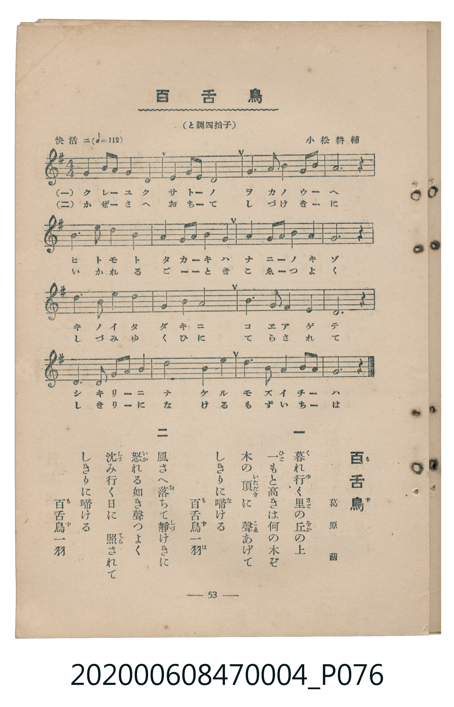

# 百舌鳥

> Re:Shōka 使用 AI 協助辨識與重建樂譜，可能會有錯誤。歡迎回報。

- **鋼琴伴奏版**：<br><audio controls src="mozu.mp3"></audio>
- **NEUTRINO 歌聲合成版**：<br><audio controls src="mozu_neutrino.mp3"></audio>

- 詞：葛原葎
- 曲：小松耕輔
- 臺灣教育會公認《新定兒童唱歌》尋常科第四學年用（2020.006.0847.0004）

## 說明

原書資訊與歌詞全文（對應 P076.jpg，書頁 p. 53，參考教材第 17 首）：
調性與拍號：と調四拍子（G 大調 4/4 拍）
速度指示：快活ニ（♩=112）

## 歌詞

```text
一
暮（く）れ行（ゆ）く里（さと）の丘（をか）の上（うへ）
一（ひと）もと高（たか）きは何（なに）の木（き）ぞ
木の頂（いたゞき）に　聲（こゑ）あげて
しきりに啼（な）ける　百舌鳥（もず）一羽（いちは）

二
風（かぜ）さへ落（お）ちて靜（しづ）けきに
怒（いか）れる如（ごと）き聲つよく
沈（しづ）み行く日（ひ）に　照（てら）されて
しきりに啼ける　百舌鳥一羽
```

## ABC

```abc
X:1
T:百舌鳥
C:曲：小松耕輔
M:4/4
L:1/16
Q:1/4=112
K:G
V:V1 name="Piano" snm="Pia"
[V:V1]
G4 B2 A2 G4 D4 | E4 G2 E2 D8 | G6 A2 B4 G2 B2 | A12 z4 |
w: 1.~ク レ _ ユ ク | サ ト _ ノ | ヲ カ ノ ウ _ | ヘ
w: 2.~か ぜ _ さ へ | お ち _ て | し づ け き _ | に
B6 e2 d4 B4 | A4 G2 A2 B4 G4 | A4 G2 A2 B4 A4 | G12 z4 |
w: 1.~ヒ ト モ ト | タ カ _ キ ハ | ナ ニ _ ノ キ | ゾ
w: 2.~い か れ る | ご _ _ と き | こ ゑ _ つ よ | く
d6 B2 e4 d4 | G4 B4 A8 | B6 G2 F4 E4 | D12 z4 |
w: 1.~キ ノ イ タ | ダ キ ニ | コ エ ア ゲ | テ
w: 2.~し づ み ゆ | く ひ に | て ら さ れ | て
D6 D2 G2 A2 B4 | d8 B4 e4 | d6 B2 A4 B2 A2 | G12 z4 |
w: 1.~シ キ リ _ ニ | ナ ケ ル | モ ズ イ チ _ | ハ
w: 2.~し き り _ に | な け る | も ず い ち _ | は
```

## TMD 檔案連結

- [主旋律 TMD 檔案](mozu.tmd) [[在 TMD Studio 編輯](https://tmdlang.github.io/Tmd-TS/#tmd=s7IKdvYPcrWy4qpTUCpJTLdSSM7PyUlNLsnMz7MqzsjMK0nNjM_KTMmPL87Iz05Ugisry88pzU21Si9KTEmNN4k3MjAyiDcwMIs3sDAxBzIMTBBKi_NLi5JTrYqTM_Lzc-JLUitKkvLzsxHyBUX5Zal5iXlANQVFIBtTwIoQClLLMlNSQdKpKZkl-UWZiTlI7kgtKga7FWxJfElRYl5xclFmAcgDCFX5RSUZ-UC3FmRUWmVkFoMMSU7Mic9OzEPyUklGKtBHiXmZuSALtLQUns_c96Kj5-XmpQpaWlyKtgqGhkZc9rYK7lw2JvomdiB9L1bOe79n1ouJs5_2zX8xsQ9s1rPZm4BiTzf0P5u770XD1Bd7poCFX7Tvet64-NnUmS-aNj2b0_y0dc2LVb2PG7qeTdvwdN2sp62Tnq9e-nTKxmdrex43dD_d0P10x47nyyc-X7Pm6ezZT9fueLpzy_MpK97v6QCFtB4wpPVAIQ1kGJi839OpxMWlr6VgSy3ApaCgAPTRs9k7Xmxuf7Gi60VHO9BdQM8-bV3xbFo70BVPN_Q-a-9UCDAwN9PLKkh_v6cHqPjlgkaFAj0FU2Mg92l_84uGZqB3n82dAPSEgqG5wstl04BOBYYNyPgXq_Y_a1gOMri798XM-UDRx40rgIJA3wJFnq6dALTEXeHpkuVAMQVgcCsARYG6QVpfNsx_umvZs57250t2gUJ6_-pnW3Y_bu4G6ng0c6UtMJZACkEqn-xoAFHPZq0Dyj1u7AeKP27qebGwB8RtagNxG_tftoO5jVOBDgCLrHuyYwZYwaTHjUBDISJdYDVtjxt3QF0BNBsstAmqrakJyHi5GqyzcT5MZ-_jxvVP9k4FC6563LgaYtyzOaCYBMqCufPAbpyzAijxckETWKIFZETTPJiK1Y8bGl40ApMVUGry46aJYEGgfUAHLgNpftw4HWRVUxdQ6dOpeyC2gRVNfNzUDdQMT8lgfwF1zgLKAn3wfN9emH0LgS6Fh9uuHnBAL4I4s_tx4xywacAg2vFiAkQLMECAIkBdy17OBcoCRYBuAJoPthTk79VgbzVMglkADpCmHqCDni6D-HIKLMR7gZ573LjkcRMoksDaNnWgGrkfGGlAuWfTwT4ABQU0WJ63LgeLLHvcBExaYDcC7cAaLJihAQkBkFLK8wwUKGjpc3H55leVWgVkJublO9QY1FSDLFCwsdCyAzOwZVQFYBYBOgboSQUNEwVg2fF8fYMOPHdpYtEAtAZqmAZQo6aVwuOm9QqPm9cA8R4gXgbm1wDJrUBeB1S0DyTSvAkouhrMe9wEVAeUAYnOUDBAMXRXD8jQxm4gngPR3jgViHeAFDd2AfFCqOgysMh0IF4KxBOBuBdmaONqhKE1CoYKugrGCkZg2jQeSNQomIEoQxAFFgBBiDpdoDpjsJwxUMQIKgeCBiA1YBN9DEH-Ww_kg_wNIpeBSLAIxOcgsQ4w2Qc3HeR_EAsWBiAWSB8kDLDaYwTySjdIJTAoQORUMLkDogsYGCDeQjAJMglqDzBIwPZAgwXE6oXKrMawB3_K2AUqs8hPGc2ToGlgEZgGhc1-qP-BEdi0Fkj3g_0PjNZmYIRD0wpIBqR2H_aU0QJJHU09QNwN9tYUqFZQqlgB9i5IdDJQHpgqwKJLgGywAxr7kVMGKKZ1FcwUTMEpBBRGoBg3hKcBdBEQG5ZOsKYKoI_BYQ_1NSwdQHwOiXsQuRYs0w-NfXA8Av0PSy8QeUgI4E4XLdBYhgQFSBfIBEhwQHSAAgM59ieDVUFSxBIwG-o2YKCQli52dFJWYoBiHhTPoGjZDw6DBqgoOEKbNgMxMCKbgOmmaRNYvg17WoDlflCyaoN6BVhKg5M6iAcqjjohJQgwkCAiSPEPindQzJsBSRAbVlZAYhqSnyBpxFDBHFRQgMsNoD5YoYGtYABFHiQqQR4EBTMo6iGeREQ-KLKgGRboXUjBAPEyiAUqKiDexp0AkLM5JHGBVMOiExQKIBKW5SF-h9gDCREQC5RwEDJEJwBgY4myBLAdGt2roDkXHO2gYqBpI5AGxx2o0GjaBUkkzY3w6gIp_6InBGDx3wQqSUAZHhL9QONBFQOkmGhqAvJmQQsQSCUCUrMeJUFAIhZIwbI8LJFAkgUooSCSDSiRgEi8RQLQr5BQh_gXFvewjA-R2wgWB8UVxOcQUYjvQTKNUBnMjIqZHiDBAIt7SDDACgRw5ocVFMAAgYhCAgVWmUACBd2eWi4uXTsFUANDAUgrcwEA)]
- [鋼琴伴奏 TMD 檔案](mozu_piano.tmd) [[在 TMD Studio 編輯](https://tmdlang.github.io/Tmd-TS/#tmd=s7IKdvYPcrWy4tLSUng-c9-Ljp6Xm5e-39PxsnvP8wlbnuzZ8nRp__POjvd7OhW0tLgUbRUMDY247G0V3LlsTPRN7LjqFJRerJz3fs-sFxNnP-2b_2JinxJI7NnsTUCxpxv6n83d96Jh6os9U8DCL9p3PW9c_GzqzBdNm57NaX7auubFqt7HDV3Ppm14um7W09ZJz1cvfTpl47O1PY8bup9u6H66Y8fz5ROfr1nzdPbsp2t3PN255fmUFUDXGRkYGegZGJjpGViYmAMZBiZABypxcfnmV5VaBWQm5uUHeTjUGNRUcykAgY2Flh2Yoa-lYIsOFICmP9nR8GJhj4KGiQLQxc_XN-goBBiYm-llFaRrYtGgpQ82rEbBUEFXwVjBCEybxgOJGgUzEGUIosACIAhRpwtUZwyWMwaKGEHlQNAApAZsoo9hjcLjpvVA_uPmNWByGYgEi4BktoLFOsBkH9z0x82bwKzHTauh4o-bQPpAMjOw22MElGvsBqlsnAMmp4LJHRBdjV1g3kIwCTIJak_jdIg9jUuBeCKY1QuVWY1hD_7w3tVDTniDwk9XwUzBFBzuIJtB4WgID1l0ERAbFvpYw7p5EsRHwDB93LwIHrqgsN4PDVEQuRYs0w8NU3DoNINDDxraIHmQnn14QrsFGnbdQHU9YF0gE0AyU6A6HjeuQAnTyWBVkHBeAmZD3dYIcgkpob2jk5zQBoUyKJzNgCSIDUvvkHCFpAlIjBgqmIMSOzjtA_XBEj62xA0KKkjAPW6CeAoU0KBgbUAKalDQQBNd02aIjqYVQAyOoiZQcgfpaMMT3MhJFRKVINWwwHvcCDIDkWxB4pCE_ripE5YdwNGEkCE6uIFFFVnBDQk2IAVLvrAogAQ6KBoQkQKKAhCJN3k3bYf6aS0wtFbBQxaWiCFyG8HioJAAiYNCGCS6CxY_zY1QGcxEhxnavUBdkMIDal4jyFaIHDghwxJ9UxNUdBY0a0CKG5AOUGGHak8tcrnug1yum0DLdWAoxCtEG8bCKFA5DGSZxefGAgMUyDKNBwkCZUHBC1MDlwExDKAeAqsC6UZRhq4NyocbC7UbxRCQmAlME5SP6hiYiFE8btfAheH2QxkIH6KYBXQZuouA4adrpwAKwmgfoCicbQRmK3MBAA)]

## 分析

```text
================================================================================
📊 TMD Song Profile: [ 百舌鳥 ]
================================================================================
⏱  Duration:       0:34 (34.3s), 16 measures total
🎼 Key & Tempo:    首調基準 G, != 112.0 BPM, <4/4>
   - 分析範圍：      由實際發聲的音符與和弦推測調性；播放脈絡另行呈現
🎤 人聲音域:    D4 (MIDI 62) – E5 (MIDI 76) [跨度: 14 個半音 / 1.2 個八度, 難度: moderate]
   - 最低音:  D4 in [Mozu #1 @ m.1, 0:01]
   - 最高音: E5 in [Mozu #1 @ m.5, 0:09]
   - 適合: soprano, mezzo-soprano, contralto, tenor, baritone, bass
🏛  結構:      Mozu (34.3s)
⚡ 編曲密度:        Peak 1 軌道同時演奏
🗝  調性診斷：       G 大調（純淨自然大調，未偵測到可信轉調）
   - 風格氣質:    純淨自然大調（陽光明朗、易唱易記，無明顯調外色彩）
   - 轉調歷程:    全曲維持單一推測調性（未偵測到可信轉調）
   - 核心骨幹音:  D, G, B, A, E
   - 調性數值:    G 大調 [相關度: 0.84, 穩定度: Moderate, 自然音純度: 100.0%]
   - 候選調性 (K-S): G 大調 (0.84), D 大調 (0.80), B 小調 (0.67)
   - 五度圈歷程:   +1
   - 各段落調性細節:
     • [Mozu #1]: G 大調 (r: 0.84, 自然音純度: 100.0%)

  [ 五度圈游移軌跡 ]
               C  
         F           [G ]*
      Bb               D  
      Eb               A  
         Ab           E  
            Db       B  
               F# 
     (* = active key center)

  [ 十二半音累積音高分佈 ]
     C  :                            0.0%
     C# :                            0.0%
     D  : ████████████████████████  25.0%
     D# :                            0.0%
     E  : ████████                   8.3%
     F  :                            0.0%
     F# : ██                         1.7%
     G  : ███████████████████████   24.2%
     G# :                            0.0%
     A  : ███████████████████       20.0%
     A# :                            0.0%
     B  : ████████████████████      20.8%
--------------------------------------------------------------------------------
Assignment 軌道音域：
  - Piano         : D4 – E5 (14 個半音 / 1.2 個八度, 56 個音符)
================================================================================
```


## 原書掃描頁




