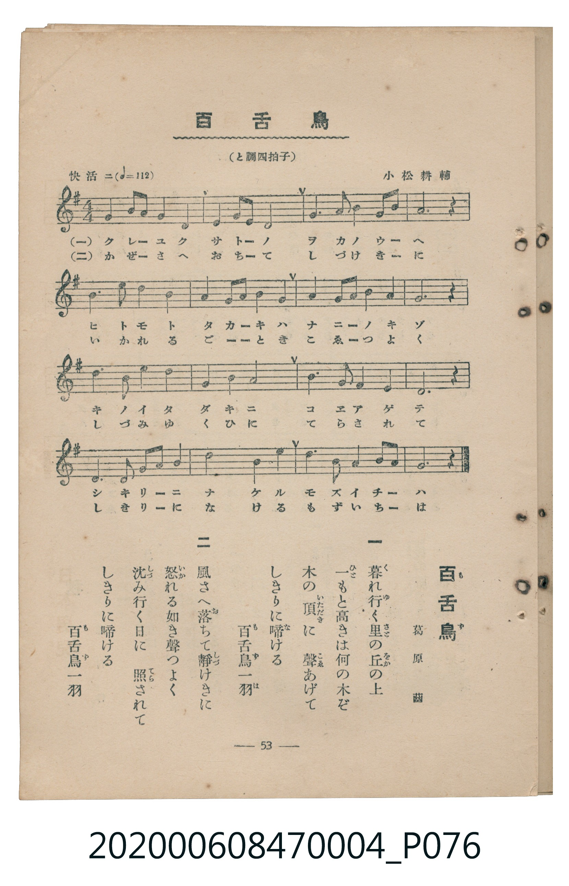

# 百舌鳥

> Re:Shōka 使用 AI 協助辨識與重建樂譜，可能會有錯誤。歡迎回報。

- **鋼琴伴奏版**：<br><audio controls src="mozu.mp3"></audio>
- **NEUTRINO 歌聲合成版**：<br><audio controls src="mozu_neutrino.mp3"></audio>

- 詞：葛原𦱳
- 曲：小松耕輔
- 臺灣教育會公認《新定兒童唱歌》尋常科第四學年用（2020.006.0847.0004）

## 說明

原書資訊與歌詞全文（對應 P076.jpg，書頁 p. 53，參考教材第 17 首）：
調性與拍號：と調四拍子（G 大調 4/4 拍）
速度指示：快活ニ（♩=112）


## 歌詞

```text
一
暮（く）れ行（ゆ）く里（さと）の丘（をか）の上（うへ）
一（ひと）もと高（たか）きは何（なに）の木（き）ぞ
木の頂（いたゞき）に　聲（こゑ）あげて
しきりに啼（な）ける　百舌鳥（もず）一羽（いちは）

二
風（かぜ）さへ落（お）ちて靜（しづ）けきに
怒（いか）れる如（ごと）き聲つよく
沈（しづ）み行く日（ひ）に　照（てら）されて
しきりに啼ける　百舌鳥一羽
```

## ABC

<div class="abc-score" data-abc-src="mozu.abc" aria-label="五線譜載入中"></div>

[下載 ABC 原始檔](mozu.abc)

## TMD 檔案連結

- [主旋律 TMD 檔案](mozu.tmd) [[在 TMD Studio 編輯](https://tmdlang.github.io/Tmd-TS/#tmd=s7IKdvYPcrWy4qpTUCpJTLdSSM7PyUlNLsnMz7MqzsjMK0nNjM_KTMmPL87Iz05Ugisry88pzU21Si9KTEmNN4k3MjAyiDcwMIs3sDAxBzIMTBBKi_NLi5JTrYqTM_Lzc-JLUitKkvLzsxHyBUX5Zal5iXlANQVFIBtTwIoQClLLMlNSQdKpKZkl-UWZiTlI7kgtKga7FWxJfElRYl5xclFmAcgDCFX5RSUZ-UC3FmRUWmVkFoMMSU7Mic9OzEPyUklGKtBHiXmZucgWAJWmZ-ZZlSRmAkMAFArlifG5iZl5OYl5Keh-jC9ITE-1CjAwN1Pi0tJSeD5z34uOnpeblypoaXEp2ioYGhpx2dsquHPZmOib2IH0vlg57_2eWS8mzn7aN__Dso2bwQY-m70JKPh0Q_-zufteNEx9sWcKWPhF-67njYufTZ35omnTsznNT1vXvFjV-7ih69m0DU_XzXraOun56qVPp2x8trbncUP30w3dT3fseL584vM1a57Onv107Y6nO7c8n7Li_Z4OUFTpAaNKDxRVQIaByfs9nUpcXPpaCrbUAlwKCgpALz2bvePF5vYXK7pedLQD3QX07dPWFc-mtQNd8XRD77P2TgVQWOllFaS_39MDVPxyQaNCgZ6CqTGQ-7S_-UVDM9C7z-ZOAHpCwdBc4eWyaUCnAsMGZPyLVfufNSwHGdzd-2LmfKDo48YVQEGgb4EiT9dOAFrirvB0yXKgmAIwvBWAokDdIK0vG-Y_3bXsWU_78yW7QCG9f_WzLbsfN3cDdTyaudIWGE0ghSCVT3Y0gKhns9YB5R439gPFHzf1vFjYA-I2tYG4jf0v28HcxqlAB4BF1j3ZMQOsYNLjRqChEJEusJq2x407oK4Amg0W2gTV1tQEZLxcDdbZOB-ms_dx4_one6eCBVc9blwNMe7ZHFBMAmXB3HlgN85ZAZR4uaAJLNECMqJpHkzF6scNDS8agckKKDX5cdNEsCDQPqADl4E0P26cDrKqqQuo9OnUPRDbwIomPm7qBmqGJ2Wwv4A6ZwFlgT54vm8vzL6FQJfCw21XDzigF0Gc2f24cQ7YNGAQ7XgxAaIFGCBAEaCuZS_nAmWBIkA3AM0HWwry92qwtxomwSwAB0hTD9BBT5dBfDkFFuK9QM89blzyuAkUSWBtmzpQjdwPjDSg3LPpYB-AggIaLM9bl4NFlj1uAiYtsBuBdmANFszQgIQASCnleQYKFLT0ubh886tKrQIyE_PyHWoMaqpBFijYWGjZgRnYMqoCMIsAHQP0pIKGiQKw7Hi-vkEHnrs0sWgAWgM1TAOoUdNK4XHTeoXHzWuAeA8QLwPza4DkViCvAyraBxJp3gQUXQ3mPW4CqgPKgERnKBigGLqrB2RoYzcQz4Fob5wKxDtAihu7gHghVHQZWGQ6EC8F4olA3AsztHE1wtAaBUMFXQVjBSMwbRoPJGoUzECUIYgCC4AgRJ0uUJ0xWM4YKGIElQNBA5AasIk-hiD_rQfyQf4GkctAJFgE4nOQWAeY7IObDvI_iAULAxALpA8SBljtMQJ5pRukEhgUIHIqmNwB0QUMDBBvIZgEmQS1BxgkYHugwQJi9UJlVmPYgz9l7AKVWeSnjOZJ0DSwCEyDwmY_1P_ACGxaC6T7wf4HRmszMMKhaQUkA1K7D3vKaIGkjqYeIO4Ge2sKVCsoVawAexckOhkoD0wVYNElQDbYAY39yCkDFNO6CmYKpuAUAgojUIwbwtMAugiIDUsnWFMF0MfgsIf6GpYOID6HxD2IXAuW6YfGPjgegf6HpReIPCQEcKeLFmgsQ4ICpAtkAiQ4IDpAgYEc-5PBqiApYgmYDXUbMFBISxc7OikrMUAxD4pnULTsB4dBA1QUHKFNm4EYGJFNwHTTtAks34Y9LcByPyhZtUG9AiylwUkdxAMVR52QEgQYSBARpPgHxTso5s2AJIgNKysgMQ3JT5A0YqhgDioowOUGUB-s0MBWMIAiDxKVIA-CghkU9RBPIiIfFFnQDAv0LqRggHgZxAIVFRBv404AyNkckrhAqmHRCQoFEAnL8hC_Q-yBhAiIBUo4CBmiEwCwsURZAtgOje5V0JwLjnZQMdC0EUiD4w5UaDTtgiSS5kZ4dYGUf9ETArD4bwKVJKAMD4l-oPGgigFSTDQ1AXmzoAUIpBIBqVmPkiAgEQukYFkelkggyQKUUBDJBpRIQCTeIgHoV0ioQ_wLi3tYxofIbQSLg-IK4nOIKMT3IJlGqAxmRsVMD5BggMU9JBhgBQI488MKCmCAQEQhgQKrTCCBgm5PLReXrp0CqIGhAKSVuQA)]
- [鋼琴伴奏 TMD 檔案](mozu_piano.tmd) [[在 TMD Studio 編輯](https://tmdlang.github.io/Tmd-TS/#tmd=s7IKdvYPcrWy4qpTUCpJTLdSyC8qychPL0osyKi0ysgsLskvykxOzInPTsxLVIIrKs4vLUpOjS9ITE-1CjAwN1Pi0tJSeD5z34uOnpebl77f0_Gye8_zCVue7NnydGn_886O93s6FbS0uBRtFQwNjbjsbRXcuWxM9E3sQAa-WDnv_Z5ZLybOfto3_8OyjZvBtjybvQko-HRD_7O5-140TH2xZwpY-EX7rueNi59NnfmiadOzOc1PW9e8WNX7uKHr2bQNT9fNeto66fnqpU-nbHy2tudxQ_fTDd1Pd-x4vnzi8zVrns6e_XTtjqc7tzyfsgLoPCMDIwM9AwMzPQMLE3Mgw8AE6EIlLi7f_KpSq4DMxLz8IA-HGoOaai4FILCx0LIDM_S1FGzRgQLQ9Cc7Gl4s7FHQMFEAuvj5-gYdBVCg6GUVpGti0aClDzasRsFQQVfBWMEITJvGA4kaBTMQZQiiwAIgCFGnC1RnDJYzBooYQeVA0ACkBmyij2GNwuOm9UD-4-Y1YHIZiASLgGS2gsU6wGQf3PTHzZvArMdNq6Hij5tA-kAyM7DbYwSUa-wGqWycAyangskdEF2NXWDeQjAJMglqT-N0iD2NS4F4IpjVC5VZjWEP_vDe1UNOeIPCT1fBTMEUHO4gm0HhaAgPWXQREBsW-ljDunkSxEfAMH3cvAgeuqCw3g8NURC5FizTDw1TcOg0g0MPGtogeZCefXhCuwUadt1AdT1gXSATQDJToDoeN65ACdPJYFWQcF4CZkPd1ghyCSmhvaOTnNAGhTIonM2AJIgNS--QcIWkCUiMGCqYgxI7OO0D9cESPrbEDQoqSMA9boJ4ChTQoGBtQApqUNBAE13TZoiOphVADI6iJlByB-lowxPcyEkVEpUg1bDAe9wIMgORbEHikIT-uKkTlh3A0YSQITq4gUUVWcENCTYgBUu-sCiABDooGhCRAooCEIk3eTdth_ppLTC0VsFDFpaIIXIbweKgkACJg0IYJLoLFj_NjVAZzESHGdq9QF2QwgNqXiPIVogcOCHDEn1TE1R0FjRrQIobkA5QYYdqTy1yue6DXK6bQMt1YCjEK0QbxsIoUDkMZJnF58YCAxTIMo0HCQJlQcELUwOXATEMoB4CqwLpRlGGrg3KhxsLtRvFEJCYCUwTlI_qGJiIUTxu18CF4fZDGQgfopgFdBm6i4Dhp2unAArCaB-gKJxtBGYrcwEA)]

## 分析

```text
================================================================================
📊 TMD Song Profile: [ 百舌鳥 ]
================================================================================
⏱  Duration:       0:34 (34.3s), 16 measures total
🎼 Key & Tempo:    首調基準 G, != 112.0 BPM, <4/4>
   - 分析範圍：      由實際發聲的音符與和弦推測調性；播放脈絡另行呈現
🎤 人聲音域:    D4 (MIDI 62) – E5 (MIDI 76) [跨度: 14 個半音 / 1.2 個八度, 難度: moderate]
   - 最低音:  D4 in [Mozu #1 @ m.1, 0:01]
   - 最高音: E5 in [Mozu #1 @ m.5, 0:09]
   - 適合: soprano, mezzo-soprano, contralto, tenor, baritone, bass
🏛  結構:      Mozu (34.3s)
⚡ 編曲密度:        Peak 1 軌道同時演奏
🗝  調性診斷：       G 大調（純淨自然大調，未偵測到可信轉調）
   - 風格氣質:    純淨自然大調（陽光明朗、易唱易記，無明顯調外色彩）
   - 轉調歷程:    全曲維持單一推測調性（未偵測到可信轉調）
   - 核心骨幹音:  D, G, B, A, E
   - 調性數值:    G 大調 [相關度: 0.84, 穩定度: Moderate, 自然音純度: 100.0%]
   - 候選調性 (K-S): G 大調 (0.84), D 大調 (0.80), B 小調 (0.67)
   - 五度圈歷程:   +1
   - 各段落調性細節:
     • [Mozu #1]: G 大調 (r: 0.84, 自然音純度: 100.0%)

  [ 五度圈游移軌跡 ]
               C  
         F           [G ]*
      Bb               D  
      Eb               A  
         Ab           E  
            Db       B  
               F# 
     (* = active key center)

  [ 十二半音累積音高分佈 ]
     C  :                            0.0%
     C# :                            0.0%
     D  : ████████████████████████  25.0%
     D# :                            0.0%
     E  : ████████                   8.3%
     F  :                            0.0%
     F# : ██                         1.7%
     G  : ███████████████████████   24.2%
     G# :                            0.0%
     A  : ███████████████████       20.0%
     A# :                            0.0%
     B  : ████████████████████      20.8%
--------------------------------------------------------------------------------
Assignment 軌道音域：
  - Piano         : D4 – E5 (14 個半音 / 1.2 個八度, 56 個音符)
================================================================================
```


## 原書掃描頁




