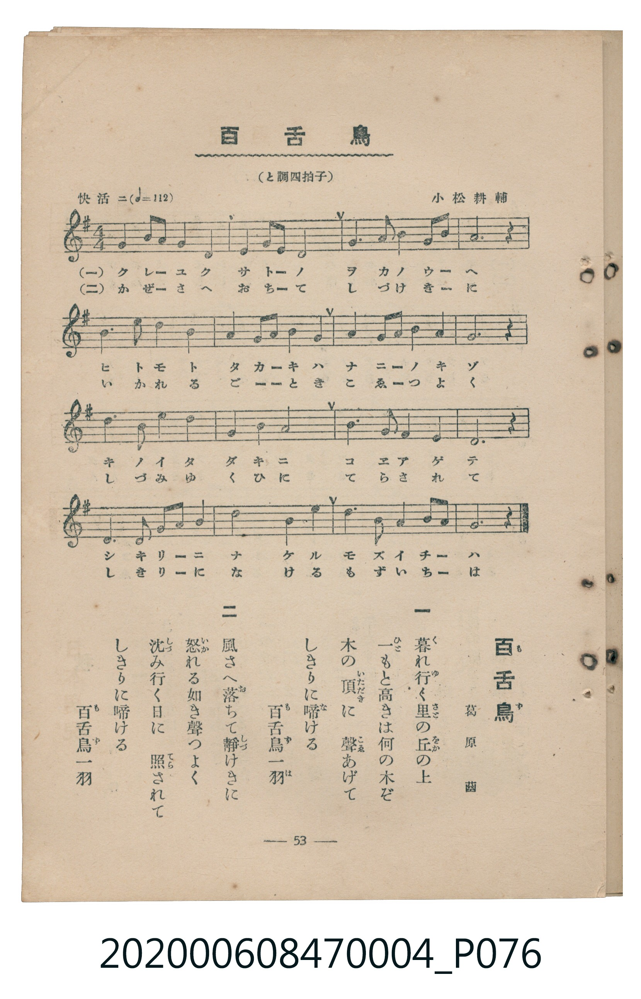

# 百舌鳥

<audio controls src="mozu.mp3"></audio>

- 詞：葛原しげる
- 曲：小松耕輔
- 臺灣教育會公認《新定兒童唱歌》尋常科第四學年用（2020.006.0847.0004）

## 說明

原書資訊與歌詞全文（對應 P076.jpg，書頁 p. 53，參考教材第 17 首）：
調性與拍號：と調四拍子（G 大調 4/4 拍）
速度指示：快活ニ（♩=112）

## 歌詞

```text
一
暮（く）れ行（ゆ）く里（さと）の丘（をか）の上（うへ）
一（ひと）もと高（たか）きは何（なに）の木（き）ぞ
木の頂（いたゞき）に　聲（こゑ）あげて
しきりに啼（な）ける　百舌鳥（もず）一羽（いちは）

二
風（かぜ）さへ落（お）ちて靜（しづ）けきに
怒（いか）れる如（ごと）き聲つよく
沈（しづ）み行く日（ひ）に　照（てら）されて
しきりに啼ける　百舌鳥一羽
```

## ABC

```abc
X:1
T:百舌鳥
C:曲：小松耕輔
M:4/4
L:1/16
Q:1/4=112
K:G
V:V1 name="Piano" snm="Pia"
[V:V1]
G4 B3 A G4 E4 | G4 A3 G E8 | G6 A2 B4 d3 e | A12 z4 |
B6 d2 e4 d4 | B4 d3 e d4 B4 | A4 B3 A G4 E4 | G12 z4 |
d6 e2 d4 B4 | A4 B4 d8 | B6 d2 A4 G4 | E12 z4 |
D6 G2 B4 A4 | B8 d4 B4 | e6 d2 B4 A3 B | G12 z4 |
```

## TMD 檔案連結

- [主旋律 TMD 檔案](mozu.tmd)
- [鋼琴伴奏 TMD 檔案](mozu_piano.tmd)

## 分析

```text
================================================================================
📊 TMD Song Profile: [ 百舌鳥 ]
================================================================================
⏱  Duration:       0:34 (34.3s), 16 measures total
🎼 Key & Tempo:    首調基準 G, != 112.0 BPM, <4/4>
   - 分析範圍：      由實際發聲的音符與和弦推測調性；播放脈絡另行呈現
🎤 人聲音域:    D4 (MIDI 62) – E5 (MIDI 76) [跨度: 14 個半音 / 1.2 個八度, 難度: moderate]
   - 最低音:  D4 in [Mozu #1 @ m.13, 0:25]
   - 最高音: E5 in [Mozu #1 @ m.3, 0:06]
   - 適合: soprano, mezzo-soprano, contralto, tenor, baritone, bass
🏛  結構:      Mozu (34.3s)
⚡ 編曲密度:        Peak 1 軌道同時演奏
🗝  調性診斷：       G 大調（純淨自然大調，未偵測到可信轉調）
   - 風格氣質:    純淨自然大調（陽光明朗、易唱易記，無明顯調外色彩）
   - 轉調歷程:    全曲維持單一推測調性（未偵測到可信轉調）
   - 核心骨幹音:  B, G, D, E, A
   - 調性數值:    G 大調 [相關度: 0.80, 穩定度: Moderate, 自然音純度: 100.0%]
   - 候選調性 (K-S): G 大調 (0.80), E 小調 (0.70), B 小調 (0.68)
   - 五度圈歷程:   +1
   - 各段落調性細節:
     • [Mozu #1]: G 大調 (r: 0.80, 自然音純度: 100.0%)

  [ 五度圈游移軌跡 ]
               C  
         F           [G ]*
      Bb               D  
      Eb               A  
         Ab           E  
            Db       B  
               F# 
     (* = active key center)

  [ 十二半音累積音高分佈 ]
     C  :                            0.0%
     C# :                            0.0%
     D  : ████████████████████      20.0%
     D# :                            0.0%
     E  : █████████████████         17.5%
     F  :                            0.0%
     F# :                            0.0%
     G  : ██████████████████████    22.1%
     G# :                            0.0%
     A  : ███████████████           15.8%
     A# :                            0.0%
     B  : ████████████████████████  24.6%
--------------------------------------------------------------------------------
Assignment 軌道音域：
  - Piano         : D4 – E5 (14 個半音 / 1.2 個八度, 55 個音符)
================================================================================
```


## 原書掃描頁




