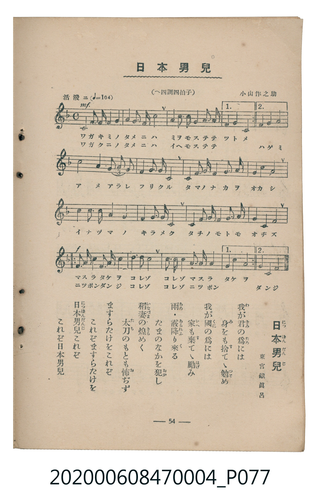

# 日本男兒

> Re:Shōka 使用 AI 協助辨識與重建樂譜，可能會有錯誤。歡迎回報。

- **鋼琴伴奏版**：<br><audio controls src="nihon_danji.mp3"></audio>
- **NEUTRINO 歌聲合成版**：<br><audio controls src="nihon_danji_neutrino.mp3"></audio>

- 曲：小山作之助／詞：東宮鐵眞呂
- 臺灣教育會公認《新定兒童唱歌》尋常科第四學年用（2020.006.0847.0004）

## 說明

原書資訊與歌詞全文（對應 P077.jpg，書頁 p. 54，參考教材第 18 首）：
調性與拍號：へ四調四拍子（F 大調 4/4 拍，原書誤植「へ調」為「へ四調」）
速度指示：活潑ニ（♩=104）


## 歌詞

```text
我が君（きみ）の爲（ため）には
身（み）をも捨（す）てゝ勉（つと）め
我が國（くに）の爲には
家（いへ）も棄（す）てゝ勵（はげ）み
雨（あめ）・霰（あられ）降（ふ）り來（く）る
たまのなかを犯（おか）し
稻妻（いなづま）の煌（きら）めく
太刀（たち）のもとも怖（お）ぢず
ますらたけをこれぞ
これぞますらたけを
日本男兒（につぽんだんじ）これぞ
これぞ日本男兒
```

## ABC

<div class="abc-score" data-abc-src="nihon_danji.abc" aria-label="五線譜載入中"></div>

[下載 ABC 原始檔](nihon_danji.abc)

## TMD 檔案連結

- [主旋律 TMD 檔案](nihon_danji.tmd) [[在 TMD Studio 編輯](https://tmdlang.github.io/Tmd-TS/#tmd=s7IKdvYPcrWy4qpTUCpJTLdSSM7PyUlNLsnMz7MqzsjMK0nNjM_KTMmPL87Iz05Ugisry88pzU21Si9KTEmNN4k3MjAyiDcwMIs3sDAxBzIMTBBKi_NLi5JTrYqTM_Lzc-JLUitKkvLzsxHyBUX5Zal5iXlANQVFIBtTwIoQClLLMlNSQdKpKZkl-UWZiTlI7kgtKga7FWxJfElRYl5xclFmAcgDCFX5RSUZ-UC3FmRUWmVkFoMMSU7Mic9OzEPyUklGKtBHuZk5mSWJRZXImjPTM_OsclMzszKxOB9qc0FieqpVgIG5uRKXlpbCs-lLn81Z83zK9qetkxS0tLgUbRUMDUy47G0V3LhsTPRN7EDan83e9H7PrKcb-p9u3Phk75wnO7ufdq18v6f_xcp5QPFnczc-Xbfu5YStz-fMezqxCWzhi_ZdzxsXP5s680XTpmdzmp-2rnmxqvdxQ9ezaRuerpsFtOv56qVPp2x8trbncUP30w3dT3fseL584vM1a57Onv107Y6nO7c8n7Li_Z4OUHTpAaNLDxRdQIaByfs9nUpcXPpaCrbUAlwKCgpP--Y_m73jxeb2Fyu6XnS0A90F9NvT1hXPprUDXfF0Q--z9k4FUKDpZRWkv9_TA1T8ckGjQoGeginQRT1P-5tfNDQDvfts7gSgJxQMLRReLpsGdCoweEDGv1i1_1nDcpDB3b0vZs4Hij5u3AH0KlAcSAIFn66dALTHTeHpkuVAMQVgwCsARUEmQxy2asmzJcDw6wFqA8o_buh93rQLwoWYAhQB2gay6mXD_Ke7lj3raX--ZBcocrbsfrZ34uPmbqDxj2autAVGLkghSOWzjomPG3ueTpgNlHrc2Pu4cT9Q5nHjuucdwNgGisx_3NQIFln9uHE9SAPQH7tWg6XAKpsmPW5qetYLiqbHjTPBKpc9bpr7tBvoa6DIkseNQCmgskYky-aA3PG4sR9oKNwyZAuertsGVtAC9BlYc9OzxS0YFmwFi6x_3DgJLLgf7O_ZEIc0QV3dvPvlnA0wEaBBPUDBlzOBoQQUAeoHinQ92dcGcQ2Y2w1xAcjfjfuALnvcuOpxYzfQl8-71oOVdQG5YPumg1Q-X7H76bLdMMcClS4FaoP6qRVoGThIm4BBAQoBoB1Q_y1Z9bSjARq8jQsh6oG-BIYVyK8NwDQDsgksvuhxIzjxgJ0zE-QJkJ6JoHBvnAz00OPGeTAnQ7mYKsFBj5TFwcYDgxsYOXsfN01-3LgATM4AW4jdUGTtICnKMxwUKGjpc3H5ZWbk57kk5mVlWgVkJublO9QY1FSDXWBjaKZlB2YBM7uhnsLj5vUKj5vWAPFaIHs-EPcp1AB5-4GshUDcDcT9IBGw3CYgXgSU3Qmk28AYJNMCxB1g9RqGepogB4DMr1Gozk2rVTCNV9AFQ0MoCaF1FYygdI2CMYqIoYIplA-DNWDzfEBWrYcKgZwMoSHOhooCHQ8zFOQFmOhCKA3xDDbDEY6AWG4Kdx5E3BioAt3hcJ9hcSfCRZugNCTYYKJtcBoSgDDxDjQ3oxsOjDQj5EgD0mBf4Yi0piVA1gyskdYPFAFF53wFDSPkSKN1fEFcPBDxBdOB6UxgMMGsngGl8UUXzEmgAISpgEU4wnBYfD1uApoFihYwvRKI14BNmQrEq6ABshoeffPAgfK4uQvIXw1OPiAZkDogr2k7UjyhWQjznYYRkGmkqaqhCwSaGMFghC_ZAl2IKoVIhhpIzgeZCnI_TM0qaGhAfILNcIxkZYTmLFB8wfMVmo-wuBORVOZBaUiYweIF4gpE6KGKg1jbMQxHxBco0wDDv7kVHh8gU0AFDcj7oJhcD4-vRqjdoMABlYGLYPHV3ASkd2HGFyy9omYiUA4gJaIQCRbiaZhjYaLI-WotXHQllIZ4AZvhpEUUqlKsDkXEVCPcaaBQgolCCjxEuMHEm2AsYBiiG45SfQEjCFyyAaMGFCFNG-HRvhmc1R437UPjIeuBRiNUF1r1Bay9ID4zhsceOr9GwQzJaSA2nsIQmlahVsP8BwkhmBMQ0bYZyRCQ00Fq9mE1HJa4TNGyjjE8kZGUuSAWw0IL5gBsjkeJYKAHYGph3kA1HFZ3gUp1UJNh7uNmUKQ0ADGQbtpBINJQtIGCE6ERtQajapxBqiokm2F-bIDSEBfQPNqIyGrY4w2HByABCFME9xbcKwjza7m4dO0UEC1KBSBPmQsA)]
- [鋼琴伴奏 TMD 檔案](nihon_danji_piano.tmd) [[在 TMD Studio 編輯](https://tmdlang.github.io/Tmd-TS/#tmd=s7IKdvYPcrWy4qpTUCpJTLdSyC8qychPL0osyKi0ysgsLskvykxOzInPTsxLVIIrKs4vLUpOjS9ITE-1CjAwN1fi0tJSeDZ96bM5a55P2f60ddL7PR0vu_c8n7DlyZ4tT5f2P-_seL-nU0FLi0vRVsHQwITL3lbBjcvGRN_EDmTms9mb3u-Z9XRD_9ONG5_snfNkZ_fTrpXv9_S_WDkPKP5s7san69a9nLD1-Zx5Tyc2gV3xon3X88bFz6bOfNG06dmc5qeta16s6n3c0PVs2oan62YBHfB89dKnUzY-W9vzuKH76Ybupzt2PF8-8fmaNU9nz366dsfTnVueT1kBdKSRgZGBnoGBmZ6BhYk5kGFgAnSnEheXX2ZGfp5LYl5WplVAZmJefpCHQ41BTTWXAhDYGJpp2YFZNQrVuWm1CqbxCrpgaAglIbSughGUrlEwRhExVDCF8mGwBmyeT43C4-b1UKHHTWug9Fqg6HyYaHMf3NDHTfvhoguhdDcQ92M1HOEIiOWmcOdBxI2BKtAdDvcZFnciXLQJSi8CumgnXLQNToNUt8DFO9DcjOlOWofnenA4DUR4wnRgOrNpCdzqGVAaX3DCnPS4CRL4IBlYhCAMh4UnmgTMFRpGQKaRpqqGLhBoYjjXCF_0Ny1Ck0JEpwZI8nHzSiBeAzL1cfNUuJpVUFeDomA1VsMxot8IzVmgcIWnTzQfYXEnIkrnQek-IO6CiTZBXAFKxCDVEPchxEGs7RiGo4UrLP5REyUoRZESoIgEAHHc4-ZWuKPR0-lauOhKKL0QHKjYDCctQFGVYnUoIkQb4U4DpVaYKCSDg0RQQrS5CcZq2oVhOKw4BZamEJuN4aGLzq9RMEPSCmLjyfzQOAfmI1hQgXgQHzxu2ggvvCDBuhnJEGDiBavZh9VwWOSboiVBY3giICmRQiwGWYmwELvjUSIA6AGYWpg30J1J1dCEFJqgwvxx89zHzbDgetzcAKU3A920A8mlNApQIhIp9hDF4QGQ3yBegHgCyoJ7BWF-LWbTwAe5aWCCaBkUAJNyvEK0YSyYMo2PBcUGlAWVgEcShGsaDxVWMAGxQApBQgbo6igwDygDMo488-CmgIoUuFbqmYfpwOpc1FBEeMYEp6lwdWhuxK6IJMOQHAhMCLp2Coi0oADkKXMBAA)]

## 分析

```text
================================================================================
📊 TMD Song Profile: [ 日本男兒 ]
================================================================================
⏱  Duration:       0:55 (55.4s), 24 measures total
🎼 Key & Tempo:    首調基準 F, != 104.0 BPM, <4/4>
   - 分析範圍：      由實際發聲的音符與和弦推測調性；播放脈絡另行呈現
🎤 人聲音域:    C4 (MIDI 60) – D5 (MIDI 74) [跨度: 14 個半音 / 1.2 個八度, 難度: moderate]
   - 最低音:  C4 in [NihonDanji #1 @ m.1, 0:00]
   - 最高音: D5 in [NihonDanji #1 @ m.18, 0:39]
   - 適合: soprano, mezzo-soprano, contralto, tenor, baritone, bass
🏛  結構:      NihonDanji (55.4s)
⚡ 編曲密度:        Peak 1 軌道同時演奏
🗝  調性診斷：       C 大調（純淨自然大調，未偵測到可信轉調）
   - 風格氣質:    純淨自然大調（陽光明朗、易唱易記，無明顯調外色彩）
   - 轉調歷程:    全曲維持單一推測調性（未偵測到可信轉調）
   - 核心骨幹音:  C, A, F, G, D
   - 調性數值:    C 大調 [相關度: 0.85, 穩定度: Moderate, 自然音純度: 100.0%]
   - 候選調性 (K-S): C 大調 (0.85), F 大調 (0.77), A 小調 (0.69)
   - 五度圈歷程:   +0
   - 各段落調性細節:
     • [NihonDanji #1]: C 大調 (r: 0.85, 自然音純度: 100.0%)

  [ 五度圈游移軌跡 ]
              [C ]*
         F            G  
      Bb               D  
      Eb               A  
         Ab           E  
            Db       B  
               F# 
     (* = active key center)

  [ 十二半音累積音高分佈 ]
     C  : ████████████████████████  37.5%
     C# :                            0.0%
     D  : ███                        4.2%
     D# :                            0.0%
     E  :                            0.0%
     F  : █████████████             19.8%
     F# :                            0.0%
     G  : ███████████               17.9%
     G# :                            0.0%
     A  : █████████████             20.7%
     A# :                            0.0%
     B  :                            0.0%
--------------------------------------------------------------------------------
Assignment 軌道音域：
  - Piano         : C4 – D5 (14 個半音 / 1.2 個八度, 108 個音符)
================================================================================
```


## 原書掃描頁




