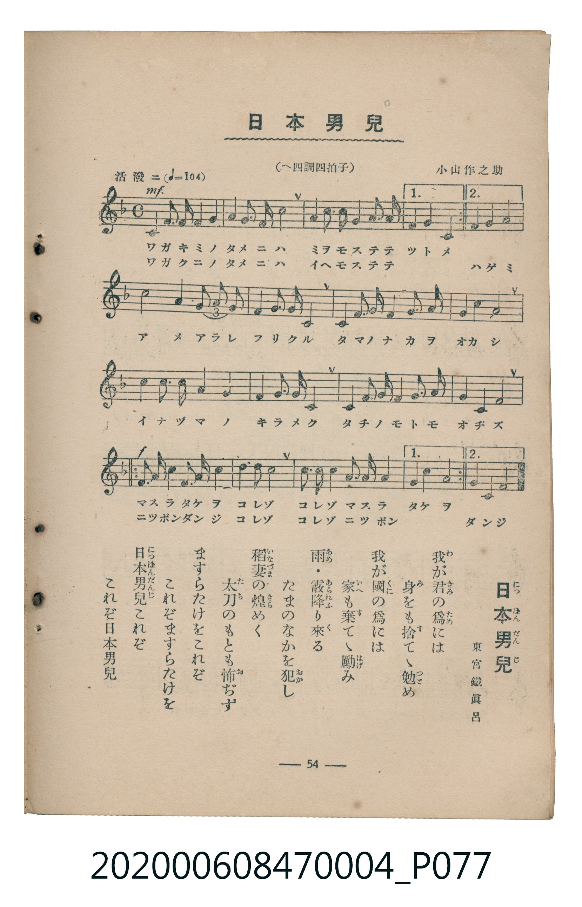

# 日本男兒

> Re:Shōka 使用 AI 協助辨識與重建樂譜，可能會有錯誤。歡迎回報。

<audio controls src="nihon_danji.mp3"></audio>

- 曲：小山作之助／詞：東宮鐵眞呂
- 臺灣教育會公認《新定兒童唱歌》尋常科第四學年用（2020.006.0847.0004）

## 說明

原書資訊與歌詞全文（對應 P077.jpg，書頁 p. 54，參考教材第 18 首）：
調性與拍號：へ四調四拍子（F 大調 4/4 拍，原書誤植「へ調」為「へ四調」）
速度指示：活潑ニ（♩=104）

## 跨冊／重複收錄參照

> 同名異曲（各冊收錄之不同詞曲版本）

- **[同名異曲]** 《新定兒童唱歌》高等科男子用（2020.006.0848）：[**〈日本男兒〉**](../../koto_boys_2020.006.0848/1_2_08_nihon_danji/index.md)（`G` / `4/4` — [原始 TMD](../../koto_boys_2020.006.0848/1_2_08_nihon_danji/nihon_danji.tmd)）
- 總表：[跨冊重複與同名歌曲總索引](../../../duplicate_songs.md)

## 歌詞

```text
我が君（きみ）の爲（ため）には
身（み）をも捨（す）てゝ勉（つと）め
我が國（くに）の爲には
家（いへ）も棄（す）てゝ勵（はげ）み
雨（あめ）・霰（あられ）降（ふ）り來（く）る
たまのなかを犯（おか）し
稻妻（いなづま）の煌（きら）めく
太刀（たち）のもとも怖（お）ぢず
ますらたけをこれぞ
これぞますらたけを
日本男兒（につぽんだんじ）これぞ
これぞ日本男兒
```

## ABC

```abc
X:1
T:日本男兒
C:曲：小山作之助／詞：東宮鐵眞呂
M:4/4
L:1/16
Q:1/4=104
K:F
V:V1 name="Piano" snm="Pia"
[V:V1]
!mf! C4 F3 F F4 G4 | A4 G3 F c8 | A4 c3 c G4 A3 A | F4 G4 C8 |
w: ワ ガ キ ミ ノ | タ メ ニ ハ | ミ ヲ モ ス テ テ | ツ ト メ
C4 F3 F F4 G4 | A4 G3 F c8 | A4 c3 c G4 A3 A | F4 G4 A8 |
w: ワ ガ ク ニ ノ | タ メ ニ ハ | イ ヘ モ ス テ テ | ハ ゲ ミ
c8 A4 G4/3 A4/3 G4/3 | F4 G3 G C8 | C4 F3 G F4 G3 A | G4 c4 A8 |
w: ア メ ア ラ レ | フ リ ク ル | タ マ ノ ナ カ ヲ | オ カ シ
c4 c3 c A4 G4 | F4 G3 G C8 | C4 F3 G F4 G3 A | G4 C4 F8 |
w: イ ナ ヅ マ ノ | キ ラ メ ク | タ チ ノ モ ト モ | オ ヂ ズ
!f! F3 A c4 F3 A c4 | d6 d2 c8 | c3 c c4 A3 A A4 | G4 c4 A8 |
w: マ ス ラ タ ケ ヲ | コ レ ゾ | コ レ ゾ マ ス ラ | タ ケ ヲ
F3 A c4 F3 A c4 | d6 d2 c8 | c3 c c4 A3 A A4 | G4 C4 F8 |
w: ニ ツ ポン ダ ン ジ | コ レ ゾ | コ レ ゾ ニ ツ ポン | ダ ン ジ
```

## TMD 檔案連結

- [主旋律 TMD 檔案](nihon_danji.tmd) [[在 TMD Studio 編輯](https://tmdlang.github.io/Tmd-TS/#tmd=s7IKdvYPcrWy4qpTUCpJTLdSSM7PyUlNLsnMz7MqzsjMK0nNjM_KTMmPL87Iz05Ugisry88pzU21Si9KTEmNN4k3MjAyiDcwMIs3sDAxBzIMTBBKi_NLi5JTrYqTM_Lzc-JLUitKkvLzsxHyBUX5Zal5iXlANQVFIBtTwIoQClLLMlNSQdKpKZkl-UWZiTlI7kgtKga7FWxJfElRYl5xclFmAcgDCFX5RSUZ-UC3FmRUWmVkFoMMSU7Mic9OzEPyUklGKtBHuZk5mSWJRZVKXFpaCs-mL302Z83zKduftk5S0NLiUrRVMDQw4bK3VXDjsjHRN7EDaX42e9P7PbOebuh_unHjk71znuzsftq18v2e_hcr5wHFn83d-HTdupcTtj6fM-_pxCawdS_adz1vXPxs6swXTZuezWl-2rrmxarexw1dz6ZteLpuFtCu56uXPp2y8dnanscN3U83dD_dseP58onP16x5Onv207U7nu7c8nzKivd7OkChrgcMdT1QqAMZBibv93QqcXHpaynYUgtwKSgoPO2b_2z2jheb21-s6HrR0Q50F9BvT1tXPJvWDnTF0w29z9o7FQIMzM31sgrS3-_pASp-uaBRoUBPwRToop6n_c0vGpqB3n02dwLQEwqGFgovl00DOhUYPCDjX6za_6xhOcjg7t4XM-cDRR837gB6FSgOJIGCT9dOANrjpvB0yXKgmAIw4BWAoiCTIQ5bteTZEmD49QC1AeUfN_Q-b9oF4UJMAYoAbQNZ9bJh_tNdy571tD9fsgsUOVt2P9s78XFzN9D4RzNX2gIjF6QQpPJZx8THjT1PJ8wGSj1u7H3cuB8o87hx3fMOYGwDReY_bmoEi6x-3LgepAHoj12rwVJglU2THjc1PesFRdPjxplglcseN8192g30NVBkyeNGoBRQWSOSZXNA7njc2A80FG4ZsgVP120DK2gB-gysuenZ4hYMC7aCRdY_bpwEFtwP9vdsiEOaoK5u3v1yzgaYCNCgHqDgy5nAUAKKAPUDRbqe7GuDuAbM7Ya4AOTvxn1Alz1uXPW4sRvoy-dd68HKuoBcsH3TQSqfr9j9dNlumGOBSpcCtUH91Aq0DBykTcCgAIUA0A6o_5asetrRAA3exoUQ9UBfAsMK5NcGYJoB2QQWX_S4EZx4wM6ZCfIESM9EULg3TgZ66HHjPJiToVxMleCgR8riYOOBwQ2MnL2PmyY_blwAJmeALcRuKLJ2kBTlGQ4KFLT0ubj8MjPy81wS87IyrQIyE_PyHWoMaqrBLrAxNNOyA7OAmd1QT-Fx83qFx01rgHgtkD0fiPsUaoC8_UDWQiDuBuJ-kAhYbhMQLwLK7gTSbWAMkmkB4g6weg1DPU2QA0Dm1yhU56bVKpjGK-iCoSGUhNC6CkZQukbBGEXEUMEUyofBGrB5PiCr1kOFQE6G0BBnQ0WBjocZCvICTHQhlIZ4BpvhCEdALDeFOw8ibgxUge5wuM-wuBPhok1QGhJsMNE2OA0JQJh4B5qb0Q0HRpoRcqQBabCvcERa0xIgawbWSOsHioCic76ChhFypNE6viAuHoj4gunAdCYwmGBWz4DS-KIL5iRQAMJUwCIcYTgsvh43Ac0CRQuYXgnEa8CmTAXiVdAAWQ2PvnngQHnc3AXkrwYnH5AMSB2Q17QdKZ7QLIT5TsMIyDTSVNXQBQJNjGAwwpdsgS5ElUIkQw0k54NMBbkfpmYVNDQgPsFmOEayMkJzFii-4PkKzUdY3IlIKvOgNCTMYPECcQUi9FDFQaztGIYj4guUaYDh39wKjw-QKaCCBuR9UEyuh8dXI9RuUOCAysBFsPhqbgLSuzDjC5ZeUTMRKAeQElGIBAvxNMyxMFHkfLUWLroSSkO8gM1w0iIKVSlWhyJiqhHuNFAowUQhBR4i3GDiTTAWMAzRDUepvoARBC7ZgFEDipCmjfBo3wzOao-b9qHxkPVAoxGqC636AtZeEJ8Zw2MPnV-jYIbkNBAbT2EITatQq2H-g4QQzAmIaNuMZAjI6SA1-7AaDktcpmhZxxieyEjKXBCLYaEFcwA2x6NEMNADMLUwb6AaDqu7QKU6qMkw93EzKFIagBhIN-0gEGko2kDBidCIWoNRNc4gVRWSzTA_NkBpiAtoHm1EZDXs8YbDA5AAhCmCewvuFYT5tVxcunYKiBalApCnzAUA)]
- [鋼琴伴奏 TMD 檔案](nihon_danji_piano.tmd) [[在 TMD Studio 編輯](https://tmdlang.github.io/Tmd-TS/#tmd=s7IKdvYPcrWy4tLSUng2femzOWueT9n-tHXS-z0dL7v3PJ-w5cmeLU-X9j_v7Hi_p1NBS4tL0VbB0MCEy95WwY3LxkTfxI6rTkHp2exN7_fMerqh_-nGjU_2znmys_tp18r3e_pfrJwHFH82d-PTdeteTtj6fM68pxOblEA6XrTvet64-NnUmS-aNj2b0_y0dc2LVb2PG7qeTdvwdN0soAOer176dMrGZ2t7Hjd0P93Q_XTHjufLJz5fs-bp7NlP1-54unPL8ykrgI40MjAy0DMwMNMzsDAxBzIMTIDuVOLi8svMyM9zSczLyrQKyEzMyw_ycKgxqKnmUgACG0MzLTswq0ahOjetVsE0XkEXDA2hJITWVTCC0jUKxigihgqmUD4M1oDN86lReNy8Hir0uGkNlF4LFJ0PE23ugxv6uGk_XHQhlO4G4n6shiMcAbHcFO48iLgxUAW6w-E-w-JOhIs2QelFQBfthIu2wWmQ6ha4eAeamzHdSevwXA8Op4EIT5gOTGc2LYFbPQNK4wtOmJMeN0ECHyQDixCE4bDwRJOAuULDCMg00lTV0AUCTQznGuGL_qZFaFKI6NQAST5uXgnEa0CmPm6eClezCupqUBSsxmo4RvQboTkLFK7w9InmIyzuRETpPCjdB8RdMNEmiCtAiRikGuI-hDiItR3DcLRwhcU_aqIEpShSAhSRACCOe9zcCnc0ejpdCxddCaUXggMVm-GkBSiqUqwORYRoI9xpoNQKE4VkcJAISog2N8FYTbswDIcVp8DSFGKzMTx00fk1CmZIWkFsPJkfGufAfAQLKhAP4oPHTRvhhRckWDcjGQJMvGA1-7AaDot8U7QkaAxPBCQlUojFICsRFmJ3PEoEAD0AUwvzBrozqRqakEITVJg_bp77uBkWXI-bG6D0ZqCbdiC5lEYBSkQixR6iODwA8hvECxBPQFlwryDMr8VsGvggNw1MEC2DAmBSjleINowFU6bxsaDYgLKgEvBIgnBN46HCCiYgFkghSMgAXR0F5gFlQMaRZx7cFFCRAtdKPfMwHVidixqKCM-Y4DQVrg7NjdgVkWQYkgOBCUHXTgGRFhSAPGUuAA)]

## 分析

```text
================================================================================
📊 TMD Song Profile: [ 日本男兒 ]
================================================================================
⏱  Duration:       0:55 (55.4s), 24 measures total
🎼 Key & Tempo:    首調基準 F, != 104.0 BPM, <4/4>
   - 分析範圍：      由實際發聲的音符與和弦推測調性；播放脈絡另行呈現
🎤 人聲音域:    C4 (MIDI 60) – D5 (MIDI 74) [跨度: 14 個半音 / 1.2 個八度, 難度: moderate]
   - 最低音:  C4 in [NihonDanji #1 @ m.1, 0:00]
   - 最高音: D5 in [NihonDanji #1 @ m.18, 0:39]
   - 適合: soprano, mezzo-soprano, contralto, tenor, baritone, bass
🏛  結構:      NihonDanji (55.4s)
⚡ 編曲密度:        Peak 1 軌道同時演奏
🗝  調性診斷：       C 大調（純淨自然大調，未偵測到可信轉調）
   - 風格氣質:    純淨自然大調（陽光明朗、易唱易記，無明顯調外色彩）
   - 轉調歷程:    全曲維持單一推測調性（未偵測到可信轉調）
   - 核心骨幹音:  C, A, F, G, D
   - 調性數值:    C 大調 [相關度: 0.85, 穩定度: Moderate, 自然音純度: 100.0%]
   - 候選調性 (K-S): C 大調 (0.85), F 大調 (0.77), A 小調 (0.69)
   - 五度圈歷程:   +0
   - 各段落調性細節:
     • [NihonDanji #1]: C 大調 (r: 0.85, 自然音純度: 100.0%)

  [ 五度圈游移軌跡 ]
              [C ]*
         F            G  
      Bb               D  
      Eb               A  
         Ab           E  
            Db       B  
               F# 
     (* = active key center)

  [ 十二半音累積音高分佈 ]
     C  : ████████████████████████  37.5%
     C# :                            0.0%
     D  : ███                        4.2%
     D# :                            0.0%
     E  :                            0.0%
     F  : █████████████             19.8%
     F# :                            0.0%
     G  : ███████████               17.9%
     G# :                            0.0%
     A  : █████████████             20.7%
     A# :                            0.0%
     B  :                            0.0%
--------------------------------------------------------------------------------
Assignment 軌道音域：
  - Piano         : C4 – D5 (14 個半音 / 1.2 個八度, 108 個音符)
================================================================================
```


## 原書掃描頁




