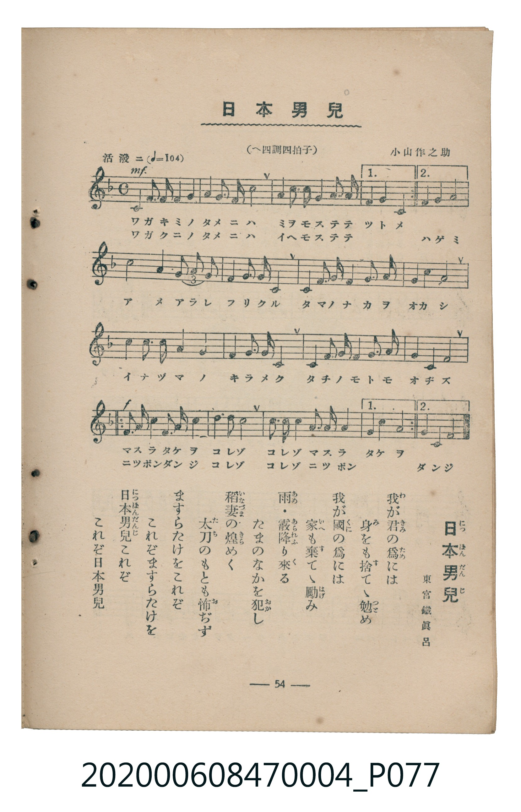

# 日本男兒

<audio controls src="nihon_danji.mp3"></audio>

- 曲：小山作之助／詞：東宮鐵眞呂
- 臺灣教育會公認《新定兒童唱歌》尋常科第四學年用（2020.006.0847.0004）

## 說明

原書資訊與歌詞全文（對應 P077.jpg，書頁 p. 54，參考教材第 18 首）：
調性與拍號：へ四調四拍子（F 大調 4/4 拍，原書誤植「へ調」為「へ四調」）
速度指示：活潑ニ（♩=104）

## 歌詞

```text
我が君（きみ）の爲（ため）には
身（み）をも捨（す）てゝ勉（つと）め
我が國（くに）の爲には
家（いへ）も棄（す）てゝ勵（はげ）み
雨（あめ）・霰（あられ）降（ふ）り來（く）る
たまのなかを犯（おか）し
稻妻（いなづま）の煌（きら）めく
太刀（たち）のもとも怖（お）ぢず
ますらたけをこれぞ
これぞますらたけを
日本男兒（につぽんだんじ）これぞ
これぞ日本男兒
```

## ABC

```abc
X:1
T:日本男兒
C:曲：小山作之助／詞：東宮鐵眞呂
M:4/4
L:1/16
Q:1/4=104
K:F
V:V1 name="Piano" snm="Pia"
[V:V1]
!mf! C4 C3 D F4 G4 | A4 c3 d c8 | d3 c A3 c G4 F3 G | A4 G4 C8 |
C4 C3 D F4 G4 | A4 c3 d c8 | d3 c A3 c G4 F3 G | G4 A4 F8 |
c4 A4 G4/3 A4/3 G4/3 F4 | D4 F3 G F4 C4 | D4 F3 F G4 c3 A | G4 c4 c8 |
d4 d3 d c4 A4 | G4 A3 G F8 | D4 D3 D C4 F3 G | A4 G4 F8 |
!f! d3 d A3 c d3 c A4 | c4 d4 c8 | A3 G F4 G3 A c3 A | G4 A4 c8 |
d3 d A3 c d3 c A4 | c4 d4 c8 | A3 G F4 G3 A c3 A | G4 A4 F8 |
```

## TMD 檔案連結

- [主旋律 TMD 檔案](nihon_danji.tmd)
- [鋼琴伴奏 TMD 檔案](nihon_danji_piano.tmd)

## 分析

```text
================================================================================
📊 TMD Song Profile: [ 日本男兒 ]
================================================================================
⏱  Duration:       0:55 (55.4s), 24 measures total
🎼 Key & Tempo:    首調基準 F, != 104.0 BPM, <4/4>
   - 分析範圍：      由實際發聲的音符與和弦推測調性；播放脈絡另行呈現
🎤 人聲音域:    C4 (MIDI 60) – D5 (MIDI 74) [跨度: 14 個半音 / 1.2 個八度, 難度: moderate]
   - 最低音:  C4 in [NihonDanji #1 @ m.1, 0:00]
   - 最高音: D5 in [NihonDanji #1 @ m.2, 0:03]
   - 適合: soprano, mezzo-soprano, contralto, tenor, baritone, bass
🏛  結構:      NihonDanji (55.4s)
⚡ 編曲密度:        Peak 1 軌道同時演奏
🗝  調性診斷：       C 大調（純淨自然大調，未偵測到可信轉調）
   - 風格氣質:    純淨自然大調（陽光明朗、易唱易記，無明顯調外色彩）
   - 轉調歷程:    全曲維持單一推測調性（未偵測到可信轉調）
   - 核心骨幹音:  C, F, A, G, D
   - 調性數值:    C 大調 [相關度: 0.83, 穩定度: Moderate, 自然音純度: 100.0%]
   - 候選調性 (K-S): C 大調 (0.83), F 大調 (0.79), A 小調 (0.67)
   - 五度圈歷程:   +0
   - 各段落調性細節:
     • [NihonDanji #1]: C 大調 (r: 0.83, 自然音純度: 100.0%)

  [ 五度圈游移軌跡 ]
              [C ]*
         F            G  
      Bb               D  
      Eb               A  
         Ab           E  
            Db       B  
               F# 
     (* = active key center)

  [ 十二半音累積音高分佈 ]
     C  : ████████████████████████  31.5%
     C# :                            0.0%
     D  : ███████████               14.6%
     D# :                            0.0%
     E  :                            0.0%
     F  : ██████████████            18.7%
     F# :                            0.0%
     G  : █████████████             16.6%
     G# :                            0.0%
     A  : ██████████████            18.6%
     A# :                            0.0%
     B  :                            0.0%
--------------------------------------------------------------------------------
Assignment 軌道音域：
  - Piano         : C4 – D5 (14 個半音 / 1.2 個八度, 116 個音符)
================================================================================
```


## 原書掃描頁




