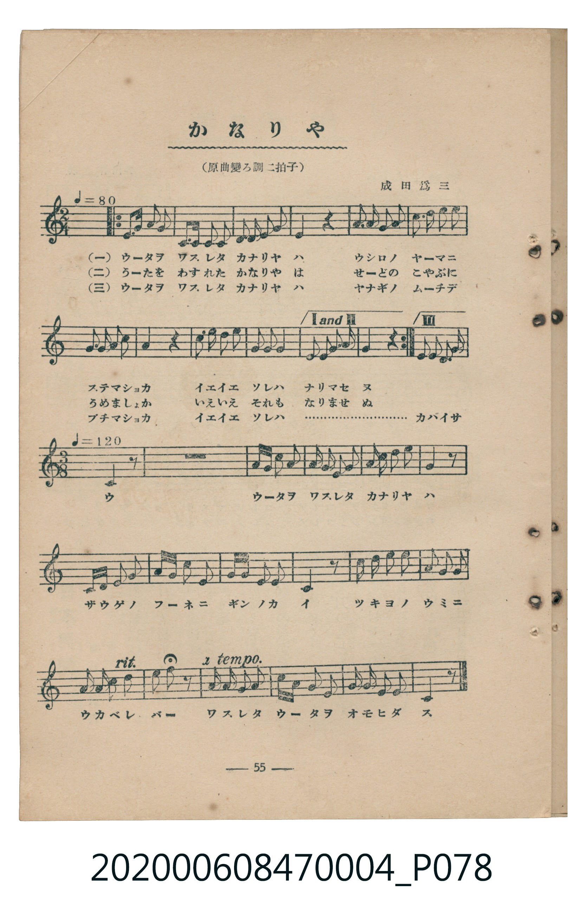
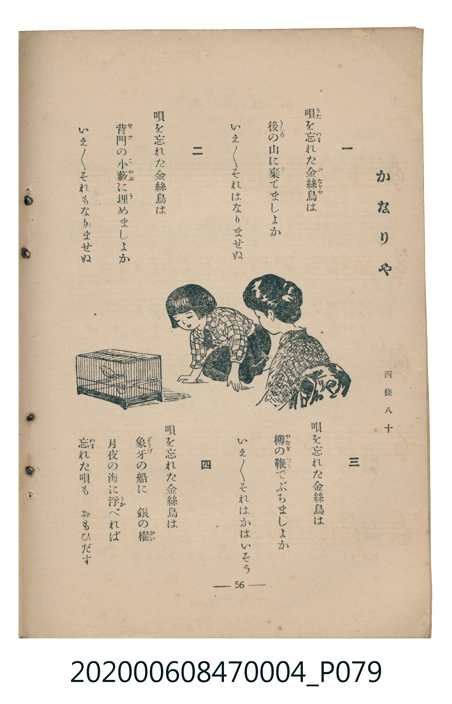

# かなりや

> Re:Shōka 使用 AI 協助辨識與重建樂譜，可能會有錯誤。歡迎回報。

- **NEUTRINO 歌聲合成版**：<br><audio controls src="kanariya_neutrino.mp3"></audio>
- **鋼琴伴奏版**：<br><audio controls src="kanariya.mp3"></audio>


- 曲：成田爲三／詞：西條八十
- 臺灣教育會公認《新定兒童唱歌》尋常科第四學年用（2020.006.0847.0004）

## 說明

原書資訊與歌詞全文（對應 P078.jpg–P079.jpg，書頁 pp. 55–56，參考教材第 19 首）：
調性與拍號：原曲變ろ調二拍子（本譜無調號 2/4 拍，後半轉 3/8 拍）
速度指示：♩=80 → ♩=120

## 跨冊／重複收錄參照

> 同曲（西條八十作詞、成田為三作曲〈かなりや〉；收錄於《新定兒童唱歌》四年級與《唱歌帖》P106）

- **[同曲]** 楊金土手抄《唱歌帖》第 2 冊・II（2020.006.0843）：[**〈カナリヤ〉**](../../../shokacho/vol_02/p106_kanariya/index.md)（`C` / `4/4` — [原始 TMD](../../../shokacho/vol_02/p106_kanariya/kanariya.tmd)）
- 總表：[跨冊重複與同名歌曲總索引](../../../duplicate_songs.md)

## 歌詞

```text
一
唄（うた）を忘（わす）れた金絲鳥（かなりや）は
後（うしろ）の山に棄（す）てましよか
いえ／＼それはなりませぬ

二
唄を忘れた金絲鳥は
背門（せど）の小藪（こやぶ）に埋（う）めましよか
いえ／＼それもなりませぬ

三
唄を忘れた金絲鳥は
柳（やなぎ）の鞭（むち）でぶちましよか
いえ／＼それはかはいそう

四
唄を忘れた金絲鳥は
象牙（ざうげ）の船に　銀の櫂（かい）
月夜の海に浮（うか）べれば
忘（わす）れた唄も　おもひだす
（譜面第 5 行記為「ワスレタ ウータヲ オモヒダ ス」）
```

## ABC

```abc
X:1
T:かなりや
C:曲：成田爲三／詞：西條八十
M:2/4
L:1/16
Q:1/4=80
K:C
V:V1 name="Piano" snm="Pia"
[V:V1]
!mp! E3 G A2 G2 | C3 C C2 C2 | D2 D2 E2 G2 | E4 z4 |
w: ウ _ タ ヲ | ワ ス レ タ | カ ナ リ ヤ | ハ
A2 A2 G2 A2 | c2 d2 e2 e2 | G2 G2 A2 c2 | A4 z4 |
w: ウ シ ロ ノ | ヤ _ マ ニ | ス テ マ ショ | カ
c2 e2 d2 e2 | G2 G2 G4 | E2 E2 G2 A2 | G4 z4 |
w: イ エ イ エ | ソ レ ハ | ナ リ マ セ | ヌ
E3 G A2 G2 | C3 C C2 C2 | D2 D2 E2 G2 | E4 z4 |
w: う _ た を | わ す れ た | か な り や | は
A2 A2 G2 A2 | c2 d2 e2 e2 | G2 G2 A2 c2 | A4 z4 |
w: せ _ ど の | こ や ぶ に | う め ま しょ | か
c2 e2 d2 e2 | G2 G2 G4 | E2 E2 G2 A2 | G4 z4 |
w: い え い え | そ れ も | な り ま せ | ぬ
E3 G A2 G2 | C3 C C2 C2 | D2 D2 E2 G2 | E4 z4 |
w: ウ _ タ ヲ | ワ ス レ タ | カ ナ リ ヤ | ハ
A2 A2 G2 A2 | c2 d2 e2 e2 | G2 G2 A2 c2 | A4 z4 |
w: ヤ ナ ギ ノ | ム _ チ デ | ブ チ マ ショ | カ
c2 e2 d2 e2 | G2 G2 G4 | E2 E2 D2 G2 | [M:3/8] [Q:1/8=240] C4 z2 |
w: イ エ イ エ | ソ レ ハ | カ ハ イ サ | ウ
z6 | A G c2 A2 | A G E2 G2 | A c d2 e2 |
w: ウ _ タ ヲ | ワ ス レ タ | カ ナ リ ヤ
G4 z2 | C D E2 G2 | A G c2 E2 | G G E2 E2 |
w: ハ | ザ ウ ゲ ノ | フ _ ネ ニ | ギ ン ノ カ
C4 z2 | c d e2 e2 | A2 G2 G2 | [Q:1/8=200] A A c2 d2 |
w: イ | ツ キ ヨ ノ | ウ ミ ニ | ウ カ ベ レ
[Q:1/8=170] e2 e2 z2 | [Q:1/8=240] A A G2 A2 | c A G2 E2 | G G E2 E2 |
w: バ _ | ワ ス レ タ | ウ _ タ ヲ | オ モ ヒ ダ
C4 z2 |
w: ス
```

## TMD 檔案連結

- [主旋律 TMD 檔案](kanariya.tmd) [[在 TMD Studio 編輯](https://tmdlang.github.io/Tmd-TS/#tmd=s7IKdvYPcrWy4qpTUCpJTLdSSM7PyUlNLsnMz7MqzsjMK0nNjM_KTMmPL87Iz05Ugisry88pzU21Si9KTEmNN4k3MjAyiDcwMIs3sDAxBzIMTBBKi_NLi5JTrYqTM_Lzc-JLUitKkvLzsxHyBUX5Zal5iXlANQVFIBtTwIoQClLLMlNSQdKpKZkl-UWZiTlI7kgtKga7FWxJfElRYl5xclFmAcgDCFX5RSUZ-UC3FmRUWmVkFoMMSU7Mic9OzEPyUklGKtBHiXmZuSALtLQUHjd2P25c9bip63FTi4KWFpeirYKFAZe9rYIzl42RvokdSOez2Zve75n1rGPC8ykbnndserKj8_2e_hcr5wEFXyzd_2zR3Ketq5_2NoJtedG-63nj4mdTZ75o2vRsTvPT1jUvVvU-buh6Nm3D03WznrZOer566dMpG5-t7Xnc0P10Q_fTHTueL5_4fM2ap7NnP1274-nOLc-nrHi_pwMU2HrAwNYDBTaQYWDyfk-nEheXvpaCLbUAl4KCwtO--c9m73ixuf3Fiq4XHe1AdwE99rR1xbNp7UBXPN3Q-6y9UyHAwNxCL6sg_VHDZCDTEsR8v6cHqO_lgkaFggI9BVNToJSpGVDwaX_zi4ZmoP-fzZ0A9JWCoaXCy2XTgG4HBhbIvher9j9rWA6yqbv3xcz5QFGwCza9WAeMgV6g7JNdPUCpp2snAK1_NmfNi7VznrcsBIoDFSsAI0QBKAmyZl_P096uF3s7FYz1LSBinSDjXzbMf7pr2bOe9udLdgHNfjRzpa2FgcKjtkkKIKahkQEXSNWTHQ1gv09pAVryuLHtcSPQIZ2PmyY93T8DJNLU_7hxJlikByj1sn3i862bXm5eClaMSC4gBY3rwQbt64EZNB3oC7DEuqcbNz5uXP1sMcQOsHGNyx437gOrARkE0vm4seVxYwcwOb3fs-dx41ywheuhNoCUzn7cuAbi5F09UCdDnInmNKhDXjT3vJzWALYQqHMl1CEb-l9MXwUWnAx09uPGbWDx1U_nd0NcDfZpIxFOa2rC6rQd4KAn4LRn8zeDgxZo6KrHjX0Qp72ctxYs2PC4cSFYZDnQdUA2kcEEjAsgCZSaC_QF2C3AXERMMG1c-LwTGCNA46eBY20SxDkvOnYCw-VxQ8PLLqCL1j1b3QSLclBkg30xp-Ppkjkgua3bQbG7dR0s4oFhCTRiJ9jCDWA3YEtLYIc1AW143AhMQsDg3PS4cQFQAUgDUDUwtb-cuwiUb0wVXizsebFixvOmXY8beh43r3_ctPNx85rHTfsVHjcte9y8B8h63LwJyFn1uHnR4-ZJj5sbgJydjxtgWYHy8gEKFLT0ubi8gcVoUWZlolVAZmJevkONQU01yBIFG0MzLTswC1gyaQAzlibYfRDH1SigOBzIbVr9uLnrcTPQzUvAsv0gw0G6axSqcwtqFYwVdIHQVMEMTOoChQ3BIoZgGoRrFIyAJAiD1ELUQHTpKhhA6RqwkT4g-5ZBhUD2A0mgo0AagM6Ciu4EstfA5cEuBKvrApOrwOQSqJ5-rNYA_Q328fbHzWsfN_eBVS553DzvcXM32Dyg79tAXJCC5VAb4J4G-RPmVxAN9G8cyHsgwhhO1IDlYWrAKiBa8XgaaB_Y8WvBZB_UCyCvgD3ePA9MdkM9vRPMa0PIQFyLCBEc_l7yuGkFhASr3AuKaWA4gayCRDPQ37vB3B6Ep8EeAHsM4U-EF0EYbAs4WmGRDAkcmBwWP4N8BnIGiESwwY4C-wocyfAoBDsQLAKJYoifd0NlejCsQaTwXT3AFA6uMoAlDNh8UAaH5G4QF7k9AeKuR_ib2om7ERRf4NgEWg1y_ySojyG-BDoLyAb5BSIPdhyYB_ZzE9j_QFdCZCAZAlskg6sSYJEHVgatQYBlH5jbhlRxtENtoG3ibpwN9_RKMLkO6oHJcO8A3QcmQekWFkxAd4LF9oFJsGsRIYLD36A6B0KCVUKrQDAbUQuCuWtom7gbIb7qAJMINthRYL-BIxnoNHjiRo5iqJ9B4QZxK-7EvaOT7OJ7iJbcoKIamFfXwUruBY-bGx83g5Ny8zQwm54lN9jBUC80gRI2ouReAAuOZnBCBjoRIj4NSYw6JTcokvvBUlvJT9agaAZHMQUlNDRCQSIwHVvBRsITLLC5pwnuAWhAm_eaVuCUU6OgUZRaXKIJNoW81ogN0Fi7WoVqRZCxtdDEDAnJGnh4QhxqBvQpOHwg6QDERaRwM5AUepjBTcJM7tgsgNXo6BkBeyYApR98GQApEWwDh84mWOKf-ri5F9ZsAeaIzUBxkIGQyAMpADZegW2cFVD1oHbofJB6RCoBxjuy16HhAhICeRwSLhAeaoBCwgg538DyFloi2gYODKCbwd6DZY6pYF4vmIQ1adYB2ZuhaiBJCZYIEdYCfQQUWwukwckSZh4kuJvBlSrEPHiKK8os0YOWkcDEMxMU-iBjJihopKUW5SaWJILSnEaiQklqbkE-SCV6kkNKjchNdxB3J1LyAyY7A2CyM4OkH2iuA4tbmAKbyfCAgvgDlkpBylEKJAiXYPgjJ0NIEpoJ9jsoaUG8hxpq2JMelkTatArIXgTEoKYJyJ8QUVBzE2F5LReXrp0CrIehAGQrcwEA)]
- [鋼琴伴奏 TMD 檔案](kanariya_piano.tmd) [[在 TMD Studio 編輯](https://tmdlang.github.io/Tmd-TS/#tmd=s7IKdvYPcrWy4tLSUnjc2P24cdXjpq7HTS3v93S87N7zfMKWJ3u2PF3a_7yz4_2eTgUtLS5FWwULAy57WwVnLhsjfRM7rjoFpWezN73fM-tZx4TnUzY879j0ZEfn-z39L1bOAwq-WLr_2aK5T1tXP-1tVAKpfdG-63nj4mdTZ75o2vRsTvPT1jUvVvU-buh6Nm3D03WznrZOer566dMpG5-t7Xnc0P10Q_fTHTueL5_4fM2ap7NnP1274-nOLc-nrAC6zsjAyEDPwMBMz8DCxBzIMDABOlCJi8s7MS-xKLMy0SogMzEvP8jDocagpppLAQhsDM207MCsGoXq3IJaBWMFXSA0VTADk7pAYUOwiCGYBuEaBSMgCcIgtRA1EF26CgZQugZspE-NwuOmZVChx037QWTzJrCGx83roaI7gew1cHmQjtVgdV1gchWYXALV04_VmhqwY2EOBtFAR8eB3AgijOFEDVgepgasAqIVj8sfN20Hu2AtmOyDugPkHrDrm-eByW6oy3eCeW0Imabtj5uXI3kLm-PBDgE7EOFehFNBGKwaHMawEId4EiaHxe0gFz5uWgEmEWyQzF6w68AhDg9PkJ-Qwxvi9t1QmR4Ma6Aup3ZaaQSFHDhcG-eDXTAJ6maIOx83zgSyQa6ByIN0gEIemD_BqsE-aGqBykDSF53SSuNsuMtXgsl1UFdMhrvpceM2MAlKBjC_Pm5qBIvtA5PTHze1I3mLXmmlEeK6DjCJYINk5oLdCA7xpia44SjhDXU7yP8gGVC6oktaGbrlCthWqDuaQOkEUa4sgPmpGZwumqHJoXkakhjNyhVQyINDnYJSBBrGIBGYjq1gI2FVjI2xvoVdrUK1oq2hkUEtNA1A3F4D9wHEMDOga8B-gIQ8iItIGGYgKXR_wU3CTCXYLICV8OjpB3vaAcUYvnQDD3ZgQCK7E-oJkBDIlRBPQHiovod4CDlZwZIeWqxsA7v8cRPIxYi0MxXM6wWTsPpoHZC9GaoGEjewWEVY-7i5BSi2FkiD4xlmHiRsmsHlMMQ8WBQCo84AGHVmkDiApi6wuIUpsP0Adz_EeFhMg5SjZCMIl2CwIEclJBpmgp0Eih6Q4yegeQZ79GGJ6KZVQPYiIAZVMo-bG6CioCocYXktetvJB7ntZIFoOgFbTobxCtGGsQpm8UDaLD43FuQTiBCUAvoTJGcajySCUGGAKHXgJoBkoUaBBbFpNQFJmAAlkDWCWNgMBDsAzWIMPqrjIQEBS9yjfhwafoS7EHfRC_M6XA_EAIQlKE5GlQeZjGIfwpEwp2GYhqwcXS-aLnBYwHjo5Q7CRLD_YAUPSC0o2yIVOTBToP5AMRXVJXDNoByva6cAy_QKQLYyFwA)]

## 分析

```text
================================================================================
📊 TMD Song Profile: [ かなりや ]
================================================================================
⏱  Duration:       1:06 (66.5s), 53 measures total
🎼 Key & Tempo:    首調基準 C, != 80.0 BPM, <2/4>
   - 分析範圍：      由實際發聲的音符與和弦推測調性；播放脈絡另行呈現
🎤 人聲音域:    C4 (MIDI 60) – E5 (MIDI 76) [跨度: 16 個半音 / 1.3 個八度, 難度: moderate]
   - 最低音:  C4 in [Kanariya #1 @ m.2, 0:01]
   - 最高音: E5 in [Kanariya #1 @ m.6, 0:08]
   - 適合: soprano, mezzo-soprano, contralto, tenor, baritone, bass
🏛  結構:      Kanariya (66.5s)
⚡ 編曲密度:        Peak 1 軌道同時演奏
🗝  調性診斷：       C 調性不明確（純淨自然大調，未偵測到可信轉調）
   - 風格氣質:    純淨自然大調（陽光明朗、易唱易記，無明顯調外色彩）
   - 轉調歷程:    全曲維持單一推測調性（未偵測到可信轉調）
   - 核心骨幹音:  G, E, C, A, D
   - 調性數值:    C 調性不明確 [相關度: 0.79, 穩定度: Ambiguous, 自然音純度: 100.0%]
   - 候選調性 (K-S): C 大調 (0.79), E 小調 (0.76), G 大調 (0.68)
   - 五度圈歷程:   +0
   - 各段落調性細節:
     • [Kanariya #1]: C 調性不明確 (r: 0.79, 自然音純度: 100.0%)

  [ 五度圈游移軌跡 ]
              [C ]*
         F            G  
      Bb               D  
      Eb               A  
         Ab           E  
            Db       B  
               F# 
     (* = active key center)

  [ 十二半音累積音高分佈 ]
     C  : ████████████████          18.8%
     C# :                            0.0%
     D  : ████████                   9.4%
     D# :                            0.0%
     E  : ███████████████████████   26.2%
     F  :                            0.0%
     F# :                            0.0%
     G  : ████████████████████████  27.6%
     G# :                            0.0%
     A  : ████████████████          17.9%
     A# :                            0.0%
     B  :                            0.0%
--------------------------------------------------------------------------------
Assignment 軌道音域：
  - Piano         : C4 – E5 (16 個半音 / 1.3 個八度, 166 個音符)
================================================================================
```


## 原書掃描頁






